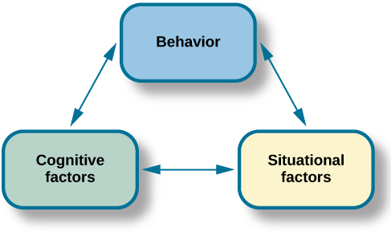

# 11.4 Các Phương Pháp Tiếp Cận Học Tập

> [!info]
>
> ### Mục Tiêu Học Tập
>
> Sau khi học xong mục này, bạn sẽ có thể:
>
> - Mô tả góc nhìn hành vi về nhân cách
> - Mô tả góc nhìn nhận thức về nhân cách
> - Mô tả góc nhìn nhận thức xã hội về nhân cách

Trái ngược với các phương pháp tiếp cận động lực học tâm thần của Freud và các nhà tân Freud, vốn liên hệ nhân cách với các quá trình bên trong (và ẩn giấu), các phương pháp tiếp cận học tập chỉ tập trung vào hành vi có thể quan sát được.
Điều này minh họa một lợi thế đáng kể của các phương pháp tiếp cận học tập so với động lực học tâm thần: Vì các phương pháp tiếp cận học tập liên quan đến các hiện tượng có thể quan sát và đo lường được, chúng có thể được kiểm chứng một cách khoa học.

## Góc Nhìn Hành Vi

Các nhà hành vi học không tin vào thuyết tất định sinh học: Họ không coi các nét nhân cách là bẩm sinh.
Thay vào đó, họ xem nhân cách là thứ được định hình đáng kể bởi các sự củng cố và hệ quả bên ngoài cơ thể sinh vật.
Nói cách khác, con người hành xử theo một cách nhất quán dựa trên việc học tập trước đó. B. F.
**Skinner**, một nhà hành vi học nghiêm ngặt, tin rằng môi trường chịu trách nhiệm duy nhất cho mọi hành vi, bao gồm cả những khuôn mẫu hành vi bền vững và nhất quán được các nhà lý thuyết nhân cách nghiên cứu.

Như bạn có thể nhớ lại từ phần tìm hiểu về tâm lý học học tập, Skinner đã đề xuất rằng chúng ta thể hiện các khuôn mẫu hành vi nhất quán vì chúng ta đã phát triển một số khuynh hướng phản ứng nhất định (Skinner, 1953).
Nói cách khác, chúng ta *học* cách hành xử theo những cách cụ thể.
Chúng ta gia tăng những hành vi dẫn đến những hệ quả tích cực, và chúng ta giảm bớt những hành vi dẫn đến những hệ quả tiêu cực.
Skinner không đồng ý với ý tưởng của Freud cho rằng nhân cách được cố định trong thời thơ ấu.
Ông lập luận rằng nhân cách phát triển trong suốt cả cuộc đời của chúng ta, chứ không chỉ trong vài năm đầu đời.
Các phản ứng của chúng ta có thể thay đổi khi chúng ta bắt gặp những tình huống mới; do đó, chúng ta có thể kỳ vọng nhiều sự biến thiên hơn theo thời gian trong nhân cách so với những gì Freud dự đoán.
Ví dụ, hãy xem xét một phụ nữ trẻ tên là Greta, một người thích chấp nhận rủi ro.
Cô lái xe nhanh và tham gia vào các môn thể thao mạo hiểm như dù lượn và lướt ván diều.
Nhưng sau khi kết hôn và có con, hệ thống củng cố và trừng phạt trong môi trường của cô thay đổi.
Việc chạy quá tốc độ và các môn thể thao mạo hiểm không còn được củng cố nữa, vì vậy cô không còn tham gia vào các hành vi đó.
Trên thực tế, Greta hiện tự mô tả mình là một người thận trọng.

## Góc Nhìn Nhận Thức Xã Hội

Albert **Bandura** đồng ý với Skinner rằng nhân cách phát triển thông qua **học tập** (learning).
Tuy nhiên, ông không đồng ý với phương pháp tiếp cận hành vi nghiêm ngặt của Skinner đối với sự phát triển nhân cách, bởi vì ông cảm thấy rằng tư duy và suy luận là những thành phần quan trọng của việc học tập.
Ông đã trình bày một **thuyết nhận thức xã hội** (social-cognitive theory) về nhân cách nhấn mạnh cả học tập và nhận thức như những nguồn gốc của sự khác biệt cá nhân trong nhân cách.
Trong thuyết nhận thức xã hội, các khái niệm về thuyết tất định tương hỗ, học tập qua quan sát và niềm tin vào năng lực bản thân đều đóng một vai trò trong sự phát triển nhân cách.

### Thuyết Tất Định Tương Hỗ

Trái ngược với ý tưởng của Skinner cho rằng chỉ riêng môi trường quyết định hành vi, Bandura (1990) đã đề xuất khái niệm **thuyết tất định tương hỗ** (reciprocal determinism), trong đó các quá trình nhận thức, hành vi và bối cảnh đều tương tác với nhau, mỗi yếu tố đồng thời gây ảnh hưởng và chịu ảnh hưởng bởi các yếu tố khác ([Hình 11.10](#Figure_11_04_RecipDeter)). *Các quá trình nhận thức* đề cập đến tất cả các đặc điểm đã học trước đó, bao gồm niềm tin, kỳ vọng và các đặc điểm nhân cách. *Hành vi* đề cập đến bất kỳ điều gì chúng ta làm mà có thể được khen thưởng hoặc trừng phạt.
Cuối cùng, *bối cảnh* mà hành vi diễn ra đề cập đến môi trường hoặc tình huống, bao gồm các kích thích khen thưởng/trừng phạt.

**Hình 11.10** Bandura đã đề xuất ý tưởng về thuyết tất định tương hỗ: Hành vi, các quá trình nhận thức và bối cảnh tình huống của chúng ta đều tác động qua lại lẫn nhau.

Chẳng hạn, hãy tưởng tượng bạn đang ở một lễ hội và một trong những điểm thu hút là nhảy bungee từ một cây cầu.
Bạn có làm điều đó không?
Trong ví dụ này, hành vi là nhảy bungee.
Các yếu tố nhận thức có thể ảnh hưởng đến hành vi này bao gồm niềm tin và giá trị của bạn, cùng với những trải nghiệm trong quá khứ của bạn với các hành vi tương tự.
Cuối cùng, bối cảnh đề cập đến cấu trúc khen thưởng cho hành vi đó.
Theo thuyết tất định tương hỗ, tất cả các yếu tố này đều đang cùng tham gia vận hành.

### Học Tập Qua Quan Sát

Đóng góp then chốt của Bandura cho lý thuyết học tập là ý tưởng cho rằng phần lớn việc học tập mang tính gián tiếp (vicarious).
Chúng ta học hỏi bằng cách quan sát hành vi của người khác và các hệ quả của nó, điều mà Bandura gọi là học tập qua quan sát (observational learning).
Ông cảm thấy rằng kiểu học tập này cũng đóng một vai trò trong sự phát triển nhân cách của chúng ta.
Giống như việc chúng ta học các hành vi đơn lẻ, chúng ta học các khuôn mẫu hành vi mới khi thấy chúng được thực hiện bởi những người khác hoặc các hình mẫu.
Dựa trên các ý tưởng của các nhà hành vi học về sự củng cố, Bandura gợi ý rằng liệu chúng ta có chọn bắt chước hành vi của một hình mẫu hay không phụ thuộc vào việc chúng ta thấy hình mẫu đó được củng cố hay bị trừng phạt.
Thông qua việc học tập quan sát, chúng ta biết được những hành vi nào được chấp nhận và được khen thưởng trong nền văn hóa của mình, đồng thời chúng ta cũng học cách kiềm chế các hành vi lệch chuẩn hoặc không được xã hội chấp nhận bằng cách nhìn thấy những hành vi nào bị trừng phạt.

Chúng ta có thể thấy các nguyên tắc của thuyết tất định tương hỗ hoạt động trong việc học tập qua quan sát.
Ví dụ, các yếu tố cá nhân quyết định hành vi nào trong môi trường mà một người chọn bắt chước, và những sự kiện môi trường đó lần lượt được xử lý về mặt nhận thức theo các yếu tố cá nhân khác.
Một người có thể cảm thấy việc nhận được sự chú ý là một sự củng cố, và người đó có thể có xu hướng bắt chước các hành vi như khoe khoang khi thấy một hình mẫu được củng cố khen thưởng.
Đối với những người khác, hành vi khoe khoang có thể bị nhìn nhận tiêu cực, bất chấp sự chú ý có thể mang lại—hoặc việc nhận được sự chú ý cao độ có thể bị coi là bị soi mói.
Trong cả hai trường hợp, người đó có thể ít có khả năng bắt chước những hành vi đó hơn mặc dù lý do cho việc không làm như vậy là khác nhau.

### Niềm Tin Vào Năng Lực Bản Thân

Bandura (1977, 1995) đã nghiên cứu một số yếu tố nhận thức và cá nhân ảnh hưởng đến việc học tập và phát triển nhân cách, và gần đây nhất đã tập trung vào khái niệm niềm tin vào năng lực bản thân.
**Niềm tin vào năng lực bản thân** (self-efficacy) là mức độ tự tin của chúng ta vào khả năng của chính mình, được phát triển thông qua các trải nghiệm xã hội của chúng ta.
Niềm tin vào năng lực bản thân ảnh hưởng đến cách chúng ta tiếp cận các thách thức và đạt được các mục tiêu.
Trong việc học tập qua quan sát, niềm tin vào năng lực bản thân là một yếu tố nhận thức ảnh hưởng đến những hành vi mà chúng ta chọn bắt chước cũng như sự thành công của chúng ta trong việc thực hiện những hành vi đó.

Những người có niềm tin vào năng lực bản thân cao tin rằng các mục tiêu của họ nằm trong tầm tay, có cái nhìn tích cực về các thách thức khi coi chúng là những nhiệm vụ cần phải làm chủ, phát triển mối quan tâm sâu sắc và cam kết mạnh mẽ đối với các hoạt động mà họ tham gia, đồng thời nhanh chóng phục hồi sau những thất bại.
Ngược lại, những người có niềm tin vào năng lực bản thân thấp thường tránh né các nhiệm vụ đầy thử thách vì họ nghi ngờ khả năng thành công của mình, có xu hướng tập trung vào sự thất bại và các kết quả tiêu cực, đồng thời mất niềm tin vào khả năng của mình nếu họ trải qua những thất bại.
Cảm giác về năng lực bản thân có thể mang tính đặc thù cho một số tình huống nhất định.
Chẳng hạn, một học sinh có thể cảm thấy tự tin vào khả năng của mình trong lớp tiếng Anh nhưng kém tự tin hơn nhiều trong lớp toán.

## Julian Rotter Và Tâm Điểm Kiểm Soát

Julian **Rotter** (1966) đã đề xuất khái niệm tâm điểm kiểm soát (locus of control), một yếu tố nhận thức khác ảnh hưởng đến việc học tập và phát triển nhân cách.
Khác với niềm tin vào năng lực bản thân, vốn liên quan đến niềm tin vào khả năng của chính chúng ta, **tâm điểm kiểm soát** (locus of control) đề cập đến niềm tin của chúng ta về quyền năng mà chúng ta có đối với cuộc sống của chính mình.
Theo quan điểm của Rotter, con người sở hữu một tâm điểm kiểm soát bên trong hoặc bên ngoài ([Hình 11.11](#Figure_11_04_Control)).
Những người trong chúng ta có tâm điểm kiểm soát bên trong ("người hướng nội kiểm") có xu hướng tin rằng hầu hết các kết quả của chúng ta là kết quả trực tiếp từ những nỗ lực của chúng ta.
Những người trong chúng ta có tâm điểm kiểm soát bên ngoài ("người hướng ngoại kiểm") có xu hướng tin rằng các kết quả của chúng ta nằm ngoài tầm kiểm soát của chúng ta.
Những người hướng ngoại kiểm nhìn nhận cuộc sống của họ bị kiểm soát bởi những người khác, sự may rủi hoặc số phận.
Ví dụ, giả sử bạn không dành nhiều thời gian để ôn thi môn tâm lý học mà thay vào đó lại đi ăn tối với bạn bè.
Khi bạn nhận được điểm thi, bạn thấy mình bị điểm D. Nếu bạn sở hữu tâm điểm kiểm soát bên trong, rất có thể bạn sẽ thừa nhận rằng mình bị điểm D vì đã không dành đủ thời gian học tập và quyết định học chăm chỉ hơn cho bài kiểm tra tiếp theo.
Mặt khác, nếu bạn sở hữu tâm điểm kiểm soát bên ngoài, bạn có thể kết luận rằng bài thi quá khó và không buồn học cho bài kiểm tra tiếp theo, vì bạn cho rằng đằng nào mình cũng sẽ bị điểm kém.
Các nhà nghiên cứu phát hiện ra rằng những người có tâm điểm kiểm soát bên trong có kết quả học tập tốt hơn, đạt được nhiều thành tựu hơn trong sự nghiệp, độc lập hơn, khỏe mạnh hơn, có khả năng đối phó tốt hơn và ít bị trầm cảm hơn những người có tâm điểm kiểm soát bên ngoài (Benassi, Sweeney, & Durfour, 1988; Lefcourt, 1982; Maltby, Day, & Macaskill, 2007; Whyte, 1977, 1978, 1980).

**Hình 11.11** Tâm điểm kiểm soát diễn ra trên một phổ liên tục từ bên trong đến bên ngoài.

> [!tip]
>
> ### Kết Nối Với Học Tập
>
> Truy cập [trang web mô tả về Tâm Điểm Kiểm Soát](https://openstax.org/l/locuscontrol) này để tìm hiểu thêm.

## Walter Mischel Và Cuộc Tranh Luận Giữa Cá Nhân Và Tình Huống

Walter **Mischel** là học trò của Julian Rotter và đã giảng dạy nhiều năm tại Stanford, nơi ông là đồng nghiệp của Albert Bandura.
Mischel đã khảo sát các tài liệu tâm lý học thực nghiệm trong vài thập kỷ liên quan đến việc dự đoán hành vi dựa trên nét tính cách, và kết luận của ông đã làm rung chuyển nền tảng của tâm lý học nhân cách.
Mischel phát hiện ra rằng các dữ liệu không ủng hộ nguyên lý trung tâm của lĩnh vực này—rằng các nét nhân cách của một người là nhất quán qua các tình huống khác nhau.
Báo cáo của ông đã châm ngòi cho một giai đoạn tự xem xét lại kéo dài nhiều thập kỷ, được gọi là cuộc tranh luận giữa cá nhân và tình huống (person-situation debate), giữa các nhà tâm lý học nhân cách.

Mischel gợi ý rằng có lẽ chúng ta đã tìm kiếm sự nhất quán ở nhầm chỗ.
Ông nhận thấy rằng mặc dù hành vi không nhất quán giữa các tình huống khác nhau, nhưng nó lại nhất quán hơn nhiều *bên trong* các tình huống cùng loại—do đó hành vi của một người trong một tình huống rất có thể sẽ được lặp lại trong một tình huống tương tự.
Và như bạn sẽ thấy tiếp theo liên quan đến "thí nghiệm kẹo dẻo marshmallow" nổi tiếng của ông, Mischel cũng phát hiện ra rằng hành vi là nhất quán trong các tình huống tương đương theo thời gian.

Một trong những đóng góp đáng chú ý nhất của Mischel cho tâm lý học nhân cách là các ý tưởng của ông về sự tự điều hòa (self-regulation).
Theo Lecci & Magnavita (2013), "Sự tự điều hòa là quá trình xác định một mục tiêu hoặc tập hợp các mục tiêu và, trong việc theo đuổi các mục tiêu này, sử dụng cả phản hồi bên trong (ví dụ: suy nghĩ và cảm xúc) lẫn phản hồi bên ngoài (ví dụ: phản ứng của bất kỳ điều gì hoặc bất kỳ ai trong môi trường) để tối đa hóa việc đạt được mục tiêu" (tr. 6.3).
Sự tự điều hòa còn được gọi là sức mạnh ý chí (will power).
Khi nói về ý chí, chúng ta có xu hướng nghĩ về nó như khả năng trì hoãn sự thỏa mãn (delay of gratification).
Ví dụ, cậu con trai tuổi vị thành niên của Bettina đã làm những chiếc bánh cupcake dâu tây trông rất ngon mắt.
Tuy nhiên, Bettina đã từ bỏ niềm vui được ăn một chiếc, bởi vì cô đang tập luyện cho một cuộc chạy đua 5 km và muốn giữ dáng cũng như thi đấu tốt trong cuộc đua.
Liệu bạn có thể cưỡng lại việc nhận một phần thưởng nhỏ ngay bây giờ để nhận được một phần thưởng lớn hơn sau này không?
Đây chính là câu hỏi mà Mischel đã điều tra trong thí nghiệm kẹo dẻo marshmallow kinh điển của mình.

Mischel đã thiết kế một nghiên cứu để đánh giá sự tự điều hòa ở trẻ nhỏ.
Trong nghiên cứu kẹo dẻo marshmallow, Mischel và các đồng nghiệp đã đặt một đứa trẻ mầm non vào một căn phòng với một viên kẹo dẻo trên bàn.
Những đứa trẻ được thông báo rằng chúng có thể ăn viên kẹo dẻo ngay bây giờ, hoặc đợi cho đến khi nhà nghiên cứu quay lại phòng, và khi đó chúng có thể có hai viên kẹo dẻo (Mischel, Ebbesen & Raskoff, 1972).
Điều này được lặp lại với hàng trăm trẻ mẫu giáo.
Những gì Mischel và nhóm của ông phát hiện ra là trẻ nhỏ khác nhau về mức độ tự kiểm soát của chúng.
Mischel và các đồng nghiệp tiếp tục theo dõi nhóm trẻ mẫu giáo này cho đến khi học trung học, và bạn nghĩ họ đã phát hiện ra điều gì?
Những đứa trẻ có khả năng tự kiểm soát tốt hơn ở trường mẫu giáo (những đứa trẻ đã chờ đợi phần thưởng lớn hơn) đã thành công hơn ở trường trung học.
Chúng có điểm SAT cao hơn, có các mối quan hệ bạn bè tích cực và ít có nguy cơ gặp các vấn đề về lạm dụng chất hơn; khi trưởng thành, họ cũng có cuộc hôn nhân ổn định hơn (Mischel, Shoda, & Rodriguez, 1989; Mischel et al., 2010).
Mặt khác, những đứa trẻ có khả năng tự kiểm soát kém ở trường mẫu giáo (những đứa trẻ đã chộp lấy một viên kẹo dẻo ngay lập tức) lại không thành công bằng ở trường trung học, và chúng bị phát hiện là gặp các vấn đề về học tập và hành vi.
Một nghiên cứu gần đây hơn sử dụng cỡ mẫu lớn hơn và mang tính đại diện hơn đã tìm thấy các mối liên hệ giữa việc trì hoãn sự thỏa mãn sớm (Watts, Duncan, & Quan, 2018) và các thước đo về thành tựu ở tuổi vị thành niên.
Tuy nhiên, các nhà nghiên cứu cũng phát hiện ra rằng các mối liên hệ này không mạnh mẽ như những gì đã báo cáo trong thí nghiệm ban đầu của Mischel và khá nhạy cảm với các yếu tố tình huống như các thước đo sớm về năng lực nhận thức, nền tảng gia đình và môi trường gia đình.
Nghiên cứu này gợi ý rằng việc xem xét các yếu tố tình huống là rất quan trọng để hiểu rõ hơn về hành vi.

> [!tip]
>
> ### Kết Nối Với Học Tập
>
> Xem [bài diễn thuyết TEDTalk của Joachim de Posada về thí nghiệm kẹo dẻo marshmallow](https://openstax.org/l/TEDPosada) này để tìm hiểu thêm và xem bài kiểm tra được thực hiện cho trẻ em ở Colombia.

Ngày nay, cuộc tranh luận phần lớn đã được giải quyết, và hầu hết các nhà tâm lý học đều xem xét cả yếu tố tình huống lẫn yếu tố cá nhân trong việc thấu hiểu hành vi.
Đối với Mischel (1993), con người là những bộ xử lý tình huống.
Những đứa trẻ trong thí nghiệm kẹo dẻo marshmallow mỗi đứa đều xử lý, hoặc diễn giải, cấu trúc khen thưởng của tình huống đó theo cách riêng của mình.
Phương pháp tiếp cận nhân cách của Mischel nhấn mạnh tầm quan trọng của cả tình huống lẫn cách mà con người nhận thức về tình huống đó.
Thay vì hành vi bị quyết định bởi tình huống, con người sử dụng các quá trình nhận thức để diễn giải tình huống và sau đó hành xử phù hợp với sự diễn giải đó.
