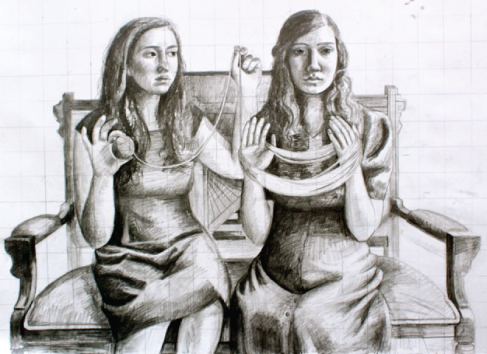
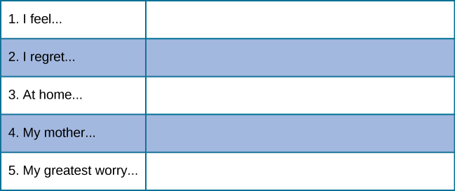

# 11.9 Đánh Giá Nhân Cách (Personality Assessment)

> [!info]
>
> ### Mục Tiêu Học Tập
>
> Sau khi học xong phần này, bạn sẽ có thể:
>
> - Thảo luận về Bảng kiểm kê nhân cách nhiều pha Minnesota (MMPI)
> - Nhận biết và mô tả các bài trắc nghiệm phóng chiếu phổ biến được sử dụng trong đánh giá nhân cách

Roberto, Mikhail và Nat là bạn học đại học và đều muốn trở thành sĩ quan cảnh sát.
Roberto là người trầm tính và nhút nhát, thiếu tự tin và thường đi theo người khác.
Anh là một người tốt bụng nhưng thiếu động lực.
Mikhail thì ồn ào và huyên náo, là một người có tố chất lãnh đạo.
Anh làm việc chăm chỉ nhưng lại bốc đồng và uống rượu quá nhiều vào cuối tuần.
Nat là người chu đáo và được mọi người quý mến.
Nat đáng tin cậy nhưng lại quá bài bản, ngăn nắp và do đó gặp khó khăn trong việc đưa ra các quyết định nhanh chóng.
Trong số ba người này, ai sẽ là sĩ quan cảnh sát giỏi nhất?
Những phẩm chất và nhân tố nhân cách nào làm nên một sĩ quan cảnh sát tốt?
Điều gì làm nên một cảnh sát tồi hoặc nguy hiểm?

Công việc của một sĩ quan cảnh sát có mức độ căng thẳng rất cao, và các cơ quan thực thi pháp luật muốn đảm bảo rằng họ tuyển dụng đúng người.
Trắc nghiệm nhân cách thường được sử dụng cho mục đích này—để sàng lọc các ứng viên xin việc và đào tạo nghề nghiệp.
Các bài trắc nghiệm nhân cách cũng được sử dụng trong các vụ án hình sự, các cuộc tranh chấp quyền nuôi con và để đánh giá các rối loạn tâm lý.
Phần này sẽ khám phá những bài trắc nghiệm nổi tiếng nhất trong số rất nhiều loại trắc nghiệm nhân cách khác nhau.

## Bảng Kiểm Kê Tự Báo Cáo (Self-Report Inventories)

Bảng kiểm kê tự báo cáo là một loại trắc nghiệm khách quan được sử dụng để đánh giá nhân cách.
Chúng thường sử dụng các câu hỏi trắc nghiệm nhiều lựa chọn hoặc thang đo dạng số, đại diện cho một khoảng từ 1 (rất không đồng ý) đến 5 (rất đồng ý).
Chúng thường được gọi là thang đo Likert theo tên người phát triển ra nó, Rensis Likert (1932) ([Hình 11.16](#Figure_11_09_Likert)).
Các bảng kiểm kê tự báo cáo nhìn chung dễ thực hiện và tiết kiệm chi phí.
Tuy nhiên, khả năng người làm trắc nghiệm có xu hướng trả lời theo cách cố ý hoặc vô ý mang tính mong muốn xã hội hơn (socially desirable), phóng đại, thiên vị hoặc gây hiểu lầm cũng cao hơn.
Ví dụ, một người nộp đơn xin việc có thể sẽ cố gắng thể hiện bản thân dưới góc nhìn tích cực, thậm chí như một ứng viên xuất sắc hơn nhiều so với thực tế của họ.

**Hình 11.16** Nếu bạn từng tham gia một cuộc khảo sát, bạn có thể đã quen thuộc với các câu hỏi theo thang đo kiểu Likert. Hầu hết các bảng kiểm kê nhân cách đều sử dụng các loại thang đo phản hồi này.

Một trong những bảng kiểm kê nhân cách được sử dụng rộng rãi nhất là **Trắc nghiệm nhân cách nhiều pha Minnesota (MMPI)** (Minnesota Multiphasic Personality Inventory), được xuất bản lần đầu vào năm 1943 với 504 câu hỏi Đúng/Sai, và được cập nhật thành MMPI-2 vào năm 1989 với 567 câu hỏi.
Phiên bản MMPI ban đầu dựa trên một mẫu nhỏ, hạn chế, bao gồm phần lớn là nông dân ở Minnesota và bệnh nhân tâm thần; bảng kiểm kê sửa đổi được dựa trên một mẫu đại diện hơn trên quy mô toàn quốc nhằm cho phép chuẩn hóa tốt hơn.
Bài trắc nghiệm MMPI-2 mất khoảng 1–2 giờ để hoàn thành.
Các phản hồi được cho điểm để tạo ra một hồ sơ lâm sàng gồm 10 thang đo: chứng nghi bệnh (hypochondriasis), trầm cảm (depression), hysteria, sai lệch nhân cách xã hội (psychopathic deviance), nam tính đối lập nữ tính (masculinity versus femininity), hoang tưởng/đa nghi (paranoia), suy nhược tâm thần/ám ảnh cưỡng chế (psychasthenia), tâm thần phân liệt (schizophrenia), hưng cảm nhẹ (hypomania) và hướng nội xã hội (social introversion).
Ngoài ra còn có một thang đo để xác định các yếu tố nguy cơ lạm dụng rượu.
Vào năm 2008, bài trắc nghiệm lại được sửa đổi một lần nữa, sử dụng các phương pháp tiên tiến hơn, thành phiên bản MMPI-2-RF.
Phiên bản này chỉ mất khoảng một nửa thời gian để hoàn thành và chỉ có 338 câu hỏi ([Hình 11.17](#Figure_11_09_MMPI)).
Mặc dù bài trắc nghiệm mới có nhiều ưu điểm, nhưng MMPI-2 đã có vị thế vững chắc hơn và hiện vẫn được sử dụng rộng rãi hơn.
Thông thường, các bài trắc nghiệm này được thực hiện trên máy tính.
Mặc dù MMPI ban đầu được phát triển để hỗ trợ chẩn đoán lâm sàng các rối loạn tâm lý, nhưng hiện nay nó cũng được sử dụng để sàng lọc nghề nghiệp, chẳng hạn như trong ngành thực thi pháp luật, cũng như trong tư vấn đại học, nghề nghiệp và hôn nhân (Ben-Porath & Tellegen, 2008).

**Hình 11.17** Những câu hỏi Đúng/Sai này tương tự như những dạng câu hỏi bạn sẽ thấy trong bài trắc nghiệm MMPI.

Ngoài các thang đo lâm sàng, các bài trắc nghiệm còn có các thang đo độ giá trị (validity scales) và độ tin cậy (reliability scales). (Hãy nhớ lại các khái niệm về độ tin cậy và độ giá trị từ phần nghiên cứu tâm lý học của bạn.)
Một trong những thang đo độ giá trị là Thang đo nói dối (Lie Scale, hay Thang “L”), bao gồm 15 mục và được sử dụng để xác định xem người trả lời có đang “giả tạo hình ảnh tốt” (faking good - báo cáo giảm nhẹ các vấn đề tâm lý để có vẻ khỏe mạnh hơn) hay không.
Ví dụ, nếu ai đó trả lời “có” cho một số mục tích cực một cách phi thực tế chẳng hạn như “Tôi chưa bao giờ nói dối”, họ có thể đang cố gắng “giả tạo hình ảnh tốt” hoặc cố tỏ ra tốt hơn thực tế.

Các thang đo độ tin cậy kiểm tra tính nhất quán của một công cụ theo thời gian, đảm bảo rằng nếu bạn làm bài kiểm tra MMPI-2-RF hôm nay và làm lại 5 năm sau đó, hai điểm số của bạn sẽ tương tự nhau.
Beutler, Nussbaum và Meredith (1988) đã cho các sĩ quan cảnh sát mới tuyển dụng làm bài kiểm tra MMPI và sau đó cho chính những sĩ quan cảnh sát này làm lại 2 năm sau đó.
Sau 2 năm làm việc, phản hồi của các sĩ quan cảnh sát cho thấy mức độ dễ bị tổn thương gia tăng đối với chứng nghiện rượu, các triệu chứng cơ thể (những phàn nàn về thể chất mơ hồ, không giải thích được) và sự lo âu.
Khi bài trắc nghiệm được thực hiện thêm 2 năm sau đó (4 năm sau khi bắt đầu công việc), kết quả cho thấy nguy cơ cao mắc phải các khó khăn liên quan đến rượu.

## Các Bài Trắc Nghiệm Phóng Chiếu (Projective Tests)

Một phương pháp khác để đánh giá nhân cách là **trắc nghiệm phóng chiếu** (projective testing).
Loại trắc nghiệm này dựa trên một trong những cơ chế phòng vệ do Freud đề xuất—sự phóng chiếu—như một phương thức để đánh giá các quá trình vô thức.
Trong loại trắc nghiệm này, một loạt các thẻ hình mơ hồ được đưa ra cho người được kiểm tra, sau đó người này được khuyến khích phóng chiếu những cảm xúc, xung năng và mong muốn của họ lên các thẻ hình đó—bằng cách kể một câu chuyện, giải thích một hình ảnh hoặc hoàn thành một câu.
Nhiều bài trắc nghiệm phóng chiếu đã trải qua các quy trình chuẩn hóa (chẳng hạn như Exner, 2002) và có thể được sử dụng để đánh giá xem một người có những suy nghĩ bất thường hoặc mức độ lo âu cao hay không, hoặc liệu họ có dễ trở nên bất ổn hay không.
Một số ví dụ về trắc nghiệm phóng chiếu là Trắc nghiệm vết mực Rorschach, Trắc nghiệm ứng cảm chủ đề (TAT), trắc nghiệm C-TCB, trắc nghiệm TEMAS (Tell-Me-A-Story) và Trắc nghiệm điền câu dở dang Rotter (RISB).
Các trắc nghiệm phóng chiếu ít bị bóp méo có chủ ý hơn; rất khó để "giả tạo hình ảnh tốt" vì không rõ đâu là một câu trả lời “tốt”.
Trắc nghiệm phóng chiếu tốn nhiều thời gian hơn cho người đánh giá so với các bảng kiểm kê tự báo cáo.
Nếu người đánh giá chấm điểm bài trắc nghiệm Rorschach bằng hệ thống tính điểm Exner, bài trắc nghiệm này được coi là một thước đo có độ giá trị và độ tin cậy cao.
Tuy nhiên, tính giá trị của các trắc nghiệm phóng chiếu khác vẫn còn gây tranh cãi, và kết quả thường không thể sử dụng cho các vụ kiện tụng tại tòa án (Goldstein, n.d.).

**Trắc nghiệm vết mực Rorschach** (Rorschach Inkblot Test) được phát triển vào năm 1921 bởi một nhà tâm lý học người Thụy Sĩ tên là Hermann Rorschach (phát âm là “ROAR-shock”).
Đó là một chuỗi các thẻ hình vết mực đối xứng được nhà tâm lý học đưa ra cho thân chủ.
Khi đưa ra mỗi thẻ, nhà tâm lý học sẽ hỏi thân chủ: “Hình này có thể là gì?”
Những gì người làm trắc nghiệm nhìn thấy sẽ bộc lộ những cảm xúc và những đấu tranh giằng xé trong vô thức (Piotrowski, 1987; Weiner, 2003).
Bài trắc nghiệm Rorschach đã được chuẩn hóa bằng hệ thống Exner và có hiệu quả trong việc đo lường trầm cảm, rối loạn tâm thần và lo âu.

Một bài trắc nghiệm phóng chiếu thứ hai là **Trắc nghiệm ứng cảm chủ đề (TAT)** (Thematic Apperception Test), được sáng tạo vào những năm 1930 bởi Henry Murray, một nhà tâm lý học người Mỹ, và một nhà phân tâm học tên là Christiana Morgan.
Người tham gia làm trắc nghiệm TAT được xem 8–12 bức tranh mơ hồ và được yêu cầu kể một câu chuyện về mỗi bức tranh ([Hình 11.18](#Figure_11_09_TAT)).
Những câu chuyện này cung cấp cái nhìn sâu sắc về thế giới xã hội của họ, bộc lộ những hy vọng, nỗi sợ hãi, mối quan tâm và mục tiêu.
Định dạng kể chuyện giúp làm giảm bớt sự kháng cự của một người trong việc bộc lộ những chi tiết cá nhân thuộc tầng vô thức (Cramer, 2004).
TAT đã được sử dụng trong các bối cảnh lâm sàng để đánh giá các khó khăn về tâm lý.
Sự chuẩn hóa trong quy trình thực hiện trắc nghiệm hầu như không tồn tại giữa các nhà lâm sàng, và bài trắc nghiệm này có xu hướng có độ giá trị và độ tin cậy từ khiêm tốn đến thấp (Aronow, Weiss, & Rezinkoff, 2001; Lilienfeld, Wood, & Garb, 2000).
Bất chấp những thiếu sót này, TAT vẫn là một trong những bài trắc nghiệm phóng chiếu được sử dụng rộng rãi nhất.

**Hình 11.18** Hình ảnh này trích từ Trắc nghiệm ứng cảm chủ đề (TAT).

Một bài trắc nghiệm phóng chiếu thứ ba là **Trắc nghiệm điền câu dở dang Rotter (RISB)** (Rotter Incomplete Sentence Blank) do Julian Rotter phát triển vào năm 1950 (hãy nhớ lại lý thuyết của ông về điểm kiểm soát đã được đề cập ở phần trước trong chương này).
Có ba phiên bản của bài trắc nghiệm này để sử dụng cho các nhóm tuổi khác nhau: mẫu dành cho học sinh, mẫu dành cho sinh viên đại học và mẫu dành cho người trưởng thành.
Bài trắc nghiệm bao gồm 40 câu chưa hoàn chỉnh mà đối tượng được yêu cầu hoàn thành càng nhanh càng tốt ([Hình 11.19](#Figure_11_09_ISB)).
Thời gian trung bình để hoàn thành bài trắc nghiệm là khoảng 20 phút, vì các phản hồi chỉ dài từ 1–2 từ.
Bài trắc nghiệm này tương tự như một trắc nghiệm liên tưởng từ, và giống như các loại trắc nghiệm phóng chiếu khác, người ta cho rằng các câu trả lời sẽ bộc lộ những khát khao, nỗi sợ hãi và những xung đột nội tâm.
RISB được sử dụng để sàng lọc các vấn đề thích nghi ở sinh viên đại học và trong tư vấn nghề nghiệp (Holaday, Smith, & Sherry, 2010; Rotter & Rafferty, 1950).

**Hình 11.19** Những câu chưa hoàn chỉnh này tương tự như các dạng câu hỏi trong bài trắc nghiệm RISB. Bạn sẽ hoàn thành những câu này như thế nào?

Trong nhiều thập kỷ, những bài trắc nghiệm phóng chiếu truyền thống này đã được sử dụng trong các đánh giá nhân cách liên văn hóa.
Tuy nhiên, người ta nhận thấy rằng sự thiên vị của bài trắc nghiệm đã làm hạn chế tính hữu ích của chúng (Hoy-Watkins & Jenkins-Moore, 2008).
Thật khó để đánh giá nhân cách và lối sống của các thành viên thuộc các nhóm văn hóa/dân tộc có sự khác biệt lớn bằng cách sử dụng các công cụ nhân cách dựa trên dữ liệu từ một nền văn hóa hoặc một chủng tộc duy nhất (Hoy-Watkins & Jenkins-Moore, 2008).
Ví dụ, khi TAT được sử dụng với những người tham gia làm trắc nghiệm là người Mỹ gốc Phi, kết quả thường là độ dài câu chuyện ngắn hơn và mức độ đồng nhất văn hóa thấp (Duzant, 2005).
Do đó, việc phát triển các công cụ đánh giá nhân cách khác khám phá các yếu tố như chủng tộc, ngôn ngữ và mức độ hòa nhập văn hóa là vô cùng cấp thiết (Hoy-Watkins & Jenkins-Moore, 2008).
Để giải quyết nhu cầu này, Robert Williams đã phát triển bài trắc nghiệm phóng chiếu mang tính đặc thù văn hóa đầu tiên được thiết kế để phản ánh những trải nghiệm đời sống hàng ngày của người Mỹ gốc Phi (Hoy-Watkins & Jenkins-Moore, 2008).
Phiên bản cập nhật của công cụ này là **Trắc nghiệm C-TCB** (Contemporized-Themes Concerning Blacks Test) (Williams, 1972).
C-TCB chứa 20 hình ảnh màu thể hiện các cảnh sinh hoạt trong lối sống của người Mỹ gốc Phi.
Khi C-TCB được so sánh với TAT đối với người Mỹ gốc Phi, người ta nhận thấy rằng việc sử dụng C-TCB dẫn đến độ dài câu chuyện tăng lên, mức độ cảm xúc tích cực cao hơn và sự đồng cảm/nhận diện mạnh mẽ hơn với bài trắc nghiệm C-TCB (Hoy, 1997; Hoy-Watkins & Jenkins-Moore, 2008).

**Trắc nghiệm ứng cảm chủ đề đa văn hóa TEMAS** (TEMAS Multicultural Thematic Apperception Test) là một công cụ khác được thiết kế để phù hợp với văn hóa của các nhóm thiểu số, đặc biệt là thanh thiếu niên gốc Tây Ban Nha (Hispanic).
TEMAS—viết tắt của cụm từ “Tell Me a Story” (Hãy kể cho tôi nghe một câu chuyện) nhưng cũng là một cách chơi chữ từ *temas* trong tiếng Tây Ban Nha (có nghĩa là "các chủ đề")—sử dụng các hình ảnh và gợi ý kể chuyện liên quan đến văn hóa của nhóm thiểu số (Constantino, 1982).
