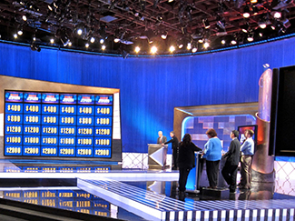
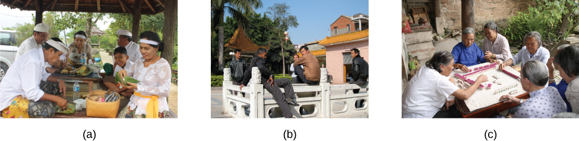

# 12.1 Tâm Lý Học Xã Hội Là Gì?

> [!info]
>
> ### Mục Tiêu Học Tập
>
> Sau khi học xong phần này, bạn sẽ có thể:
>
> - Định nghĩa tâm lý học xã hội
> - Mô tả các ảnh hưởng mang tính tình huống đối lập với ảnh hưởng mang tính thiên hướng tính cách đối với hành vi
> - Mô tả sai lầm quy gán cơ bản
> - Giải thích thiên kiến người hành động - người quan sát
> - Mô tả thiên kiến tự đề cao
> - Giải thích giả thuyết thế giới công bằng

**Tâm lý học xã hội** (social psychology) nghiên cứu cách con người tác động lẫn nhau, và xem xét sức mạnh của hoàn cảnh tình huống.
Theo Hiệp hội Tâm lý học Hoa Kỳ (APA, n.d.), các nhà tâm lý học xã hội "quan tâm đến mọi khía cạnh của nhân cách và tương tác xã hội, khám phá ảnh hưởng của các mối quan hệ giữa các cá nhân và quan hệ nhóm đối với hành vi con người."
Xuyên suốt chương này, chúng ta sẽ xem xét sự hiện diện của các cá nhân khác và các nhóm người tác động như thế nào đến hành vi, suy nghĩ và cảm xúc của một người.
Về cơ bản, con người sẽ thay đổi hành vi của mình để thích ứng với tình huống xã hội hiện tại.
Nếu chúng ta rơi vào một tình huống mới lạ hoặc không chắc chắn phải cư xử ra sao, chúng ta sẽ quan sát các tín hiệu từ những cá nhân khác xung quanh.

Lĩnh vực tâm lý học xã hội nghiên cứu các chủ đề ở cả cấp độ nội cá nhân lẫn cấp độ liên cá nhân.
Các chủ đề **nội cá nhân** (intrapersonal)—những chủ đề liên quan đến bản thân từng cá thể riêng lẻ—bao gồm cảm xúc và thái độ, cái tôi (the self), và nhận thức xã hội (social cognition - những phương thức chúng ta suy nghĩ về bản thân và người khác).
Các chủ đề **liên cá nhân** (interpersonal)—những chủ đề liên quan đến các cặp đôi và nhóm người—bao gồm hành vi giúp đỡ ([Hình 12.2](#CNX_Psych_12_01_helping)), hành vi hung tính, định kiến và phân biệt đối xử, sự thu hút và các mối quan hệ thân mật, cùng các tiến trình nhóm và mối quan hệ liên nhóm.

**Hình 12.2** Tâm lý học xã hội giải quyết mọi kiểu tương tác giữa con người với nhau, trải rộng trên nhiều phương thức chúng ta kết nối: từ những khoảnh khắc đối đầu căng thẳng đến những khoảnh khắc cùng nhau làm việc và giúp đỡ người khác, như được thể hiện ở đây. (nguồn: Trung sĩ Derec Pierson, Quân đội Hoa Kỳ)

Các nhà tâm lý học xã hội tập trung vào cách con người khái niệm hóa và giải thích các tình huống, cũng như cách những cách giải thích này ảnh hưởng đến suy nghĩ, cảm xúc và hành vi của họ (Ross & Nisbett, 1991).
Do đó, tâm lý học xã hội nghiên cứu các cá nhân trong một bối cảnh xã hội và cách các biến số tình huống tương tác với nhau để định hình hành vi.
Trong chương này, chúng ta sẽ thảo luận về các tiến trình nội cá nhân như sự tự thể hiện bản thân, sự bất hòa nhận thức và sự thay đổi thái độ; cùng các tiến trình liên cá nhân như sự tuân thủ và vâng lời, hành vi hung tính và lòng vị tha, và cuối cùng là tình yêu cùng sự thu hút giữa các cá nhân.

## Các Ảnh Hưởng Tình Huống Và Thiên Hướng Tính Cách Đối Với Hành Vi

Hành vi là sản phẩm của cả hoàn cảnh tình huống (ví dụ: các ảnh hưởng văn hóa, vai trò xã hội và sự hiện diện của người ngoài cuộc) lẫn bản thân con người (ví dụ: các đặc điểm nhân cách).
Các phân ngành của tâm lý học có xu hướng tập trung vào một loại ảnh hưởng này hơn loại ảnh hưởng kia.
**Thuyết tình huống** (situationism) là quan điểm cho rằng hành vi và hành động của chúng ta được quyết định bởi môi trường và bối cảnh xung quanh trước mắt.
Ngược lại, **thuyết thiên hướng tính cách** (dispositionism) khẳng định rằng hành vi của chúng ta được quyết định bởi các yếu tố nội tại bên trong (Heider, 1958).
Một **yếu tố nội tại** (internal factor) là một thuộc tính gắn liền với một cá nhân, bao gồm các nét tính cách và khí chất.
Các nhà tâm lý học xã hội thường có xu hướng áp dụng góc nhìn thuyết tình huống, trong khi các nhà tâm lý học nhân cách lại đề cao góc nhìn thuyết thiên hướng tính cách.
Tuy nhiên, các tiếp cận hiện đại trong tâm lý học xã hội xem xét cả tình huống lẫn cá nhân khi nghiên cứu hành vi con người (Fiske, Gilbert, & Lindzey, 2010).
Trên thực tế, lĩnh vực tâm lý học nhân cách - xã hội (social-personality psychology) đã xuất hiện để nghiên cứu sự tương tác phức tạp giữa các yếu tố nội tại và yếu tố tình huống tác động đến hành vi con người (Mischel, 1977; Richard, Bond, & Stokes-Zoota, 2003).

## Sai Lầm Quy Gán Cơ Bản

Tại Hoa Kỳ, nền văn hóa chủ đạo có xu hướng thiên về tiếp cận quy gán tính cách khi giải thích hành vi của con người.
Tại sao bạn nghĩ lại như vậy?
Chúng ta có xu hướng nghĩ rằng mọi người tự kiểm soát được hành vi của chính mình, và do đó, bất kỳ sự thay đổi hành vi nào cũng phải xuất phát từ một điều gì đó thuộc về nội tại, chẳng hạn như tính cách, thói quen hoặc khí chất của họ.
Theo một số nhà tâm lý học xã hội, con người thường có xu hướng nhấn mạnh quá mức các yếu tố nội tại khi đưa ra lời giải thích—hay sự quy gán (attributions)—cho hành vi của người khác.
Họ có xu hướng cho rằng hành vi của người khác là một *nét tính cách* của người đó, và đánh giá thấp sức mạnh của hoàn cảnh tình huống tác động lên hành vi của đối phương.
Họ thường không nhận ra được khi nào hành vi của người khác bắt nguồn từ các biến số tình huống, và do đó phản ánh *trạng thái* nhất thời của người đó.
Giả định sai lầm này được gọi là **sai lầm quy gán cơ bản** (fundamental attribution error) (Ross, 1977; Riggio & Garcia, 2009).
Để hiểu rõ hơn, hãy tưởng tượng tình huống sau: Jamie đi làm về và mở cửa trước thì nhận được lời chào vui vẻ từ người bạn đời Morgan hỏi thăm xem ngày hôm nay thế nào.
Thay vì đáp lại lời chào ân cần của bạn đời, Jamie lại quát lên: “Để tôi yên!”
Tại sao Jamie lại quát lên?
Một người mắc phải sai lầm quy gán cơ bản sẽ giải thích hành vi của Jamie như thế nào?
Phản ứng phổ biến nhất là Jamie là một người xấu tính, giận dữ hoặc khó gần (các nét tính cách).
Đây là một lời giải thích nội tại hoặc dựa trên thiên hướng tính cách.
Tuy nhiên, hãy tưởng tượng rằng Jamie vừa bị sa thải khỏi chỗ làm do công ty cắt giảm nhân sự.
Liệu lời giải thích của bạn về hành vi của Jamie có thay đổi không?
Lời giải thích sửa đổi của bạn có thể là Jamie đang vô cùng thất vọng và chán nản vì bị sa thải nên có tâm trạng tồi tệ (trạng thái).
Đây hiện là một lời giải thích mang tính ngoại tại hoặc dựa trên hoàn cảnh tình huống cho hành vi của Jamie.

Sai lầm quy gán cơ bản có sức mạnh lớn đến mức con người thường bỏ qua những ảnh hưởng tình huống hiển nhiên tác động lên hành vi.
Một ví dụ kinh điển đã được chứng minh trong một loạt các thí nghiệm mang tên nghiên cứu người dẫn trò chơi đố vui (quizmaster study) (Ross, Amabile, & Steinmetz, 1977).
Các sinh viên tham gia được phân công ngẫu nhiên vào vai người đặt câu hỏi (người dẫn trò - quizmaster) hoặc người dự thi trong một trò chơi đố vui.
Những người đặt câu hỏi tự nghĩ ra các câu hỏi hóc búa mà họ đã biết trước đáp án, rồi đưa ra những câu hỏi này cho người dự thi.
Người dự thi chỉ trả lời đúng trung bình 4 trên 10 câu hỏi ([Hình 12.3](#CNX_Psych_12_01_quizshow)).
Sau phần thi, cả người đặt câu hỏi và người dự thi được yêu cầu tự đánh giá kiến thức tổng quát của bản thân so với sinh viên trung bình.
Những người đặt câu hỏi không đánh giá kiến thức chung của mình cao hơn người dự thi, nhưng những người dự thi lại đánh giá trí thông minh của người đặt câu hỏi cao hơn hẳn bản thân mình.
Trong một nghiên cứu thứ hai, những người quan sát tương tác này cũng đánh giá người đặt câu hỏi có nhiều kiến thức tổng quát hơn người dự thi.
Ảnh hưởng hiển nhiên đến kết quả thực hiện ở đây chính là hoàn cảnh tình huống: Người đặt câu hỏi tự viết ra câu hỏi, nên đương nhiên họ có lợi thế tuyệt đối.
Cả người dự thi và người quan sát đều đưa ra sự quy gán nội tại cho kết quả thể hiện.
Họ kết luận rằng người đặt câu hỏi chắc hẳn phải thông minh hơn người dự thi.

**Hình 12.3** Trong nghiên cứu người dẫn trò chơi đố vui, mọi người có xu hướng phớt lờ ảnh hưởng của hoàn cảnh tình huống và kết luận sai lầm rằng kiến thức của người đặt câu hỏi lớn hơn kiến thức của chính họ. (nguồn: Steve Jurvetson)

Hiệu ứng hào quang (halo effect) đề cập đến xu hướng để cho ấn tượng tổng thể về một cá nhân làm sai lệch cách chúng ta cảm nhận về tính cách của họ.
Ví dụ, chúng ta có thể mặc định rằng những người có ngoại hình hấp dẫn thì có nhiều khả năng là người tốt hơn những người kém hấp dẫn hơn.
Một ví dụ khác về cách biểu hiện của hiệu ứng hào quang là việc cho rằng một người mà chúng ta nhận thấy là cởi mở hoặc thân thiện sẽ có phẩm chất đạo đức tốt hơn một người không có biểu hiện như vậy.

Như đã được chứng minh qua các ví dụ trên, sai lầm quy gán cơ bản được xem là một ảnh hưởng mạnh mẽ trong cách chúng ta giải thích hành vi của người khác.
Tuy nhiên, cần lưu ý rằng một số nhà nghiên cứu đã gợi ý rằng sai lầm quy gán cơ bản có thể không mạnh mẽ như cách nó thường được miêu tả.
Trên thực tế, một đợt đánh giá tổng quan gần đây đối với hơn 173 nghiên cứu đã công bố cho thấy một vài yếu tố (chẳng hạn như mức độ đặc dị cao của nhân vật và mức độ giải thích các sự kiện giả định) đóng vai trò quyết định mức độ ảnh hưởng thực sự của sai lầm quy gán cơ bản (Malle, 2006).

## Liệu Sai Lầm Quy Gán Cơ Bản Có Phải Là Một Hiện Tượng Phổ Quát?

Bạn có thể nghĩ ra những ví dụ về sai lầm quy gán cơ bản trong cuộc sống của chính mình.
Liệu con người ở mọi nền văn hóa đều mắc phải sai lầm quy gán cơ bản hay không?
Nghiên cứu cho thấy rằng không phải như vậy.
Những người đến từ một **nền văn hóa cá nhân** (individualistic culture)—tức nền văn hóa tập trung vào thành tựu cá nhân và quyền tự chủ—có xu hướng mắc sai lầm quy gán cơ bản cao nhất.
Các nền văn hóa cá nhân, thường thấy ở các nước phương Tây như Hoa Kỳ, Canada và Vương quốc Anh, thúc đẩy sự tập trung vào cá nhân.
Do đó, thiên hướng tính cách của một người được xem là lời giải thích chính cho hành vi của họ.
Ngược lại, những người đến từ một **nền văn hóa tập thể** (collectivistic culture)—tức nền văn hóa tập trung vào các mối quan hệ cộng đồng với người khác như gia đình, bạn bè và xã hội ([Hình 12.4](#CNX_Psych_12_01_cultures))—ít có khả năng mắc phải sai lầm quy gán cơ bản hơn (Markus & Kitayama, 1991; Triandis, 2001).

**Hình 12.4** Những người đến từ các nền văn hóa tập thể, chẳng hạn như một số nền văn hóa châu Á, có nhiều khả năng nhấn mạnh vào các mối quan hệ với người khác hơn là tập trung chủ yếu vào cá nhân. Các hoạt động như (a) chuẩn bị bữa ăn, (b) tụ tập trò chuyện, và (c) chơi trò chơi giúp gắn kết mọi người trong một nhóm. (nguồn a: sửa đổi từ tác phẩm của Arian Zwegers; nguồn b: sửa đổi từ tác phẩm của "conbon33"/Flickr; nguồn c: sửa đổi từ tác phẩm của Anja Disseldorp)

Tại sao bạn nghĩ điều này lại xảy ra?
Các nền văn hóa tập thể, thường thấy ở các quốc gia Đông Á, Mỹ Latinh và châu Phi, tập trung vào tập thể nhiều hơn là vào cá nhân (Nisbett, Peng, Choi, & Norenzayan, 2001).
Sự tập trung vào người khác này cung cấp một góc nhìn rộng lớn hơn, có tính đến cả các ảnh hưởng tình huống lẫn văn hóa đối với hành vi; do đó, một lời giải thích tinh tế, đa chiều hơn về nguyên nhân dẫn đến hành vi của người khác trở nên khả dĩ hơn. [Bảng 12.1](#fs-idm158708336) so sánh giữa nền văn hóa cá nhân và nền văn hóa tập thể.

**Đặc Điểm Của Nền Văn Hóa Cá Nhân Và Nền Văn Hóa Tập Thể**

| Nền văn hóa cá nhân | Nền văn hóa tập thể |
| --- | --- |
| Định hướng thành tựu | Định hướng mối quan hệ |
| Tập trung vào quyền tự chủ | Tập trung vào sự hòa hợp nhóm |
| Góc nhìn thiên hướng tính cách | Góc nhìn tình huống |
| Độc lập | Phụ thuộc lẫn nhau |
| Phong cách tư duy phân tích | Phong cách tư duy toàn diện |

**Bảng 12.1**

Masuda và Nisbett (2001) đã chứng minh rằng các loại thông tin mà con người chú ý đến khi quan sát các kích thích thị giác (ví dụ: cảnh một bể cá) có thể khác nhau đáng kể tùy thuộc vào việc người quan sát đến từ nền văn hóa tập thể hay nền văn hóa cá nhân.
Những người tham gia Nhật Bản có nhiều khả năng nhận diện các vật thể được trình chiếu hơn khi chúng xuất hiện trong cùng bối cảnh mà ban đầu họ đã nhìn thấy.
Việc thao túng bối cảnh diễn ra quá trình nhớ lại vật thể không có tác động nào như vậy đối với những người tham gia người Mỹ.
Các nhà nghiên cứu khác cũng chỉ ra những khác biệt tương tự xuyên suốt các nền văn hóa.
Ví dụ, Zhang, Fung, Stanley, Isaacowitz, và Zhang (2014) đã chứng minh sự khác biệt trong cách thức lối tư duy toàn diện có thể phát triển giữa những người tham gia Trung Quốc và Mỹ, và Ramesh cùng Gelfand (2010) đã chứng minh rằng tỷ lệ nghỉ việc có liên quan nhiều hơn đến sự phù hợp giữa một người và tổ chức nơi họ làm việc trong một mẫu người Ấn Độ, nhưng sự phù hợp giữa cá nhân và công việc cụ thể của họ lại có tính dự đoán tỷ lệ nghỉ việc cao hơn trong một mẫu người Mỹ.

## Thiên Kiến Người Hành Động - Người Quan Sát

Quay trở lại ví dụ trước của chúng ta, Jamie đã bị sa thải, nhưng một người quan sát bên ngoài sẽ không thể biết điều đó.
Vì vậy, một người quan sát ngây thơ sẽ có xu hướng quy kết hành vi thù địch của Jamie cho tính cách của Jamie thay vì nguyên nhân tình huống thực sự.
Tại sao bạn nghĩ chúng ta lại đánh giá thấp ảnh hưởng của hoàn cảnh tình huống đối với hành vi của người khác?
Một lý do là chúng ta thường không có đủ mọi thông tin cần thiết để đưa ra lời giải thích mang tính tình huống cho hành vi của người khác.
Thông tin duy nhất chúng ta có thể có là những gì quan sát được trực tiếp bằng mắt.
Do sự thiếu hụt thông tin này, chúng ta có xu hướng mặc định rằng hành vi đó bắt nguồn từ một yếu tố thuộc về tính cách hoặc nội tại.
Tuy nhiên, khi giải thích hành vi của chính mình, chúng ta lại có nhiều thông tin hơn rất nhiều.
Nếu bạn đi học hoặc đi làm về trong tâm trạng bực bội và quát tháo chú chó cưng hoặc một người thân yêu, lời giải thích của bạn sẽ là gì?
Bạn có thể nói rằng bạn rất mệt mỏi hoặc cảm thấy không khỏe và cần một không gian yên tĩnh—đó là một lời giải thích mang tính tình huống.
**Thiên kiến người hành động - người quan sát** (actor-observer bias) là hiện tượng quy gán hành vi của người khác cho các yếu tố nội tại (sai lầm quy gán cơ bản), trong khi lại quy gán hành vi của chính bản thân mình cho các lực lượng tình huống (Jones & Nisbett, 1971; Nisbett, Caputo, Legant, & Marecek, 1973; Choi & Nisbett, 1998).
Với tư cách là người thực hiện hành vi (người hành động), chúng ta có sẵn nhiều thông tin hơn để giải thích hành vi của mình.
Tuy nhiên, với tư cách là người quan sát, chúng ta có ít thông tin hơn; do đó, chúng ta có xu hướng mặc định áp dụng góc nhìn thiên hướng tính cách.

Một nghiên cứu về thiên kiến người hành động - người quan sát đã điều tra các lý do mà những người tham gia nam giới đưa ra để giải thích tại sao họ thích bạn gái của mình (Nisbett et al., 1973).
Khi được hỏi tại sao họ thích bạn gái của chính mình, những người tham gia tập trung vào những phẩm chất nội tại, thuộc về tính cách của bạn gái họ (ví dụ: tính cách dễ chịu của cô ấy).
Lời giải thích của những người tham gia hiếm khi bao gồm các nguyên nhân nội tại xuất phát từ chính bản thân họ, chẳng hạn như các nét tính cách của chính họ (ví dụ: “Tôi cần một người bầu bạn.”).
Ngược lại, khi suy đoán lý do tại sao một người bạn nam khác lại thích bạn gái của anh ta, những người tham gia lại có khả năng đưa ra các lời giải thích về tính cách và các lời giải thích ngoại tại ngang nhau.
Điều này củng cố quan niệm cho rằng những người hành động có xu hướng đưa ra rất ít lời giải thích nội tại nhưng lại đưa ra nhiều lời giải thích tình huống cho hành vi của chính mình.
Ngược lại, những người quan sát có xu hướng đưa ra nhiều lời giải thích về tính cách hơn cho hành vi của một người bạn ([Hình 12.5](#CNX_Psych_12_01_biasgraph)).

**Hình 12.5** Thiên kiến người hành động - người quan sát thể hiện rõ khi các đối tượng giải thích lý do của chính họ khi thích một người bạn gái so với ấn tượng của họ về lý do của người khác khi thích một người bạn gái.

## Thiên Kiến Tự Đề Cao

Chúng ta có thể thấu hiểu thiên kiến tự đề cao bằng cách đào sâu hơn vào **sự quy gán** (attribution), tức một niềm tin về nguyên nhân dẫn đến một kết quả.
Một mô hình quy gán đề xuất ba chiều kích chính: điểm kiểm soát (nội tại đối lập ngoại tại), tính ổn định (ổn định đối lập không ổn định), và khả năng kiểm soát (có thể kiểm soát đối lập không thể kiểm soát).
Trong bối cảnh này, tính ổn định đề cập đến mức độ mà các hoàn cảnh dẫn đến một kết quả nhất định có thể thay đổi được.
Các hoàn cảnh được coi là ổn định nếu chúng khó có khả năng thay đổi.
Khả năng kiểm soát đề cập đến mức độ mà các hoàn cảnh gắn liền với một kết quả có thể được kiểm soát.
Rõ ràng, những điều mà chúng ta có quyền năng kiểm soát sẽ được coi là có thể kiểm soát được (Weiner, 1979).

Sau khi nhận được một kết quả, các thiên kiến tự đề cao là những quy gán cho phép chúng ta nhìn nhận bản thân dưới ánh sáng thuận lợi (ví dụ: đưa ra các quy gán nội tại cho thành công và quy gán ngoại tại cho thất bại).
Khi bạn hoàn thành tốt một nhiệm vụ, chẳng hạn như đạt điểm tuyệt đối trong một kỳ thi, việc bạn đưa ra lời quy gán tính cách cho hành vi của mình (“Mình thông minh,”) thay vì một lời quy gán tình huống (“Đề thi dễ,”) sẽ mang lại lợi ích tốt nhất cho hình ảnh bản thân.
**Thiên kiến tự đề cao** (self-serving bias) là xu hướng giải thích những thành công của chúng ta là do các đặc điểm tính cách (nội tại), nhưng lại giải thích những thất bại của chúng ta là do các yếu tố tình huống (ngoại tại).
Một lần nữa, điều này phụ thuộc vào văn hóa.
Thiên kiến này phục vụ mục đích bảo vệ lòng tự trọng.
Bạn có thể hình dung rằng nếu con người luôn đưa ra những lời quy gán tình huống cho hành vi của mình, họ sẽ không bao giờ có thể ghi nhận công lao và cảm thấy hài lòng về những thành tựu của chính mình.

Hãy xem xét ví dụ về cách chúng ta giải thích chiến thắng của đội thể thao yêu thích của mình.
Nghiên cứu cho thấy chúng ta thường đưa ra những quy gán nội tại, ổn định và có thể kiểm soát cho chiến thắng của đội nhà ([Hình 12.6](#CNX_Psych_12_01_winning)) (Grove, Hanrahan, & McInman, 1991).
Ví dụ, chúng ta có thể tự nhủ rằng đội của mình tài năng (nội tại), luôn nỗ lực tập luyện chăm chỉ (ổn định) và áp dụng các chiến thuật hiệu quả (có thể kiểm soát).
Ngược lại, chúng ta có nhiều khả năng đưa ra các quy gán ngoại tại, không ổn định và không thể kiểm soát khi đội bóng yêu thích của chúng ta thất bại.
Ví dụ, chúng ta có thể tự nhủ rằng đội đối phương có nhiều cầu thủ giàu kinh nghiệm hơn hoặc trọng tài thiên vị (ngoại tại), đội đối phương được đá trên sân nhà (không ổn định), và thời tiết lạnh giá đã ảnh hưởng đến phong độ của đội chúng ta (không thể kiểm soát).

**Hình 12.6** Chúng ta có xu hướng tin rằng đội của mình chiến thắng vì đội giỏi hơn, nhưng thất bại là vì những lý do nằm ngoài tầm kiểm soát của đội (Roesch & Amirkham, 1997). (nguồn: "TheAHL"/Flickr)

## Giả Thuyết Thế Giới Công Bằng

Một hệ quả từ xu hướng đưa ra các lời giải thích thiên hướng tính cách cho hành vi của người phương Tây là hiện tượng đổ lỗi cho nạn nhân (victim blame) (Jost & Major, 2001).
Khi mọi người gặp phải vận rủi hoặc điều bất hạnh, những người khác có xu hướng cho rằng bằng cách nào đó chính họ phải chịu trách nhiệm về số phận của mình.
Một hệ tư tưởng hay thế giới quan phổ biến ở Hoa Kỳ là giả thuyết thế giới công bằng.
**Giả thuyết thế giới công bằng** (just-world hypothesis) là niềm tin rằng con người nhận được những kết quả mà họ xứng đáng được nhận (Lerner & Miller, 1978).
Để duy trì niềm tin rằng thế giới là một nơi công bằng, con người có xu hướng nghĩ rằng người tốt sẽ gặp điều lành, và kẻ xấu sẽ phải gánh chịu những kết cục tiêu cực (Jost, Banaji, & Nosek, 2004; Jost & Major, 2001).
Khả năng suy nghĩ về thế giới như một nơi công bằng, nơi con người nhận được những gì họ xứng đáng, cho phép chúng ta cảm thấy rằng thế giới có thể dự đoán được và chúng ta có quyền kiểm soát nhất định đối với các kết quả trong cuộc sống của mình (Jost et al., 2004; Jost & Major, 2001).
Ví dụ, nếu bạn muốn trải nghiệm những kết quả tích cực, bạn chỉ cần làm việc chăm chỉ để vươn lên trong cuộc sống.

Bạn có thể nghĩ ra một hệ quả tiêu cực của giả thuyết thế giới công bằng không?
Một hệ quả tiêu cực là xu hướng mọi người đổ lỗi cho những người nghèo về cảnh ngộ khốn khó của họ.
Những lời giải thích phổ biến nào thường được đưa ra cho lý do tại sao con người lại sống trong nghèo đói?
Bạn có từng nghe những tuyên bố như: “Người nghèo lười biếng và không chịu làm việc” hoặc “Những người nghèo chỉ muốn sống bám vào trợ cấp chính phủ”?
Đây là những kiểu giải thích nào, thiên hướng tính cách hay tình huống?
Những lời giải thích mang tính thiên hướng tính cách này là những ví dụ rõ ràng về sai lầm quy gán cơ bản.
Việc đổ lỗi cho người nghèo về sự nghèo đói của họ đã hoàn toàn phớt lờ các yếu tố tình huống tác động đến họ, chẳng hạn như tỷ lệ thất nghiệp cao, suy thoái kinh tế, cơ hội giáo dục kém cỏi và vòng luẩn quẩn đói nghèo của gia đình qua nhiều thế hệ ([Hình 12.7](#CNX_Psych_12_01_homeless)).
Các nghiên cứu khác cho thấy những người có niềm tin vào thế giới công bằng thường có thái độ tiêu cực đối với những người thất nghiệp và những người sống chung với căn bệnh AIDS (Sutton & Douglas, 2005).
Tại Hoa Kỳ và nhiều quốc gia khác, các nạn nhân bị tấn công tình dục có thể thấy mình bị đổ lỗi vì đã bị lạm dụng.
Các nhóm bảo vệ quyền lợi của nạn nhân, chẳng hạn như Tổ chức Chấm dứt Bạo lực Gia đình (DOVE), đã tham dự phiên tòa để hỗ trợ các nạn nhân nhằm đảm bảo rằng sự khiển trách được nhắm thẳng vào những kẻ thủ ác gây ra bạo lực tình dục, chứ không phải nạn nhân.

**Hình 12.7** Những người giữ niềm tin vào thế giới công bằng có xu hướng đổ lỗi cho người nghèo về hoàn cảnh của họ, phớt lờ các nguyên nhân mang tính tình huống và văn hóa của sự nghèo đói. (nguồn: Adrian Miles)
