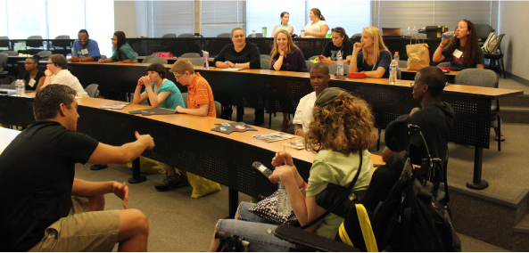
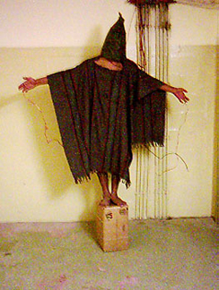

# 12.2 Tự Thể Hiện Bản Thân (Self-Presentation)

> [!info]
>
> ### Mục Tiêu Học Tập
>
> Sau khi học xong phần này, bạn sẽ có thể:
>
> - Mô tả các vai trò xã hội và cách chúng tác động đến hành vi
> - Giải thích chuẩn mực xã hội là gì và chúng tác động như thế nào đến hành vi
> - Định nghĩa kịch bản hành vi (script)
> - Mô tả những phát hiện và chỉ trích đối với thí nghiệm nhà tù Stanford của Zimbardo

Như bạn đã học, tâm lý học xã hội là ngành nghiên cứu cách con người tác động lẫn nhau về mặt suy nghĩ, cảm xúc và hành vi.
Chúng ta đã thảo luận về các góc nhìn tình huống và sự nhấn mạnh của tâm lý học xã hội vào những cách thức mà môi trường của một người, bao gồm văn hóa và các ảnh hưởng xã hội khác, tác động đến hành vi.
Trong phần này, chúng ta sẽ xem xét các lực lượng tình huống có ảnh hưởng mạnh mẽ đến hành vi của con người, bao gồm vai trò xã hội, chuẩn mực xã hội và kịch bản hành vi.
Chúng ta sẽ thảo luận về cách con người sử dụng môi trường xã hội như một nguồn thông tin, hoặc các tín hiệu chỉ dẫn, về cách thức cư xử.
Những ảnh hưởng tình huống đối với hành vi của chúng ta mang lại những hệ quả quan trọng, chẳng hạn như việc liệu chúng ta có sẵn sàng giúp đỡ một người lạ trong tình huống khẩn cấp hay không, hoặc chúng ta sẽ hành xử như thế nào trong một môi trường xa lạ.

## Vai Trò Xã Hội

Một yếu tố quyết định xã hội quan trọng đối với hành vi con người là các vai trò xã hội của chúng ta.
Một **vai trò xã hội** (social role) là một khuôn mẫu hành vi được kỳ vọng ở một người trong một môi trường hoặc một nhóm nhất định (Hare, 2003).
Mỗi người trong chúng ta đều đảm nhiệm nhiều vai trò xã hội cùng lúc.
Bạn có thể đồng thời vừa là một sinh viên, một bậc cha mẹ, một giáo viên tương lai, một người con trai hoặc con gái, một người bạn đời và một nhân viên cứu hộ.
Những vai trò xã hội này ảnh hưởng đến hành vi của bạn như thế nào?
Các vai trò xã hội được định nghĩa bởi tri thức chia sẻ chung về mặt văn hóa.
Nghĩa là, hầu như tất cả mọi người trong một nền văn hóa nhất định đều biết hành vi nào được kỳ vọng ở một cá nhân nắm giữ một vai trò cụ thể.
Ví dụ, vai trò xã hội của một sinh viên là gì?
Nếu nhìn quanh một giảng đường đại học, bạn có thể sẽ thấy các sinh viên thể hiện hành vi chăm chú học tập: ghi chép bài, lắng nghe giáo sư giảng, đọc giáo trình và ngồi trật tự tại bàn học của mình ([Hình 12.8](#CNX_Psych_12_02_classroom)).
Tất nhiên, bạn có thể thấy một số sinh viên đi chệch khỏi hành vi học tập được kỳ vọng, chẳng hạn như nhắn tin điện thoại hoặc lướt Facebook trên máy tính xách tay, nhưng trong mọi trường hợp, các sinh viên mà bạn quan sát đều đang có mặt trên lớp—một phần không thể tách rời trong vai trò xã hội của sinh viên.

**Hình 12.8** Là một sinh viên chỉ là một trong số rất nhiều vai trò xã hội mà bạn đảm nhiệm. (nguồn: sửa đổi từ tác phẩm của “Rural Institute”/Flickr)

Các vai trò xã hội và hành vi liên quan của chúng ta có thể thay đổi tùy theo các bối cảnh khác nhau.
Bạn cư xử như thế nào khi đang thực hiện vai trò của một người con tham dự một buổi họp mặt gia đình?
Bây giờ hãy tưởng tượng cách bạn hành xử khi đang thực hiện vai trò của một nhân viên tại nơi làm việc của mình.
Rất có khả năng là hành vi của bạn sẽ hoàn toàn khác biệt.
Có thể bạn sẽ thoải mái, cởi mở hơn với gia đình, đùa giỡn và làm những trò ngốc nghếch.
Nhưng tại nơi làm việc, bạn có thể ăn nói chuyên nghiệp hơn, và mặc dù bạn có thể thân thiện, bạn vẫn giữ thái độ nghiêm túc và tập trung vào việc hoàn thành công việc.
Đây là những ví dụ về cách các vai trò xã hội ảnh hưởng và thường chi phối hành vi của chúng ta đến mức bản sắc và nhân cách có thể biến đổi theo ngữ cảnh (nghĩa là trong các nhóm xã hội khác nhau) (Malloy, Albright, Kenny, Agatstein & Winquist, 1997).

## Chuẩn Mực Xã Hội

Như đã thảo luận ở phần trước, các vai trò xã hội được xác định bởi tri thức chung của nền văn hóa về những gì là hành vi được kỳ vọng ở một cá nhân trong một vai trò cụ thể.
Tri thức chung này bắt nguồn từ các chuẩn mực xã hội.
Một **chuẩn mực xã hội** (social norm) là kỳ vọng của một nhóm về những gì là hành vi phù hợp và có thể chấp nhận được đối với các thành viên của nhóm đó—tức là cách họ phải hành xử và suy nghĩ ra sao (Deutsch & Gerard, 1955; Berkowitz, 2004).
Chúng ta được kỳ vọng sẽ hành động như thế nào?
Chúng ta được kỳ vọng sẽ nói về điều gì?
Chúng ta được kỳ vọng sẽ mặc trang phục ra sao?
Trong phần thảo luận về vai trò xã hội, chúng ta đã lưu ý rằng các trường đại học có các chuẩn mực xã hội cho hành vi của sinh viên trong vai trò sinh viên, và các nơi làm việc có các chuẩn mực xã hội cho hành vi của nhân viên trong vai trò nhân viên.
Các chuẩn mực xã hội hiện diện ở khắp mọi nơi, bao gồm trong các gia đình, các băng nhóm và trên các phương tiện truyền thông mạng xã hội.
Một số chuẩn mực xã hội trên Instagram là gì?

> [!example]
>
> ### Kết Nối Các Khái Niệm
>
> #### Trẻ Vị Thành Niên, Thanh Thiếu Niên Và Chuẩn Mực Xã Hội
>
> Cô con gái 11 tuổi của tôi, Janelle, gần đây nói với tôi rằng con bé cần quần soóc và áo phông cho mùa hè, và muốn tôi đưa đến một cửa hàng trong trung tâm thương mại rất được giới trẻ tiền vị thành niên và thanh thiếu niên ưa chuộng để mua chúng.
> Tôi nhận thấy nhiều bé gái có quần áo từ cửa hàng đó, nên tôi đã thử trêu con bé.
> Tôi nói: “Tất cả các áo đều in chữ ‘Aero’ ở mặt trước.
> Nếu con mặc chiếc áo như vậy và có một giáo viên dạy thay, trong khi các bạn nữ khác cũng đều mặc kiểu áo đó, chẳng lẽ giáo viên dạy thay sẽ nghĩ tất cả các con đều tên là ‘Aero’ sao?”
>
> Con gái tôi đáp lại theo phong cách điển hình của một đứa trẻ 11 tuổi: “Mẹ, mẹ chẳng buồn cười chút nào cả.
> Mình đi mua sắm được chưa mẹ?”
>
> Tôi đã thử một chiến thuật khác.
> Tôi hỏi Janelle liệu việc có quần áo từ cửa hàng cụ thể đó có làm con bé trở nên nổi tiếng hay được yêu thích hay không.
> Con bé trả lời: “Không, nó không làm con nổi tiếng.
> Nhưng đó là những gì những đứa trẻ nổi tiếng hay mặc.
> Nó sẽ làm con cảm thấy hạnh phúc hơn.”
> Làm thế nào một nhãn hiệu hoặc tên thương hiệu lại có thể khiến ai đó cảm thấy hạnh phúc hơn?
> Hãy nhớ lại những gì bạn đã học về **sự phát triển suốt đời** (lifespan development).
> Điều gì ở trẻ tiền vị thành niên và thanh thiếu niên khiến chúng khao khát được hòa nhập ([Hình 12.9](#CNX_Psych_12_02_preteens))?
> Điều này có thay đổi theo thời gian không?
> Hãy nghĩ lại trải nghiệm thời trung học của bạn, hoặc nhìn quanh khuôn viên trường đại học của bạn.
> Đâu là nhãn hiệu quần áo chính mà bạn nhìn thấy?
> Chúng ta nhận được những thông điệp gì từ truyền thông về cách thức để hòa nhập với mọi người?
>
> 
>
> 
>
> **Hình 12.9** Giới trẻ phải vật lộn để trở nên độc lập đồng thời cũng đang nỗ lực hết mình để hòa nhập với bạn bè đồng trang lứa. (nguồn: Monica Arellano-Ongpin)

## Kịch Bản Hành Vi (Scripts)

Nhờ có các vai trò xã hội, mọi người có xu hướng biết những hành vi nào được kỳ vọng ở họ trong các bối cảnh quen thuộc, cụ thể.
Một **kịch bản hành vi** (script) là tri thức của một người về trình tự các sự kiện được kỳ vọng diễn ra trong một bối cảnh cụ thể (Schank & Abelson, 1977).
Bạn hành xử như thế nào trong ngày đầu tiên đến trường, khi bạn bước vào thang máy, hoặc khi đang ở trong một nhà hàng?
Ví dụ, tại một nhà hàng ở Hoa Kỳ, nếu muốn thu hút sự chú ý của người phục vụ, chúng ta sẽ cố gắng giao tiếp bằng mắt.
Ở Brazil, bạn sẽ phát ra âm thanh “psst” để thu hút sự chú ý của người phục vụ.
Bạn có thể thấy những khác biệt văn hóa trong các kịch bản hành vi.
Đối với một người Mỹ, nói “psst” với người phục vụ có thể bị coi là thô lỗ, nhưng đối với một người Brazil, việc cố gắng giao tiếp bằng ánh mắt lại có vẻ không phải là một chiến lược hiệu quả.
Các kịch bản hành vi là những nguồn thông tin quan trọng định hướng hành vi trong các tình huống nhất định.
Bạn có thể hình dung việc mình rơi vào một tình huống xa lạ mà không có sẵn một kịch bản hành vi nào để biết cách ứng xử hay không?
Điều này có thể rất khó chịu và gây bối rối.
Bạn có thể tìm hiểu về các chuẩn mực xã hội trong một nền văn hóa xa lạ bằng cách nào?

## Thí Nghiệm Nhà Tù Stanford Của Zimbardo

**Thí nghiệm nhà tù Stanford** (Stanford prison experiment) nổi tiếng, do nhà tâm lý học xã hội Philip **Zimbardo** và các đồng nghiệp tại Đại học Stanford tiến hành, đã chứng minh sức mạnh to lớn của các vai trò xã hội, chuẩn mực xã hội và kịch bản hành vi.
Vào mùa hè năm 1971, một mẩu quảng cáo đã được đăng trên một tờ báo ở California kêu gọi các tình nguyện viên nam giới tham gia vào một nghiên cứu về tác động tâm lý của đời sống nhà tù.
Hơn 70 người đàn ông đã tình nguyện tham gia, và những tình nguyện viên này sau đó đã trải qua các bài kiểm tra tâm lý để loại bỏ những ứng viên có vấn đề tâm thần tiềm ẩn, bệnh lý nội khoa, hoặc có tiền án tiền sự hay lạm dụng ma túy.
Nhóm tình nguyện viên được rút gọn lại còn 24 nam sinh viên đại học khỏe mạnh.
Mỗi sinh viên được trả 15 đô la mỗi ngày (tương đương khoảng 80 đô la theo thời giá ngày nay) và được chỉ định ngẫu nhiên vào vai tù nhân hoặc quản giáo trong nghiên cứu.
Dựa trên những gì bạn đã học về các phương pháp nghiên cứu, tại sao việc những người tham gia được chỉ định ngẫu nhiên lại quan trọng?

Một nhà tù giả lập đã được xây dựng dưới tầng hầm của tòa nhà tâm lý học tại Stanford.
Những người tham gia được phân công đóng vai tù nhân đã bị các sĩ quan cảnh sát Palo Alto “bắt giữ” ngay tại nhà của họ, làm thủ tục lưu hồ sơ tại đồn cảnh sát, và sau đó được đưa đến nhà tù giả lập.
Thí nghiệm dự kiến sẽ kéo dài trong vài tuần.
Trước sự ngạc nhiên của các nhà nghiên cứu, cả “tù nhân” lẫn “quản giáo” đều nhập vai một cách đầy nhiệt thành.
Vào ngày thứ hai của thí nghiệm, các cai ngục đã ép các tù nhân cởi bỏ quần áo, tịch thu giường của họ và cô lập những kẻ cầm đầu bằng hình thức biệt giam.
Trong một thời gian tương đối ngắn, các cai ngục bắt đầu quấy rối các tù nhân theo một cách thức ngày càng tàn bạo, thông qua việc tước đoạt hoàn toàn sự riêng tư, tước bỏ những tiện nghi cơ bản như đệm để ngủ, và bắt làm những công việc tạp dịch hạ nhục cùng những đợt điểm danh giữa đêm khuya.

Về phần mình, các tù nhân bắt đầu có dấu hiệu lo âu trầm trọng và tuyệt vọng—họ bắt đầu cam chịu sự lạm dụng của cai ngục.
Ngay cả vị giáo sư Stanford, người đã thiết kế nghiên cứu và là nhà nghiên cứu trưởng, Philip Zimbardo, cũng nhận thấy bản thân mình đang hành động như thể nhà tù đó là thật và vai trò giám đốc nhà tù của ông cũng là thật.
Chỉ sau sáu ngày, thí nghiệm đã phải dừng lại do hành vi của những người tham gia bị suy thoái nghiêm trọng.
Zimbardo đã giải thích:

> Tại thời điểm này, rõ ràng là chúng tôi phải chấm dứt nghiên cứu.
> Chúng tôi đã tạo ra một tình huống mạnh mẽ đến mức áp đảo—một tình huống mà trong đó các tù nhân thu mình lại và hành xử theo những cách bệnh lý, và trong đó một số cai ngục hành xử một cách tàn bạo, bạo dâm.
> Ngay cả những cai ngục “tốt” cũng cảm thấy bất lực không thể can thiệp, và không có một cai ngục nào bỏ việc trong khi nghiên cứu đang diễn ra.
> Thật vậy, cần phải lưu ý rằng không có cai ngục nào từng đi làm muộn ca trực, xin nghỉ ốm, về sớm hoặc đòi trả thêm tiền làm thêm giờ. (Zimbardo, 2013)

Thí nghiệm nhà tù Stanford đã được sử dụng như một minh chứng đáng nhớ về sức mạnh phi thường của các vai trò xã hội, chuẩn mực và kịch bản hành vi trong việc định hình hành vi con người.
Tuy nhiên, nhiều khía cạnh của nghiên cứu này đã phải chịu sự chỉ trích gay gắt kể từ khi ra đời.
Bản chất của những lời chỉ trích này trải dài từ các mối lo ngại về mặt đạo đức cho đến các vấn đề về khả năng khái quát hóa kết quả (Bartels, Milovich, & Moussier, 2016; Griggs, 2014; Le Texier, 2019).
Một lời chỉ trích cho rằng cách thức tuyển dụng sinh viên cho thí nghiệm có thể đã làm sai lệch kết quả (Carnahan & McFarland, 2007).
Một lời chỉ trích khác đặt dấu hỏi về những kết luận có thể rút ra từ nghiên cứu: Zimbardo dường như đã cung cấp các hướng dẫn cụ thể về những kiểu hành vi được kỳ vọng ở các cai ngục (Zimbardo, 2007).
Nghiên cứu tiếp theo cho thấy những hướng dẫn như vậy có khả năng đã tạo ra một kỳ vọng về các kiểu hành vi mà Zimbardo báo cáo là đã quan sát thấy trong Thí nghiệm nhà tù Stanford (Bartels, 2019), và dựa trên những kỳ vọng này, các cai ngục chỉ đơn giản là hành động theo cách mà họ nghĩ rằng họ được kỳ vọng sẽ hành động.
Một vấn đề khác nữa là những nỗ lực tái lập các khía cạnh của nghiên cứu đều không thành công.
Ví dụ, khi không có hướng dẫn nào được đưa ra cho các cai ngục, các nhà nghiên cứu đã ghi nhận những kết quả hoàn toàn khác so với những gì Zimbardo đã quan sát thấy (Reicher & Haslam, 2006).

Thí nghiệm nhà tù Stanford có một số điểm tương đồng với vụ lạm dụng tù binh chiến tranh của quân đội Hoa Kỳ và nhân viên CIA tại nhà tù Abu Ghraib vào năm 2003 và 2004 trong cuộc Chiến tranh Iraq.
Các hành vi sai trái tại Abu **Ghraib** đã được ghi lại bằng những bức ảnh chụp lại cảnh lạm dụng, một số bức ảnh do chính những kẻ ngược đãi tự chụp ([Hình 12.10](#CNX_Psych_12_02_AbuGhraib)).

**Hình 12.10** Các tù binh chiến tranh người Iraq đã bị những kẻ giam giữ người Mỹ lạm dụng tại nhà tù Abu Ghraib trong cuộc chiến tranh Iraq lần thứ hai. (nguồn: Bộ Quốc phòng Hoa Kỳ)

> [!tip]
>
> ### Liên Kết Học Tập
>
> Hãy nghe [cuộc phỏng vấn của NPR với Philip Zimbardo, nơi ông thảo luận về những điểm tương đồng giữa thí nghiệm nhà tù Stanford và nhà tù Abu Ghraib ở Iraq](https://openstax.org/l/Stanford_psych) để tìm hiểu thêm.
