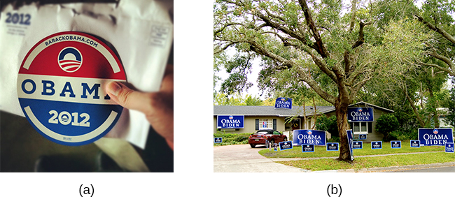

# 12.3 Thái Độ Và Sự Thuyết Phục (Attitudes and Persuasion)

> [!info]
>
> ### Mục Tiêu Học Tập
>
> Sau khi học xong phần này, bạn sẽ có thể:
>
> - Định nghĩa thái độ
> - Mô tả cách thức thái độ của con người bị thay đổi từ bên trong thông qua sự bất hòa nhận thức
> - Giải thích cách thức thái độ của con người bị thay đổi từ bên ngoài thông qua sự thuyết phục
> - Mô tả các con đường thuyết phục trung tâm và ngoại vi

Các nhà tâm lý học xã hội đã ghi nhận sức mạnh của hoàn cảnh tình huống có thể tác động đến hành vi của chúng ta như thế nào.
Bây giờ chúng ta chuyển sang xem xét sức mạnh của tình huống có thể ảnh hưởng đến thái độ và niềm tin của chúng ta ra sao.
**Thái độ** (attitude) là sự đánh giá của chúng ta về một người, một ý tưởng hoặc một sự vật.
Chúng ta có thái độ đối với rất nhiều thứ, từ những sản phẩm chúng ta nhặt lên trong siêu thị, những con người trên khắp thế giới cho đến các chính sách chính trị.
Thông thường, thái độ mang tính thuận lợi hoặc không thuận lợi: tích cực hoặc tiêu cực (Eagly & Chaiken, 1993).
Và chúng bao gồm ba thành phần: thành phần cảm xúc (cảm nghĩ), thành phần hành vi (tác động của thái độ lên hành động), và thành phần nhận thức (niềm tin và hiểu biết) (Rosenberg & Hovland, 1960).

Ví dụ, bạn có thể giữ thái độ tích cực đối với việc tái chế rác thải.
Thái độ này sẽ dẫn đến những cảm xúc tích cực đối với việc tái chế (chẳng hạn như “Tái chế rác khiến tôi cảm thấy dễ chịu” hoặc “Tôi thấy vui khi biết mình đã tạo ra một sự khác biệt nhỏ trong việc giảm lượng rác thải đổ ra các bãi chôn lấp”).
Chắc chắn rằng thái độ này cũng sẽ được phản ánh trong hành vi của bạn: Bạn thực tế sẽ tái chế rác thường xuyên nhất có thể.
Cuối cùng, thái độ này sẽ được thể hiện qua những suy nghĩ thuận lợi (ví dụ: “Tái chế rất tốt cho môi trường” hoặc “Tái chế là việc làm có trách nhiệm”).

Thái độ và niềm tin của chúng ta không chỉ chịu ảnh hưởng bởi các lực lượng bên ngoài, mà còn bởi những tác động nội tại mà chúng ta tự kiểm soát được.
Giống như hành vi, thái độ và suy nghĩ của chúng ta không phải lúc nào cũng bị thay đổi bởi những áp lực tình huống, mà chúng hoàn toàn có thể được thay đổi một cách có ý thức bằng chính ý chí tự do của chúng ta.
Trong phần này, chúng ta sẽ thảo luận về những điều kiện khiến chúng ta muốn thay đổi thái độ và niềm tin của chính mình.

## Sự Bất Hòa Nhận Thức Là Gì?

Các nhà tâm lý học xã hội đã ghi nhận rằng việc cảm thấy hài lòng về bản thân và duy trì lòng tự trọng tích cực là một động lực mạnh mẽ thúc đẩy hành vi con người (Tavris & Aronson, 2008).
Tại Hoa Kỳ, các thành viên của nền văn hóa chủ đạo thường nghĩ rất tốt về bản thân và coi mình là những người tốt, trên mức trung bình ở nhiều nét tính cách đáng mong muốn (Ehrlinger, Gilovich, & Ross, 2005).
Thông thường, hành vi, thái độ và niềm tin của chúng ta sẽ bị ảnh hưởng khi chúng ta trải nghiệm một mối đe dọa đối với lòng tự trọng hoặc hình ảnh bản thân tích cực của mình.
Nhà tâm lý học Leon Festinger (1957) đã định nghĩa **sự bất hòa nhận thức** (cognitive dissonance) là cảm giác khó chịu về mặt tâm lý phát sinh từ việc duy trì hai hoặc nhiều thái độ, hành vi hoặc nhận thức (suy nghĩ, niềm tin hoặc quan điểm) mâu thuẫn nhau.
Lý thuyết bất hòa nhận thức của Festinger khẳng định rằng khi chúng ta trải nghiệm một xung đột giữa các hành vi, thái độ hoặc niềm tin đi ngược lại với những tự nhận thức tích cực về bản thân, chúng ta sẽ trải qua cảm giác khó chịu tâm lý (sự bất hòa).
Ví dụ, nếu bạn tin rằng hút thuốc lá có hại cho sức khỏe nhưng bạn vẫn tiếp tục hút thuốc, bạn sẽ trải qua sự xung đột giữa niềm tin và hành vi của mình ([Hình 12.11](#CNX_Psych_12_03_dissonance)).

![Một sơ đồ thể hiện tiến trình của sự bất hòa nhận thức. Hai phát biểu mâu thuẫn nhau (“Tôi là người hút thuốc” và “Hút thuốc có hại cho sức khỏe”) được kết hợp lại như một ví dụ về sự bất hòa nhận thức. Một sơ đồ dòng chảy nối chúng trong một quá trình dán nhãn “Loại bỏ căng thẳng bất hòa”, với hai hướng kết quả. Hướng thứ nhất cho thấy lời cảnh báo trên bao thuốc lá với dấu tích đè lên được dán nhãn “Hút thuốc có hại cho sức khỏe”, sau đó dẫn đến ảnh một cánh tay dán miếng dán nicotine được dán nhãn “Tôi đã bỏ thuốc lá”. Hướng thứ hai cho thấy lời cảnh báo trên bao thuốc lá với dấu X đè lên được dán nhãn “Nghiên cứu chưa đưa ra kết luận chắc chắn”, sau đó dẫn đến ảnh một người đang hút thuốc được dán nhãn “Tôi vẫn là người hút thuốc”.](../../images/img_ddba7d46c3dd.jpg)

**Hình 12.11** Sự bất hòa nhận thức được khơi dậy bởi những niềm tin và hành vi mâu thuẫn nhau. Tin rằng thuốc lá có hại cho sức khỏe nhưng vẫn cứ hút thuốc có thể gây ra sự bất hòa nhận thức. Để giảm bớt sự bất hòa nhận thức, các cá nhân có thể thay đổi hành vi của mình, chẳng hạn như bỏ thuốc lá, hoặc thay đổi niềm tin của mình, chẳng hạn như gạt bỏ bằng chứng cho rằng hút thuốc là có hại. (nguồn “thuốc lá”: sửa đổi từ tác phẩm của CDC/Debora Cartagena; “miếng dán”: sửa đổi từ "RegBarc"/Wikimedia Commons; “hút thuốc”: sửa đổi từ tác phẩm của Tim Parkinson)

Các nghiên cứu sau đó đã ghi nhận rằng chỉ những nhận thức mâu thuẫn đe dọa đến hình ảnh bản thân tích cực của cá nhân mới gây ra sự bất hòa (Greenwald & Ronis, 1978).
Các nghiên cứu bổ sung cũng phát hiện ra rằng sự bất hòa không chỉ gây khó chịu về mặt tâm lý mà còn có thể gây ra sự kích thích sinh lý (Croyle & Cooper, 1983) và kích hoạt các vùng não quan trọng đối với chức năng cảm xúc và nhận thức (van Veen, Krug, Schooler, & Carter, 2009).
Khi trải nghiệm sự bất hòa nhận thức, chúng ta có động lực mạnh mẽ để làm giảm bớt nó vì nó gây khó chịu về mặt tâm lý, thể chất và tinh thần.
Chúng ta có thể làm giảm **sự bất hòa nhận thức** bằng cách đưa các nhận thức, thái độ và hành vi của mình về cùng một hướng nhất quán—nghĩa là làm cho chúng trở nên hài hòa với nhau.
Điều này có thể được thực hiện theo nhiều cách khác nhau, chẳng hạn như:

- thay đổi hành vi mâu thuẫn (ví dụ: ngừng hút thuốc lá),
- thay đổi nhận thức của chúng ta thông qua sự hợp lý hóa hoặc chối bỏ (ví dụ: tự nhủ rằng các rủi ro sức khỏe có thể giảm bớt bằng cách hút thuốc lá có đầu lọc),
- bổ sung một nhận thức mới (ví dụ: “Hút thuốc giúp kiềm chế cơn thèm ăn để tôi không bị thừa cân, điều này rất tốt cho sức khỏe của tôi.”).

Một ví dụ kinh điển về sự bất hòa nhận thức là Joaquin, một thanh niên 20 tuổi vừa gia nhập quân ngũ.
Trong trại huấn luyện tân binh, anh phải thức dậy lúc 5 giờ sáng, thường xuyên bị thiếu ngủ trầm trọng, bị la mắng quát tháo, người đầy vết bọ cát cắn, thân thể bầm dập xây xát và kiệt quệ tinh thần ([Hình 12.12](#CNX_Psych_12_03_marines)).
Mọi chuyện thậm chí còn tồi tệ hơn: Các tân binh vượt qua được tuần huấn luyện thứ 11 sẽ phải trải qua 54 giờ huấn luyện liên tục không nghỉ.

**Hình 12.12** Một người đã chọn một con đường gian khổ phải đối mặt với sự bất hòa nhận thức bên cạnh rất nhiều sự khó chịu khác. (nguồn: Tyler J. Bolken)

Không có gì đáng ngạc nhiên khi Joaquin cảm thấy khốn khổ.
Chẳng ai thích mình bị khốn khổ cả.
Trong tình huống này, con người có thể thay đổi niềm tin, thái độ hoặc hành vi của họ.
Lựa chọn cuối cùng—thay đổi hành vi—là bất khả thi đối với Joaquin.
Anh đã ký hợp đồng phục vụ quân đội trong 4 năm, và anh không thể tự ý rời đi một cách hợp pháp.

Nếu Joaquin cứ tiếp tục nghĩ về việc mình khốn khổ như thế nào, 4 năm đó sẽ dài đằng đẵng.
Anh sẽ rơi vào trạng thái bất hòa nhận thức triền miên.
Để thay thế cho sự đau khổ này, Joaquin có thể thay đổi niềm tin hoặc thái độ của mình.
Anh có thể tự nhủ: “Mình đang trở nên mạnh mẽ hơn, khỏe mạnh hơn và sắc bén hơn.
Mình đang học tính kỷ luật và cách bảo vệ bản thân cùng đất nước.
Những gì mình đang làm thực sự quan trọng.”
Nếu đây là niềm tin của anh, anh sẽ nhận ra rằng mình đang trở nên kiên cường hơn qua những thử thách.
Sau đó, anh sẽ cảm thấy dễ chịu hơn và không còn phải trải qua sự bất hòa nhận thức—một trạng thái vốn rất khó chịu.

### Hiệu Ứng Của Nghi Thức Kết Nạp

Ví dụ về quân đội đã minh họa cho quan sát rằng một **nghi thức kết nạp** (initiation) gian khổ vào một nhóm sẽ tác động khiến chúng ta yêu thích nhóm đó nhiều hơn.
Một khái niệm tâm lý học xã hội khác mang tên **sự biện minh cho nỗ lực** (justification of effort) gợi ý rằng chúng ta thường đánh giá cao những mục tiêu và thành tựu mà chúng ta đã phải bỏ ra rất nhiều công sức để đạt được.
Theo lý thuyết này, nếu một điều gì đó khó đạt được đối với chúng ta, chúng ta sẽ tin rằng nó có giá trị hơn.
Ví dụ, nếu bạn chuyển đến một căn hộ mới và dành hàng giờ đồng hồ để tự tay lắp ráp một chiếc tủ ngăn kéo mua từ Ikea, bạn sẽ quý trọng nó hơn một chiếc tủ sang trọng hơn do người khác mua cho bạn.
Chúng ta không muốn mình đã lãng phí thời gian và công sức để gia nhập một nhóm mà cuối cùng mình lại rời bỏ.
Một thí nghiệm kinh điển của Aronson và Mills (1959) đã chứng minh hiệu ứng biện minh cho nỗ lực này.
Các sinh viên đại học đã tình nguyện tham gia vào một nhóm trong khuôn viên trường thường xuyên gặp nhau để thảo luận về tâm lý học tình dục.
Những người tham gia được phân ngẫu nhiên vào một trong ba điều kiện: không có nghi thức kết nạp, nghi thức kết nạp dễ dàng, và nghi thức kết nạp khó khăn vào nhóm.
Sau khi tham gia vào buổi thảo luận đầu tiên (vốn được cố tình dàn dựng để trở nên vô cùng tẻ nhạt), những người tham gia được yêu cầu đánh giá mức độ yêu thích của họ đối với nhóm.
Những người đã trải qua quy trình kết nạp khó khăn để vào nhóm đã đánh giá nhóm thuận lợi và tích cực hơn nhiều so với những người trải qua nghi thức kết nạp dễ dàng hoặc không có nghi thức kết nạp ([Hình 12.13](#CNX_Psych_12_03_justification)).

**Hình 12.13** Sự biện minh cho nỗ lực có tác động rõ rệt đến mức độ yêu thích một nhóm của một cá nhân. Các sinh viên trong điều kiện kết nạp khó khăn yêu thích nhóm hơn các sinh viên ở những điều kiện khác do sự biện minh cho nỗ lực.

Các hiệu ứng tương tự có thể được nhìn thấy trong một nghiên cứu gần đây hơn về cách thức nỗ lực của sinh viên ảnh hưởng đến việc đánh giá khóa học.
Heckert, Latier, Ringwald-Burton và Drazen (2006) đã khảo sát 463 sinh viên chưa tốt nghiệp theo học các khóa học tại một trường đại học ở vùng Trung Tây về mức độ nỗ lực mà các khóa học đòi hỏi ở họ.
Ngoài ra, các sinh viên cũng được yêu cầu đánh giá các khía cạnh khác nhau của khóa học.
Với những gì bạn vừa đọc, sẽ không có gì đáng ngạc nhiên khi những khóa học đòi hỏi mức độ nỗ lực cao nhất lại được đánh giá là có giá trị hơn những khóa học không đòi hỏi nhiều nỗ lực.
Hơn nữa, các sinh viên cho biết họ học được nhiều hơn trong các khóa học đòi hỏi nhiều nỗ lực hơn, bất kể điểm số mà họ nhận được trong những khóa học đó là gì (Heckert et al., 2006).

Bên cạnh ví dụ quân đội kinh điển và nghi thức kết nạp nhóm, bạn có thể nghĩ ra các ví dụ khác về **sự bất hòa nhận thức** không?
Dưới đây là một ví dụ: Maria và Marco sống tại hạt Fairfield, tiểu bang Connecticut, một trong những khu vực giàu có nhất nước Mỹ với chi phí sinh hoạt vô cùng đắt đỏ.
Maria làm việc từ xa tại nhà còn Marco thì không đi làm bên ngoài.
Họ thuê một căn nhà rất nhỏ với giá hơn 3.000 đô la mỗi tháng.
Marco phải mua sắm quần áo tại các cửa hàng đồ cũ ký gửi và tiết kiệm bất cứ khi nào có thể.
Họ luôn phàn nàn rằng họ chẳng bao giờ có tiền và không thể mua sắm bất cứ thứ gì mới.
Khi được hỏi tại sao họ không chuyển đến một nơi ở ít tốn kém hơn (vì Maria hoàn toàn có thể làm việc từ xa), họ trả lời rằng hạt Fairfield rất đẹp, họ yêu những bãi biển ở đây và cảm thấy thoải mái khi sống tại vùng này.
Lý thuyết bất hòa nhận thức áp dụng cho những lựa chọn của Maria và Marco như thế nào?

## Sự Thuyết Phục (Persuasion)

Trong phần trước, chúng ta đã thảo luận rằng động lực làm giảm sự bất hòa nhận thức thúc đẩy chúng ta thay đổi thái độ, hành vi và/hoặc nhận thức của mình để làm cho chúng trở nên hòa hợp.
**Sự thuyết phục** (persuasion) là tiến trình thay đổi thái độ của chúng ta đối với một điều gì đó dựa trên một dạng thông điệp giao tiếp nào đó.
Phần lớn sự thuyết phục mà chúng ta trải nghiệm đến từ các lực lượng bên ngoài.
Con người thuyết phục người khác thay đổi thái độ, niềm tin và hành vi của họ như thế nào ([Hình 12.14](#CNX_Psych_12_03_persuasion))?
Bạn nhận được những thông điệp giao tiếp nào đang cố gắng thuyết phục bạn thay đổi thái độ, niềm tin và hành vi của mình?

**Hình 12.14** Chúng ta bắt gặp những nỗ lực thuyết phục ở khắp mọi nơi. Sự thuyết phục không chỉ giới hạn trong quảng cáo chính thức; chúng ta đối mặt với nó xuyên suốt trong thế giới thường nhật của mình. (nguồn: Robert Couse-Baker)

Một phân ngành của tâm lý học xã hội nghiên cứu về sự thuyết phục và ảnh hưởng xã hội, cung cấp cho chúng ta rất nhiều thông tin phong phú về cách con người có thể bị thuyết phục bởi người khác.

### Tiếp Cận Thay Đổi Thái Độ Yale

Chủ đề thuyết phục là một trong những lĩnh vực được nghiên cứu sâu rộng nhất trong tâm lý học xã hội (Fiske et al., 2010).
Trong Chiến tranh Thế giới thứ hai, Carl **Hovland** đã nghiên cứu sâu rộng về sự thuyết phục cho Quân đội Hoa Kỳ.
Sau chiến tranh, Hovland tiếp tục công trình khám phá về sự thuyết phục tại Đại học Yale.
Từ nghiên cứu này đã ra đời một mô hình gọi là **tiếp cận thay đổi thái độ Yale** (Yale attitude change approach), mô tả các điều kiện mà theo đó con người có xu hướng thay đổi thái độ của họ.
Hovland đã chứng minh rằng các đặc điểm nhất định của nguồn phát thông điệp thuyết phục, nội dung của thông điệp và đặc điểm của người tiếp nhận (khán thính giả) sẽ ảnh hưởng đến tính thuyết phục của một thông điệp (Hovland, Janis, & Kelley, 1953).

Các đặc điểm của nguồn phát thông điệp thuyết phục bao gồm độ tin cậy của người nói (Hovland & Weiss, 1951) và sự hấp dẫn về ngoại hình của người nói (Eagly & Chaiken, 1975; Petty, Wegener, & Fabrigar, 1997).
Do đó, những người nói có uy tín, có chuyên môn về chủ đề và được coi là đáng tin cậy sẽ có sức thuyết phục cao hơn những người nói kém tin cậy hơn.
Tương tự, những người nói hấp dẫn hơn sẽ có sức thuyết phục hơn những người kém hấp dẫn.
Việc sử dụng các diễn viên và vận động viên nổi tiếng để quảng cáo sản phẩm trên truyền hình và báo in dựa trên nguyên lý này.
Tuy nhiên, tác động trước mắt và lâu dài của sự thuyết phục cũng phụ thuộc vào độ tin cậy của người truyền tải thông điệp (Kumkale & Albarracín, 2004).

Các đặc điểm của bản thân thông điệp ảnh hưởng đến sự thuyết phục bao gồm tính tinh tế (phẩm chất quan trọng nhưng không quá lộ liễu) (Petty & Cacioppo, 1986; Walster & Festinger, 1962); tính đa chiều (tức là có nhiều hơn một khía cạnh) (Crowley & Hoyer, 1994; Igou & Bless, 2003; Lumsdaine & Janis, 1953); thời điểm (Haugtvedt & Wegener, 1994; Miller & Campbell, 1959), và liệu cả hai mặt của vấn đề có được trình bày hay không.
Những thông điệp tinh tế có sức thuyết phục hơn những thông điệp trực diện thô thiển.
Các luận điểm được đưa ra đầu tiên, chẳng hạn như trong một cuộc tranh luận, sẽ có ảnh hưởng lớn hơn nếu các thông điệp được đưa ra liên tiếp nhau ngay lập tức.
Tuy nhiên, nếu có một khoảng thời gian trì hoãn sau thông điệp đầu tiên và trước khi khán giả cần đưa ra quyết định, thì thông điệp cuối cùng được trình bày sẽ có xu hướng thuyết phục hơn (Miller & Campbell, 1959).

Các đặc điểm của người tiếp nhận (khán thính giả) ảnh hưởng đến sự thuyết phục bao gồm sự chú ý (Albarracín & Wyer, 2001; Festinger & Maccoby, 1964), trí thông minh, lòng tự trọng (Rhodes & Wood, 1992) và độ tuổi (Krosnick & Alwin, 1989).
Để có thể bị thuyết phục, các thành viên khán giả phải đang chú ý.
Những người có trí thông minh thấp hơn thường dễ bị thuyết phục hơn những người có trí thông minh cao hơn; trong khi những người có lòng tự trọng ở mức vừa phải lại dễ bị thuyết phục hơn những người có lòng tự trọng quá cao hoặc quá thấp (Rhodes & Wood, 1992).
Cuối cùng, những người trẻ tuổi trong độ tuổi từ 18–25 dễ bị thuyết phục hơn những người lớn tuổi hơn.

### Mô Hình Khả Năng Suy Ngẫm

Một mô hình đặc biệt phổ biến mô tả động lực của sự thuyết phục là mô hình khả năng suy ngẫm trong thuyết phục (elaboration likelihood model of persuasion) (Petty & Cacioppo, 1986).
**Mô hình khả năng suy ngẫm** (elaboration likelihood model) xem xét các biến số của tiếp cận thay đổi thái độ—nghĩa là các đặc điểm của nguồn phát thông điệp, nội dung thông điệp và đặc điểm của khán thính giả được sử dụng để xác định thời điểm sự thay đổi thái độ sẽ xảy ra.
Theo mô hình khả năng suy ngẫm, có hai con đường chính đóng vai trò truyền tải thông điệp thuyết phục: con đường trung tâm và con đường ngoại vi ([Hình 12.15](#CNX_Psych_12_03_Persuasion2)).

![Một sơ đồ thể hiện hai con đường thuyết phục. Một hộp ở bên trái được dán nhãn “thông điệp thuyết phục” và các mũi tên từ hộp này tách thành hai hướng: con đường trung tâm và con đường ngoại vi, mỗi con đường đều có các hộp mô tả đặc điểm của khán thính giả, quá trình xử lý và kết quả thuyết phục. Khán thính giả là “có động lực, có óc phân tích” ở con đường trung tâm, và “không có động lực, không phân tích” ở con đường ngoại vi. Quá trình xử lý ở con đường trung tâm là “nỗ lực cao; đánh giá thông điệp” và ở con đường ngoại vi là “nỗ lực thấp; bị thuyết phục bởi các tín hiệu ngoài thông điệp”. Kết quả thuyết phục ở con đường trung tâm là “sự thay đổi thái độ lâu dài” và ở con đường ngoại vi là “sự thay đổi thái độ tạm thời”.](../../images/img_ca3914ef9cd3.jpg)

**Hình 12.15** Sự thuyết phục có thể đi theo một trong hai con đường, và độ bền vững của kết quả cuối cùng phụ thuộc vào con đường đã đi qua.

**Con đường trung tâm** (central route) được dẫn dắt bởi tính logic và sử dụng dữ liệu cùng các sự thật khách quan để thuyết phục mọi người về giá trị của một lập luận.
Ví dụ, một hãng xe hơi đang tìm cách thuyết phục bạn mua mẫu xe của họ sẽ nhấn mạnh vào các tính năng an toàn và khả năng tiết kiệm nhiên liệu của chiếc xe.
Đây là một con đường thuyết phục trực tiếp tập trung vào chất lượng của thông tin.
Để con đường thuyết phục trung tâm có hiệu quả trong việc thay đổi thái độ, suy nghĩ và hành vi, lập luận đưa ra phải vững chắc và nếu thành công, nó sẽ dẫn đến sự thay đổi thái độ lâu dài, bền vững.

Con đường thuyết phục trung tâm hoạt động tốt nhất khi đối tượng cần thuyết phục (khán thính giả) là những người có tư duy phân tích và sẵn sàng tham gia vào quá trình xử lý thông tin.
Dưới góc nhìn của một nhà quảng cáo, những sản phẩm nào sẽ được bán tốt nhất bằng con đường thuyết phục trung tâm?
Khán thính giả nào có nhiều khả năng bị ảnh hưởng nhất để mua sản phẩm đó?
Một ví dụ là mua máy vi tính.
Chẳng hạn, các chủ doanh nghiệp nhỏ có thể đặc biệt bị thuyết phục bởi sự tập trung vào chất lượng của máy tính cùng các tính năng kỹ thuật như tốc độ xử lý và dung lượng bộ nhớ.

**Con đường ngoại vi** (peripheral route) là một con đường gián tiếp sử dụng các tín hiệu ngoại vi bên ngoài để gắn kết cảm xúc tích cực với thông điệp (Petty & Cacioppo, 1986).
Thay vì tập trung vào các sự thật và chất lượng của sản phẩm, con đường ngoại vi dựa vào việc liên kết với các đặc tính tích cực như cảm xúc vui vẻ và sự bảo chứng của người nổi tiếng.
Ví dụ, việc nhờ một vận động viên thể thao nổi tiếng quảng cáo giày thể thao là một phương pháp phổ biến được sử dụng để khuyến khích các bạn trẻ mua giày.
Con đường thay đổi thái độ này không đòi hỏi nhiều nỗ lực hay sự xử lý thông tin phức tạp.
Phương pháp thuyết phục này có thể thúc đẩy thái độ tích cực đối với thông điệp hoặc sản phẩm, nhưng nó thường chỉ tạo ra sự thay đổi thái độ hoặc hành vi mang tính tạm thời, kém bền vững.
Khán giả không cần phải có tư duy phân tích hay có động lực xử lý thông điệp.
Trên thực tế, một con đường thuyết phục ngoại vi thậm chí có thể không được khán giả nhận ra, chẳng hạn như trong chiến lược cài cắm sản phẩm (product placement).
Cài cắm sản phẩm đề cập đến việc đưa một sản phẩm có tên thương hiệu hoặc bộ nhận diện thương hiệu rõ ràng vào trong một chương trình truyền hình hoặc bộ phim để quảng bá sản phẩm đó (Gupta & Lord, 1998).
Ví dụ, một mùa của loạt chương trình truyền hình thực tế *American Idol* đã làm nổi bật hình ảnh ban giám khảo uống nước từ những chiếc cốc có in logo Coca-Cola.
Những sản phẩm nào khác sẽ được bán tốt nhất khi sử dụng con đường thuyết phục ngoại vi?
Một ví dụ khác là quần áo: Một nhà bán lẻ có thể tập trung vào những người nổi tiếng đang mặc cùng phong cách quần áo đó.

### Kỹ Thuật "Đặt Một Chân Vào Cửa"

Các nhà nghiên cứu đã thử nghiệm nhiều chiến lược thuyết phục mang lại hiệu quả cao trong việc bán sản phẩm và thay đổi thái độ, ý tưởng cùng hành vi của con người.
Một chiến lược hiệu quả là kỹ thuật "đặt một chân vào cửa" (foot-in-the-door technique) (Cialdini, 2001; Pliner, Hart, Kohl, & Saari, 1974).
Bằng cách sử dụng **kỹ thuật "đặt một chân vào cửa"**, người thuyết phục sẽ khiến một người đồng ý đáp ứng một ân huệ nhỏ hoặc mua một món đồ nhỏ trước, để rồi sau đó mới đưa ra yêu cầu về một ân huệ lớn hơn hoặc mua một món hàng đắt tiền hơn.
Kỹ thuật "đặt một chân vào cửa" đã được chứng minh trong một nghiên cứu của Freedman và Fraser (1966), trong đó những người tham gia đã đồng ý cắm một tấm biển nhỏ trong sân nhà hoặc ký vào một bản kiến nghị thì có nhiều khả năng đồng ý cắm một tấm biển lớn trong sân nhà hơn so với những người ban đầu không nhận được yêu cầu nhỏ ([Hình 12.16](#CNX_Psych_12_03_signs)).
Nghiên cứu về kỹ thuật này cũng minh họa cho nguyên tắc nhất quán (principle of consistency) (Cialdini, 2001): Hành vi trong quá khứ thường định hướng hành vi trong tương lai của chúng ta, và chúng ta luôn có mong muốn duy trì tính nhất quán một khi đã cam kết thực hiện một hành vi.

**Hình 12.16** Với kỹ thuật "đặt một chân vào cửa", việc khiến ai đó đồng ý với một yêu cầu nhỏ như (a) đeo một chiếc huy hiệu chiến dịch có thể khiến họ có nhiều khả năng đồng ý hơn với một yêu cầu lớn hơn sau đó, chẳng hạn như (b) cắm các biển hiệu chiến dịch trong sân nhà của mình. (nguồn a: sửa đổi từ tác phẩm của Joe Crawford; nguồn b: sửa đổi từ tác phẩm của "shutterblog"/Flickr)

Một ứng dụng phổ biến của kỹ thuật "đặt một chân vào cửa" là khi thanh thiếu niên xin cha mẹ một sự cho phép nhỏ (ví dụ: kéo dài giờ giới nghiêm thêm nửa tiếng) rồi sau đó mới xin một điều gì đó lớn hơn nhiều.
Việc cha mẹ đã chấp thuận yêu cầu nhỏ hơn sẽ làm tăng khả năng họ bằng lòng với yêu cầu lớn hơn sau đó.

Một chủ cửa hàng sẽ sử dụng kỹ thuật "đặt một chân vào cửa" như thế nào để bán cho bạn một sản phẩm đắt tiền?
Ví dụ, giả sử bạn đang chọn mua mẫu điện thoại thông minh mới nhất, và nhân viên bán hàng gợi ý bạn mua gói dữ liệu tốt nhất.
Bạn đồng ý với điều này.
Sau đó, nhân viên bán hàng gợi ý một khoản mua sắm lớn hơn—gói bảo hành mở rộng ba năm.
Sau khi đã đồng ý với yêu cầu nhỏ hơn, bạn có nhiều khả năng sẽ đồng ý với cả yêu cầu lớn hơn.
Bạn có thể đã gặp phải điều này nếu từng đi mua ô tô: Khi những người bán hàng nhận ra người mua có ý định mua một mẫu xe nhất định, họ có thể cố gắng khiến khách hàng trả tiền cho nhiều hoặc hầu hết các tùy chọn bổ sung có sẵn trên xe.
Một ví dụ khác về kỹ thuật "đặt một chân vào cửa" áp dụng cho một cá nhân dự định mua một chiếc xe đã qua sử dụng nhưng cuối cùng lại quyết định mua một chiếc xe hoàn toàn mới trang bị đầy đủ phụ kiện.
Tại sao?
Bởi vì người bán hàng đã thuyết phục người mua rằng họ cần một chiếc xe sở hữu toàn bộ các tính năng an toàn hiện đại vốn không hề có trên chiếc xe cũ.
