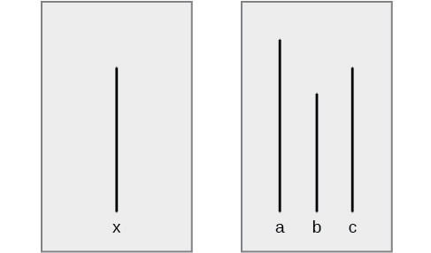
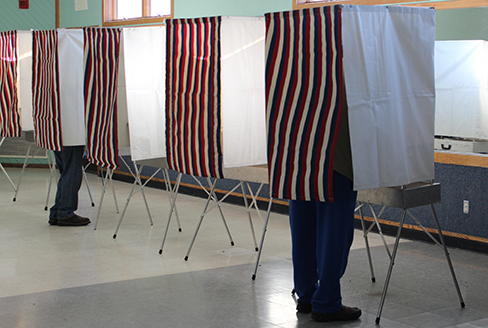
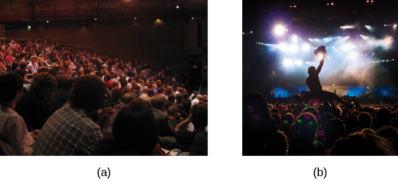

# 12.4 Sự Tuân Thủ, Phục Tùng Và Vâng Lời (Conformity, Compliance, and Obedience)

> [!info]
>
> ### Mục Tiêu Học Tập
>
> Sau khi học xong phần này, bạn sẽ có thể:
>
> - Giải thích hiệu ứng Asch
> - Định nghĩa sự tuân thủ và các loại ảnh hưởng xã hội
> - Mô tả thí nghiệm của Stanley Milgram và những hàm ý của nó
> - Định nghĩa tư duy nhóm, sự thuận lợi hóa xã hội và sự lười biếng xã hội

Trong phần này, chúng ta sẽ thảo luận về những phương thức bổ sung mà con người tác động lên người khác.
Các chủ đề về sự tuân thủ, ảnh hưởng xã hội, sự vâng lời và các tiến trình nhóm chứng minh sức mạnh của hoàn cảnh tình huống xã hội trong việc làm thay đổi suy nghĩ, cảm xúc và hành vi của chúng ta.
Chúng ta bắt đầu phần này bằng một cuộc thảo luận về một thí nghiệm tâm lý học xã hội nổi tiếng đã chứng minh con người dễ bị tác động bởi các áp lực xã hội bên ngoài đến mức nào.

## Sự Tuân Thủ (Conformity)

Solomon **Asch** đã tiến hành một số thí nghiệm vào những năm 1950 để xác định xem con người bị ảnh hưởng như thế nào bởi suy nghĩ và hành vi của người khác.
Trong một nghiên cứu, một nhóm người tham gia được cho xem một chuỗi các đoạn thẳng in sẵn có độ dài khác nhau: a, b và c ([Hình 12.17](#CNX_Psych_12_04_Asch)).
Sau đó, những người tham gia được cho xem đoạn thẳng thứ tư: x.
Họ được yêu cầu xác định xem đoạn thẳng nào từ nhóm đầu tiên (a, b hoặc c) giống với độ dài của đoạn thẳng thứ tư nhất.

**Hình 12.17** Những đoạn thẳng này minh họa nhiệm vụ phán đoán trong nghiên cứu về sự tuân thủ của Asch. Đoạn thẳng nào ở bên phải—a, b hay c—có cùng độ dài với đoạn thẳng x ở bên trái?

Mỗi nhóm người tham gia chỉ có duy nhất một đối tượng ngây thơ, thực sự làm bài trắc nghiệm.
Các thành viên còn lại trong nhóm đều là cộng sự ngầm của nhà nghiên cứu.
Một **cộng sự ngầm** (confederate) là người nắm rõ mục đích thí nghiệm và làm việc cho nhà nghiên cứu.
Các cộng sự ngầm được sử dụng để thao túng các tình huống xã hội như một phần của thiết kế nghiên cứu, và những người tham gia ngây thơ thực sự tin rằng các cộng sự ngầm này cũng là những người tham gia không được biết trước thông tin giống như họ.
Trong nghiên cứu của Asch, các cộng sự ngầm đã xác định một đoạn thẳng rõ ràng là ngắn hơn đoạn thẳng mục tiêu—một câu trả lời sai rành rành.
Người tham gia ngây thơ sau đó phải nói to câu trả lời xác định đoạn thẳng nào khớp nhất với đoạn thẳng mục tiêu.

Bạn nghĩ người tham gia thực sự có tần suất hùa theo câu trả lời của các cộng sự ngầm như thế nào?
Nghĩa là, bạn nghĩ nhóm đã ảnh hưởng đến người tham gia thường xuyên ra sao, và người tham gia đã đưa ra câu trả lời sai bao nhiêu lần?
Asch (1955) phát hiện ra rằng 76% người tham gia đã tuân thủ theo áp lực nhóm ít nhất một lần bằng cách chỉ ra đoạn thẳng không chính xác.
**Sự tuân thủ** (conformity) là sự thay đổi trong hành vi của một người để đi theo nhóm, ngay cả khi người đó không thực sự đồng ý với nhóm.
Tại sao con người lại đưa ra câu trả lời sai?
Những yếu tố nào sẽ làm tăng hoặc giảm việc một người nhượng bộ hoặc tuân thủ áp lực nhóm?

**Hiệu ứng Asch** (Asch effect) là ảnh hưởng của đa số trong nhóm lên phán đoán của một cá nhân.

Những yếu tố nào khiến một người có nhiều khả năng khuất phục trước áp lực nhóm hơn?
Nghiên cứu cho thấy quy mô của phe đa số, sự hiện diện của một người bất đồng chính kiến khác và tính chất công khai hay tương đối riêng tư của câu trả lời là những ảnh hưởng then chốt đối với sự tuân thủ.

- Quy mô của phe đa số: Số lượng người thuộc phe đa số càng lớn, một cá nhân càng có nhiều khả năng tuân thủ. Tuy nhiên, có một giới hạn trên: một thời điểm mà việc bổ sung thêm thành viên không còn làm tăng thêm sự tuân thủ nữa. Trong nghiên cứu của Asch, sự tuân thủ tăng dần theo số lượng người trong phe đa số—lên đến bảy cá nhân. Vượt quá con số bảy người, mức độ tuân thủ đi ngang và giảm nhẹ (Asch, 1955).
- Sự hiện diện của một người bất đồng ý kiến khác: Nếu có ít nhất một người bất đồng ý kiến với nhóm đa số, tỷ lệ tuân thủ sẽ giảm xuống gần bằng không (Asch, 1955).
- Bản chất công khai hay riêng tư của các phản hồi: Khi các phản hồi được đưa ra một cách công khai (trước mặt người khác), sự tuân thủ có nhiều khả năng xảy ra hơn; tuy nhiên, khi các phản hồi được đưa ra một cách riêng tư (ví dụ: viết câu trả lời ra giấy), sự tuân thủ ít có khả năng xảy ra hơn (Deutsch & Gerard, 1955).

Phát hiện cho thấy sự tuân thủ có nhiều khả năng xảy ra hơn khi phản hồi mang tính công khai so với khi phản hồi mang tính riêng tư chính là lý do tại sao các cuộc bầu cử chính phủ yêu cầu bỏ phiếu kín, để chúng ta không bị người khác ép buộc ([Hình 12.18](#CNX_Psych_12_04_voting)).
**Hiệu ứng Asch** có thể dễ dàng nhận thấy ở trẻ em khi chúng phải bỏ phiếu công khai cho một điều gì đó.
Ví dụ, nếu giáo viên hỏi liệu bọn trẻ muốn có thêm giờ ra chơi, không có bài tập về nhà hay được phát kẹo, một khi một vài đứa trẻ bỏ phiếu trước, những đứa trẻ còn lại sẽ nghe theo và đi theo đa số.
Trong một lớp học khác, đa số có thể bỏ phiếu khác đi, và hầu hết trẻ em sẽ tuân theo đa số đó.
Khi phiếu bầu của một người thay đổi tùy theo việc nó được đưa ra ở nơi công khai hay riêng tư, điều này được gọi là sự phục tùng/ưng thuận (compliance).
Sự phục tùng có thể là một hình thức của sự tuân thủ.
Sự phục tùng là việc làm theo một yêu cầu hoặc đòi hỏi, ngay cả khi bạn không đồng tình với yêu cầu đó.
Trong các nghiên cứu của Asch, những người tham gia đã phục tùng bằng cách đưa ra các câu trả lời sai, nhưng trong thâm tâm họ không chấp nhận rằng những câu trả lời sai hiển nhiên đó là đúng.

**Hình 12.18** Việc bỏ phiếu bầu các quan chức chính phủ tại Hoa Kỳ là bí mật nhằm giảm bớt áp lực của sự tuân thủ. (nguồn: Nicole Klauss)

Bây giờ bạn đã biết về các thí nghiệm đoạn thẳng của Asch, bạn nghĩ tại sao những người tham gia lại tuân thủ?
Câu trả lời đúng cho câu hỏi về đoạn thẳng là hiển nhiên, và đó là một nhiệm vụ rất dễ dàng.
Các nhà nghiên cứu đã phân loại động lực tuân thủ thành hai loại: ảnh hưởng xã hội chuẩn mực và ảnh hưởng xã hội thông tin (Deutsch & Gerard, 1955).

Trong **ảnh hưởng xã hội chuẩn mực** (normative social influence), con người tuân thủ theo chuẩn mực nhóm để hòa nhập, để cảm thấy dễ chịu và được nhóm chấp nhận.
Tuy nhiên, với **ảnh hưởng xã hội thông tin** (informational social influence), con người tuân thủ vì họ tin rằng nhóm có năng lực và sở hữu thông tin chính xác, đặc biệt là khi nhiệm vụ hoặc tình huống mang tính mơ hồ, không rõ ràng.
Loại ảnh hưởng xã hội nào đã vận hành trong các nghiên cứu về sự tuân thủ của Asch?
Vì nhiệm vụ phán đoán đoạn thẳng là hoàn toàn rõ ràng, những người tham gia không cần phải dựa vào nhóm để lấy thông tin.
Thay vào đó, những người tham gia đã làm theo để hòa nhập và tránh bị chế giễu—đây là một trường hợp điển hình của ảnh hưởng xã hội chuẩn mực.

Một ví dụ về ảnh hưởng xã hội thông tin có thể là việc phải làm gì trong một tình huống khẩn cấp.
Hãy tưởng tượng bạn đang ở trong rạp chiếu phim xem phim và có thứ gì đó giống như khói bay vào rạp từ dưới cánh cửa thoát hiểm khẩn cấp.
Bạn không chắc chắn đó có phải là khói hay không—nó có thể là hiệu ứng đặc biệt cho bộ phim, chẳng hạn như máy tạo sương mù.
Khi bạn không chắc chắn, bạn sẽ có xu hướng nhìn vào hành vi của những người khác trong rạp.
Nếu người khác tỏ ra lo lắng và đứng dậy rời đi, bạn có khả năng cũng sẽ làm điều tương tự.
Tuy nhiên, nếu những người khác có vẻ thờ ơ không quan tâm, bạn có thể sẽ ngồi yên tại chỗ và tiếp tục xem phim ([Hình 12.19](#CNX_Psych_12_04_audience)).

**Hình 12.19** Con người trong đám đông có xu hướng quan sát các tín hiệu từ người khác và hành động theo đó. (a) Khán giả đang lắng nghe một bài giảng và mọi người tương đối trật tự, ngồi yên và chú ý đến diễn giả trên sân khấu. (b) Khán giả đang ở một buổi hòa nhạc rock nơi mọi người nhảy múa, ca hát và có thể tham gia vào các hoạt động như lướt trên đám đông. (nguồn a: sửa đổi từ tác phẩm của Matt Brown; nguồn b: sửa đổi từ tác phẩm của Christian Holmér)

Bạn sẽ hành xử như thế nào nếu là một người tham gia trong nghiên cứu của Asch?
Nhiều sinh viên khẳng định rằng họ sẽ không bao giờ tuân thủ, rằng nghiên cứu này đã lỗi thời và con người ngày nay độc lập hơn nhiều.
Ở một mức độ nhất định, điều này có thể đúng.
Nghiên cứu cho thấy tỷ lệ tuân thủ tổng thể có thể đã giảm kể từ thời điểm nghiên cứu của Asch.
Hơn nữa, những nỗ lực tái lập nghiên cứu của Asch đã làm rõ rằng có nhiều yếu tố quyết định khả năng một người thể hiện sự tuân thủ đối với nhóm.
Các yếu tố này bao gồm độ tuổi, giới tính và nền tảng văn hóa - xã hội của người tham gia (Bond & Smith, 1996; Larsen, 1990; Walker & Andrade, 1996).

> [!tip]
>
> ### Liên Kết Học Tập
>
> Xem [video về một đợt tái lập thí nghiệm Asch](https://openstax.org/l/Asch2) này để tìm hiểu thêm.

## Thí Nghiệm Của Stanley Milgram

Sự tuân thủ là một tác động từ ảnh hưởng của người khác lên suy nghĩ, cảm xúc và hành vi của chúng ta.
Một hình thức ảnh hưởng xã hội khác là sự vâng lời trước nhân vật có thẩm quyền.
**Sự vâng lời** (obedience) là sự thay đổi hành vi của một cá nhân để tuân theo một yêu cầu của một nhân vật có thẩm quyền quyền lực.
Con người thường làm theo yêu cầu vì họ lo ngại về những hậu quả tiêu cực nếu không phục tùng.
Để chứng minh hiện tượng này, chúng ta hãy cùng xem lại một thí nghiệm kinh điển khác của tâm lý học xã hội.

Stanley **Milgram** là một giáo sư tâm lý học xã hội tại Đại học Yale, người đã chịu ảnh hưởng sâu sắc bởi phiên tòa xét xử Adolf Eichmann, một tội phạm chiến tranh Đức Quốc xã.
Lời biện hộ của Eichmann cho những tội ác diệt chủng man rợ mà hắn đã phạm phải là hắn “chỉ đang làm theo mệnh lệnh”.
Milgram (1963) muốn kiểm tra tính hợp lý của lời biện hộ này, vì vậy ông đã thiết kế một thí nghiệm và ban đầu tuyển dụng 40 người đàn ông cho nghiên cứu của mình.
Các tình nguyện viên tham gia được dẫn dắt để tin rằng họ đang tham gia vào một nghiên cứu nhằm cải thiện khả năng học tập và trí nhớ.
Những người tham gia được thông báo rằng họ sẽ dạy cho các học viên khác (người học) những câu trả lời đúng cho một chuỗi các mục kiểm tra.
Những người tham gia được hướng dẫn cách sử dụng một thiết bị mà họ được cho biết là sẽ phát ra các cú sốc điện với những mức cường độ khác nhau nhắm vào người học.
Những người tham gia được hướng dẫn phải giật điện người học nếu người này đưa ra câu trả lời sai—rằng cú sốc điện sẽ giúp họ học tốt hơn.
Những người tham gia tin rằng họ đang thực sự phóng điện vào người học, với các cú sốc tăng dần từng nấc 15 vôn, lên đến mức tối đa là 450 vôn.
Những người tham gia không hề biết rằng người học thực chất là các cộng sự ngầm của nhà nghiên cứu và các cộng sự ngầm này không hề bị giật điện thật.

Để đáp lại một chuỗi các câu trả lời sai từ phía người học, những người tham gia đã ngoan ngoãn và liên tục giật điện họ.
Các cộng sự ngầm đóng vai người học đã kêu cứu thảm thiết, van xin người tham gia (đóng vai giáo viên) dừng lại, và thậm chí phàn nàn về cơn đau tim.
Tuy nhiên, khi nhà nghiên cứu yêu cầu các giáo viên tham gia tiếp tục giật điện, 65% số người tham gia đã tiếp tục giật điện đến mức điện áp tối đa và cho đến khi người học hoàn toàn bất động, không còn phản ứng gì nữa ([Hình 12.20](#CNX_Psych_12_04_milgram)).
Điều gì khiến một con người vâng lời quyền lực đến mức sẵn sàng gây ra tổn thương nghiêm trọng cho một người khác?

**Hình 12.20** Thí nghiệm Milgram cho thấy mức độ đáng kinh ngạc mà con người tuân theo quyền lực. Cứ ba người tham gia thì có hai người (65%) tiếp tục phát các cú sốc điện nhắm vào một người học không còn phản hồi.

Một số biến thể của thí nghiệm **Milgram** ban đầu đã được tiến hành để kiểm tra các ranh giới của sự vâng lời.
Khi các đặc điểm nhất định của tình huống bị thay đổi, những người tham gia ít có khả năng tiếp tục giật điện hơn (Milgram, 1965).
Ví dụ, khi bối cảnh của thí nghiệm được chuyển đến một tòa nhà văn phòng ngoài khuôn viên trường đại học, tỷ lệ người tham gia thực hiện cú sốc cao nhất giảm xuống còn 48%.
Khi người học ở cùng phòng với người dạy, tỷ lệ giật điện cao nhất giảm xuống 40%.
Khi bàn tay của người dạy và người học chạm vào nhau, tỷ lệ sốc cao nhất giảm xuống 30%.
Khi nhà nghiên cứu đưa ra mệnh lệnh qua điện thoại, tỷ lệ này giảm xuống chỉ còn 23%.
Những biến thể này cho thấy rằng khi tính nhân bản của người bị giật điện tăng lên, sự vâng lời giảm xuống.
Tương tự, khi thẩm quyền uy quyền của người làm thí nghiệm giảm đi, sự vâng lời cũng giảm theo.

Trường hợp này vẫn còn rất nhiều tính ứng dụng trong thực tế ngày nay.
Một người sẽ làm gì nếu một nhân vật có thẩm quyền ra lệnh phải làm một điều gì đó?
Điều gì sẽ xảy ra nếu người đó tin rằng mệnh lệnh đó là sai trái, hoặc tệ hơn, là phi đạo đức?
Trong một nghiên cứu của Martin và Bull (2008), các nữ hộ sinh đã bí mật điền vào một bảng câu hỏi liên quan đến các thực hành tốt nhất và các kỳ vọng trong việc đỡ đẻ.
Sau đó, một nữ hộ sinh cấp cao hơn và là người giám sát đã yêu cầu các nữ hộ sinh cấp dưới làm một điều mà trước đó họ đã tuyên bố là họ phản đối.
Hầu hết các nữ hộ sinh cấp dưới đều vâng lời cấp trên, đi ngược lại niềm tin của chính bản thân họ.
Burger (2009) đã tái lập một phần nghiên cứu này.
Ông phát hiện ra trong một mẫu đa văn hóa gồm cả phụ nữ và nam giới rằng mức độ vâng lời của họ hoàn toàn tương đồng với nghiên cứu của Milgram.
Doliński và cộng sự (2017) đã thực hiện một đợt tái lập công trình của Burger tại Ba Lan và kiểm soát giới tính của cả người tham gia lẫn người học, và một lần nữa, các kết quả nhất quán với công trình ban đầu của Milgram lại được ghi nhận.

## Tư Duy Nhóm (Groupthink)

Khi ở trong các bối cảnh nhóm, chúng ta thường bị ảnh hưởng bởi suy nghĩ, cảm xúc và hành vi của những người xung quanh.
Dù là do ảnh hưởng xã hội chuẩn mực hay ảnh hưởng xã hội thông tin, các nhóm đều có quyền năng mạnh mẽ để chi phối các cá nhân.
Một hiện tượng khác của sự tuân thủ nhóm là tư duy nhóm.
**Tư duy nhóm** (groupthink) là sự điều chỉnh các quan điểm của các thành viên trong một nhóm để phù hợp với những gì họ tin là sự đồng thuận chung của nhóm (Janis, 1972).
Trong các tình huống nhóm, tập thể thường đưa ra những hành động mà các cá nhân sẽ không bao giờ thực hiện bên ngoài bối cảnh nhóm, bởi vì các nhóm thường đưa ra các quyết định cực đoan hơn so với từng cá nhân riêng lẻ.
Hơn nữa, tư duy nhóm có thể cản trở những luồng tư duy phản biện trái chiều.
Việc loại bỏ các ý kiến đa dạng này góp phần dẫn đến những quyết định sai lầm tai hại của cả tập thể.

> [!note]
>
> ### Đào Sâu Hơn
>
> #### Tư Duy Nhóm Trong Chính Phủ Hoa Kỳ
>
> Đã có một số trường hợp tư duy nhóm xuất hiện trong chính phủ Hoa Kỳ.
> Một ví dụ đã xảy ra khi Hoa Kỳ dẫn đầu một liên minh nhỏ các quốc gia phát động cuộc tấn công vào Iraq vào tháng 3 năm 2003.
> Cuộc xâm lược này diễn ra vì một nhóm nhỏ các cố vấn và cựu Tổng thống George W. Bush tin chắc rằng Iraq đại diện cho một mối đe dọa khủng bố đáng kể với một kho vũ khí hủy diệt hàng loạt lớn sẵn sàng sử dụng.
> Mặc dù một số cá nhân trong nhóm này có thể đã có một vài nghi ngờ về độ tin cậy của thông tin có sẵn cho họ vào thời điểm đó, nhưng cuối cùng, cả nhóm đã đạt đến sự đồng thuận rằng Iraq sở hữu vũ khí hủy diệt hàng loạt và đại diện cho một mối đe dọa nghiêm trọng đối với an ninh quốc gia.
> Về sau, sự thật được phơi bày rằng Iraq hoàn toàn không có vũ khí hủy diệt hàng loạt, nhưng mãi cho đến khi cuộc chiến đã đi được một chặng đường dài điều đó mới được xác nhận.
> Hậu quả là hơn 6.000 binh sĩ Mỹ đã tử trận và thêm rất nhiều thường dân thiệt mạng.
> Chính quyền Bush đã đi đến những kết luận đó như thế nào?
> Hãy xem [video này về Colin Powell, 10 năm sau bài phát biểu nổi tiếng tại Liên Hợp Quốc, thảo luận về những thông tin ông có vào thời điểm đó](https://www.openstax.org/l/GroupThink) mà các quyết định của ông dựa trên ("Phỏng vấn chính thức của CNN: Colin Powell hiện bày tỏ sự hối tiếc về bài phát biểu tại LHQ về vũ khí hủy diệt hàng loạt", 2010).
>
> Bạn có nhận thấy bằng chứng của tư duy nhóm không?

Tại sao tư duy nhóm lại xảy ra?
Có một số nguyên nhân dẫn đến tư duy nhóm, và điều đó khiến cho hiện tượng này hoàn toàn có thể ngăn ngừa được.
Khi nhóm có tính gắn kết cao độ, hoặc có cảm giác kết nối mạnh mẽ, việc duy trì sự hòa hợp trong nhóm có thể trở nên quan trọng hơn đối với cả nhóm so với việc đưa ra các quyết định sáng suốt.
Nếu người lãnh đạo nhóm mang tính áp đặt và công khai quan điểm của mình, điều này có thể khiến các thành viên trong nhóm nản lòng, không dám bất đồng ý kiến với lãnh đạo.
Nếu nhóm bị cô lập khỏi việc lắng nghe những góc nhìn thay thế hoặc mới lạ, tư duy nhóm sẽ có nhiều khả năng xảy ra hơn.
Làm thế nào để bạn nhận biết khi nào tư duy nhóm đang diễn ra?

Có một số triệu chứng của tư duy nhóm bao gồm:

- coi nhóm là bất khả xâm phạm hoặc bất khả chiến bại—tin rằng nhóm không thể làm điều gì sai trái
- tin rằng nhóm luôn đúng đắn về mặt đạo đức
- sự tự kiểm duyệt của các thành viên trong nhóm, chẳng hạn như giữ lại thông tin để tránh phá vỡ sự đồng thuận chung
- sự dập tắt các ý kiến bất đồng của các thành viên trong nhóm
- sự bao bọc, che chắn cho người lãnh đạo nhóm khỏi các quan điểm bất đồng
- cảm nhận một ảo tưởng về sự nhất trí tuyệt đối giữa các thành viên trong nhóm
- giữ những định kiến hoặc thái độ tiêu cực đối với nhóm ngoài hoặc những người có quan điểm khác biệt (Janis, 1972)

Dựa trên các nguyên nhân và triệu chứng của tư duy nhóm, làm thế nào để tránh được hiện tượng này?
Có một số chiến lược có thể cải thiện việc ra quyết định của nhóm bao gồm: tìm kiếm ý kiến đóng góp từ bên ngoài, bỏ phiếu kín, yêu cầu người lãnh đạo giữ kín quan điểm cho đến khi tất cả các thành viên trong nhóm đã lên tiếng, tiến hành nghiên cứu trên tất cả các quan điểm, cân nhắc chi phí và lợi ích của mọi phương án, và phát triển một kế hoạch dự phòng (Janis, 1972; Mitchell & Eckstein, 2009).

## Sự Phân Cực Nhóm (Group Polarization)

Một hiện tượng khác xảy ra trong các bối cảnh nhóm là sự phân cực nhóm.
**Sự phân cực nhóm** (group polarization) (Teger & Pruitt, 1967) là sự củng cố và tăng cường thái độ ban đầu của nhóm sau khi thảo luận các quan điểm bên trong nhóm.
Nghĩa là, nếu ban đầu một nhóm có xu hướng ủng hộ một quan điểm nào đó, thì sau khi thảo luận, sự đồng thuận của nhóm có khả năng sẽ tán thành quan điểm đó mạnh mẽ hơn nữa.
Ngược lại, nếu ban đầu nhóm phản đối một quan điểm, cuộc thảo luận nhóm có thể sẽ dẫn đến sự phản đối gay gắt hơn.
Sự phân cực nhóm giải thích cho rất nhiều hành động do các tập thể thực hiện mà từng cá nhân riêng rẽ sẽ không bao giờ dám làm.
Sự phân cực nhóm có thể được quan sát thấy tại các đại hội đảng phái chính trị, khi cương lĩnh của đảng được ủng hộ nhiệt liệt bởi những cá nhân mà khi ở ngoài nhóm sẽ từ chối ủng hộ chúng.
Gần đây, một số nhà lý thuyết lập luận rằng sự phân cực nhóm có thể chịu một phần trách nhiệm cho sự phân cực chính trị cực đoan dường như đang hiện diện khắp nơi trong xã hội hiện đại.
Do con người có thể tự lựa chọn các phương tiện truyền thông phù hợp nhất với quan điểm chính trị của bản thân, họ ít có khả năng tiếp xúc với các quan điểm trái chiều.
Theo thời gian, điều này dẫn đến sự củng cố góc nhìn của chính họ và làm gia tăng thái độ cùng hành vi thù địch đối với những người có lý tưởng chính trị khác biệt.
Đáng chú ý, sự phân cực chính trị dẫn đến các mức độ phân biệt đối xử công khai ngang bằng, hoặc thậm chí vượt qua cả sự phân biệt chủng tộc (Iyengar & Westwood, 2015).
Một ví dụ thường nhật hơn là cuộc thảo luận của một nhóm bạn về mức độ hấp dẫn của một người nào đó.
Liệu ý kiến của bạn có thay đổi nếu bạn thấy ai đó hấp dẫn nhưng bạn bè của bạn lại không đồng ý?
Nếu bạn bè của bạn đồng thanh nhiệt liệt tán thưởng, liệu bạn có thấy người đó trở nên hấp dẫn hơn nữa hay không?

Những cái bẫy xã hội (social traps) đề cập đến những tình huống nảy sinh khi các cá nhân hoặc các nhóm cá nhân hành xử theo những cách không mang lại lợi ích tốt nhất cho chính họ và có thể dẫn đến những hậu quả tiêu cực, lâu dài.
Tuy nhiên, một khi đã hình thành, cái bẫy xã hội rất khó để thoát ra.
Ví dụ, sau Chiến tranh Thế giới thứ hai, Hoa Kỳ và Liên Xô trước đây đã tham gia vào một cuộc chạy đua vũ trang hạt nhân.
Mặc dù sự hiện diện của vũ khí hạt nhân không mang lại lợi ích tốt nhất cho bất kỳ bên nào, nhưng một khi cuộc chạy đua vũ trang đã bắt đầu, mỗi quốc gia đều cảm thấy cần phải tiếp tục sản xuất vũ khí hạt nhân để tự bảo vệ mình trước đối phương.

### Sự Lười Biếng Xã Hội (Social Loafing)

Hãy tưởng tượng bạn vừa được giao một bài tập nhóm với những sinh viên khác mà bạn hầu như không quen biết.
Tất cả mọi người trong nhóm sẽ nhận cùng một điểm số.
Bạn có phải là kiểu người sẽ gánh vác phần lớn công việc, mặc dù điểm số cuối cùng được chia đều cho tất cả?
Hay bạn có nhiều khả năng sẽ làm việc ít hơn vì biết rằng những người khác sẽ bù đắp phần thiếu hụt?
**Sự lười biếng xã hội** (social loafing) liên quan đến việc suy giảm hiệu suất đóng góp của cá nhân trong các nhiệm vụ mà công sức của mọi người được gộp chung lại.
Bởi vì nỗ lực của từng cá nhân không được đánh giá riêng biệt, các cá nhân có thể trở nên ít có động lực để thể hiện tốt.
Karau và Williams (1993) cùng Simms và Nichols (2014) đã xem xét lại các nghiên cứu về sự lười biếng xã hội và nhận diện khi nào nó ít có khả năng xảy ra nhất.
Các nhà nghiên cứu lưu ý rằng sự lười biếng xã hội có thể được xoa dịu nếu, cùng với các tình huống khác, các cá nhân biết rằng công việc của họ sẽ được người quản lý (trong môi trường làm việc) hoặc giảng viên (trong lớp học) đánh giá riêng lẻ, hoặc nếu người quản lý hay giảng viên yêu cầu các thành viên trong nhóm hoàn thành các bài tự đánh giá.

Khả năng xảy ra sự lười biếng xã hội trong các nhóm làm việc của sinh viên sẽ tăng lên khi quy mô nhóm tăng lên (Shepperd & Taylor, 1999).
Theo Karau và Williams (1993), sinh viên đại học là nhóm dân số có nhiều khả năng lười biếng xã hội nhất.
Nghiên cứu của họ cũng phát hiện ra rằng phụ nữ và những người tham gia đến từ các nền văn hóa tập thể ít có khả năng lười biếng xã hội hơn, giải thích rằng định hướng nhóm của họ có thể lý giải cho điều này.

Các sinh viên đại học có thể giải quyết tình trạng lười biếng xã hội hoặc "ngồi mát ăn bát vàng" (free-riding) bằng cách đề xuất với giáo sư của họ áp dụng phương pháp ghép nhóm theo bầy đàn (flocking method).
Harding (2018) đã so sánh các nhóm sinh viên tự chọn nhóm với những nhóm được thành lập bằng phương pháp flocking—vốn phân công các sinh viên có lịch trình và động lực tương đồng vào cùng một nhóm.
Bà không chỉ nhận thấy rằng sinh viên báo cáo ít tình trạng "ngồi mát ăn bát vàng" hơn, mà họ còn đạt kết quả tốt hơn trong các bài tập nhóm so với những nhóm do sinh viên tự lựa chọn.

Điều thú vị là điều ngược lại với sự lười biếng xã hội sẽ xảy ra khi nhiệm vụ mang tính phức tạp và khó khăn (Bond & Titus, 1983; Geen, 1989).
Trong một bối cảnh nhóm, chẳng hạn như nhóm làm việc của sinh viên, nếu kết quả cá nhân của bạn không thể bị đánh giá riêng rẽ, bạn sẽ chịu ít áp lực hơn để thể hiện tốt, và do đó ít lo âu hoặc ít bị kích thích sinh lý hơn (Latané, Williams, & Harkens, 1979).
Điều này đặt bạn vào một trạng thái thư thái, nơi bạn có thể thể hiện hết khả năng tốt nhất của mình nếu muốn (Zajonc, 1965).
Nếu nhiệm vụ là một thử thách khó khăn, nhiều người cảm thấy có động lực và tin rằng nhóm của họ rất cần sự đóng góp của họ để hoàn thành tốt một dự án đầy thử thách (Jackson & Williams, 1985).

### Sự Phi Cá Nhân Hóa (Deindividuation)

Một cách thức khác mà việc là một phần của nhóm có thể ảnh hưởng đến hành vi được biểu hiện trong những trường hợp xảy ra sự phi cá nhân hóa.
Sự phi cá nhân hóa (deindividuation) đề cập đến những tình huống trong đó một người có thể cảm thấy một cảm giác vô danh (ẩn danh) và do đó làm giảm trách nhiệm giải trình cùng cảm nhận về cái tôi khi ở giữa những người khác.
Sự phi cá nhân hóa thường được chỉ ra trong các trường hợp xảy ra các hành vi bạo loạn hoặc hành vi của đám đông hung hãn (Zimbardo, 1969), nhưng nghiên cứu về chủ đề này và vai trò của sự phi cá nhân hóa trong các hành vi đó đã mang lại những kết quả không nhất quán (như đã thảo luận trong Granström, Guvå, Hylander, & Rosander, 2009).

[Bảng 12.2](#Table_12_04_01) tóm tắt các loại ảnh hưởng xã hội mà bạn đã tìm hiểu trong chương này.

**Các Loại Ảnh Hưởng Xã Hội**

| Loại ảnh hưởng xã hội | Mô tả |
| --- | --- |
| **Sự tuân thủ (Conformity)** | Thay đổi hành vi của bạn để đi theo nhóm ngay cả khi bạn không đồng tình với nhóm |
| **Sự phục tùng (Compliance)** | Làm theo một yêu cầu hoặc đòi hỏi |
| **Ảnh hưởng xã hội chuẩn mực (Normative social influence)** | Tuân thủ một chuẩn mực nhóm để hòa nhập, cảm thấy dễ chịu và được nhóm chấp nhận |
| **Ảnh hưởng xã hội thông tin (Informational social influence)** | Tuân thủ một chuẩn mực nhóm được thúc đẩy bởi niềm tin rằng nhóm có năng lực và sở hữu thông tin chính xác |
| **Sự vâng lời (Obedience)** | Thay đổi hành vi của bạn để làm hài lòng một nhân vật có thẩm quyền hoặc để tránh những hậu quả bất lợi |
| **Tư duy nhóm (Groupthink)** | Xu hướng ưu tiên sự gắn kết nhóm hơn là tư duy phản biện, điều này có thể dẫn đến việc ra quyết định tồi; có nhiều khả năng xảy ra hơn khi có sự nhất trí tuyệt đối được cảm nhận trong nhóm |
| **Sự phân cực nhóm (Group polarization)** | Sự củng cố và tăng cường thái độ ban đầu của nhóm sau khi thảo luận các quan điểm bên trong nhóm |
| **Sự lười biếng xã hội (Social loafing)** | Sự bỏ ra ít nỗ lực hơn của một người khi làm việc trong nhóm vì hiệu suất cá nhân không thể được đánh giá tách biệt khỏi nhóm, do đó gây suy giảm hiệu suất trong các nhiệm vụ dễ dàng |
| **Sự phi cá nhân hóa (Deindividuation)** | Tình huống nhóm trong đó một người có thể cảm thấy ẩn danh và hậu quả là giảm trách nhiệm giải trình cùng cảm nhận về cái tôi |

**Bảng 12.2**
