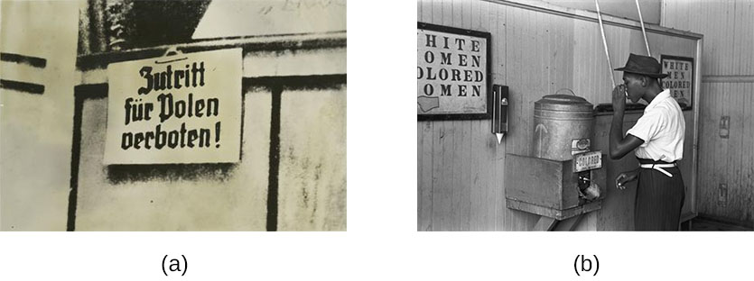
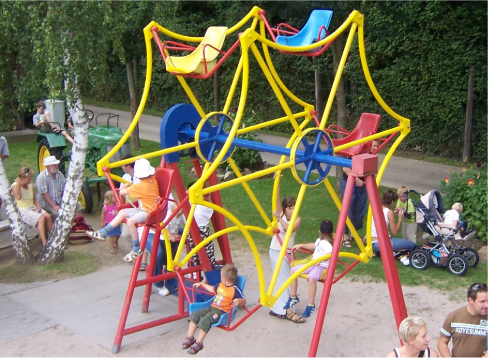

# 12.5 Định Kiến Và Phân Biệt Đối Xử (Prejudice and Discrimination)

> [!info]
>
> ### Mục Tiêu Học Tập
>
> Sau khi học xong phần này, bạn sẽ có thể:
>
> - Định nghĩa và phân biệt giữa định kiến, khuôn mẫu và sự phân biệt đối xử
> - Đưa ra các ví dụ về định kiến, khuôn mẫu và sự phân biệt đối xử
> - Giải thích lý do tại sao định kiến và sự phân biệt đối xử tồn tại

Xung đột giữa con người có thể dẫn đến tội phạm, chiến tranh và những vụ thảm sát hàng loạt, chẳng hạn như nạn diệt chủng.
Định kiến và sự phân biệt đối xử thường là những nguyên nhân gốc rễ dẫn đến xung đột nhân loại, giải thích cách thức những người xa lạ trở nên căm ghét lẫn nhau đến mức cùng cực là gây hại cho đối phương.
Định kiến và phân biệt đối xử ảnh hưởng đến tất cả mọi người.
Trong phần này, chúng ta sẽ xem xét định nghĩa về định kiến và phân biệt đối xử, các ví dụ về những khái niệm này, cùng nguyên nhân dẫn đến các thiên kiến đó.

**Hình 12.21** Định kiến và phân biệt đối xử xảy ra trên khắp toàn cầu. (a) Một tấm biển năm 1939 tại Ba Lan bị Đức chiếm đóng cảnh báo “Cấm người Ba Lan vào!” (b) Một người đàn ông người Mỹ gốc Phi uống nước từ một vòi nước chỉ định dành riêng cho “người da màu” ở Oklahoma vào năm 1939 trong thời kỳ phân biệt chủng tộc như một thực hành phân biệt đối xử. (nguồn b: sửa đổi từ tác phẩm của Cơ quan An sinh Nông trại Hoa Kỳ)

## Thấu Hiểu Về Định Kiến Và Phân Biệt Đối Xử

Như chúng ta đã thảo luận trong câu chuyện mở đầu về Trayvon Martin, con người vô cùng đa dạng và mặc dù chúng ta chia sẻ nhiều điểm tương đồng, chúng ta cũng có rất nhiều điểm khác biệt.
Các nhóm xã hội mà chúng ta thuộc về giúp hình thành nên bản sắc của chúng ta (Tajfel, 1974).
Những khác biệt này có thể khó dung hòa đối với một số người, điều này có thể dẫn đến định kiến đối với những người khác biệt.
**Định kiến** (prejudice) là một thái độ và cảm xúc tiêu cực đối với một cá nhân chỉ thuần túy dựa trên tư cách thành viên của người đó trong một nhóm xã hội cụ thể (Allport, 1954; Brown, 2010).
Định kiến rất phổ biến đối với những người là thành viên của một nhóm văn hóa xa lạ.
Do đó, một số hình thức giáo dục, tiếp xúc, tương tác và xây dựng mối quan hệ nhất định với các thành viên của các nhóm văn hóa khác nhau có thể làm giảm bớt xu hướng định kiến.
Trên thực tế, việc chỉ đơn giản tưởng tượng ra việc tương tác với các thành viên của các nhóm văn hóa khác nhau cũng có thể tác động đến định kiến.
Thật vậy, khi những người tham gia thực nghiệm được yêu cầu tưởng tượng bản thân đang tương tác tích cực với một người đến từ một nhóm khác, điều này đã dẫn đến sự gia tăng thái độ tích cực đối với nhóm kia và gia tăng các nét tính cách tích cực gắn liền với nhóm đó.
Hơn nữa, sự tương tác xã hội trong tưởng tượng có thể làm giảm bớt sự lo âu gắn liền với các tương tác liên nhóm (Crisp & Turner, 2009).
Một số ví dụ về các nhóm xã hội mà bạn thuộc về góp phần tạo nên bản sắc của bạn là gì?
Các nhóm xã hội có thể bao gồm giới tính, chủng tộc, sắc tộc, quốc tịch, tầng lớp xã hội, tôn giáo, xu hướng tính dục, nghề nghiệp và nhiều nhóm khác.
Và tương tự như các vai trò xã hội, bạn có thể đồng thời là thành viên của nhiều nhóm xã hội.
Một ví dụ về định kiến là việc có thái độ tiêu cực đối với những người không sinh ra tại Hoa Kỳ.
Mặc dù những người có thái độ định kiến này không hề quen biết tất cả những người không sinh ra tại Hoa Kỳ, họ vẫn không thích những người này chỉ vì thân phận người nước ngoài của họ.

Bạn có thể nghĩ ra một thái độ định kiến mà bạn từng có đối với một nhóm người không?
Định kiến của bạn đã phát triển như thế nào?
Định kiến thường bắt đầu dưới dạng một **khuôn mẫu định kiến** (stereotype)—tức là một niềm tin hoặc giả định cụ thể về các cá nhân chỉ thuần túy dựa trên tư cách thành viên của họ trong một nhóm, bất kể các đặc điểm cá nhân riêng biệt của họ.
Các khuôn mẫu trở nên bị khái quát hóa quá mức và áp đặt lên tất cả các thành viên trong nhóm.
Ví dụ, một người giữ thái độ định kiến đối với người cao tuổi có thể tin rằng tất cả người già đều chậm chạp và kém năng lực (Cuddy, Norton, & Fiske, 2005; Nelson, 2004).
Chúng ta không thể nào quen biết từng cá nhân lớn tuổi để có thể khẳng định rằng tất cả người cao tuổi đều chậm chạp và bất tài.
Do đó, niềm tin tiêu cực này đã bị khái quát hóa quá mức cho mọi thành viên trong nhóm, ngay cả khi nhiều thành viên cá nhân trong nhóm đó thực tế có thể rất nhanh nhẹn và thông minh.

Một ví dụ khác về một khuôn mẫu nổi tiếng liên quan đến niềm tin về sự khác biệt chủng tộc giữa các vận động viên.
Như Hodge, Burden, Robinson và Bennett (2008) đã chỉ ra, các vận động viên da đen thường bị cho là có thể lực tốt hơn nhưng lại kém thông minh hơn các đồng nghiệp da trắng của họ.
Những niềm tin này vẫn tiếp tục tồn tại dai dẳng bất chấp rất nhiều ví dụ nổi bật thực tế chứng minh điều ngược lại.
Đáng buồn thay, những niềm tin như vậy thường ảnh hưởng đến cách các vận động viên này bị đối xử bởi người khác và cách họ nhìn nhận về bản thân cùng năng lực của chính mình.
Dù bạn có đồng tình với một khuôn mẫu hay không, các khuôn mẫu nhìn chung đều được biết đến rộng rãi trong một nền văn hóa nhất định (Devine, 1989).

Đôi khi con người sẽ hành động dựa trên những thái độ định kiến của họ đối với một nhóm người, và hành vi này được gọi là sự phân biệt đối xử.
**Sự phân biệt đối xử** (discrimination) là hành động tiêu cực nhắm vào một cá nhân do tư cách thành viên của người đó trong một nhóm cụ thể (Allport, 1954; Dovidio & Gaertner, 2004).
Hậu quả của việc nắm giữ những niềm tin tiêu cực (khuôn mẫu) và thái độ tiêu cực (định kiến) về một nhóm cụ thể là con người thường đối xử tồi tệ với đối tượng của định kiến, chẳng hạn như loại trừ người cao tuổi ra khỏi vòng bạn bè của họ.
Theo cách này, sự phân biệt đối xử là một hình thức của sự áp bức.
Một ví dụ về một nhà tâm lý học từng phải trải qua sự phân biệt đối xử theo giới tính được tìm thấy trong cuộc đời và sự nghiệp học thuật của Mary Whiton Calkins.
Calkins đã được cấp giấy phép đặc biệt để tham dự các buổi hội thảo sau đại học tại Harvard (vào thời điểm cuối những năm 1880, Đại học Harvard không tiếp nhận phụ nữ) và có thời điểm bà là sinh viên duy nhất của nhà tâm lý học lừng danh William James.
Bà đã vượt qua tất cả các yêu cầu cần thiết để nhận bằng Tiến sĩ và được nhà tâm lý học Hugo Münsterberg mô tả là “một trong những giáo sư tâm lý học xuất sắc nhất tại đất nước này”.
Tuy nhiên, Harvard đã từ chối cấp bằng Tiến sĩ cho Calkins chỉ vì bà là phụ nữ (Harvard University, 2019). [Bảng 12.3](#Table_12_05_01) tóm tắt các đặc điểm của khuôn mẫu, định kiến và phân biệt đối xử.
Bạn đã bao giờ trở thành mục tiêu của sự phân biệt đối xử chưa?
Nếu có, cách đối xử tiêu cực này khiến bạn cảm thấy như thế nào?

**Kết Nối Khuôn Mẫu, Định Kiến Và Phân Biệt Đối Xử**

| Mục | Chức năng | Mối liên hệ | Ví dụ |
| --- | --- | --- | --- |
| **Khuôn mẫu (Stereotype)** | Nhận thức; những suy nghĩ về con người | Những niềm tin khái quát hóa quá mức về con người có thể dẫn đến định kiến. | “Người hâm mộ đội Yankees đều kiêu ngạo và đáng ghét.” |
| **Định kiến (Prejudice)** | Cảm xúc; cảm nhận về con người, cả tích cực lẫn tiêu cực | Cảm xúc có thể ảnh hưởng đến cách đối xử với người khác, dẫn đến phân biệt đối xử. | “Tôi ghét người hâm mộ đội Yankees; họ làm tôi phát cáu.” |
| **Phân biệt đối xử (Discrimination)** | Hành vi; cách đối xử tích cực hoặc tiêu cực đối với người khác | Giữ khuôn mẫu và nuôi dưỡng định kiến có thể dẫn đến việc loại trừ, xa lánh và đối xử thiên vị/bất công với các thành viên trong nhóm. | “Tôi sẽ không bao giờ tuyển dụng hay kết bạn với một người nếu tôi biết họ là người hâm mộ đội Yankees.” |

**Bảng 12.3**

Cho đến nay, chúng ta đã thảo luận về khuôn mẫu, định kiến và sự phân biệt đối xử như những suy nghĩ, cảm xúc và hành vi tiêu cực bởi vì đây là những điều điển hình gây ra nhiều vấn đề nhất.
Tuy nhiên, điều quan trọng cần chỉ ra là con người cũng có thể giữ những suy nghĩ, cảm xúc và hành vi tích cực đối với các cá nhân dựa trên tư cách thành viên nhóm; ví dụ, họ sẽ thể hiện sự đối xử ưu đãi đặc quyền cho những người giống với bản thân họ—nghĩa là những người cùng giới tính, cùng chủng tộc hoặc cùng hâm mộ một đội thể thao.

> [!tip]
>
> ### Liên Kết Học Tập
>
> Xem [video về một thực nghiệm xã hội được tiến hành trong công viên](https://openstax.org/l/racismexp) chứng minh các khái niệm về định kiến, khuôn mẫu và sự phân biệt đối xử.
> Trong video, ba người cố gắng trộm một chiếc xe đạp công khai giữa thanh thiên bạch nhật.
> Chủng tộc và giới tính của tên trộm được thay đổi: một thiếu niên da trắng, một thiếu niên da đen và một phụ nữ da trắng.
> Có ai cố gắng ngăn cản họ không?
> Cách đối xử với các thanh thiếu niên trong video minh họa cho khái niệm phân biệt chủng tộc.

## Các Dạng Định Kiến Và Phân Biệt Đối Xử

Khi gặp những người xa lạ, chúng ta tự động xử lý ba mẩu thông tin về họ: chủng tộc, giới tính và tuổi tác (Ito & Urland, 2003).
Tại sao những khía cạnh này của một người không quen biết lại quan trọng đến vậy?
Tại sao thay vào đó chúng ta không chú ý xem ánh mắt của họ có thân thiện hay không, họ có đang mỉm cười hay không, chiều cao của họ hay kiểu quần áo họ đang mặc?
Mặc dù những đặc điểm thứ cấp này rất quan trọng trong việc hình thành ấn tượng đầu tiên về một người lạ, nhưng các danh mục xã hội về chủng tộc, giới tính và tuổi tác cung cấp một lượng lớn thông tin về một cá nhân.
Tuy nhiên, thông tin này thường dựa trên các khuôn mẫu định kiến.
Chúng ta có thể có những kỳ vọng khác nhau về những người lạ tùy thuộc vào chủng tộc, giới tính và độ tuổi của họ.
Bạn giữ những khuôn mẫu và định kiến nào về những người thuộc nhóm chủng tộc, giới tính và độ tuổi khác với bản thân mình?

### Chủ Nghĩa Phân Biệt Chủng Tộc (Racism)

**Chủ nghĩa phân biệt chủng tộc** (racism) là **định kiến** và **sự phân biệt đối xử** chống lại một cá nhân chỉ thuần túy dựa trên tư cách thành viên của họ trong một nhóm chủng tộc cụ thể (chẳng hạn như đối với người Mỹ gốc Phi, người Mỹ gốc Á, người gốc Latinh, người Mỹ bản địa, người Mỹ gốc Âu).
Một số khuôn mẫu về các nhóm chủng tộc hoặc sắc tộc khác nhau là gì?
Nghiên cứu cho thấy các khuôn mẫu văn hóa đối với người Mỹ gốc Á bao gồm lạnh lùng, ranh mãnh và thông minh; đối với người gốc Latinh là lạnh lùng và kém thông minh; đối với người Mỹ gốc Âu là lạnh lùng và thông minh; và đối với người Mỹ gốc Phi là hung hăng, giỏi thể thao và có nhiều khả năng phạm pháp hơn (Devine & Elliot, 1995; Fiske, Cuddy, Glick, & Xu, 2002; Sommers & Ellsworth, 2000; Dixon & Linz, 2000).

Chủ nghĩa phân biệt chủng tộc tồn tại đối với nhiều nhóm chủng tộc và sắc tộc.
Ví dụ, người da đen có nhiều khả năng bị cảnh sát khám xét phương tiện khi dừng xe lưu thông hơn đáng kể so với người da trắng, đặc biệt là khi người da đen lái xe trong các khu dân cư chủ yếu là người da trắng sinh sống—một hiện tượng thường được gọi là “DWB” hoặc “lái xe trong khi là người da đen” (driving while Black) (Rojek, Rosenfeld, & Decker, 2012).

Người Mỹ gốc Mexico và các nhóm gốc Latinh khác cũng là mục tiêu của sự phân biệt chủng tộc từ phía cảnh sát và các thành viên khác trong cộng đồng.
Ví dụ, khi thanh toán các món hàng bằng séc cá nhân, những người mua sắm gốc Latinh có nhiều khả năng bị yêu cầu xuất trình giấy tờ tùy thân chính thức hơn so với những người mua sắm da trắng (Dovidio et al., 2010).

Trong một vụ việc bị cáo buộc quấy rối của cảnh sát, một số sĩ quan cảnh sát East Haven, Connecticut, đã bị bắt giữ với các cáo buộc liên bang do được cho là liên tục quấy rối và bạo hành người gốc Latinh.
Khi những lời cáo buộc được đưa ra, thị trưởng East Haven đã được hỏi: “Hôm nay ông đang làm gì cho cộng đồng người gốc Latinh?”
Vị thị trưởng đã trả lời: “Có thể tôi sẽ ăn bánh taco khi về nhà, tôi vẫn chưa chắc chắn lắm” (“East Haven Mayor”, 2012).
Phát ngôn này đã xem nhẹ vấn đề nghiêm trọng về việc phân loại đối tượng theo hồ sơ chủng tộc (racial profiling) và sự quấy rối của cảnh sát đối với người gốc Latinh, đồng thời hạ thấp văn hóa của người gốc Latinh bằng cách nhấn mạnh vào sự quan tâm đến một món ăn mang tính khuôn mẫu gắn liền với người Latinh.

Chủ nghĩa phân biệt chủng tộc cũng phổ biến đối với nhiều nhóm khác ở Hoa Kỳ bao gồm người Mỹ bản địa, người Mỹ gốc Ả Rập, người Mỹ gốc Do Thái và người Mỹ gốc Á.
Bạn đã từng trải qua hoặc chứng kiến sự phân biệt chủng tộc đối với bất kỳ nhóm chủng tộc hoặc sắc tộc nào trong số này chưa?
Bạn có nhận thấy sự phân biệt chủng tộc trong cộng đồng của mình không?

Một lý do khiến các hình thức phân biệt chủng tộc hiện đại, và định kiến nói chung, khó bị phát hiện có liên quan đến mô hình thái độ kép (dual attitudes model) (Wilson, Lindsey, & Schooler, 2000).
Con người có hai dạng thái độ: thái độ công khai/hiển ngôn (explicit attitudes)—vốn mang tính có ý thức và có thể kiểm soát được, và thái độ ngầm ẩn (implicit attitudes)—vốn thuộc về vô thức và không thể kiểm soát được (Devine, 1989; Olson & Fazio, 2003).
Bởi vì việc nắm giữ các quan điểm bình đẳng là điều đáng mong muốn về mặt xã hội (Plant & Devine, 1998), hầu hết mọi người không biểu lộ sự thiên vị chủng tộc cực đoan hoặc các định kiến khác trên các thước đo thái độ công khai của họ.
Tuy nhiên, các thước đo thái độ ngầm ẩn thường cho thấy bằng chứng về sự thiên vị chủng tộc từ mức độ nhẹ đến mạnh mẽ hoặc các định kiến ngấm ngầm khác (Greenwald, McGee, & Schwartz, 1998; Olson & Fazio, 2003).

### Chủ Nghĩa Phân Biệt Giới Tính (Sexism)

**Chủ nghĩa phân biệt giới tính** (sexism) là **định kiến** và **sự phân biệt đối xử** nhắm vào các cá nhân dựa trên giới tính của họ.
Điển hình là phân biệt giới tính diễn ra dưới hình thức nam giới nắm giữ các thiên kiến chống lại phụ nữ, nhưng bất kỳ ai cũng có thể biểu lộ sự phân biệt giới tính đối với chính giới tính của mình hoặc giới tính khác.
Giống như phân biệt chủng tộc, phân biệt giới tính có thể rất tinh vi và khó nhận biết.
Các hình thức phân biệt giới tính phổ biến trong xã hội hiện đại bao gồm các kỳ vọng về vai trò giới, chẳng hạn như kỳ vọng phụ nữ phải là người chăm sóc gia đình nội trợ.
Phân biệt giới tính cũng bao gồm những kỳ vọng của mọi người về cách thức các thành viên của một nhóm giới tính phải hành xử.
Ví dụ, phụ nữ được kỳ vọng phải thân thiện, thụ động và biết nuôi dưỡng chăm sóc, và khi phụ nữ hành xử một cách không thân thiện, quả quyết hoặc lơ là, họ thường bị ghét bỏ vì đã vi phạm vai trò giới của mình (Rudman, 1998).
Nghiên cứu của Laurie Rudman (1998) nhận thấy rằng khi các ứng viên xin việc nữ tự quảng bá năng lực bản thân (self-promote), họ có khả năng được coi là có năng lực, nhưng lại có thể bị không thích và ít có khả năng được tuyển dụng hơn vì họ đã vi phạm những kỳ vọng về giới tính đối với sự khiêm tốn.
Theo cách này, phụ nữ đôi khi bị đổ lỗi cho sự bất bình đẳng về tiền lương và việc làm, nhưng nếu họ nỗ lực vượt qua chúng thì lại bị nhìn nhận tiêu cực—một hiện tượng đôi khi được gọi là tình thế tiến thoái lưỡng nan (double bind).
Phân biệt giới tính có thể tồn tại ở cấp độ xã hội như trong tuyển dụng, cơ hội việc làm và giáo dục.
Phụ nữ ít có khả năng được tuyển dụng hoặc thăng chức trong các ngành nghề do nam giới thống trị như kỹ thuật, hàng không và xây dựng ([Hình 12.22](#CNX_Psych_12_05_woman)) (Blau, Ferber, & Winkler, 2010; Ceci & Williams, 2011).
Bạn đã bao giờ trải qua hoặc chứng kiến sự phân biệt giới tính chưa?
Hãy nghĩ về công việc hoặc sự nghiệp của các thành viên trong gia đình bạn.
Tại sao bạn nghĩ lại có sự khác biệt trong công việc mà phụ nữ và nam giới làm, chẳng hạn như có nhiều nữ y tá hơn nhưng lại có nhiều nam bác sĩ phẫu thuật hơn (Betz, 2008)?

**Hình 12.22** Phụ nữ hiện đảm nhận nhiều công việc trước đây từng đóng cửa đối với họ, mặc dù họ vẫn phải đối mặt với nhiều thách thức trong các ngành nghề do nam giới chiếm ưu thế. (nguồn: "The National Guard"/Flickr)

### Phân Biệt Đối Xử Theo Độ Tuổi (Ageism)

Con người thường hình thành những phán đoán và giữ những kỳ vọng về người khác dựa trên tuổi tác của họ.
Những phán đoán và kỳ vọng này có thể dẫn đến **chủ nghĩa phân biệt đối xử theo độ tuổi** (ageism), hay **định kiến** và **sự phân biệt đối xử** đối với các cá nhân chỉ thuần túy dựa trên tuổi tác của họ.
Hãy nghĩ về những kỳ vọng mà bạn có đối với người cao tuổi.
Những kỳ vọng của ai đó có thể ảnh hưởng như thế nào đến những cảm xúc mà họ có đối với các cá nhân thuộc các nhóm tuổi lớn hơn?
Sự phân biệt tuổi tác diễn ra phổ biến trong văn hóa Hoa Kỳ (Nosek, 2005), và một thái độ phân biệt tuổi tác phổ biến đối với người cao tuổi là coi họ là bất tài, yếu ớt về thể chất và chậm chạp (Greenberg, Schimel, & Martens, 2002), và một số người còn coi người già là kém hấp dẫn.
Chang, Kannoth, Levy, Wang, Lee và Levy (2020) đã báo cáo về mối quan hệ giữa sự phân biệt tuổi tác và các kết quả sức khỏe trong khoảng thời gian hơn 40 năm từ các quốc gia trên thế giới.
Xuyên suốt 11 lĩnh vực sức khỏe, những người trên 50 tuổi có nhiều khả năng trải qua sự phân biệt tuổi tác nhất dưới hình thức bị từ chối tiếp cận các dịch vụ y tế và cơ hội việc làm.
Tuy nhiên, một số nền văn hóa, bao gồm một số nền văn hóa châu Á, người gốc Latinh và người Mỹ gốc Phi, cả bên ngoài và bên trong Hoa Kỳ, lại dành cho người cao tuổi sự tôn trọng và tôn vinh sâu sắc.

Thông thường, sự phân biệt tuổi tác xảy ra chống lại người cao tuổi, nhưng phân biệt tuổi tác cũng có thể xảy ra đối với những người trẻ tuổi.
Bạn có những kỳ vọng gì đối với những người trẻ hơn?
Xã hội có kỳ vọng người trẻ tuổi phải non nớt và vô trách nhiệm không?
Các thế hệ trẻ có bị coi là sống quá dễ dãi hoặc có nhân cách yếu đuối hơn các thế hệ đi trước không?
Raymer, Reed, Spiegel và Purvanova (2017) đã xem xét sự phân biệt tuổi tác đối với những người lao động trẻ tuổi.
Họ phát hiện ra rằng những người lao động lớn tuổi ủng hộ những khuôn mẫu tiêu cực về lao động trẻ, tin rằng người trẻ có nhiều đặc điểm khiếm khuyết trong công việc hơn (bao gồm cả nhận thức về sự thiếu năng lực).
Những hình thức phân biệt tuổi tác này có thể ảnh hưởng như thế nào đến một người trẻ tuổi và một người lớn tuổi đang cùng nộp đơn xin việc cho vị trí nhân viên bán hàng?

### Kỳ Thị Đồng Tính Và Kỳ Thị Chuyển Giới (Homophobia and Transphobia)

Một hình thức định kiến khác là **sự kỳ thị đồng tính** (homophobia): một thuật ngữ bao trùm đề cập đến **định kiến** và **sự phân biệt đối xử** nhắm vào các cá nhân chỉ thuần túy dựa trên xu hướng tính dục của họ, thường áp dụng cho người song tính, đồng tính nữ, đồng tính nam và những người không dị tính khác.
Sự kỳ thị người chuyển giới (transphobia) là sự căm ghét hoặc sợ hãi những người được cho là phá vỡ hoặc làm mờ đi các vai trò giới mang tính khuôn mẫu, thường được biểu hiện qua việc đóng khung khuôn mẫu, phân biệt đối xử, quấy rối và/hoặc bạo lực.
Giống như phân biệt tuổi tác, **sự kỳ thị đồng tính** là một định kiến lan rộng trong xã hội Hoa Kỳ và được nhiều người dung túng (Herek & McLemore, 2013; Nosek, 2005).
Những cảm xúc tiêu cực thường dẫn đến sự phân biệt đối xử, chẳng hạn như việc loại trừ những người đồng tính nữ, đồng tính nam, song tính, chuyển giới và xu hướng tính dục thiểu số khác (LGBTQ+) ra khỏi các nhóm xã hội và sự xa lánh những người hàng xóm cùng đồng nghiệp LGBTQ+.
Sự phân biệt đối xử này cũng mở rộng đến việc các nhà tuyển dụng cố tình từ chối tuyển dụng những ứng viên xin việc LGBTQ+ có đủ điều kiện năng lực—một hành vi đã bị Tòa án Tối cao chính thức tuyên bố là bất hợp pháp vào năm 2020 nhưng vẫn là một vấn đề nghiêm trọng.
Bạn đã bao giờ trải qua hoặc chứng kiến sự kỳ thị đồng tính chưa?
Nếu có, những khuôn mẫu, thái độ định kiến và hành vi phân biệt đối xử nào đã bộc lộ rõ?

## Tại Sao Định Kiến Và Phân Biệt Đối Xử Lại Tồn Tại?

**Định kiến** và **sự phân biệt đối xử** vẫn tồn tại dai dẳng trong xã hội là do quá trình học tập xã hội và sự tuân thủ các chuẩn mực xã hội.
Trẻ em học được các thái độ và niềm tin định kiến từ xã hội: cha mẹ, thầy cô, bạn bè, phương tiện truyền thông và các nguồn xã hội hóa khác, chẳng hạn như mạng xã hội (O’Keeffe & Clarke-Pearson, 2011).
Nếu một số loại định kiến và phân biệt đối xử được chấp nhận trong một xã hội, có thể sẽ có những áp lực chuẩn mực thúc đẩy việc tuân thủ và chia sẻ những niềm tin, thái độ cùng hành vi định kiến đó.
Ví dụ, các trường công lập và tư thục vẫn còn bị phân tầng phần nào theo tầng lớp xã hội.
Trong lịch sử, chỉ con cái của những gia đình giàu có mới đủ khả năng theo học các trường tư thục, trong khi con cái của các gia đình có thu nhập trung bình và thấp thường học các trường công lập.
Nếu một đứa trẻ đến từ một gia đình có thu nhập thấp nhận được học bổng để theo học một trường tư thục, đứa trẻ đó có thể bị các bạn cùng lớp đối xử như thế nào?
Bạn có thể nhớ lại một lần bạn từng giữ những thái độ, niềm tin định kiến hoặc hành xử theo cách phân biệt đối xử vì nhóm bạn bè của bạn kỳ vọng bạn làm như vậy không?

## Khuôn Mẫu Định Kiến Và Lời Tiên Tri Tự Ứng Nghiệm

Khi chúng ta giữ một **khuôn mẫu định kiến** về một người, chúng ta có những kỳ vọng rằng họ sẽ làm đúng theo khuôn mẫu đó.
Một **lời tiên tri tự ứng nghiệm** (self-fulfilling prophecy) là một kỳ vọng do một người nắm giữ làm thay đổi hành vi của chính họ theo cách có xu hướng biến kỳ vọng đó thành hiện thực.
Khi chúng ta giữ những khuôn mẫu về một người, chúng ta có xu hướng đối xử với người đó theo những kỳ vọng của mình.
Cách đối xử này có thể tác động khiến người đó hành động đúng theo những kỳ vọng khuôn mẫu của chúng ta, từ đó củng cố và xác nhận lại niềm tin khuôn mẫu đó.
Nghiên cứu của Rosenthal và Jacobson (1968) nhận thấy rằng những học sinh có hoàn cảnh thiệt thòi nhưng được giáo viên kỳ vọng sẽ học giỏi đã đạt điểm cao hơn những học sinh có hoàn cảnh thiệt thòi mà giáo viên kỳ vọng sẽ học kém.

Hãy xem xét ví dụ này về nguyên nhân và kết quả trong một lời tiên tri tự ứng nghiệm: Nếu một nhà tuyển dụng kỳ vọng một ứng viên xin việc công khai đồng tính là kém năng lực, nhà tuyển dụng tiềm năng đó có thể đối xử tiêu cực với ứng viên trong suốt buổi phỏng vấn bằng cách ít trò chuyện hơn, ít giao tiếp bằng mắt hơn và nhìn chung hành xử lạnh nhạt với ứng viên (Hebl, Foster, Mannix, & Dovidio, 2002).
Đổi lại, ứng viên xin việc sẽ nhận thấy rằng nhà tuyển dụng tương lai không thích mình, và anh ta sẽ phản ứng bằng cách đưa ra những câu trả lời ngắn hơn cho các câu hỏi phỏng vấn, ít nhìn vào mắt người phỏng vấn hơn và nhìn chung rút lui khỏi buổi phỏng vấn.
Sau buổi phỏng vấn, nhà tuyển dụng sẽ suy ngẫm về hành vi của ứng viên (vốn có vẻ lạnh lùng và xa cách), và nhà tuyển dụng sẽ kết luận dựa trên kết quả thể hiện kém cỏi của ứng viên trong buổi phỏng vấn rằng ứng viên đó thực sự bất tài.
Như vậy, khuôn mẫu của nhà tuyển dụng—rằng người đồng tính kém năng lực và không phải là nhân viên tốt—đã được củng cố.
Bạn có nghĩ rằng ứng viên xin việc này có khả năng được tuyển dụng không?
Việc đối xử với các cá nhân theo những niềm tin khuôn mẫu có thể dẫn đến định kiến và sự phân biệt đối xử.

Một động lực khác có thể củng cố các khuôn mẫu là thiên kiến xác nhận.
Khi tương tác với mục tiêu định kiến của mình, chúng ta có xu hướng chú ý đến những thông tin phù hợp với kỳ vọng khuôn mẫu và phớt lờ những thông tin mâu thuẫn với kỳ vọng của chúng ta.
Trong tiến trình này, được gọi là **thiên kiến xác nhận** (confirmation bias), chúng ta chủ động tìm kiếm những thông tin ủng hộ các khuôn mẫu của mình và bỏ qua những thông tin không nhất quán với các khuôn mẫu đó (Wason & Johnson-Laird, 1972).
Trong ví dụ phỏng vấn xin việc, nhà tuyển dụng có thể đã không nhận ra rằng ứng viên xin việc rất thân thiện, cởi mở và đã đưa ra những câu trả lời có năng lực cho các câu hỏi phỏng vấn ở phần đầu của buổi phỏng vấn.
Thay vào đó, nhà tuyển dụng chỉ tập trung vào phần thể hiện của ứng viên ở phần sau của buổi phỏng vấn, sau khi ứng viên đã thay đổi thái độ và hành vi để phản ứng lại cách đối xử tiêu cực của người phỏng vấn.
Bạn đã bao giờ trở thành nạn nhân của lời tiên tri tự ứng nghiệm hoặc thiên kiến xác nhận chưa, dù là với tư cách là nguồn gốc hay mục tiêu của sự thiên vị đó?
Làm thế nào chúng ta có thể ngăn chặn vòng luẩn quẩn của lời tiên tri tự ứng nghiệm?

## Nhóm Trong Và Nhóm Ngoài (In-Groups and Out-Groups)

Như đã thảo luận ở phần trước, tất cả chúng ta đều thuộc về một nhóm giới tính, chủng tộc, độ tuổi và kinh tế xã hội nhất định.
Các nhóm này cung cấp một nguồn mạnh mẽ cho bản sắc và lòng tự trọng của chúng ta (Tajfel & Turner, 1979).
Những nhóm này đóng vai trò là các nhóm trong của chúng ta.
Một **nhóm trong** (in-group) là một nhóm mà chúng ta nhận diện bản thân gắn liền với nó hoặc coi mình thuộc về nhóm đó.
Một nhóm mà chúng ta không thuộc về, hay một **nhóm ngoài** (out-group), là một nhóm mà chúng ta coi là hoàn toàn khác biệt với mình.
Ví dụ, nếu bạn là phụ nữ, nhóm trong về giới tính của bạn bao gồm tất cả phụ nữ, và nhóm ngoài về giới tính của bạn bao gồm tất cả nam giới ([Hình 12.23](#CNX_Psych_12_05_children)).
Mọi người thường xem các nhóm giới tính là hoàn toàn khác biệt nhau về nét tính cách, đặc điểm, vai trò xã hội và sở thích.
Bởi vì chúng ta thường cảm thấy có cảm giác thuộc về mạnh mẽ và sự kết nối cảm xúc sâu sắc với nhóm trong của mình, chúng ta phát triển sự thiên vị nhóm trong: tức sự ưu tiên dành cho nhóm của mình hơn các nhóm khác.
**Thiên vị nhóm trong** (in-group bias) này có thể dẫn đến định kiến và sự phân biệt đối xử vì nhóm ngoài bị nhìn nhận là khác biệt và ít được ưa chuộng hơn nhóm trong của chúng ta.

**Hình 12.23** Những đứa trẻ này còn rất nhỏ, nhưng chúng đã nhận thức được về nhóm trong và nhóm ngoài giới tính của mình. (nguồn: sửa đổi từ tác phẩm của "Reiner Kraft"/Flickr)

Bất chấp những động lực nhóm dường như chỉ đẩy các nhóm tiến về phía xung đột, vẫn có những lực lượng thúc đẩy sự hòa giải giữa các nhóm: sự biểu lộ lòng thấu cảm, sự thừa nhận những nỗi đau trong quá khứ của cả hai bên và việc chấm dứt các hành vi hủy hoại.

Một chức năng của định kiến là giúp chúng ta cảm thấy hài lòng về bản thân và duy trì một khái niệm bản thân tích cực.
Nhu cầu cảm thấy hài lòng về bản thân này mở rộng ra cả các nhóm trong của chúng ta: Chúng ta muốn cảm thấy tự hào và muốn bảo vệ nhóm trong của mình.
Chúng ta tìm cách giải quyết các mối đe dọa ở cấp độ cá nhân và ở cấp độ nhóm trong.
Điều này thường diễn ra bằng cách đổ lỗi cho một nhóm ngoài về vấn đề gặp phải.
**Hiện tượng đổ lỗi cho dê tế thần** (scapegoating) là hành động đổ lỗi cho một nhóm ngoài khi nhóm trong trải qua sự thất vọng hoặc bị ngăn cản không đạt được mục tiêu (Allport, 1954).
