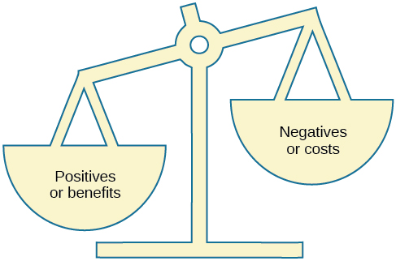

# 12.7 Hành Vi Vì Xã Hội (Prosocial Behavior)

> [!info]
>
> ### Mục Tiêu Học Tập
>
> Sau khi học xong phần này, bạn sẽ có thể:
>
> - Mô tả lòng vị tha
> - Mô tả các điều kiện ảnh hưởng đến sự hình thành các mối quan hệ
> - Xác định những yếu tố thu hút con người đến với nhau
> - Mô tả thuyết tam giác tình yêu
> - Giải thích thuyết trao đổi xã hội trong các mối quan hệ

Bạn đã tìm hiểu về nhiều hành vi tiêu cực trong tâm lý học xã hội, nhưng phân ngành này cũng nghiên cứu rất nhiều hành vi và tương tác xã hội tích cực.
Điều gì khiến con người yêu quý lẫn nhau?
Chúng ta kết bạn với ai?
Chúng ta hẹn hò với ai?
Các nhà nghiên cứu đã ghi nhận một số đặc điểm của hoàn cảnh tình huống có ảnh hưởng đến việc liệu chúng ta có thiết lập mối quan hệ với người khác hay không.
Ngoài ra còn có những nét tính cách phổ quát mà con người nhận thấy là hấp dẫn ở người khác.
Trong phần này, chúng ta sẽ thảo luận về những điều kiện làm cho việc hình thành các mối quan hệ trở nên khả dĩ hơn, những gì chúng ta tìm kiếm trong tình bạn và các mối quan hệ lãng mạn, các loại hình tình yêu khác nhau và một lý thuyết giải thích cách các mối quan hệ của chúng ta được hình thành, duy trì và chấm dứt.

## Hành Vi Vì Xã Hội Và Lòng Vị Tha

Bạn có tự nguyện giúp đỡ người khác không?
Hành vi tự nguyện với ý định giúp đỡ người khác được gọi là **hành vi vì xã hội** (prosocial behavior).
Tại sao con người lại giúp đỡ người khác?
Phải chăng lợi ích cá nhân, chẳng hạn như cảm giác hài lòng về bản thân, là lý do duy nhất khiến con người giúp đỡ lẫn nhau?
Nghiên cứu cho thấy có rất nhiều lý do khác.
**Lòng vị tha** (altruism) là mong muốn của con người nhằm giúp đỡ người khác ngay cả khi tổn thất hoặc chi phí lớn hơn nhiều so với lợi ích thu lại từ việc giúp đỡ.
Trên thực tế, những người hành động theo cách vị tha có thể hoàn toàn gạt bỏ những mất mát cá nhân gắn liền với việc giúp đỡ ([Hình 12.26](#CNX_Psych_12_06_altruism)).
Ví dụ, các bản tin về vụ tấn công khủng bố ngày 11/9 vào Trung tâm Thương mại Thế giới ở New York đã tường thuật về một nhân viên trong tòa tháp thứ nhất đã giúp các đồng nghiệp của mình đến được cầu thang thoát hiểm an toàn.
Sau khi đưa một đồng nghiệp đến nơi an toàn, anh đã quay trở lại tòa nhà đang bốc cháy để tiếp tục giúp đỡ những đồng nghiệp khác.
Trong trường hợp này, cái giá phải trả cho việc giúp đỡ là vô cùng lớn, và người anh hùng ấy đã hy sinh mạng sống của mình trong đống đổ nát (Stewart, 2002).

**Hình 12.26** Các sự kiện ngày 11/9 đã làm bùng nổ một biểu hiện to lớn về lòng vị tha và chủ nghĩa anh hùng từ phía lực lượng ứng cứu đầu tiên và rất nhiều người dân bình thường. (nguồn: Don Halasy)

Một số nhà nghiên cứu gợi ý rằng lòng vị tha vận hành dựa trên sự thấu cảm.
**Sự thấu cảm** (empathy) là năng lực thấu hiểu góc nhìn của người khác, cảm nhận những gì họ đang cảm nhận.
Một người giàu lòng thấu cảm sẽ tạo ra một sự kết nối cảm xúc với người khác và cảm thấy bị thôi thúc phải giúp đỡ (Batson, 1991).
Các nhà nghiên cứu khác lại lập luận rằng lòng vị tha là một hình thức giúp đỡ vị tha, không màng đến lợi ích hay cảm giác hài lòng về bản thân.
Chắc chắn rằng sau khi giúp đỡ, con người sẽ cảm thấy hài lòng về bản thân, nhưng một số nhà nghiên cứu cho rằng đây là một hệ quả của lòng vị tha chứ không phải nguyên nhân.
Những nhà nghiên cứu khác lại phản bác rằng hành vi giúp đỡ luôn mang tính tư lợi vì bản ngã (ego) của chúng ta có can dự vào, và chúng ta nhận được những lợi ích tâm lý từ việc giúp đỡ (Cialdini, Brown, Lewis, Luce, & Neuberg, 1997).
Thật khó để xác định bằng thực nghiệm động cơ thực sự của việc giúp đỡ, liệu nó chủ yếu là vì tư lợi (egoism) hay hoàn toàn vị tha (altruism).
Do đó, cuộc tranh luận về việc liệu lòng vị tha thuần túy có tồn tại hay không vẫn đang tiếp diễn.

> [!tip]
>
> ### Liên Kết Học Tập
>
> Xem đoạn trích này từ loạt phim truyền hình nổi tiếng [*Friends*, nơi chủ đề chủ nghĩa vị kỷ đối lập với lòng vị tha được tranh luận](https://openstax.org/l/friendsclip) để tìm hiểu thêm.

## Sự Hình Thành Các Mối Quan Hệ

Bạn nghĩ yếu tố đơn lẻ nào có ảnh hưởng lớn nhất trong việc quyết định bạn sẽ trở thành bạn bè với ai và bạn sẽ hình thành mối quan hệ lãng mạn với ai?
Bạn có thể ngạc nhiên khi biết rằng câu trả lời rất đơn giản: những người mà bạn có nhiều tiếp xúc nhất.
Yếu tố quan trọng nhất này chính là khoảng cách không gian (proximity).
Bạn có nhiều khả năng trở thành bạn bè với những người mà bạn thường xuyên tiếp xúc.
Ví dụ, hàng thập kỷ nghiên cứu đã chỉ ra rằng bạn có nhiều khả năng kết bạn với những người sống cùng ký túc xá, cùng tòa nhà chung cư hoặc ngay trong khu dân cư lân cận hơn là với những người sống ở xa (Festinger, Schachter, & Back, 1950).
Đơn giản là việc xây dựng mối quan hệ với những người bạn gặp thường xuyên dễ dàng hơn vì bạn có cơ hội để tìm hiểu họ.

Sự tương đồng là một yếu tố khác ảnh hưởng đến việc chúng ta hình thành mối quan hệ với ai.
Chúng ta có nhiều khả năng trở thành bạn bè hoặc người yêu của một người có nét tương đồng với chúng ta về bối cảnh xuất thân, thái độ và lối sống.
Trên thực tế, không có bằng chứng khoa học nào cho thấy hai cực trái dấu thì hút nhau.
Thay vào đó, chúng ta bị thu hút bởi những người giống chúng ta nhất ([Hình 12.27](#CNX_Psych_12_07_wedding)) (McPherson, Smith-Lovin, & Cook, 2001).
Tại sao bạn nghĩ chúng ta lại bị thu hút bởi những người tương đồng với mình?
Việc chia sẻ những điểm chung chắc chắn sẽ giúp bạn dễ dàng hòa hợp với người khác và tạo dựng các kết nối.
Khi bạn và một người khác chia sẻ cùng gu âm nhạc, sở thích, khẩu vị ăn uống, v.v., việc quyết định làm gì trong thời gian bên nhau có thể trở nên rất dễ dàng.
**Xu hướng đồng điệu** (homophily) là khuynh hướng con người hình thành các mạng lưới xã hội, bao gồm tình bạn, hôn nhân, quan hệ kinh doanh và nhiều loại mối quan hệ khác, với những người có nét tương đồng với bản thân (McPherson et al., 2001).

**Hình 12.27** Con người có xu hướng bị thu hút bởi những người có nét tương đồng. Nhiều cặp đôi chia sẻ chung một nền tảng văn hóa. Điều này có thể khá rõ ràng trong một nghi lễ như đám cưới, và tinh tế hơn (nhưng không kém phần quan trọng) trong sự vận hành hàng ngày của một mối quan hệ. (nguồn: sửa đổi từ tác phẩm của Shiraz Chanawala)

Tuy nhiên, xu hướng đồng điệu lại giới hạn sự tiếp xúc của chúng ta với tính đa dạng (McPherson et al., 2001).
Bằng cách chỉ hình thành các mối quan hệ với những người giống mình, chúng ta sẽ tạo ra các nhóm đồng nhất và sẽ không được tiếp xúc với những quan điểm khác biệt.
Nói cách khác, vì chúng ta có xu hướng dành thời gian cho những người giống mình nhất, chúng ta sẽ bị hạn chế tiếp xúc với những người khác biệt với mình, bao gồm những người thuộc các chủng tộc, sắc tộc, địa vị kinh tế xã hội và hoàn cảnh sống khác nhau.

Một khi chúng ta đã hình thành mối quan hệ với người khác, chúng ta khao khát sự tương hỗ.
**Sự tương hỗ** (reciprocity) là sự cho và nhận trong các mối quan hệ.
Chúng ta đóng góp vào mối quan hệ, nhưng chúng ta cũng kỳ vọng nhận lại được những lợi ích.
Nghĩa là, chúng ta muốn các mối quan hệ của mình phải là một con đường hai chiều.
Chúng ta có nhiều khả năng quý mến và gắn kết hơn với những người cũng thích chúng ta.
Sự bộc lộ bản thân là một phần của con đường hai chiều đó.
**Sự bộc lộ bản thân** (self-disclosure) là việc chia sẻ những thông tin mang tính cá nhân (Laurenceau, Barrett, & Pietromonaco, 1998).
Chúng ta hình thành những kết nối thân mật hơn với những người mà chúng ta chia sẻ những thông tin quan trọng về bản thân.
Thật vậy, sự bộc lộ bản thân là một đặc điểm của các mối quan hệ thân mật lành mạnh, miễn là thông tin được tiết lộ phù hợp với quan điểm của chính chúng ta (Cozby, 1973).

## Sự Thu Hút (Attraction)

Chúng ta đã thảo luận về cách khoảng cách địa lý và sự tương đồng dẫn đến việc hình thành các mối quan hệ, cũng như việc sự tương hỗ và sự bộc lộ bản thân rất quan trọng đối với việc duy trì mối quan hệ.
Nhưng những nét đặc điểm nào của một người khiến chúng ta cảm thấy bị thu hút?
Chúng ta không hình thành mối quan hệ với tất cả những người sống hoặc làm việc gần mình, vậy làm thế nào để chúng ta quyết định sẽ lựa chọn những cá nhân cụ thể nào làm bạn bè và người yêu?

Các nhà nghiên cứu đã ghi nhận một số đặc điểm mà con người nhận thấy là hấp dẫn.
Trước hết, chúng ta tìm kiếm những người bạn và người yêu hấp dẫn về mặt ngoại hình.
Mọi người có sự khác biệt về những gì họ coi là hấp dẫn, và sự hấp dẫn chịu ảnh hưởng của văn hóa.
Tuy nhiên, nghiên cứu gợi ý rằng một số đặc điểm hấp dẫn mang tính phổ quát ở phụ nữ bao gồm đôi mắt to, gò má cao, đường viền hàm thon gọn, vóc dáng mảnh mai (Buss, 1989) và tỷ lệ vòng eo trên hông thấp (Singh, 1993).
Đối với nam giới, các đặc điểm hấp dẫn bao gồm cao ráo, vai rộng và eo thon (Buss, 1989).
Cả nam giới và phụ nữ có mức độ đối xứng khuôn mặt và cơ thể cao nhìn chung đều được coi là hấp dẫn hơn những cá nhân bất đối xứng (Fink, Neave, Manning, & Grammer, 2006; Penton-Voak et al., 2001; Rikowski & Grammer, 1999).
Các đặc điểm xã hội mà con người thấy hấp dẫn ở bạn đời nữ tiềm năng bao gồm sự ấm áp, tình cảm và kỹ năng xã hội; ở nam giới, các đặc điểm hấp dẫn bao gồm thành tựu, phẩm chất lãnh đạo và kỹ năng nghề nghiệp (Regan & Berscheid, 1997).
Mặc dù con người muốn có những người bạn đời hấp dẫn về mặt thể chất, nhưng điều này không có nghĩa là chúng ta tìm kiếm người hấp dẫn nhất có thể.
Trên thực tế, quan sát này đã khiến một số người đề xuất giả thuyết tương xứng (matching hypothesis)—khẳng định rằng con người có xu hướng chọn một người mà họ coi là ngang bằng với mình về độ hấp dẫn ngoại hình và mức độ đáng mong muốn về mặt xã hội (Taylor, Fiore, Mendelsohn, & Cheshire, 2011).
Ví dụ, bạn và hầu hết những người bạn biết có thể sẽ nói rằng một ngôi sao điện ảnh vô cùng quyến rũ là “vượt quá tầm với” của bạn.
Vì vậy, ngay cả khi bạn có khoảng cách gần gũi với người đó, bạn cũng có thể sẽ không mở lời rủ họ đi hẹn hò vì bạn tin rằng mình nhiều khả năng sẽ bị từ chối.
Con người cân nhắc độ hấp dẫn của một đối tác tiềm năng so với xác suất thành công với người đó.
Nếu bạn nghĩ mình đặc biệt kém hấp dẫn (ngay cả khi thực tế không phải vậy), bạn có khả năng sẽ tìm kiếm những đối tác khá kém hấp dẫn (nghĩa là kém hấp dẫn về ngoại hình hoặc trong hành vi).

## Thuyết Tam Giác Tình Yêu Của Sternberg

Chúng ta thường yêu thương những người mà chúng ta tạo dựng mối quan hệ, nhưng kiểu tình yêu mà chúng ta dành cho gia đình, bạn bè và người yêu lại có sự khác biệt.
Robert Sternberg (1986) đề xuất rằng có ba thành phần cấu thành nên tình yêu: sự thân mật (intimacy), niềm đam mê (passion) và sự cam kết (commitment).
Ba thành phần này tạo thành một hình tam giác xác định nhiều loại hình tình yêu: điều này được gọi là **thuyết tam giác tình yêu của Sternberg** ([Hình 12.28](#CNX_Psych_12_07_love)).
Sự thân mật là việc chia sẻ những chi tiết cùng suy nghĩ và cảm xúc thầm kín.
Niềm đam mê là sự hấp dẫn về thể xác—ngọn lửa bùng cháy.
Sự cam kết là việc luôn sát cánh bên đối phương—phần “khi mạnh khỏe cũng như lúc ốm đau” của mối quan hệ.

**Hình 12.28** Theo thuyết tam giác tình yêu của Sternberg, bảy kiểu tình yêu có thể được mô tả từ sự kết hợp của ba thành phần: sự thân mật, niềm đam mê và sự cam kết. (nguồn: sửa đổi từ tác phẩm của “Lnesa”/Wikimedia Commons)

Sternberg (1986) khẳng định rằng một mối quan hệ lành mạnh sẽ hội tụ đầy đủ cả ba thành phần của tình yêu—sự thân mật, niềm đam mê và sự cam kết—được mô tả là **tình yêu trọn vẹn / viên mãn** (consummate love) ([Hình 12.29](#CNX_Psych_12_07_couple)).
Tuy nhiên, các khía cạnh khác nhau của tình yêu có thể chiếm ưu thế hơn ở những giai đoạn cuộc đời khác nhau.
Các hình thức tình yêu khác bao gồm sự yêu thích (liking)—được định nghĩa là có sự thân mật nhưng không có đam mê hay cam kết.
Sự mê đắm (infatuation) là sự hiện diện của đam mê mà thiếu vắng sự thân mật hoặc cam kết.
Tình yêu rỗng (empty love) là có sự cam kết nhưng không có sự thân mật hay đam mê.
**Tình yêu đồng hành / bằng hữu** (companionate love)—đặc trưng của tình bạn thân thiết và các mối quan hệ gia đình—bao gồm sự thân mật và cam kết nhưng không có đam mê.
**Tình yêu lãng mạn** (romantic love) được định nghĩa là có đam mê và sự thân mật, nhưng thiếu đi sự cam kết.
Cuối cùng, tình yêu khờ khạo/hời hợt (fatuous love) được định nghĩa là có đam mê và cam kết, nhưng không có sự thân mật, chẳng hạn như một mối quan hệ tình ái thể xác lâu dài.
Bạn có thể mô tả những ví dụ khác về các mối quan hệ phù hợp với những kiểu tình yêu khác nhau này không?

**Hình 12.29** Theo Sternberg, tình yêu trọn vẹn mô tả một mối quan hệ lành mạnh chứa đựng sự thân mật, niềm đam mê và sự cam kết. (nguồn: Carloxito/Wikimedia)

## Thuyết Trao Đổi Xã Hội (Social Exchange Theory)

Chúng ta đã thảo luận về lý do tại sao chúng ta hình thành các mối quan hệ, điều gì thu hút chúng ta đến với người khác và các loại hình tình yêu khác nhau.
Nhưng điều gì quyết định việc liệu chúng ta có hài lòng và duy trì một mối quan hệ hay không?
Một lý thuyết đưa ra lời giải thích là thuyết trao đổi xã hội.
Theo **thuyết trao đổi xã hội** (social exchange theory), chúng ta hành động như những nhà kinh tế học ngây thơ trong việc theo dõi tỷ lệ chi phí và lợi ích của việc hình thành và duy trì mối quan hệ với người khác ([Hình 12.30](#CNX_Psych_12_07_exchange)) (Rusbult & Van Lange, 2003).

**Hình 12.30** Hành động giống như những nhà kinh tế học ngây thơ, con người có thể theo dõi chi phí và lợi ích của việc duy trì một mối quan hệ. Thông thường, chỉ những mối quan hệ mà trong đó lợi ích vượt trội hơn chi phí mới được duy trì.

Con người có động lực để tối đa hóa các lợi ích của các cuộc trao đổi xã hội, hay các mối quan hệ, và giảm thiểu tối đa các chi phí.
Con người thích có nhiều lợi ích hơn chi phí, hoặc có chi phí và lợi ích gần như ngang bằng nhau, nhưng hầu hết mọi người đều cảm thấy bất mãn nếu sự trao đổi xã hội tạo ra nhiều tổn thất/chi phí hơn là lợi ích.
Chúng ta hãy cùng thảo luận về một ví dụ: Nếu bạn từng quyết định cam kết gắn bó trong một mối quan hệ lãng mạn, có lẽ bạn đã cân nhắc những ưu điểm và nhược điểm của quyết định này.
Lợi ích của việc ở trong một mối quan hệ lãng mạn có cam kết là gì?
Bạn có thể đã cân nhắc việc có được sự bầu bạn, sự thân mật và niềm đam mê, nhưng cũng là sự thoải mái khi ở bên một người mà bạn hiểu rõ.
Chi phí của việc ở trong một mối quan hệ lãng mạn có cam kết là gì?
Bạn có thể nghĩ rằng theo thời gian, sự buồn chán khi chỉ ở bên một người duy nhất có thể xuất hiện; hơn nữa, việc chia sẻ các hoạt động như đi xem phim và đi ăn tối có thể khá tốn kém.
Tuy nhiên, các lợi ích của việc hẹn hò với người bạn đời lãng mạn có lẽ vượt trội hơn chi phí, nếu không bạn đã chẳng tiếp tục duy trì mối quan hệ đó.
