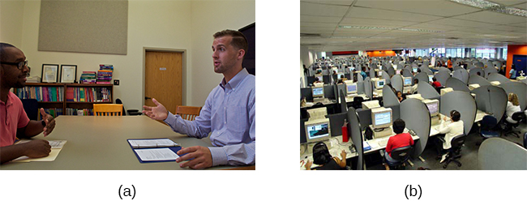
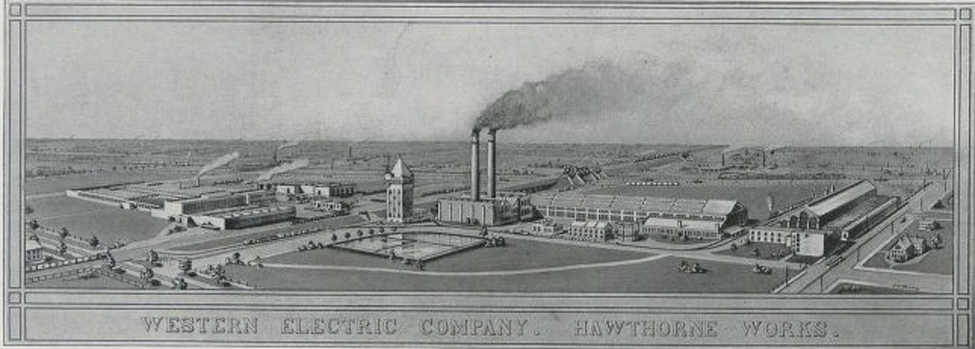
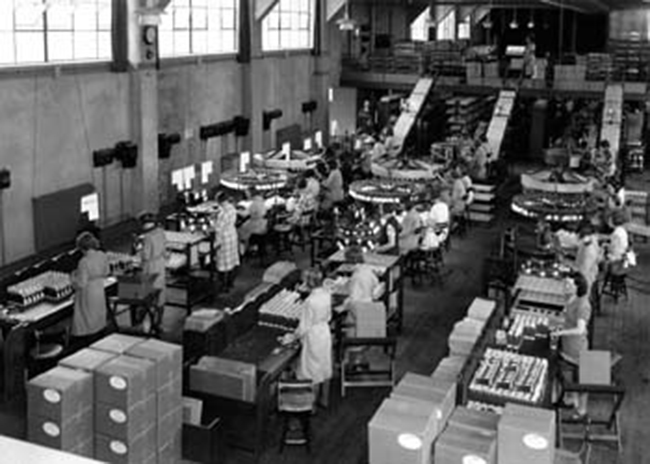
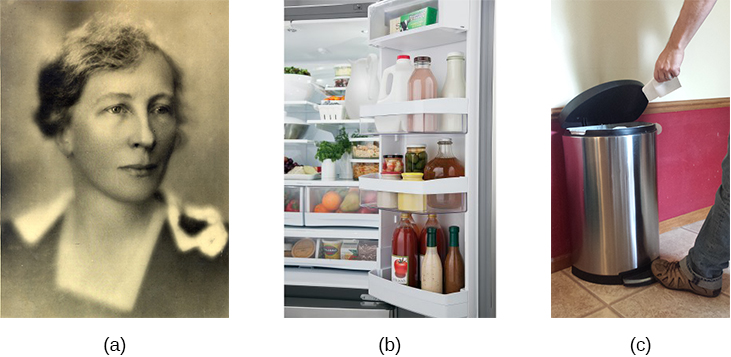

# 13.1 Tâm Lý Học Công Nghiệp Và Tổ Chức Là Gì? (What Is Industrial and Organizational Psychology?)

> [!info]
>
> ### Mục Tiêu Học Tập
>
> Sau khi học xong phần này, bạn sẽ có thể:
>
> - Hiểu được phạm vi nghiên cứu trong lĩnh vực tâm lý học công nghiệp và tổ chức
> - Mô tả lịch sử phát triển của tâm lý học công nghiệp và tổ chức

Vào năm 2019, những người làm việc tại Hoa Kỳ đã dành trung bình khoảng 42–54 giờ mỗi tuần cho công việc (Cục Thống kê Lao động—Bộ Lao động Hoa Kỳ, 2019).
Giấc ngủ là hoạt động duy nhất khác mà họ dành nhiều thời gian hơn với mức trung bình khoảng 43–62 giờ mỗi tuần.
Ngày làm việc chiếm một phần đáng kể trong thời gian và năng lượng của người lao động.
Nó tác động đến cuộc sống của họ và gia đình họ theo cả hai hướng thể chất và tâm lý, tích cực lẫn tiêu cực.
**Tâm lý học công nghiệp và tổ chức (I-O)** (industrial and organizational psychology) là một nhánh của tâm lý học nghiên cứu cách thức hành vi và tâm lý con người tác động đến công việc và cách chúng bị tác động ngược lại bởi công việc.

Các nhà tâm lý học công nghiệp và tổ chức làm việc trong bốn bối cảnh chính: học viện/đại học, chính phủ, các công ty tư vấn và doanh nghiệp.
Hầu hết các nhà tâm lý học I-O đều có bằng thạc sĩ hoặc tiến sĩ.
Lĩnh vực tâm lý học I-O có thể được chia thành ba mảng lớn ([Hình 13.2](#CNX_Psych_13_01_IOTypes) và [Hình 13.3](#CNX_Psych_13_01_HumFact)): tâm lý học công nghiệp, tâm lý học tổ chức và tâm lý học yếu tố con người.
**Tâm lý học công nghiệp** (industrial psychology) quan tâm đến việc mô tả các yêu cầu công việc và đánh giá khả năng đáp ứng những yêu cầu đó của các cá nhân.
Ngoài ra, khi nhân viên đã được tuyển dụng, tâm lý học công nghiệp sẽ nghiên cứu và phát triển các phương pháp đào tạo, đánh giá và phản hồi đối với những đánh giá đó.
Xuất phát từ sự quan tâm đến các đặc điểm của ứng viên, tâm lý học công nghiệp cũng phải xem xét các vấn đề pháp lý liên quan đến sự phân biệt đối xử trong tuyển dụng.
**Tâm lý học tổ chức** (organizational psychology) là một chuyên ngành quan tâm đến cách các mối quan hệ giữa các nhân viên tác động đến chính những nhân viên đó và hiệu quả hoạt động của doanh nghiệp.
Điều này bao gồm việc nghiên cứu mức độ thỏa mãn trong công việc, động lực làm việc và sự cam kết của người lao động.
Lĩnh vực này cũng nghiên cứu về quản trị, khả năng lãnh đạo và văn hóa tổ chức, cũng như cách thức các cấu trúc của tổ chức, phong cách quản lý và lãnh đạo, các chuẩn mực xã hội và kỳ vọng vai trò tác động đến hành vi của từng cá nhân.
Do quan tâm đến sức khỏe tinh thần và các mối quan hệ của người lao động, tâm lý học tổ chức cũng xem xét các chủ đề về sự quấy rối, bao gồm quấy rối tình dục và bạo lực tại nơi làm việc.
**Tâm lý học yếu tố con người** (human factors psychology) là môn khoa học nghiên cứu cách người lao động tương tác với các công cụ làm việc và cách thiết kế các công cụ đó nhằm tối ưu hóa năng suất, sự an toàn và sức khỏe của người lao động.
Những nghiên cứu này có thể liên quan đến các tương tác đơn giản như độ vừa vặn của bàn, ghế và máy tính đối với một con người phải ngồi trên ghế tại bàn làm việc sử dụng máy tính trong nhiều giờ mỗi ngày.
Chúng cũng có thể bao gồm việc kiểm tra cách con người tương tác với các màn hình hiển thị phức tạp và khả năng diễn giải chúng một cách chính xác và nhanh chóng.
Tại châu Âu, lĩnh vực này thường được gọi là công thái học (ergonomics).

**Hình 13.2** (a) Tâm lý học công nghiệp tập trung vào việc tuyển dụng và duy trì nhân viên. (b) Tâm lý học tổ chức quan tâm đến các mối quan hệ của nhân viên và văn hóa tổ chức. (nguồn a: sửa đổi từ tác phẩm của Cory Zanker; nguồn b: sửa đổi từ tác phẩm của Vitor Lima)

![Hình vẽ bao gồm hình minh họa cho thấy một người ngồi tại bàn làm việc. Các số đo được cung cấp thể hiện khoảng cách và góc thích hợp từ thiết bị làm việc. Các nhãn ghi như sau: Khoảng cách nhìn từ đầu đến màn hình nên từ 19–24 inch. Đối với góc nhìn, mắt phải ngang bằng với đỉnh màn hình. Ghế phải có phần hỗ trợ thắt lưng cho vùng lưng dưới. Cẳng tay và cánh tay trên phải tạo thành một góc 90 độ, với cổ tay thẳng trên bàn phím. Góc ngả lưng của ghế cũng phải là 90 độ, tương tự như góc uốn cong của đầu gối. Phần trên của đầu gối phải cách sàn từ 23 đến 28 inch. Nếu không thể đáp ứng khoảng cách này do tầm vóc thấp bé, nên sử dụng giá kê chân bên dưới bàn chân. Ghế phải có chiều cao điều chỉnh được để hỗ trợ tư thế theo các góc và khoảng cách đề xuất này. Hình vẽ cũng bao gồm ba bức ảnh thể hiện các không gian làm việc khác nhau: Ảnh đầu tiên chụp một người đàn ông ngồi trên một quả bóng tập thể dục tại bàn làm việc; Ảnh thứ hai chụp một người đàn ông đứng tại bàn làm việc; Ảnh thứ ba chụp một người đàn ông vừa đạp xe đạp tập thể dục cố định vừa làm việc tại bàn.](../../images/img_b2c1e4c1b4db.jpg)

**Hình 13.3** Tâm lý học yếu tố con người là môn học nghiên cứu về sự tương tác giữa con người, công cụ và hệ thống làm việc. (a) Tại bàn làm việc truyền thống, tư thế định vị nhất định là lý tưởng cho công thái học và sức khỏe. (b) Những bước phát triển gần đây trong không gian làm việc bao gồm các bàn làm việc nơi mọi người có thể ngồi trên bóng, đứng hoặc thậm chí đạp xe trong khi làm việc. (nguồn "ghế bóng": sửa đổi từ tác phẩm của Chris Rosario; nguồn "bàn đứng": sửa đổi từ tác phẩm của "juhansonin_Flickr"/Flickr; nguồn "bàn đạp xe": sửa đổi từ tác phẩm của "Benny Wong_Flickr"/Flickr)

Tâm lý học sức khỏe nghề nghiệp (Occupational health psychology - OHP) giải quyết các căng thẳng, bệnh tật và rối loạn có thể ảnh hưởng đến nhân viên do môi trường làm việc gây ra.
Do đó, lĩnh vực này được cung cấp thông tin từ các nghiên cứu thuộc các lĩnh vực y tế, sinh học, tâm lý học, tổ chức, yếu tố con người, nhân sự và công nghiệp.
Các cá nhân trong lĩnh vực này tìm cách xem xét những phương thức mà tổ chức tác động đến chất lượng đời sống làm việc của nhân viên và những phản ứng mà nhân viên dành cho tổ chức của họ hoặc do ảnh hưởng của tổ chức đối với họ.
Những phản ứng của nhân viên không chỉ giới hạn tại nơi làm việc vì có thể có sự lan tỏa vào đời sống cá nhân bên ngoài công việc của họ, đặc biệt nếu không có sự cân bằng tốt giữa công việc và cuộc sống.
Mục tiêu tối thượng của một nhà tâm lý học sức khỏe nghề nghiệp là cải thiện sức khỏe và sự an lạc tổng thể của một cá nhân, và nhờ đó nâng cao sức khỏe tổng thể của cả tổ chức (Hiệp hội Tâm lý học Sức khỏe Nghề nghiệp, 2020).

Vào năm 2009, lĩnh vực tâm lý học lao động nhân đạo (Humanitarian work psychology - HWP) đã được phát triển như một sáng kiến của một nhóm nhỏ các nhà tâm lý học I-O gặp nhau tại một hội nghị.
Nhận thấy họ có chung một tập hợp mục tiêu liên quan đến việc giúp đỡ những người có hoàn cảnh khó khăn và kém may mắn, các nhà tâm lý học I-O đã chính thức thành lập nhóm vào năm 2012 và hiện có khoảng 300 thành viên trên toàn thế giới.
Mặc dù đây là một con số khiêm tốn, nhóm vẫn tiếp tục mở rộng.
Nhóm tìm cách giúp các thành viên bị yếu thế ngoài lề trong xã hội, chẳng hạn như những người có thu nhập thấp, tìm được việc làm.
Ngoài ra, họ giúp xác định các phương thức chuyển giao viện trợ nhân đạo trong các thảm họa lớn.
Nhóm Tâm lý học Lao động Nhân đạo cũng có thể tiếp cận với những người trong cộng đồng địa phương, những người không có đủ kiến thức, kỹ năng và năng lực (KSAs - Knowledge, Skills, and Abilities) để có thể tìm được công việc có thu nhập thỏa đáng giúp họ không cần phải nhận trợ cấp.
Trong cả hai trường hợp, các nhà tâm lý học lao động nhân đạo đều cố gắng giúp các cá nhân kém may mắn phát triển các KSA mà họ có thể sử dụng để cải thiện cuộc sống và hoàn cảnh hiện tại của mình.
Khi đảm bảo những cá nhân có hoàn cảnh khó khăn này nhận được sự đào tạo hoặc giáo dục, trọng tâm được đặt vào các kỹ năng mà một khi đã học được sẽ không bao giờ bị lãng quên và có thể phục vụ các cá nhân trong suốt cuộc đời của họ khi tìm kiếm việc làm (APA, 2016). [Bảng 13.1](#Table_11_03_03) tóm tắt các lĩnh vực chính trong tâm lý học I-O, trọng tâm nghiên cứu và các công việc bên trong từng lĩnh vực.

**Các Lĩnh Vực Của Tâm Lý Học Công Nghiệp Và Tổ Chức**

| Lĩnh vực tâm lý học I-O | Mô tả | Các kiểu công việc |
| --- | --- | --- |
| Tâm lý học công nghiệp | Chuyên môn hóa và tập trung vào việc duy trì nhân viên và các quy trình tuyển dụng nhằm đảm bảo số lượng sa thải ít nhất và số lượng tuyển dụng đạt hiệu quả cao nhất tương ứng với quy mô của tổ chức. | Chuyên viên phân tích nhân sự, Nhà thiết kế chương trình đào tạo, Giáo sư, Chuyên viên phân tích nghiên cứu |
| Tâm lý học tổ chức | Nghiên cứu các mối quan hệ mà nhân viên phát triển với tổ chức của họ và ngược lại mà tổ chức phát triển với nhân viên. Ngoài ra, nghiên cứu các mối quan hệ phát triển giữa các đồng nghiệp và cách điều đó bị ảnh hưởng bởi các chuẩn mực tổ chức. | Chuyên viên nghiên cứu nhân sự (HR), Giáo sư, Cố vấn dự án, Nhà tâm lý học nhân sự, Nhà phát triển bài kiểm tra, Nhà phát triển đào tạo, Nhà phát triển năng lực lãnh đạo, Nhà phát triển tài năng |
| Yếu tố con người và kỹ thuật công thái học | Nghiên cứu những tiến bộ và thay đổi trong công nghệ nhằm nỗ lực cải thiện cách công nghệ được người tiêu dùng sử dụng, cho dù với các sản phẩm tiêu dùng, công nghệ, giao thông vận tải, môi trường làm việc hay truyền thông. Tìm cách dự đoán tốt hơn các cách thức mà con người có thể và sẽ sử dụng công nghệ cùng sản phẩm nhằm mang lại độ an toàn và độ tin cậy được nâng cao. | Giáo sư, Chuyên gia công thái học, Nhà khoa học an toàn, Cố vấn dự án, Thanh tra viên, Nhà khoa học nghiên cứu, Chuyên viên tiếp thị, Phát triển sản phẩm |
| Tâm lý học lao động nhân đạo | Làm việc để cải thiện điều kiện của các cá nhân phải đối mặt với thảm họa nghiêm trọng hoặc là một phần của nhóm dân số có hoàn cảnh khó khăn, yếu thế. Tập trung vào quan hệ lao động, tăng cường các dịch vụ y tế công cộng, các tác động đối với dân số do biến đổi khí hậu, suy thoái kinh tế và dịch bệnh. | Giáo sư, Nhà thiết kế chương trình đào tạo, Nhà khoa học nghiên cứu, Chuyên viên tư vấn, Cố vấn, Quản lý chương trình, Cán bộ ứng phó cấp cao |
| Tâm lý học sức khỏe nghề nghiệp | Quan tâm đến sự an lạc và sức khỏe tổng thể của cả nhân viên và tổ chức. | Nhà trị liệu nghề nghiệp, Nhà khoa học nghiên cứu, Cố vấn, Chuyên viên nhân sự (HR), Giáo sư |

**Bảng 13.1**

> [!tip]
>
> ### Liên Kết Học Tập
>
> Tìm hiểu những gì các nhà tâm lý học I-O làm trên trang web của [Hiệp hội Tâm lý học Công nghiệp và Tổ chức (SIOP)](https://openstax.org/l/siop)—một tổ chức nghề nghiệp dành cho những người làm việc trong chuyên ngành này.
> Trang web này cũng cung cấp một số hồ sơ cá nhân tiêu biểu của các nhà tâm lý học I-O.

## Lịch Sử Phát Triển Của Tâm Lý Học Công Nghiệp Và Tổ Chức

Tâm lý học công nghiệp và tổ chức có nguồn gốc từ đầu thế kỷ 20.
Một số nhà tâm lý học thời kỳ đầu có tầm ảnh hưởng lớn đã nghiên cứu các vấn đề mà ngày nay được phân loại là tâm lý học công nghiệp: James Cattell (1860–1944), Hugo Münsterberg (1863–1916), Walter Dill Scott (1869–1955), Robert Yerkes (1876–1956), Walter Bingham (1880–1952), và Lillian Gilbreth (1878–1972).
Cattell, Münsterberg và Scott từng là học trò của Wilhelm Wundt, người cha đẻ của tâm lý học thực nghiệm.
Một số nhà nghiên cứu này đã tham gia vào công việc trong lĩnh vực tâm lý học công nghiệp trước Thế chiến I.
Đóng góp của Cattell cho tâm lý học công nghiệp phần lớn được thể hiện qua việc ông thành lập một công ty tư vấn tâm lý mang tên Psychological Corporation (hiện vẫn đang hoạt động cho đến ngày nay), và qua những thành tựu của các sinh viên tại Đại học Columbia trong lĩnh vực tâm lý học công nghiệp.
Năm 1913, Münsterberg xuất bản cuốn *Psychology and Industrial Efficiency* (Tâm lý học và Hiệu quả Công nghiệp), đề cập đến các chủ đề như tuyển chọn nhân viên, đào tạo nhân viên và quảng cáo hiệu quả.

**Scott** là một trong những nhà tâm lý học đầu tiên áp dụng tâm lý học vào quảng cáo, quản lý và tuyển chọn nhân sự.
Năm 1903, Scott xuất bản hai cuốn sách: *The Theory of Advertising* (Lý thuyết Quảng cáo) và *Psychology of Advertising* (Tâm lý học Quảng cáo).
Đây là những cuốn sách đầu tiên mô tả việc sử dụng tâm lý học trong thế giới kinh doanh.
Đến năm 1911, ông đã xuất bản thêm hai cuốn sách nữa: *Influencing Men in Business* (Gây Ảnh hưởng Đến Con người trong Kinh doanh) và *Increasing Human Efficiency in Business* (Gia tăng Hiệu quả Con người trong Kinh doanh).
Năm 1916, một bộ phận mới thành lập tại Viện Công nghệ Carnegie đã tuyển dụng Scott để tiến hành nghiên cứu ứng dụng về tuyển chọn nhân viên (Katzell & Austin, 1992).

Trọng tâm của tất cả những nghiên cứu này là những gì ngày nay chúng ta gọi là tâm lý học công nghiệp; mãi về sau trong thế kỷ 20, lĩnh vực tâm lý học tổ chức mới phát triển thành một ngành khoa học thực nghiệm (Katzell & Austin, 1992).
Bên cạnh các vị trí học thuật, những nhà nghiên cứu này còn làm việc trực tiếp cho các doanh nghiệp với tư cách là chuyên gia tư vấn.

Khi Hoa Kỳ bước vào Thế chiến I vào tháng 4 năm 1917, công việc của các nhà tâm lý học thuộc chuyên ngành này đã mở rộng sang việc đóng góp cho các nỗ lực quân sự.
Vào thời điểm đó, Yerkes là chủ tịch của **Hiệp hội Tâm lý học Hoa Kỳ (APA)** tròn 25 năm tuổi.
APA là một hiệp hội nghề nghiệp tại Hoa Kỳ dành cho các nhà tâm lý học lâm sàng và nghiên cứu.
Ngày nay, APA thực hiện nhiều chức năng bao gồm tổ chức các hội nghị, kiểm định các chương trình cấp bằng đại học và xuất bản các tạp chí khoa học.
Yerkes đã tổ chức một nhóm trực thuộc Văn phòng Tổng Y sĩ (SGO) để phát triển các phương pháp sàng lọc và tuyển chọn binh lính nhập ngũ.
Họ đã phát triển bài trắc nghiệm Army Alpha để đo lường các khả năng trí tuệ.
Bài trắc nghiệm Army Beta là một dạng bài kiểm tra phi ngôn ngữ được thực hiện cho những tân binh mù chữ và không nói được tiếng Anh.
Scott và Bingham đã tổ chức một nhóm trực thuộc Văn phòng Tổng Quân thư (AGO) với mục tiêu phát triển các phương pháp tuyển chọn sĩ quan.
Họ đã tạo ra một danh mục các nhu cầu nghề nghiệp cho Quân đội, về cơ bản là một hệ thống mô tả công việc và một hệ thống xếp hạng hiệu suất cùng các bài kiểm tra kỹ năng nghề nghiệp cho sĩ quan (Katzell & Austin, 1992).
Sau chiến tranh, công việc về tuyển chọn nhân sự vẫn tiếp tục.
Ví dụ, Millicent Pond đã nghiên cứu việc tuyển chọn công nhân nhà máy, so sánh kết quả của các bài kiểm tra trước tuyển dụng với các chỉ số khác nhau về hiệu quả công việc (Vinchur & Koppes, 2014).

Từ năm 1929 đến năm 1932, Elton Mayo (1880–1949) và các đồng nghiệp của ông đã bắt đầu một loạt các nghiên cứu tại một nhà máy gần Chicago, mang tên Hawthorne Works của Western Electric ([Hình 13.4](#CNX_Psych_13_01_Hawthorne)).
Dự án dài hạn này đã đưa tâm lý học công nghiệp vượt ra khỏi phạm vi tuyển chọn và bố trí nhân viên đơn thuần để tiến tới nghiên cứu các vấn đề phức tạp hơn về các mối quan hệ giữa các cá nhân, động lực và các động lực của tổ chức.
Những nghiên cứu này đánh dấu sự khởi đầu của tâm lý học tổ chức.
Ban đầu chúng khởi đầu như những nghiên cứu về tác động của môi trường làm việc vật lý (ví dụ: mức độ ánh sáng trong nhà máy), nhưng các nhà nghiên cứu phát hiện ra rằng các yếu tố tâm lý và xã hội trong nhà máy lại đáng quan tâm hơn nhiều so với các yếu tố vật lý.
Những nghiên cứu này cũng xem xét cách các yếu tố tương tác giữa con người với nhau, chẳng hạn như phong cách giám sát, đã làm tăng hoặc giảm năng suất lao động ra sao.

**Hình 13.4** Nhà máy Hawthorne Works đã cung cấp bối cảnh cho một số nghiên cứu I-O thời kỳ đầu.

Phân tích các phát hiện của các nhà nghiên cứu sau này đã dẫn đến thuật ngữ **hiệu ứng Hawthorne** (Hawthorne effect), mô tả sự gia tăng hiệu suất làm việc của các cá nhân khi họ nhận thức được rằng mình đang được các nhà nghiên cứu hoặc cấp trên quan sát ([Hình 13.5](#CNX_Psych_13_01_Employees)).
Những gì các nhà nghiên cứu ban đầu phát hiện ra là bất kỳ sự thay đổi nào trong một biến số, chẳng hạn như mức độ ánh sáng, đều dẫn đến sự cải thiện về năng suất; điều này đúng ngay cả khi sự thay đổi mang tính tiêu cực, chẳng hạn như việc quay trở lại điều kiện ánh sáng kém.
Hiệu ứng này sẽ mờ nhạt dần khi sự chú ý giảm đi (Roethlisberger & Dickson, 1939).
Khái niệm hiệu ứng Hawthorne vẫn tồn tại cho đến ngày nay như một sự cân nhắc thực nghiệm quan trọng trong nhiều lĩnh vực và là một yếu tố bắt buộc phải được kiểm soát trong một thí nghiệm.
Nói cách khác, một biện pháp can thiệp thực nghiệm nào đó có thể tạo ra hiệu quả chỉ đơn giản là vì nó liên quan đến sự chú ý lớn hơn của các nhà nghiên cứu dành cho những người tham gia (McCarney et al., 2007).

**Hình 13.5** Các nhà nghiên cứu phát hiện ra rằng nhân viên làm việc hiệu quả hơn khi các nhà nghiên cứu hoặc người giám sát quan sát và tương tác với họ—một động lực tâm lý được gọi là hiệu ứng Hawthorne.

> [!tip]
>
> ### Liên Kết Học Tập
>
> Xem [video về các lời kể trực tiếp từ những nghiên cứu Hawthorne ban đầu](https://openstax.org/l/ATT) này để tìm hiểu thêm.

Vào những năm 1930, các nhà nghiên cứu bắt đầu tìm hiểu về cảm xúc của nhân viên đối với công việc của họ.
Kurt Lewin cũng đã tiến hành nghiên cứu về tác động của các phong cách lãnh đạo khác nhau, cấu trúc nhóm và động lực nhóm (Katzell & Austin, 1992).
Lewin được coi là người sáng lập ra ngành tâm lý học xã hội và phần lớn các công trình của ông cùng các học trò đã tạo ra những kết quả có ảnh hưởng quan trọng trong tâm lý học tổ chức.
Nghiên cứu của Lewin và các học trò bao gồm một nghiên cứu quan trọng thời kỳ đầu sử dụng trẻ em để tìm hiểu tác động của phong cách lãnh đạo đối với hành vi hung tính, động lực nhóm và sự thỏa mãn (Lewin, Lippitt, & White, 1939).
Lewin cũng là người đã đặt ra thuật ngữ *động lực nhóm* (group dynamics), và ông đã tham gia vào các nghiên cứu về các tương tác nhóm, sự hợp tác, cạnh tranh và giao tiếp có liên quan mật thiết đến tâm lý học tổ chức.

Song song với những nghiên cứu này trong tâm lý học công nghiệp và tổ chức, lĩnh vực tâm lý học yếu tố con người cũng đang phát triển.
Frederick **Taylor** là một kỹ sư đã nhận thấy rằng nếu người ta có thể thiết kế lại nơi làm việc, sẽ có sự gia tăng về cả sản lượng cho công ty lẫn tiền lương cho người lao động.
Năm 1911, ông đã đưa ra lý thuyết của mình trong một cuốn sách có tựa đề *The Principles of Scientific Management* (Các Nguyên lý Quản trị Khoa học) ([Hình 13.6](#CNX_Psych_13_01_Taylor)).
Cuốn sách của ông xem xét các lý thuyết quản lý, tuyển chọn và đào tạo nhân sự, cũng như bản thân công việc, bằng cách sử dụng các nghiên cứu thời gian và chuyển động (time and motion studies).
Taylor lập luận rằng mục tiêu chính của ban quản lý phải là kiếm được nhiều tiền nhất cho người sử dụng lao động, cùng với kết quả tốt nhất cho người lao động.
Ông tin rằng kết quả tốt nhất cho người lao động và ban quản lý sẽ đạt được thông qua đào tạo và phát triển để mỗi nhân viên có thể cung cấp công việc tốt nhất.
Ông tin rằng bằng cách tiến hành các nghiên cứu thời gian và chuyển động cho cả tổ chức và người lao động, lợi ích tốt nhất của cả hai bên đều được giải quyết.
Nghiên cứu thời gian và chuyển động là các phương pháp nhằm cải thiện công việc bằng cách chia các loại thao tác khác nhau thành các phần có thể đo lường được.
Các phân tích này được sử dụng để chuẩn hóa công việc và kiểm tra tính hiệu quả của con người và thiết bị.

Tuyển chọn nhân sự là một quy trình được nhân viên tuyển dụng trong công ty sử dụng để tuyển dụng và lựa chọn những ứng viên tốt nhất cho công việc.
Việc đào tạo có thể cần được tiến hành tùy thuộc vào những kỹ năng mà ứng viên được tuyển dụng có.
Thông thường các công ty sẽ tuyển dụng một người có tính cách phù hợp với những người khác nhưng có thể còn thiếu các kỹ năng.
Kỹ năng có thể được dạy, nhưng tính cách thì không thể dễ dàng thay đổi.

**Hình 13.6** (a) Frederick Taylor (1911) đã nỗ lực thiết kế các nơi làm việc để tăng năng suất, dựa trên những ý tưởng mà ông đã nêu ra trong (b) cuốn sách của mình, *The Principles of Scientific Management*. (c) Taylor đã thiết kế chiếc búa hơi nước này tại Công ty Thép Midvale. (nguồn c: sửa đổi từ tác phẩm của “Kheel Center, Đại học Cornell”/Flickr)

Một trong những ví dụ về lý thuyết của Taylor trong thực tế liên quan đến những công nhân bốc dỡ các thỏi gang nặng.
Taylor đã chỉ ra rằng công nhân có thể làm việc năng suất hơn bằng cách có các khoảng nghỉ ngơi trong giờ làm việc.
Phương pháp nghỉ ngơi này đã làm tăng năng suất của công nhân từ 12,5 lên 47,0 tấn vận chuyển mỗi ngày với mức độ mệt mỏi được báo cáo ít hơn, đồng thời tăng tiền lương cho những công nhân được trả theo tấn.
Đồng thời, chi phí của công ty đã giảm từ 9,2 xu xuống còn 3,9 xu mỗi tấn.
Bất chấp những sự gia tăng về năng suất này, lý thuyết của Taylor đã vấp phải rất nhiều sự chỉ trích vào thời điểm đó vì người ta tin rằng nó sẽ bóc lột công nhân và làm giảm số lượng công nhân cần thiết.
Một khái niệm gây tranh cãi khác là quan niệm ngầm định cho rằng chỉ có người quản lý mới có thể xác định được phương pháp làm việc hiệu quả nhất, và khi làm việc, người công nhân không có khả năng làm được điều này.
Lý thuyết của Taylor được củng cố bởi quan niệm rằng người công nhân về cơ bản là lười biếng và mục tiêu của tiếp cận quản trị khoa học của Taylor là tối đa hóa năng suất mà không mấy bận tâm đến sức khỏe tinh thần của người lao động.
Cách tiếp cận của ông đã bị các công đoàn và những người có thiện cảm với công nhân chỉ trích gay gắt (Van De Water, 1997).

**Gilbreth** là một nhà tâm lý học I-O có tầm ảnh hưởng lớn khác, người đã nỗ lực tìm cách gia tăng năng suất ([Hình 13.7](#CNX_Psych_13_01_Gilbreth)).
Bằng cách sử dụng các nghiên cứu thời gian và chuyển động, Gilbreth và chồng bà, Frank, đã nỗ lực giúp công nhân làm việc hiệu quả hơn bằng cách giảm số lượng chuyển động cần thiết để thực hiện một nhiệm vụ.
Bà đã áp dụng các phương pháp này không chỉ trong công nghiệp mà còn trong gia đình, văn phòng, cửa hàng và các khu vực khác.
Bà đã điều tra sự mệt mỏi của nhân viên và căng thẳng trong việc quản lý thời gian và nhận thấy nhiều nhân viên được thúc đẩy bởi tiền bạc và sự thỏa mãn trong công việc.
Năm 1914, Gilbreth đã viết cuốn sách *The Psychology of Management: The Function of the Mind in Determining, Teaching, and Installing Methods of Least Waste* (Tâm lý học Quản trị: Chức năng của Tâm trí trong việc Xác định, Giảng dạy và Thiết lập các Phương pháp Ít lãng phí nhất), và bà được mệnh danh là mẹ đẻ của nền quản trị hiện đại.
Một số đóng góp của Gilbreth vẫn còn được sử dụng cho đến ngày nay: bạn có thể cảm ơn bà vì ý tưởng đặt các ngăn giá đỡ bên trong cửa tủ lạnh, và bà cũng là người đã nảy ra ý tưởng sử dụng bàn đạp chân để mở nắp thùng rác (Gilbreth, 1914, 1998; Koppes, 1997; Lancaster, 2004).
Gilbreth là người phụ nữ đầu tiên gia nhập Hiệp hội Kỹ sư Cơ khí Hoa Kỳ vào năm 1926, và vào năm 1966, bà đã được trao Huy chương Hoover của Hiệp hội Kỹ sư Xây dựng Hoa Kỳ.

Công trình của Taylor và Gilbreth đã cải thiện năng suất, nhưng những đổi mới này cũng cải thiện sự phù hợp giữa công nghệ và con người sử dụng nó.
Nghiên cứu về sự phù hợp giữa máy móc và con người được gọi là công thái học (ergonomics) hoặc tâm lý học yếu tố con người.

**Hình 13.7** (a) Lillian Gilbreth đã nghiên cứu những cải tiến về hiệu quả có thể áp dụng tại nơi làm việc, gia đình và các lĩnh vực khác. Bà được ghi nhận với ý tưởng (b) đặt các kệ ngăn bên trong cánh cửa tủ lạnh và (c) thùng rác vận hành bằng bàn đạp chân. (nguồn b: sửa đổi từ tác phẩm của “Goedeker’s”/Flickr; nguồn c: sửa đổi từ tác phẩm của Kerry Ceszyk)

## Từ Thế Chiến II Cho Đến Ngày Nay

Thế chiến II cũng thúc đẩy sự mở rộng của tâm lý học công nghiệp.
Bingham được tuyển dụng làm nhà tâm lý học trưởng cho Bộ Chiến tranh (nay là Bộ Quốc phòng) và đã phát triển các hệ thống mới cho việc tuyển chọn, phân loại, đào tạo và đánh giá hiệu suất công việc, cùng các phương pháp phát triển đội ngũ, thay đổi tinh thần và thay đổi thái độ (Katzell & Austin, 1992).
Các quốc gia khác, chẳng hạn như Canada và Vương quốc Anh, cũng chứng kiến sự phát triển của tâm lý học I-O trong Thế chiến II (McMillan, Stevens, & Kelloway, 2009).
Trong những năm sau chiến tranh, cả tâm lý học công nghiệp và tâm lý học tổ chức đều trở thành những lĩnh vực nỗ lực nghiên cứu quan trọng.
Những mối lo ngại về tính công bằng của các bài kiểm tra tuyển dụng đã nảy sinh, và các thiên kiến về sắc tộc và giới tính trong các bài kiểm tra khác nhau đã được đánh giá với những kết quả trái chiều.
Ngoài ra, rất nhiều nghiên cứu đã đi sâu vào việc tìm hiểu sự thỏa mãn trong công việc và động lực của nhân viên (Katzell & Austin, 1992).

Nghiên cứu và công việc của các nhà tâm lý học I-O trong các lĩnh vực tuyển chọn, bố trí nhân viên và đánh giá hiệu suất ngày càng trở nên quan trọng vào những năm 1960.
Khi Quốc hội Hoa Kỳ thông qua Đạo luật Dân quyền năm 1964, Tiêu đề VII đã bao hàm điều được gọi là cơ hội việc làm bình đẳng.
Luật này bảo vệ người lao động chống lại sự phân biệt đối xử dựa trên chủng tộc, màu da, tôn giáo, giới tính hoặc nguồn gốc quốc gia, cũng như sự phân biệt đối xử đối với một nhân viên vì có mối liên hệ với một cá nhân thuộc một trong các danh mục này.

Các tổ chức đã phải điều chỉnh để thích nghi với bối cảnh xã hội, chính trị và pháp lý của phong trào Dân quyền, và những vấn đề này cần phải được các thành viên của I-O giải quyết trong cả nghiên cứu lẫn thực hành.

Có rất nhiều lý do để các tổ chức quan tâm đến I-O để họ có thể hiểu rõ hơn về tâm lý của người lao động, điều này giúp họ hiểu cách các tổ chức của mình có thể trở nên năng suất hơn và có tính cạnh tranh cao hơn.
Ví dụ, hầu hết các tổ chức lớn hiện đang cạnh tranh ở cấp độ toàn cầu, và họ cần hiểu cách tạo động lực cho người lao động để đạt được năng suất và hiệu quả cao.
Hầu hết các công ty cũng có lực lượng lao động đa dạng và cần hiểu sự phức tạp về mặt tâm lý của những con người thuộc các nền tảng đa dạng này.

Ngày nay, tâm lý học I-O là một lĩnh vực nghiên cứu và thực hành đa dạng và sâu sắc, như bạn sẽ tìm hiểu trong phần còn lại của chương này.
**Hiệp hội Tâm lý học Công nghiệp và Tổ chức (SIOP)**, một phân hội của APA, có tới 8.000 thành viên (SIOP, 2014) và Cục Thống kê Lao động—Bộ Lao động Hoa Kỳ (2013) đã dự đoán nghề nghiệp này sẽ có mức tăng trưởng lớn nhất trong tất cả các phân loại công việc trong vòng 20 năm sau năm 2012.
Trung bình, một người có bằng thạc sĩ về tâm lý học công nghiệp - tổ chức sẽ kiếm được hơn 80.000 đô la một năm, trong khi một người có bằng tiến sĩ sẽ kiếm được hơn 110.000 đô la một năm (Khanna, Medsker, & Ginter, 2012).
