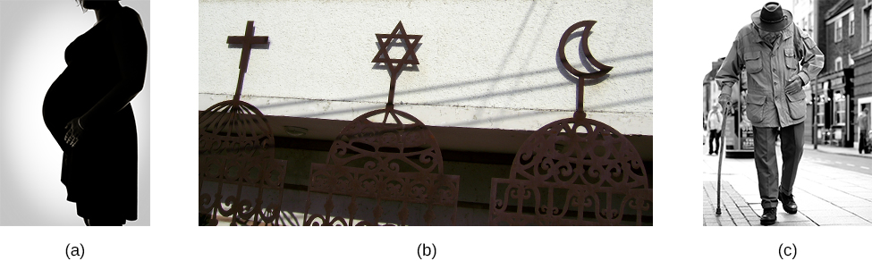

# 13.2 Tâm lý học công nghiệp: Tuyển chọn và đánh giá nhân viên

> [!info]
>
> ### Mục tiêu học tập
>
> Đến cuối phần này, bạn sẽ có thể:
>
> - Giải thích các khía cạnh của quá trình tuyển chọn nhân viên
> - Mô tả các hình thức đào tạo nghề nghiệp
> - Mô tả các phương pháp tiếp cận và những vấn đề xung quanh việc đánh giá hiệu quả công việc

Nhánh tâm lý học I-O được gọi là tâm lý học công nghiệp tập trung vào việc xác định và ghép nối con người với các nhiệm vụ trong một tổ chức.
Quá trình này bao gồm **phân tích công việc** (job analysis), tức là mô tả một cách chính xác nhiệm vụ hoặc vị trí công tác.
Sau đó, các tổ chức phải xác định các đặc điểm của ứng viên để xem xét mức độ phù hợp với bản phân tích công việc đó.
Lĩnh vực này cũng liên quan đến việc đào tạo nhân viên từ ngày đầu tiên nhận việc trong suốt quá trình công tác tại tổ chức, đồng thời đánh giá hiệu quả làm việc của họ trong suốt chặng đường đó.

## Tuyển chọn nhân viên

Khi đọc các mẩu quảng cáo tuyển dụng, bạn có bao giờ tự hỏi làm thế nào công ty đưa ra được bản mô tả công việc đó không?
Thông thường, điều này được thực hiện với sự trợ giúp của các nhà tâm lý học I-O. Có hai cách tiếp cận liên quan nhưng khác biệt đối với phân tích công việc—bạn có thể quen thuộc với kết quả của cả hai vì chúng thường xuất hiện trên cùng một thông báo tuyển dụng.
Cách tiếp cận thứ nhất định hướng theo nhiệm vụ (task-oriented), liệt kê chi tiết các nhiệm vụ sẽ được thực hiện trong công việc.
Mỗi nhiệm vụ thường được đánh giá theo các thang đo về mức độ thường xuyên thực hiện, mức độ khó khăn và tầm quan trọng của nó đối với công việc.
Cách tiếp cận thứ hai định hướng theo người lao động (worker-oriented).
Cách tiếp cận này mô tả các đặc điểm cần có ở người lao động để thực hiện thành công công việc.
Cách tiếp cận thứ hai này còn được gọi là tiêu chuẩn công việc (job specification) (Dierdorff & Wilson, 2003).
Đối với bản tiêu chuẩn công việc, kiến thức, kỹ năng và năng lực (knowledge, skills, and abilities - KSAs) mà công việc đòi hỏi sẽ được xác định.

Quan sát, khảo sát và phỏng vấn là những phương pháp được sử dụng để thu thập thông tin cần thiết cho cả hai loại phân tích công việc.
Người ta có thể quan sát một người thành thạo ở một vị trí và phân tích xem những kỹ năng nào được thể hiện rõ ràng.
Một cách tiếp cận khác là phỏng vấn những người hiện đang giữ vị trí đó, đồng nghiệp và cấp trên của họ để đạt được sự đồng thuận về những gì họ cho là yêu cầu của công việc.

Một bản phân tích công việc chính xác và đáng tin cậy đến mức nào?
Nghiên cứu cho thấy điều này có thể phụ thuộc vào bản chất của các mô tả và nguồn thông tin cho phân tích công việc.
Ví dụ, Dierdorff và Wilson (2003) phát hiện ra rằng các phân tích công việc được xây dựng từ các mô tả do chính những người đang làm công việc đó cung cấp lại kém tin cậy nhất; tuy nhiên, họ không nghiên cứu hoặc suy đoán lý do tại sao lại có hiện tượng này.

Bộ Lao động Hoa Kỳ duy trì một cơ sở dữ liệu về các bản phân tích công việc đã được biên soạn trước đó cho các công việc và nghề nghiệp khác nhau.
Điều này cho phép nhà tâm lý học I-O tiếp cận các phân tích trước đây cho hầu như bất kỳ loại ngành nghề nào.
Hệ thống này được gọi là **O*Net** (truy cập tại [www.onetonline.org](https://www.onetonline.org)).
Trang web này mở công khai và bạn có thể xem các KSA được liệt kê cho vị trí của chính bạn hoặc một vị trí mà bạn có thể tò mò ([Hình 13.8](#CNX_Psych_13_01_KSAs)).
Mỗi nghề nghiệp liệt kê các nhiệm vụ, kiến thức, kỹ năng, năng lực, bối cảnh làm việc, hoạt động làm việc, yêu cầu học vấn, sở thích, yêu cầu tính cách và phong cách làm việc được coi là cần thiết để thành công ở vị trí đó.
Bạn cũng có thể xem dữ liệu về thu nhập trung bình và dự báo tăng trưởng việc làm trong ngành đó.

![Ảnh chụp màn hình trang web có tên “O-net online”. Trang này là Báo cáo tóm tắt dành cho Lính cứu hỏa đô thị. Dưới tiêu đề là định nghĩa: “kiểm soát và dập tắt các đám cháy đô thị, bảo vệ tính mạng và tài sản, tiến hành các nỗ lực cứu nạn”. Có một danh sách các chức danh công việc được báo cáo bao gồm Nhân viên vận hành thiết bị, Đội trưởng cứu hỏa, Trưởng lực lượng cứu hỏa, Kỹ sư cứu hỏa, Nhân viên vận hành thiết bị cứu hỏa, Lính cứu hỏa, Nhân viên an toàn, Lính cứu hỏa tình nguyện. Trang bao gồm phần tóm tắt các nhiệm vụ gồm “Tìm kiếm các tòa nhà bị cháy để xác định vị trí nạn nhân hỏa hoạn, giải cứu nạn nhân khỏi các tòa nhà đang cháy, các di tích cổ và các mối nguy hiểm dưới nước, sơ cứu và hồi sức tim phổi cho người bị thương, trang bị các thiết bị như quần áo chống cháy và thiết bị trợ thở, đánh giá đám cháy cùng tình hình và báo cáo tình trạng cho cấp trên để nhận chỉ thị qua bộ đàm hai chiều”. Phần tóm tắt các kỹ năng công nghệ bao gồm “Phần mềm giao diện người dùng và truy vấn cơ sở dữ liệu—Affiliated Computer Services ACS Firehouse; hệ thống báo cáo sự cố hỏa hoạn Microsoft Access; phần mềm thư điện tử—phần mềm email; phần mềm bộ ứng dụng văn phòng—Corel WordPerfect Office Suit, Microsoft Office; phần mềm hệ điều hành—Microsoft Windows; phần mềm bảng tính—Microsoft Excel”.](../../images/img_38ba64a6b408.jpg)

**Hình 13.8** Cơ sở dữ liệu O*Net từ Bộ Lao động Hoa Kỳ cung cấp thông tin về nhiều ngành nghề khác nhau, bao gồm kiến thức, kỹ năng và năng lực mong muốn cho vị trí đó. Trong ví dụ này, kết quả tìm kiếm hiển thị thông tin liên quan đến công việc lính cứu hỏa đô thị.

> [!tip]
>
> ### Kết nối học tập
>
> Cơ sở dữ liệu O*Net mô tả các kỹ năng, kiến thức và trình độ học vấn cần thiết cho các ngành nghề, cũng như các kiểu tính cách và phong cách làm việc phù hợp nhất với vai trò đó.
> Hãy xem trang web này nói gì về việc trở thành một [nhân viên phục vụ trong nhà hàng](https://openstax.org/l/sumreport1) hoặc một [giáo viên tiểu học](https://openstax.org/l/sumreport2) hoặc một [nhà tâm lý học công nghiệp - tổ chức](https://openstax.org/l/sumreport3) để tìm hiểu thêm về các con đường sự nghiệp này.

### Phân tích và trắc nghiệm ứng viên

Một khi công ty xác định được các ứng viên tiềm năng cho một vị trí, kiến thức, kỹ năng và các năng lực khác của ứng viên phải được đánh giá và so sánh với bản mô tả công việc.
Những đánh giá này có thể bao gồm trắc nghiệm, phỏng vấn và các mẫu công việc hoặc bài tập tình huống.
Bạn đã học về các trắc nghiệm tính cách trong chương về nhân cách; trong bối cảnh I-O, chúng được sử dụng để xác định các đặc điểm tính cách của ứng viên nhằm nỗ lực ghép nối chúng với những nét tính cách đảm bảo hiệu quả làm việc tốt trong công việc.
Ví dụ, mức độ dễ chịu (agreeableness) cao có thể là điều mong muốn ở vị trí hỗ trợ khách hàng.
Tuy nhiên, không phải lúc nào cũng rõ ràng về cách tốt nhất để tương quan các đặc điểm tính cách với những dự đoán về hiệu quả công việc.
Có thể điểm số quá cao về tính dễ chịu lại thực sự là một trở ngại ở vị trí hỗ trợ khách hàng.
Ví dụ, nếu khách hàng có nhận thức sai lầm về một sản phẩm hoặc dịch vụ, việc đồng tình với nhận thức sai lầm của họ cuối cùng sẽ không dẫn đến việc giải quyết khiếu nại của họ.
Bất kỳ việc sử dụng trắc nghiệm tính cách nào cũng nên đi kèm với một đánh giá đã được kiểm chứng về việc điểm số nào trong bài kiểm tra tương quan với hiệu quả làm việc tốt (Arthur, Woehr, & Graziano, 2001).
Các loại bài kiểm tra khác có thể được giao cho ứng viên bao gồm kiểm tra chỉ số thông minh (IQ), kiểm tra tính chính trực (integrity tests) và kiểm tra thể chất, chẳng hạn như xét nghiệm ma túy hoặc kiểm tra thể lực.

Để hiểu rõ hơn về quy trình tuyển dụng, chúng ta hãy xem xét một trường hợp ví dụ.
Một công ty xác định có một vị trí còn trống và đăng quảng cáo tuyển dụng.
Trưởng phòng nhân sự (HR) chỉ đạo nhóm tuyển dụng bắt đầu quy trình tuyển dụng.
Imani nhìn thấy quảng cáo và nộp sơ yếu lý lịch (CV), hồ sơ này được đưa vào tập hợp các hồ sơ ứng viên.
Nhóm nhân sự đã xem xét hồ sơ năng lực của các ứng viên và cung cấp danh sách các ứng viên tiềm năng tốt nhất cho người quản lý bộ phận; người này sau đó đã liên hệ với họ (bao gồm cả Imani) để sắp xếp các cuộc phỏng vấn cá nhân.

> [!question]
>
> ### Bạn nghĩ sao?
>
> #### Sử dụng điểm chuẩn cắt (Cutoff Scores) để xác định việc tuyển dụng
>
> Nhiều vị trí yêu cầu người nộp đơn phải làm các bài kiểm tra như một phần của quá trình tuyển chọn.
> Những bài kiểm tra này có thể bao gồm bài kiểm tra IQ, bài kiểm tra kỹ năng chuyên môn cụ thể hoặc trắc nghiệm tính cách.
> Tổ chức có thể đặt ra điểm cắt (cutoff scores - tức là mức điểm mà nếu ở dưới mức đó, ứng viên sẽ không được xem xét tiếp) cho mỗi bài kiểm tra để xác định xem người nộp đơn có bước tiếp vào giai đoạn sau hay không.
> Ví dụ, có trường hợp của Robert Jordan, một cử nhân đại học 49 tuổi, người đã nộp đơn xin việc vào lực lượng cảnh sát ở New London, Connecticut.
> Là một phần của quy trình tuyển chọn, Jordan đã làm bài kiểm tra nhân sự Wonderlic Personnel Test (WPT), một bài kiểm tra được thiết kế để đo lường năng lực nhận thức.
>
> Jordan đã không lọt vào vòng phỏng vấn vì điểm WPT của ông là 33, tương đương với điểm IQ là 125 (100 là điểm IQ trung bình), mức điểm này bị coi là quá cao.
> Chính sách của sở cảnh sát New London là không phỏng vấn bất kỳ ai có điểm WPT trên 27 (tương đương với điểm IQ trên 104) vì họ tin rằng bất kỳ ai đạt điểm cao hơn sẽ thấy nhàm chán với công việc cảnh sát.
> Điểm trung bình của các sĩ quan cảnh sát trên toàn quốc tương đương với điểm IQ là 104 (*Jordan v.
> New London*, 2000; ABC News, 2000).
>
> Jordan đã kiện sở cảnh sát với cáo buộc rằng việc ông bị từ chối là sự phân biệt đối xử và các quyền công dân của ông đã bị vi phạm vì ông bị từ chối quyền được bảo vệ bình đẳng trước pháp luật.
> Tòa Phúc thẩm Liên bang Khu vực 2 đã giữ nguyên phán quyết của tòa án cấp dưới rằng thành phố New London không phân biệt đối xử với ông vì các tiêu chuẩn tương tự đã được áp dụng cho tất cả những người tham gia kỳ thi (The New York Times, 1999).
>
> Bạn nghĩ sao?
> Khi nào thì các mức điểm cắt phổ quát có ý nghĩa hợp lý trong quyết định tuyển dụng, và khi nào chúng có thể loại bỏ những nhân viên có tiềm năng xuất sắc?

### Phỏng vấn

Hầu hết các công việc tại các doanh nghiệp quy mô vừa và lớn ở Hoa Kỳ đều yêu cầu một cuộc phỏng vấn trực tiếp như một bước trong quy trình tuyển chọn.
Bởi vì phỏng vấn được sử dụng rất phổ biến, chúng đã trở thành chủ đề của nhiều nghiên cứu đáng kể của các nhà tâm lý học công nghiệp.
Thông tin thu được từ phân tích công việc thường tạo thành cơ sở cho các loại câu hỏi được đưa ra.
Phỏng vấn có thể cung cấp một nguồn thông tin năng động hơn về ứng viên so với các biện pháp kiểm tra tiêu chuẩn.
Điều quan trọng là các yếu tố xã hội và ngôn ngữ cơ thể có thể ảnh hưởng đến kết quả của cuộc phỏng vấn.
Những yếu tố này bao gồm mức độ tương đồng giữa ứng viên với người phỏng vấn và các hành vi phi ngôn ngữ, chẳng hạn như cử chỉ tay, gật đầu và mỉm cười (Bye, Horverak, Sandal, Sam, & Vivjer, 2014; Rakić, Steffens, & Mummendey, 2011).

Có hai loại phỏng vấn: phỏng vấn phi cấu trúc và phỏng vấn có cấu trúc.
Trong một cuộc phỏng vấn phi cấu trúc, người phỏng vấn có thể đặt các câu hỏi khác nhau cho từng ứng viên khác nhau.
Một ứng viên có thể được hỏi về mục tiêu nghề nghiệp của cô ấy, còn một ứng viên khác có thể được hỏi về kinh nghiệm làm việc trước đây của anh ấy.
Trong một cuộc phỏng vấn phi cấu trúc, các câu hỏi thường (mặc dù không phải luôn luôn) không được xác định trước.
Và trong phỏng vấn phi cấu trúc, câu trả lời cho các câu hỏi thường không được cho điểm theo một hệ thống tiêu chuẩn.
Trong một cuộc phỏng vấn có cấu trúc, người phỏng vấn đặt cùng một bộ câu hỏi cho mọi ứng viên, các câu hỏi được chuẩn bị trước và người phỏng vấn sử dụng một hệ thống đánh giá chuẩn hóa cho từng câu trả lời.
Với cách tiếp cận này, người phỏng vấn có thể so sánh chính xác các cuộc phỏng vấn của hai ứng viên.
Trong một phân tích tổng hợp các nghiên cứu xem xét tính hiệu quả của các loại hình phỏng vấn xin việc khác nhau, McDaniel, Whetzel, Schmidt và Maurer (1994) nhận thấy rằng các cuộc phỏng vấn có cấu trúc hiệu quả hơn trong việc dự đoán hiệu quả công việc sau này của ứng viên.

Hãy quay trở lại với trường hợp ví dụ của chúng ta.
Đối với cuộc phỏng vấn đầu tiên, Imani đã được phỏng vấn bởi một nhóm nhân viên tại công ty.
Cô là một trong năm ứng viên được phỏng vấn ngày hôm đó cho vị trí tuyển dụng.
Mỗi người được phỏng vấn đều được hỏi cùng một danh sách câu hỏi, bởi cùng một nhóm người, vì vậy trải nghiệm phỏng vấn là nhất quán nhất có thể giữa các ứng viên.
Khi kết thúc các cuộc phỏng vấn, nhóm nhân sự đã họp và xem xét các câu trả lời do Imani và các ứng viên khác đưa ra.
Sau đó, nhóm nhân sự đã xác định được một vài ứng viên mới đạt tiêu chuẩn và tiến hành một vòng phỏng vấn ban đầu mới, trong khi nhóm ứng viên tiềm năng đầu tiên chờ phản hồi từ công ty.

> [!abstract]
>
> ### Kết nối đời sống
>
> #### Chuẩn bị cho buổi phỏng vấn xin việc
>
> Bạn có thể tự hỏi liệu nghiên cứu tâm lý học có thể chỉ cho bạn cách để thành công trong một cuộc **phỏng vấn xin việc** (job interview) hay không.
> Như bạn có thể hình dung, hầu hết các nghiên cứu đều quan tâm đến lợi ích của người sử dụng lao động trong việc lựa chọn ứng viên phù hợp nhất cho công việc, một mục tiêu cũng hoàn toàn hợp lý đối với ứng viên.
> Nhưng giả sử bạn không phải là ứng viên đủ tiêu chuẩn duy nhất cho công việc; liệu có cách nào để gia tăng cơ hội được tuyển dụng của bạn không?
> Một số lượng nghiên cứu hạn chế đã giải quyết câu hỏi này.
>
> Đúng như bạn dự đoán, các tín hiệu phi ngôn ngữ rất quan trọng trong một cuộc phỏng vấn.
> Liden, Martin và Parsons (1993) nhận thấy rằng việc thiếu giao tiếp bằng mắt và thiếu nụ cười từ phía ứng viên dẫn đến việc ứng viên bị đánh giá thấp hơn.
> Các nghiên cứu về quản lý ấn tượng (impression management) từ phía ứng viên đã chỉ ra rằng các hành vi tự quảng bá bản thân (self-promotion) nhìn chung có tác động tích cực đến người phỏng vấn (Gilmore & Ferris, 1989).
> Các kiểu tính cách khác nhau sử dụng các hình thức quản lý ấn tượng khác nhau, ví dụ người hướng ngoại sử dụng sự tự quảng bá bằng lời nói, còn các ứng viên có tính dễ chịu cao sử dụng các phương pháp phi ngôn ngữ như mỉm cười và giao tiếp bằng mắt.
> Sự tự quảng bá có mối liên hệ nhất quán nhất với kết quả tích cực của cuộc phỏng vấn, đặc biệt nếu nó liên quan đến mức độ phù hợp giữa con người và công việc (person–job fit) của ứng viên.
> Tuy nhiên, việc tự quảng bá quá mức với những người phỏng vấn giàu kinh nghiệm có thể phản tác dụng (Howard & Ferris, 1996).
> Barrick, Swider và Stewart (2010) đã kiểm tra tác động của những ấn tượng ban đầu trong quá trình xây dựng mối quan hệ hòa hợp thường diễn ra trước khi cuộc phỏng vấn bắt đầu.
> Họ phát hiện ra rằng những phán đoán ban đầu của người phỏng vấn trong giai đoạn này có liên quan đến lời mời nhận việc và những phán đoán đó là về năng lực của ứng viên chứ không chỉ đơn thuần là mức độ dễ mến.
> Levine và Feldman (2002) đã xem xét ảnh hưởng của một số hành vi phi ngôn ngữ trong các cuộc phỏng vấn thử nghiệm đối với mức độ dễ mến và sự thể hiện năng lực của ứng viên.
> Mức độ dễ mến bị ảnh hưởng tích cực bởi hành vi mỉm cười nhiều hơn.
> Thú vị là, các hành vi khác lại ảnh hưởng đến mức độ dễ mến khác nhau tùy thuộc vào giới tính của ứng viên.
> Những nam giới thể hiện mức độ giao tiếp bằng mắt cao hơn lại ít được yêu mến hơn; còn phụ nữ lại dễ mến hơn khi họ giao tiếp bằng mắt nhiều hơn.
> Tuy nhiên, đối với nghiên cứu này, các ứng viên nam được phỏng vấn bởi nam giới và các ứng viên nữ được phỏng vấn bởi nữ giới.
> Trong một nghiên cứu được thực hiện trong môi trường thực tế, DeGroot và Gooty (2009) nhận thấy rằng các tín hiệu phi ngôn ngữ ảnh hưởng đến đánh giá của người phỏng vấn về các ứng viên.
> Họ đã xem xét các tín hiệu thị giác, vốn thường có thể được ứng viên điều chỉnh, và các tín hiệu giọng nói (phi ngôn ngữ), vốn khó điều chỉnh hơn.
> Họ nhận thấy rằng phán đoán của người phỏng vấn bị ảnh hưởng tích cực bởi các tín hiệu thị giác và giọng nói về sự tận tâm (conscientiousness), các tín hiệu thị giác và giọng nói về sự cởi mở với trải nghiệm (openness to experience), cùng các tín hiệu giọng nói về tính hướng ngoại (extroversion).
>
> Thông điệp cốt lõi rút ra từ các nghiên cứu hạn chế đã được thực hiện là gì?
> Hãy học cách nhận thức về hành vi của bạn trong một cuộc phỏng vấn.
> Bạn có thể làm điều này bằng cách thực hành và thu thập phản hồi từ các cuộc phỏng vấn thử.
> Hãy chú ý đến bất kỳ tín hiệu phi ngôn ngữ nào bạn đang phát ra và nỗ lực thể hiện các tín hiệu phi ngôn ngữ toát lên sự tự tin cùng những nét tính cách tích cực.
> Và cuối cùng, hãy chú ý đến ấn tượng ban đầu mà bạn tạo ra vì nó cũng có thể có tác động đáng kể trong cuộc phỏng vấn.

### Đào tạo

Đào tạo là một yếu tố quan trọng đem lại thành công và hiệu quả công việc trong nhiều ngành nghề.
Hầu hết các công việc đều bắt đầu bằng một giai đoạn định hướng, trong đó nhân viên mới được cung cấp thông tin về lịch sử công ty, các chính sách và các quy trình hành chính như theo dõi chấm công, các chế độ phúc lợi và yêu cầu báo cáo.
Một mục tiêu quan trọng của đào tạo định hướng là giáo dục cho nhân viên mới về văn hóa tổ chức, các giá trị, tầm nhìn, hệ thống thứ bậc, chuẩn mực và cách thức tương tác của các nhân viên trong công ty—về cơ bản là cách tổ chức được vận hành, cách thức hoạt động và cách ra quyết định.
Cũng sẽ có khóa đào tạo dành riêng cho công việc mà cá nhân được tuyển dụng để thực hiện, hoặc đào tạo trong suốt thời gian làm việc của cá nhân nhằm giảng dạy các khía cạnh của nhiệm vụ mới, hoặc cách sử dụng các công cụ phần cứng hay phần mềm mới.
Phần lớn các loại hình đào tạo này sẽ được chính thức hóa cho nhân viên; ví dụ, đào tạo định hướng thường được thực hiện bằng các bài thuyết trình trên phần mềm, các buổi thuyết trình nhóm do các thành viên của phòng nhân sự thực hiện hoặc với những người trong bộ phận của nhân viên mới ([Hình 13.9](#CNX_Psych_13_02_Training)).

**Hình 13.9** Quá trình đào tạo thường bắt đầu bằng một giai đoạn định hướng, trong đó nhân viên mới tìm hiểu về các chính sách, tập quán và văn hóa của công ty. (nguồn: Cory Zanker)

Cố vấn (mentoring) là một hình thức đào tạo không chính thức, trong đó một nhân viên giàu kinh nghiệm sẽ hướng dẫn công việc cho một nhân viên mới.
Trong một số trường hợp, người cố vấn (mentor) sẽ được phân công chính thức cho một nhân viên mới, trong khi ở những trường hợp khác, mối quan hệ cố vấn có thể phát triển một cách tự nhiên, phi chính thức.

Tác động của hoạt động cố vấn đối với người cố vấn và nhân viên được cố vấn (gọi là protégé - người được bảo trợ/hướng dẫn) đã được nghiên cứu trong những năm gần đây.
Trong một bài tổng quan về các nghiên cứu cố vấn, Eby, Allen, Evans, Ng và DuBois (2008) nhận thấy những tác động có ý nghĩa nhưng ở mức độ khiêm tốn của hoạt động cố vấn đối với hiệu quả công việc (tức là kết quả hành vi), động lực cùng sự hài lòng, và kết quả sự nghiệp thực tế.
Trong một bài tổng quan chi tiết hơn, Allen, Eby, Poteet, Lentz và Lima (2004) phát hiện ra rằng việc được cố vấn có tác động tích cực đến mức lương thưởng và số lần thăng chức của người được cố vấn so với những nhân viên không có người cố vấn.
Ngoài ra, những người được cố vấn cảm thấy hài lòng hơn với sự nghiệp của họ và có mức độ thỏa mãn trong công việc cao hơn.
Tất cả các tác động đều ở mức độ nhỏ nhưng có ý nghĩa thống kê.
Eby, Durley, Evans và Ragins (2006) đã kiểm tra tác động của việc cố vấn đối với chính người cố vấn và nhận thấy rằng việc đóng vai trò cố vấn gắn liền với sự thỏa mãn trong công việc cao hơn và sự gắn kết với tổ chức lớn hơn.
Gentry, Weber và Sadri (2008) phát hiện ra rằng việc cố vấn có mối tương quan thuận với các đánh giá hiệu quả công việc từ cấp trên.
Allen, Lentz và Day (2006) trong một nghiên cứu so sánh giữa những người làm cố vấn và những người không làm cố vấn đã nhận thấy rằng việc làm cố vấn dẫn đến mức lương được báo cáo và số lần thăng chức cao hơn.

Hoạt động cố vấn được công nhận là đặc biệt quan trọng đối với sự thành công trong sự nghiệp của phụ nữ (McKeen & Bujaki, 2007) bằng cách tạo ra các kết nối với mạng lưới không chính thức, giảm cảm giác bị cô lập và giúp vượt qua sự phân biệt đối xử trong việc thăng chức.

Các nhà nghiên cứu đã nỗ lực tìm hiểu tác động của giới tính, chủng tộc và sắc tộc đối với các mối quan hệ cố vấn, đặc biệt là liệu kết quả có khác biệt dựa trên cấu trúc giới tính hoặc chủng tộc/sắc tộc của cặp đôi người cố vấn - người được cố vấn hay không.
Nhìn chung, phụ nữ và các thành viên của các nhóm dân số chủng tộc/sắc tộc thiểu số không thiếu khả năng tiếp cận với người cố vấn, nhưng họ thiếu cơ hội tiếp cận với những người cố vấn cùng giới tính, chủng tộc và sắc tộc với mình, bởi vì các vai trò cấp cao trong nhiều tổ chức chủ yếu do nam giới da trắng nắm giữ (MLDC, 2010).
Kết quả từ những nghiên cứu này khá đa dạng, nhưng nhìn chung cho thấy rằng các cặp ghép đôi gồm hai người cùng giới tính hoặc chủng tộc/sắc tộc có kết quả tâm lý xã hội tốt hơn, chẳng hạn như cảm giác được hỗ trợ nhiều hơn (Koberg, Boss, & Goodman, 1998; Allen et al., 2006).
Mặt khác, phụ nữ và người da màu thường có sự thăng tiến nghề nghiệp nhanh hơn hoặc mức lương cao hơn khi được cố vấn bởi những người có giới tính hoặc chủng tộc/sắc tộc khác (Parks-Yancy, 2012).

Một nghiên cứu năm 2003 của Arthur, Bennett, Edens và Bell đã xem xét nhiều nghiên cứu khác để xác định mức độ hiệu quả của việc đào tạo trong tổ chức.
Kết quả của họ cho thấy đào tạo mang lại hiệu quả, dựa trên bốn loại thước đo: (1) phản ứng tức thì của nhân viên đối với nỗ lực đào tạo, (2) bài kiểm tra vào cuối khóa đào tạo để chứng minh rằng các mục tiêu học tập đã đạt được, (3) các phép đo hành vi về hoạt động công việc do cấp trên thực hiện, và (4) các kết quả như năng suất và lợi nhuận.
Các nghiên cứu được xem xét đại diện cho các hình thức đào tạo đa dạng bao gồm tự học, thuyết trình kèm thảo luận và đào tạo có sự hỗ trợ của máy tính.

## Đánh giá nhân viên

Các nhà tâm lý học công nghiệp và tổ chức thường tham gia vào việc thiết kế các hệ thống đánh giá hiệu quả công việc cho các tổ chức.
Các hệ thống này được thiết kế để đánh giá xem mỗi nhân viên có đang thực hiện công việc một cách thỏa đáng hay không.
Các nhà tâm lý học công nghiệp và tổ chức nghiên cứu, khảo sát và triển khai các phương pháp để làm cho các cuộc đánh giá công việc trở nên công bằng và tích cực nhất có thể; họ cũng nỗ lực làm giảm tính chủ quan trong các xếp hạng hiệu quả công việc.
Việc đánh giá công việc một cách công bằng giúp nhân viên làm tốt hơn công việc của mình, cải thiện khả năng bố trí con người vào đúng công việc phù hợp với tài năng của họ, duy trì sự công bằng và xác định nhu cầu đào tạo của tổ chức cũng như của cá nhân.
Trong trường hợp ví dụ của chúng ta, Imani đã được mời nhận vị trí và được tuyển dụng với thời gian thử việc 90 ngày.
Trong thời gian đó, cô đã gặp người giám sát của mình để thảo luận về hiệu quả làm việc, những kỳ vọng đối với vị trí đó và sự phát triển của cô.
Vào cuối 90 ngày, công ty xác định rằng Imani đã đáp ứng được kỳ vọng của người sử dụng lao động và đã vượt qua thời gian thử việc.
Imani rất vui mừng khi giờ đây đã có một công việc chính thức.

**Đánh giá hiệu quả công việc** (performance appraisals) thường được ghi nhận nhiều lần trong một năm, thường là thông qua một quy trình chính thức và một cuộc họp ngắn mặt đối mặt hàng năm giữa nhân viên và người giám sát của họ.
Điều quan trọng là bản phân tích công việc ban đầu phải đóng một vai trò trong việc đánh giá hiệu quả công việc, cũng như bất kỳ mục tiêu nào đã được nhân viên hoặc cả nhân viên và người giám sát cùng đặt ra.
Cuộc họp thường được sử dụng để người giám sát trao đổi những mối quan ngại cụ thể về hiệu quả làm việc của nhân viên và củng cố tích cực những yếu tố thể hiện tốt.
Cuộc họp cũng có thể được sử dụng để thảo luận về các phần thưởng thành tích cụ thể, chẳng hạn như tăng lương, hoặc hậu quả của hiệu quả làm việc kém, chẳng hạn như thời gian thử thách.
Một phần chức năng của đánh giá hiệu quả công việc đối với tổ chức là ghi nhận hiệu quả công việc kém nhằm củng cố các quyết định chấm dứt hợp đồng lao động với một nhân viên.

Đánh giá hiệu quả công việc đang trở thành các quy trình phức tạp hơn trong các tổ chức và thường được sử dụng để thúc đẩy nhân viên cải thiện hiệu quả làm việc và mở rộng các lĩnh vực năng lực của họ, bên cạnh việc đánh giá thành tích công việc đơn thuần.
Với vai trò này, đánh giá hiệu quả công việc có thể được sử dụng để xác định các cơ hội đào tạo hoặc xem xét liệu một chương trình đào tạo cụ thể có thành công hay không.
Một cách tiếp cận để đánh giá hiệu quả công việc được gọi là đánh giá phản hồi 360 độ (360-degree feedback appraisal) ([Hình 13.10](#CNX_Psych_13_02_360Degree)).
Trong hệ thống này, đánh giá của nhân viên bắt nguồn từ sự kết hợp của các mức xếp hạng do người giám sát, đồng nghiệp ngang hàng, các nhân viên dưới quyền người đó và từ chính bản thân nhân viên đó đưa ra.
Đôi khi, những người quan sát bên ngoài cũng có thể được huy động, chẳng hạn như khách hàng.
Mục đích của hệ thống 360 độ là mang lại cho nhân viên (có thể là một nhà quản lý) và người giám sát những góc nhìn khác nhau về hiệu quả công việc của nhân viên; hệ thống này sẽ giúp nhân viên cải thiện thông qua những nỗ lực của chính họ hoặc thông qua đào tạo.
Hệ thống này cũng được sử dụng trong bối cảnh đánh giá hiệu quả công việc truyền thống, cung cấp cho người giám sát nhiều thông tin hơn để đưa ra quyết định về vị trí và mức đãi ngộ của nhân viên (Tornow, 1993a).

**Hình 13.10** Trong đánh giá hiệu quả công việc 360 độ, cấp trên, khách hàng, cấp dưới trực tiếp, đồng nghiệp và chính bản thân nhân viên cùng đánh giá hiệu quả làm việc của nhân viên đó.

Rất ít nghiên cứu đánh giá tính hiệu quả của các phương pháp 360 độ, nhưng Atkins và Wood (2002) nhận thấy rằng các đánh giá của bản thân và đồng nghiệp không đáng tin cậy khi dùng để đánh giá hiệu quả công việc của một nhân viên, và ngay cả cấp trên cũng có xu hướng đánh giá thấp những nhân viên tự cho mình những mức phản hồi khiêm tốn.
Tuy nhiên, một góc nhìn khác lại xem sự biến thiên trong các mức đánh giá này là một điểm tích cực, vì nó tạo cơ hội học hỏi nhiều hơn cho nhân viên khi họ và người giám sát cùng thảo luận về nguyên nhân của những sự khác biệt đó (Tornow, 1993b).

Về mặt lý thuyết, đánh giá hiệu quả công việc phải là một tài sản quý giá cho một tổ chức mong muốn đạt được các mục tiêu của mình, và hầu hết nhân viên trên thực tế sẽ chủ động tìm kiếm phản hồi về công việc của họ nếu nó không được cung cấp (DeNisi & Kluger, 2000).
Tuy nhiên, trên thực tế, nhiều cuộc đánh giá hiệu quả làm việc không được các tổ chức, nhân viên hoặc cả hai yêu thích (Fletcher, 2001), và rất ít cuộc đánh giá trong số đó được thử nghiệm đầy đủ để xem liệu chúng có thực sự cải thiện hiệu quả làm việc hoặc thúc đẩy nhân viên hay không (DeNisi & Kluger, 2000).
Một trong những lý do khiến các cuộc đánh giá không hoàn thành được mục đích của chúng trong tổ chức là do các hệ thống đánh giá hiệu quả công việc thường bị sử dụng không đúng cách hoặc thuộc loại không phù hợp với văn hóa cụ thể của tổ chức đó (Schraeder, Becton, & Portis, 2007).
Văn hóa của một tổ chức là cách tổ chức đó được vận hành, cách thức hoạt động và cách ra quyết định.
Nó dựa trên các giá trị tập thể, hệ thống thứ bậc và cách thức các cá nhân trong tổ chức tương tác với nhau.
Việc xem xét tính hiệu quả của các hệ thống đánh giá hiệu quả công việc trong các tổ chức cụ thể và tính hiệu quả của việc đào tạo để triển khai hệ thống đánh giá hiệu quả công việc là một lĩnh vực nghiên cứu tích cực trong tâm lý học công nghiệp (Fletcher, 2001).

## Sự thiên vị và các biện pháp bảo vệ trong tuyển dụng

Trong một quy trình tuyển dụng lý tưởng, một tổ chức sẽ tạo ra một bản phân tích công việc phản ánh chính xác các yêu cầu của vị trí đó, và tổ chức sẽ đánh giá chính xác các KSA của ứng viên để xác định ai là cá nhân tốt nhất để thực hiện các yêu cầu của công việc.
Vì nhiều lý do, các quyết định tuyển dụng trong thế giới thực thường được đưa ra dựa trên các yếu tố khác ngoài việc ghép nối bản phân tích công việc với các KSA.
Như đã đề cập trước đó, xếp hạng phỏng vấn có thể bị ảnh hưởng bởi các yếu tố khác: sự tương đồng với người phỏng vấn (Bye, Horverak, Sandal, Sam, & Vijver, 2014) và giọng nói vùng miền của người được phỏng vấn (Rakić, Steffens, & Mummendey, 2011).
Một nghiên cứu của Agerström và Rooth (2011) đã kiểm tra quyết định của các nhà quản lý tuyển dụng trong việc mời các ứng viên xin việc có trình độ tương đương nhau nhưng không béo phì và béo phì đến phỏng vấn.
Các quyết định của nhà quản lý tuyển dụng dựa trên những bức ảnh của hai ứng viên.
Nghiên cứu cho thấy những nhà quản lý tuyển dụng đạt điểm cao trong bài kiểm tra về các liên tưởng tiêu cực với người thừa cân đã thể hiện sự thiên vị khi mời ứng viên không béo phì có trình độ tương đương nhưng không mời ứng viên béo phì.
Bài kiểm tra liên tưởng đo lường các liên tưởng tự động hoặc tiềm thức giữa các giá trị tiêu cực hoặc tích cực của một cá nhân và trong trường hợp này là đặc điểm về kích thước cơ thể.
Một phân tích tổng hợp của các nghiên cứu thực nghiệm cho thấy sự hấp dẫn về ngoại hình mang lại lợi thế cho các cá nhân trong các kết quả liên quan đến công việc khác nhau như tuyển dụng, thăng chức và đánh giá hiệu quả công việc (Hosoda, Stone-Romero, & Coats, 2003).
Họ cũng nhận thấy rằng mức độ lợi thế này dường như giảm dần theo thời gian từ cuối những năm 1970 đến cuối những năm 1990.

Một số tiêu chí tuyển dụng có thể liên quan đến một nhóm cụ thể mà ứng viên thuộc về chứ không phải năng lực cá nhân.
Trừ khi tư cách thành viên trong nhóm đó ảnh hưởng trực tiếp đến hiệu quả công việc tiềm năng, một quyết định dựa trên tư cách thành viên nhóm là mang tính phân biệt đối xử ([Hình 13.11](#CNX_Psych_13_02_Discrimin)).
Để chống lại sự **phân biệt đối xử** (discrimination) trong tuyển dụng, tại Hoa Kỳ có rất nhiều luật của thành phố, tiểu bang và liên bang nhằm ngăn chặn việc tuyển dụng dựa trên các tiêu chí tư cách thành viên nhóm khác nhau.
Ví dụ, bạn có biết rằng người sử dụng lao động tiềm năng bị coi là phạm pháp nếu hỏi tuổi của bạn trong một cuộc phỏng vấn không?
Bạn có biết rằng người sử dụng lao động không thể hỏi bạn đã kết hôn chưa, có phải là công dân Hoa Kỳ hay không, có bị khuyết tật hay không, hoặc chủng tộc hay tôn giáo của bạn là gì?
Họ thậm chí không thể hỏi những câu hỏi có thể làm sáng tỏ những thuộc tính này, chẳng hạn như bạn sinh ra ở đâu hoặc bạn sống với ai.
Đây chỉ là một vài trong số các hạn chế được áp dụng để ngăn ngừa sự phân biệt đối xử trong tuyển dụng.
Tại Hoa Kỳ, các đạo luật chống phân biệt đối xử của liên bang do Ủy ban Cơ hội Việc làm Bình đẳng Hoa Kỳ (EEOC) quản lý.

**Hình 13.11** (a) Mang thai, (b) tôn giáo và (c) tuổi tác là một số tiêu chí mà theo luật pháp không được phép dựa vào đó để đưa ra các quyết định tuyển dụng. (nguồn a: sửa đổi công trình của Sean McGrath; nguồn b: sửa đổi công trình của Ze’ev Barkan; nguồn c: sửa đổi công trình của David Hodgson)

## Ủy ban Cơ hội Việc làm Bình đẳng Hoa Kỳ (EEOC)

**Ủy ban Cơ hội Việc làm Bình đẳng Hoa Kỳ (EEOC)** chịu trách nhiệm thực thi các đạo luật liên bang cấm việc phân biệt đối xử với người nộp đơn xin việc hoặc nhân viên vì lý do chủng tộc, màu da, tôn giáo, giới tính (bao gồm cả việc mang thai), khuynh hướng tình dục, nguồn gốc quốc gia, tuổi tác (từ 40 tuổi trở lên), khuyết tật hoặc thông tin di truyền của người đó. [Hình 13.12](#CNX_Psych_13_02_Discrimin2) cung cấp một số ngôn ngữ pháp lý trích từ các đạo luật đã được thông qua nhằm ngăn ngừa sự phân biệt đối xử.

![Một nhóm gồm ba ô có tiêu đề “Các đoạn trích từ luật cấm phân biệt đối xử trong việc làm”. Các ô được sắp xếp theo chiều dọc. Ô trên cùng, có tiêu đề “Tiêu đề VII của Đạo luật Dân quyền năm 1964”, chứa đoạn văn: “Người sử dụng lao động sẽ bị coi là có hành vi việc làm bất hợp pháp nếu (1) không tuyển dụng hoặc từ chối tuyển dụng hoặc sa thải bất kỳ cá nhân nào, hoặc phân biệt đối xử đối với bất kỳ cá nhân nào về thù lao, các điều khoản, điều kiện hoặc đặc quyền việc làm của người đó, vì lý do chủng tộc, màu da, tôn giáo, giới tính hoặc nguồn gốc quốc gia của cá nhân đó; hoặc (2) giới hạn, tách biệt hoặc phân loại nhân viên hoặc người nộp đơn xin việc của mình theo bất kỳ cách nào có thể tước đoạt hoặc có xu hướng tước đoạt bất kỳ cá nhân nào các cơ hội việc làm hoặc ảnh hưởng bất lợi đến tư cách nhân viên của người đó, vì lý do chủng tộc, màu da, tôn giáo, giới tính hoặc nguồn gốc quốc gia của cá nhân đó”. Ô ở giữa, có tiêu đề “Đạo luật chống phân biệt đối xử theo độ tuổi trong việc làm năm 1967”, chứa đoạn văn: “Người sử dụng lao động sẽ bị coi là bất hợp pháp nếu (1) không tuyển dụng hoặc từ chối tuyển dụng hoặc sa thải bất kỳ cá nhân nào hoặc phân biệt đối xử đối với bất kỳ cá nhân nào về thù lao, các điều khoản, điều kiện hoặc đặc quyền việc làm của người đó, vì lý do tuổi tác của cá nhân đó”. Ô dưới cùng, có tiêu đề “Tiêu đề I và V của Đạo luật Người khuyết tật Hoa Kỳ năm 1990 (ADA)”, chứa đoạn văn: “Không một thực thể nào thuộc phạm vi điều chỉnh được phân biệt đối xử với một cá nhân đủ tiêu chuẩn trên cơ sở khuyết tật liên quan đến các thủ tục nộp đơn xin việc, tuyển dụng, thăng chức hoặc sa thải nhân viên, thù lao nhân viên, đào tạo nghề nghiệp và các điều khoản, điều kiện và đặc quyền việc làm khác. . . . Thuật ngữ 'phân biệt đối xử với một cá nhân đủ tiêu chuẩn trên cơ sở khuyết tật' bao gồm . . . việc không thực hiện các điều chỉnh hợp lý đối với những hạn chế về thể chất hoặc tinh thần đã biết của một cá nhân khuyết tật đủ tiêu chuẩn là người nộp đơn hoặc nhân viên, trừ khi thực thể đó có thể chứng minh rằng việc điều chỉnh sẽ gây ra khó khăn quá mức cho hoạt động kinh doanh của thực thể đó”.](../../images/img_df0b59e44a57.jpg)

**Hình 13.12** Các đạo luật được thể hiện ở đây bảo vệ nhân viên tại Hoa Kỳ khỏi các hành vi phân biệt đối xử.

Hoa Kỳ có một số đạo luật cụ thể liên quan đến sự công bằng và phòng tránh phân biệt đối xử.
Đạo luật Trả lương Bình đẳng (Equal Pay Act) yêu cầu trả lương bình đẳng cho nam giới và phụ nữ trong cùng một nơi làm việc khi họ thực hiện công việc như nhau.
Bất chấp luật pháp, sự bất bình đẳng dai dẳng về thu nhập giữa nam và nữ vẫn tồn tại.
Corbett và Hill (2012) đã nghiên cứu một khía cạnh của khoảng cách giới bằng cách xem xét thu nhập trong năm đầu tiên sau khi tốt nghiệp đại học ở Hoa Kỳ.
Nếu chỉ so sánh thu nhập của phụ nữ với nam giới, phụ nữ kiếm được khoảng 82 cent cho mỗi một đô la mà một người đàn ông kiếm được trong năm đầu tiên ra trường.
Tuy nhiên, một phần của sự khác biệt này có thể được giải thích bởi sự lựa chọn học vấn, nghề nghiệp và lối sống, chẳng hạn như chọn các chuyên ngành có tiềm năng thu nhập thấp hơn hoặc các công việc cụ thể trong một lĩnh vực có ít trách nhiệm hơn.
Khi những yếu tố này được hiệu chỉnh, nghiên cứu vẫn phát hiện một khoảng cách không thể giải thích được là bảy cent trên mỗi đô la trong năm đầu tiên sau khi tốt nghiệp đại học mà có thể quy cho sự phân biệt đối xử về lương theo giới.
Cách tiếp cận phân tích khoảng cách lương theo giới này, được gọi là mô hình vốn con người (human capital model), đã bị chỉ trích.
Lips (2013) lập luận rằng các lựa chọn học vấn, nghề nghiệp và lối sống trên thực tế có thể bị hạn chế bởi những đòi hỏi tất yếu do sự phân biệt đối xử theo giới áp đặt.
Điều này cho thấy rằng việc loại bỏ hoàn toàn các yếu tố này khỏi phương trình khoảng cách giới sẽ dẫn đến một ước tính về quy mô của khoảng cách lương quá nhỏ so với thực tế.

Tiêu đề VII của Đạo luật Dân quyền năm 1964 quy định việc đối xử bất lợi với các cá nhân vì lý do chủng tộc hoặc màu da của họ là bất hợp pháp: Người sử dụng lao động không thể phân biệt đối xử dựa trên màu da, kết cấu tóc hoặc các **đặc tính bất biến** (immutable characteristics) khác—những nét đặc trưng của một cá nhân mang tính nền tảng đối với căn tính của họ—trong tuyển dụng, phúc lợi, thăng chức hoặc sa thải nhân viên.
Đạo luật Phân biệt đối xử khi Mang thai năm 1978 sửa đổi Đạo luật Dân quyền; đạo luật này nghiêm cấm việc phân biệt đối xử trong công việc (chẳng hạn như việc làm, tiền lương và chấm dứt hợp đồng) đối với một phụ nữ vì lý do cô ấy đang mang thai, miễn là cô ấy có thể thực hiện công việc được yêu cầu.

Phán quyết của Tòa án Tối cao trong vụ kiện *Griggs v.
Duke Power Co.* đã khiến việc đưa các yêu cầu về học vấn vào bản mô tả công việc (ví dụ: bằng tốt nghiệp trung học phổ thông) gây tác động tiêu cực đến một chủng tộc này so với một chủng tộc khác trở thành hành vi bất hợp pháp theo Tiêu đề VII của Đạo luật Dân quyền, nếu yêu cầu đó không thể chứng minh là có liên quan trực tiếp đến hiệu quả công việc.
EEOC (2014) đã nhận được hơn 94.000 đơn khiếu nại về các loại phân biệt đối xử việc làm khác nhau trong năm 2013.
Nhiều hồ sơ nộp đơn khiếu nại về nhiều hình thức phân biệt đối xử và bao gồm cả các cáo buộc trả thù vì đã nộp đơn khiếu nại, hành vi bản thân nó đã là bất hợp pháp.
Chỉ một phần nhỏ trong số các khiếu nại này trở thành các vụ kiện được đệ trình lên tòa án liên bang, mặc dù các vụ kiện có thể đại diện cho yêu cầu của nhiều người.
Vào năm 2013, đã có 148 vụ kiện được đệ trình lên các tòa án liên bang.

> [!tip]
>
> ### Kết nối học tập
>
> Vào năm 2011, Tòa án Tối cao Hoa Kỳ đã xét xử một vụ kiện trong đó các nguyên đơn là phụ nữ đã cố gắng tập hợp lại trong một vụ kiện tập thể chống lại Walmart vì sự phân biệt đối xử theo giới tính trong việc thăng chức và trả lương.
> Vụ kiện rất quan trọng vì đây là cách thực tế duy nhất để từng cá nhân phụ nữ cảm thấy mình bị phân biệt đối xử có thể theo đuổi một cuộc chiến pháp lý nhằm đòi lại quyền lợi cho các khiếu nại của họ.
> Tòa án cuối cùng đã ra phán quyết chống lại các nguyên đơn, và quyền khởi kiện tập thể đã bị từ chối.
> Tuy nhiên, bản thân vụ kiện đã công khai hóa một cách hiệu quả vấn đề phân biệt đối xử theo giới trong việc làm.
> Hãy xem [video về lịch sử vụ kiện và các vấn đề liên quan](https://openstax.org/l/SCOTUS1) và [video của PBS NewsHour về các lập luận](https://openstax.org/l/SCOTUS2) này để tìm hiểu thêm.

Dựa trên phán quyết của Tòa án Tối cao năm 2020 liên quan đến việc áp dụng Đạo luật Dân quyền, luật pháp liên bang hiện bảo vệ nhân viên trong khu vực tư nhân khỏi sự phân biệt đối xử liên quan đến khuynh hướng tình dục và bản dạng giới.
Các nhóm này bao gồm những người đồng tính nữ, đồng tính nam, song tính và chuyển giới.
Có bằng chứng về sự phân biệt đối xử bắt nguồn từ các cuộc khảo sát người lao động, các nghiên cứu về hồ sơ khiếu nại, các nghiên cứu so sánh tiền lương và các nghiên cứu phỏng vấn xin việc có đối chứng (Badgett, Sears, Lau, & Ho, 2009).
Trước phán quyết này, luật pháp liên bang chỉ bảo vệ các nhân viên liên bang khỏi sự phân biệt đối xử như vậy; Quận Columbia và 20 tiểu bang có luật bảo vệ nhân viên công và tư khỏi sự phân biệt đối xử vì khuynh hướng tình dục (American Civil Liberties Union, không ghi ngày).
Hầu hết các tiểu bang có những đạo luật này cũng bảo vệ chống lại sự phân biệt đối xử dựa trên bản dạng giới.
Bản dạng giới đề cập đến cảm nhận của một người về việc mình là nam, nữ, không phải cả hai, là cả hai hoặc là một giới tính khác.

Mặc dù việc Tòa án Tối cao diễn giải Đạo luật Dân quyền được coi là một kết quả mang tính bước ngoặt đối với cộng đồng LGBTQ, điều này sẽ liên tục bị thách thức bởi các tổ chức mà vì nhiều lý do khác nhau thấy cần phải loại trừ người LGBTQ khỏi công việc hoặc dịch vụ.
Tu chính án thứ nhất bảo vệ các tổ chức tôn giáo khỏi một số khía cạnh của luật chống phân biệt đối xử, và một số phán quyết gần đây của tòa án đã mở rộng những ngoại lệ này để một số mục vụ, trường học hoặc các tổ chức khác có thể tránh tuyển dụng hoặc phục vụ người LGBTQ.

## Đạo luật Người khuyết tật Hoa Kỳ (ADA)

**Đạo luật Người khuyết tật Hoa Kỳ (ADA)** năm 1990 quy định rằng mọi người không thể bị phân biệt đối xử do bản chất khuyết tật của họ.
Khuyết tật được định nghĩa là sự suy giảm về thể chất hoặc tinh thần làm hạn chế một hoặc nhiều hoạt động chính trong cuộc sống như nghe, đi lại và thở.
Người sử dụng lao động phải thực hiện những điều chỉnh hợp lý (reasonable accommodations) cho việc thực hiện công việc của một nhân viên khuyết tật.
Điều này có thể bao gồm việc làm cho cơ sở làm việc dễ tiếp cận bằng các đường dốc, cung cấp người đọc cho nhân viên khiếm thị hoặc cho phép nghỉ giải lao thường xuyên hơn.
Đạo luật ADA hiện đã được mở rộng để bao gồm các cá nhân mắc chứng nghiện rượu, người từng sử dụng ma túy, béo phì hoặc khuyết tật tâm thần.
Tiền đề của đạo luật là các cá nhân khuyết tật có thể đóng góp cho một tổ chức và họ không thể bị phân biệt đối xử vì những khiếm khuyết của mình (O'Keefe & Bruyere, 1994).

Đạo luật Dân quyền và Đạo luật Chống phân biệt đối xử theo độ tuổi trong việc làm đưa ra các điều khoản về **tiêu chuẩn nghề nghiệp chính đáng (BFOQs)** (bona fide occupational qualifications), vốn là những yêu cầu của một số nghề nghiệp nhất định mà nếu từ chối tuyển dụng một cá nhân thì thông thường sẽ cấu thành hành vi vi phạm pháp luật.
Ví dụ, có thể có những trường hợp tôn giáo, nguồn gốc quốc gia, tuổi tác và giới tính là những tiêu chuẩn nghề nghiệp chính đáng.
Không có ngoại lệ BFOQ nào áp dụng cho chủng tộc, mặc dù Tu chính án thứ nhất bảo vệ các biểu đạt nghệ thuật, chẳng hạn như phim ảnh, trong việc đưa chủng tộc thành yêu cầu của một vai diễn.
Những ví dụ rõ ràng về BFOQ sẽ là tuyển dụng một người thuộc một tôn giáo cụ thể cho một vị trí lãnh đạo trong một cơ sở thờ tự, hoặc cho một vị trí điều hành trong các tổ chức liên kết tôn giáo, chẳng hạn như hiệu trưởng của một trường đại học có mối quan hệ tôn giáo.
Độ tuổi đã được xác định là một BFOQ đối với các phi công hàng không; do đó, có những độ tuổi nghỉ hưu bắt buộc vì lý do an toàn.
Giới tính đã được xác định là một BFOQ đối với lính canh trong các nhà tù nam.

Giới tính là lý do phổ biến nhất để viện dẫn BFOQ như một biện pháp bào chữa chống lại việc cáo buộc người sử dụng lao động phân biệt đối xử (Manley, 2009).
Các tòa án đã thiết lập một bài kiểm tra gồm ba phần cho các BFOQ liên quan đến giới tính, vốn thường được sử dụng trong các loại vụ án pháp lý khác để xác định xem BFOQ có tồn tại hay không.
Phần kiểm tra thứ nhất là liệu tất cả hoặc phần lớn phụ nữ có không thể thực hiện được một công việc hay không.
Đây là lý do tại sao hầu hết các hạn chế về thể chất, chẳng hạn như “có thể nâng 30 pound (khoảng 13,6 kg)”, không thể coi là lý do để phân biệt đối xử vì hầu hết phụ nữ đều có khả năng nâng mức cân nặng này.
Phần kiểm tra thứ hai là bài kiểm tra “bản chất cốt lõi của doanh nghiệp” (essence of the business), trong đó việc phải chọn một giới tính khác sẽ làm suy yếu bản chất hoạt động kinh doanh của doanh nghiệp.
Bài kiểm tra này là lý do khiến hãng hàng không Pan American World Airways (tức Pan Am) hiện đã giải thể được thông báo rằng họ không thể chỉ tuyển dụng tiếp viên hàng không là nữ.
Tuyển dụng nam giới sẽ không làm suy yếu bản chất hoạt động của doanh nghiệp này.
Ở một cấp độ sâu hơn, điều này có nghĩa là việc tuyển dụng không thể được thực hiện hoàn toàn dựa trên sở thích của khách hàng hoặc của người khác.
Bài kiểm tra thứ ba và cuối cùng là liệu người sử dụng lao động có thể thực hiện các điều chỉnh thay thế hợp lý hay không, chẳng hạn như phân công lại nhân sự để một phụ nữ không phải làm việc trong khu vực chỉ dành cho nam giới của nhà tù hoặc cơ sở dành riêng cho giới tính khác.
Những lo ngại về quyền riêng tư là lý do chính khiến sự phân biệt đối xử dựa trên giới tính được tòa án tán thành, ví dụ như trong các tình huống tuyển dụng nhân viên điều dưỡng hoặc nhân viên vệ sinh (Manley, 2009).
Hầu hết các trường hợp BFOQ đều được quyết định trên cơ sở từng trường hợp cụ thể và các quyết định này của tòa án sẽ định hình chính sách cùng các quyết định cho những vụ án trong tương lai.

> [!question]
>
> ### Bạn nghĩ sao?
>
> #### Hooters và các đạo luật BFOQ
>
> 
>
> 
>
> **Hình 13.13** Các nhà hàng Hooters chỉ tuyển dụng nhân viên phục vụ bàn là nữ. (nguồn: “BemLoira BemDavassa”/Flickr)
>
> Chuỗi nhà hàng Hooters, nơi chỉ tuyển dụng nhân viên phục vụ bàn là nữ và yêu cầu họ ăn mặc theo phong cách khêu gợi, thường được viện dẫn như một ví dụ về người sử dụng lao động có hành vi phân biệt đối xử.
> Chuỗi nhà hàng này lập luận rằng các nhân viên nữ là một phần thiết yếu trong hoạt động kinh doanh của họ vì họ tiếp thị thông qua sự quyến rũ giới tính và đội ngũ phục vụ bàn giúp thu hút khách hàng.
> Nam giới từng đệ đơn kiện Hooters phân biệt đối xử trong quá khứ vì đã không tuyển dụng họ làm nhân viên phục vụ bàn chỉ đơn giản vì họ là nam.
> Chuỗi nhà hàng đã tránh được một phán quyết của tòa án về các tập quán tuyển dụng của mình bằng cách dàn xếp ngoài tòa với các nguyên đơn trong từng vụ việc.
> Bạn có nghĩ rằng các tập quán của họ vi phạm Đạo luật Dân quyền không?
> Hãy xem liệu bạn có thể áp dụng ba bài kiểm tra tư pháp vào trường hợp này và đưa ra quyết định xem liệu một vụ án được đưa ra xét xử sẽ tuyên phần thắng thuộc về nguyên đơn hay thuộc về chuỗi nhà hàng.
