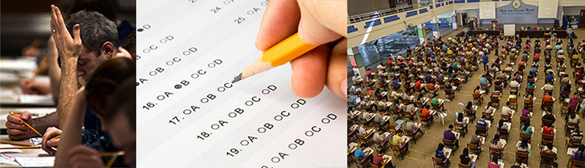

# Lời mở đầu

**Hình 14.1** Các kỳ thi là một yếu tố gây căng thẳng nhưng không thể tránh khỏi trong đời sống đại học. (nguồn “trái”: sửa đổi công trình của Travis K. Mendoza; nguồn “giữa”: sửa đổi công trình của “albertogp123”/Flickr; nguồn “phải”: sửa đổi công trình của Jeffrey Pioquinto, SJ)

## Đề cương chương

- [14.1 Căng thẳng là gì?](01-14-1-what-is-stress.md)
- [14.2 Các tác nhân gây căng thẳng](02-14-2-stressors.md)
- [14.3 Căng thẳng và bệnh tật](03-14-3-stress-and-illness.md)
- [14.4 Điều hòa căng thẳng](04-14-4-regulation-of-stress.md)
- [14.5 Mưu cầu hạnh phúc](05-14-5-the-pursuit-of-happiness.md)

Ít ai có thể phủ nhận rằng sinh viên đại học ngày nay đang phải chịu rất nhiều áp lực.
Bên cạnh vô số căng thẳng và áp lực thường nhật gắn liền với trải nghiệm đại học (chẳng hạn như các kỳ thi và tiểu luận học kỳ), sinh viên ngày nay còn phải đối mặt với học phí đại học gia tăng, gánh nặng nợ nần và khó khăn trong việc tìm kiếm việc làm sau khi tốt nghiệp.
Một bộ phận đáng kể sinh viên không theo học theo lộ trình truyền thống (non-traditional students) có thể phải đối mặt với những tác nhân gây căng thẳng bổ sung, chẳng hạn như nuôi con nhỏ hoặc duy trì một công việc toàn thời gian trong khi vẫn nỗ lực hoàn thành tấm bằng đại học.

Tất nhiên, cuộc sống luôn đầy ắp những thách thức vượt xa ngoài khuôn khổ trường đại học hay nơi làm việc.
Chúng ta có thể có những mối lo ngại về an toàn tài chính, những bất hòa với bạn bè hoặc hàng xóm, những trách nhiệm gia đình, và chúng ta có thể không có đủ thời gian để làm những điều mình mong muốn.
Ngay cả những phiền toái nhỏ nhặt—thất lạc đồ đạc, tắc đường kẹt xe và mất kết nối Internet—tất cả đều kéo theo áp lực và những đòi hỏi có thể khiến cuộc sống dường như là một chuỗi vật lộn, làm xói mòn cảm giác hạnh phúc và an vui của chúng ta.
Nghĩa là, tất cả đều có thể gây căng thẳng theo một cách nào đó.

Sự quan tâm mang tính khoa học đối với căng thẳng, bao gồm cách chúng ta thích ứng và ứng phó, đã tồn tại lâu đời trong tâm lý học; thực vậy, sau gần một thế kỷ nghiên cứu về chủ đề này, nhiều điều đã được sáng tỏ và vô số hiểu biết sâu sắc đã được phát triển.
Chương này xem xét căng thẳng và nêu bật hiểu biết hiện tại của chúng ta về hiện tượng này, bao gồm bản chất tâm lý và sinh lý, các nguyên nhân và hậu quả của nó, cũng như những bước chúng ta có thể thực hiện để làm chủ căng thẳng thay vì trở thành nạn nhân của nó.
