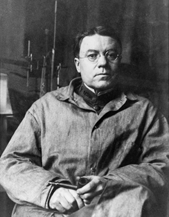
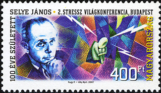

# 14.1 Căng thẳng là gì?

> [!info]
>
> ### Mục tiêu học tập
>
> Đến cuối phần này, bạn sẽ có thể:
>
> - Phân biệt giữa các định nghĩa về căng thẳng dựa trên kích thích và dựa trên phản ứng
> - Định nghĩa căng thẳng như một tiến trình
> - Phân biệt giữa căng thẳng tích cực và căng thẳng tiêu cực
> - Mô tả những đóng góp ban đầu của Walter Cannon và Hans Selye cho lĩnh vực nghiên cứu căng thẳng
> - Hiểu cơ sở sinh lý của căng thẳng và mô tả hội chứng thích ứng chung

Thuật ngữ **căng thẳng** (stress) khi liên hệ với tình trạng của con người lần đầu tiên xuất hiện trong các tài liệu khoa học vào những năm 1930, nhưng mãi đến những năm 1970 nó mới đi vào ngôn ngữ phổ thông (Lyon, 2012).
Ngày nay, chúng ta thường sử dụng thuật ngữ này một cách rộng rãi để mô tả nhiều trạng thái cảm xúc khó chịu; ví dụ, chúng ta thường nói mình bị căng thẳng tột độ (stressed out) khi cảm thấy thất vọng, tức giận, xung đột, quá tải hoặc kiệt sức.
Bất chấp việc thuật ngữ này được sử dụng rộng rãi, căng thẳng là một khái niệm khá mơ hồ và khó có thể định nghĩa một cách chính xác.

Các nhà nghiên cứu đã gặp khó khăn trong việc đạt được sự đồng thuận về một định nghĩa có thể chấp nhận được về căng thẳng.
Một số người đã khái niệm hóa căng thẳng như một sự kiện hoặc tình huống đòi hỏi khắt khe hoặc mang tính đe dọa (ví dụ: một công việc có mức độ căng thẳng cao, tình trạng quá đông đúc và việc đi làm xa mất nhiều thời gian).
Những cách hiểu như vậy được gọi là các định nghĩa dựa trên kích thích (stimulus-based definitions) bởi vì chúng mô tả căng thẳng như một tác nhân kích thích gây ra những phản ứng nhất định.
Tuy nhiên, các định nghĩa về căng thẳng dựa trên kích thích có vấn đề, vì chúng không nhận ra rằng con người khác nhau về cách nhìn nhận và phản ứng trước các tình huống và sự kiện đầy thách thức trong cuộc sống.
Ví dụ, một sinh viên chăm chỉ học tập suốt cả học kỳ có khả năng sẽ trải qua ít căng thẳng hơn trong tuần thi cuối kỳ so với một sinh viên kém trách nhiệm và không có sự chuẩn bị.

Những người khác lại khái niệm hóa căng thẳng theo những cách nhấn mạnh đến các phản ứng sinh lý xảy ra khi đối mặt với các tình huống đòi hỏi khắt khe hoặc mang tính đe dọa (ví dụ: sự kích thích sinh lý gia tăng).
Những khái niệm hóa này được gọi là các định nghĩa dựa trên phản ứng (response-based definitions) bởi vì chúng mô tả căng thẳng như một phản ứng trước các điều kiện môi trường.
Ví dụ, nhà nội tiết học Hans **Selye**, một nhà nghiên cứu căng thẳng nổi tiếng, từng định nghĩa căng thẳng là “phản ứng của cơ thể đối với bất kỳ đòi hỏi nào, cho dù đòi hỏi đó bắt nguồn từ hoặc dẫn đến các điều kiện dễ chịu hay khó chịu” (Selye, 1976, tr.
74).
Định nghĩa của Selye về căng thẳng dựa trên phản ứng ở chỗ nó khái niệm hóa căng thẳng chủ yếu dưới góc độ phản ứng sinh lý của cơ thể trước bất kỳ đòi hỏi nào đặt lên nó.
Cả định nghĩa dựa trên kích thích lẫn định nghĩa dựa trên phản ứng đều không cung cấp một định nghĩa hoàn chỉnh về căng thẳng.
Nhiều phản ứng sinh lý xảy ra khi đối mặt với các tình huống đòi hỏi khắt khe (ví dụ: nhịp tim tăng nhanh) cũng có thể xảy ra để đáp lại những điều mà hầu hết mọi người không coi là thực sự căng thẳng, chẳng hạn như nhận được tin vui bất ngờ: một sự thăng chức hoặc tăng lương ngoài dự kiến.

Một cách hữu ích để khái niệm hóa **căng thẳng** là xem nó như một quá trình mà qua đó một cá nhân nhận thức và phản ứng với các sự kiện mà họ đánh giá là quá sức hoặc đe dọa đến hạnh phúc và sức khỏe của mình (Lazarus & Folkman, 1984).
Một yếu tố quan trọng của định nghĩa này là nó nhấn mạnh tầm quan trọng của cách chúng ta đánh giá—nghĩa là phán đoán—các sự kiện đòi hỏi khắt khe hoặc đe dọa (thường được gọi là **tác nhân gây căng thẳng** - stressors); những đánh giá này sau đó sẽ ảnh hưởng đến phản ứng của chúng ta trước các sự kiện đó.
Hai loại đánh giá về một tác nhân gây căng thẳng đặc biệt quan trọng về mặt này: đánh giá sơ cấp và đánh giá thứ cấp.
Một cuộc **đánh giá sơ cấp** (primary appraisal) bao gồm việc phán đoán về mức độ nguy hại hoặc mối đe dọa tiềm ẩn đối với hạnh phúc và sức khỏe mà một tác nhân gây căng thẳng có thể kéo theo.
Một tác nhân gây căng thẳng có khả năng được đánh giá là một mối đe dọa nếu một người dự đoán rằng nó có thể dẫn đến một số tác hại, mất mát hoặc hậu quả tiêu cực khác; ngược lại, một tác nhân gây căng thẳng có khả năng được đánh giá là một thách thức nếu một người tin rằng nó mang lại tiềm năng đạt được lợi ích hoặc sự phát triển cá nhân.
Ví dụ, một nhân viên được thăng chức lên vị trí lãnh đạo có khả năng nhìn nhận sự thăng chức này là một mối đe dọa lớn hơn nhiều nếu họ tin rằng việc thăng chức sẽ dẫn đến những đòi hỏi công việc quá mức hơn là nếu họ xem đó là cơ hội để đạt được các kỹ năng mới và phát triển về mặt chuyên môn.
Tương tự như vậy, một sinh viên đại học sắp tốt nghiệp có thể đối mặt với sự thay đổi này như một mối đe dọa hoặc một thách thức ([Hình 14.2](#CNX_Psych_14_01_Graduation)).

**Hình 14.2** Việc tốt nghiệp đại học và gia nhập lực lượng lao động có thể được xem là một mối đe dọa (mất đi sự hỗ trợ tài chính) hoặc một thách thức (cơ hội cho sự độc lập và phát triển). (nguồn: Timothy Zanker)

Nhận thức về một mối đe dọa sẽ kích hoạt một cuộc **đánh giá thứ cấp** (secondary appraisal): việc phán đoán các lựa chọn sẵn có để ứng phó với một tác nhân gây căng thẳng, cũng như nhận thức về mức độ hiệu quả của các lựa chọn đó (Lyon, 2012) ([Hình 14.3](#CNX_Psych_14_01_Appraisals)).
Như bạn có thể nhớ lại từ những gì đã học về niềm tin vào năng lực bản thân (self-efficacy), niềm tin của một cá nhân vào khả năng hoàn thành một nhiệm vụ của họ là rất quan trọng (Bandura, 1994).
Một mối đe dọa có xu hướng được xem là ít thảm khốc hơn nếu một người tin rằng có thể làm được điều gì đó để giải quyết nó (Lazarus & Folkman, 1984).
Hãy tưởng tượng rằng hai người ở độ tuổi trung niên, Robin và Madhuri, tự kiểm tra vú vào một buổi sáng và mỗi người đều nhận thấy một khối u ở vùng dưới của vú trái.
Mặc dù cả hai đều coi khối u ở vú là một mối đe dọa tiềm ẩn (đánh giá sơ cấp), nhưng các đánh giá thứ cấp của họ lại khác nhau đáng kể.
Khi nghĩ về khối u ở vú, một số suy nghĩ lướt qua trong tâm trí Robin là: “Trời ơi, mình có thể bị ung thư vú!
Sẽ ra sao nếu tế bào ung thư đã di căn khắp cơ thể và mình không thể qua khỏi?
Sẽ ra sao nếu mình phải trải qua hóa trị?
Mình nghe nói trải nghiệm đó thật kinh khủng!
Sẽ ra sao nếu mình phải nghỉ việc?
Mình và bạn đời sẽ không có đủ tiền để trả nợ thế chấp nhà.
Ôi, điều này thật khủng khiếp… Mình không thể chịu đựng nổi!”
Mặt khác, Madhuri nghĩ: “Hừm, điều này có thể không tốt.
Mặc dù hầu hết thời gian những thứ này hóa ra là lành tính, nhưng mình cần phải đi kiểm tra.
Nếu hóa ra là ung thư vú, có những bác sĩ có thể điều trị vì công nghệ y tế ngày nay khá tiên tiến.
Mình sẽ có nhiều lựa chọn khác nhau, và mình sẽ ổn thôi.”
Rõ ràng, Robin và Madhuri có những quan điểm khác nhau về điều có thể hóa ra là một tình huống rất nghiêm trọng: Robin dường như nghĩ rằng khó có thể làm được điều gì với nó, trong khi Madhuri tin rằng trong trường hợp xấu nhất, sẽ có một số lựa chọn khả dĩ mang lại hiệu quả.
Do đó, Robin rõ ràng sẽ trải qua mức độ căng thẳng lớn hơn nhiều so với Madhuri.

![Một sơ đồ khái niệm bắt đầu với một ô có tiêu đề “Tác nhân gây căng thẳng” ở trên cùng với một mũi tên bên dưới dẫn đến ô có nhãn “Đánh giá sơ cấp: thách thức hay mối đe dọa?”. Bên dưới “Đánh giá sơ cấp: thách thức hay mối đe dọa?” là một đường dẫn đến từ “thách thức” ở phía bên trái và “mối đe dọa” ở phía bên phải. Bên dưới từ “thách thức” là một ô có nhãn “Tiềm năng đạt được lợi ích hoặc phát triển”. Không có đường kẻ, mũi tên hoặc ô bổ sung nào bên dưới “Tiềm năng đạt được lợi ích hoặc phát triển”. Bên dưới từ “mối đe dọa”, có một ô có nhãn “Có thể dẫn đến tổn hại, mất mát hoặc hậu quả tiêu cực”. Bên dưới ô này, có một mũi tên dẫn đến một ô khác có nhãn “Đánh giá thứ cấp: các lựa chọn tiềm năng và mức độ hiệu quả ra sao?”. Ô này có một đường kẻ bên dưới dẫn đến các từ “lựa chọn hiệu quả” ở phía bên trái và “lựa chọn không hiệu quả/không có lựa chọn” ở phía bên phải. Bên dưới các từ “lựa chọn hiệu quả”, có một mũi tên dẫn đến ô có nhãn “Mối đe dọa thấp”. Bên dưới các từ “lựa chọn không hiệu quả/không có lựa chọn”, có một mũi tên dẫn đến ô có nhãn “Mối đe dọa cao”.](../../images/img_f68c68d5e536.jpg)

**Hình 14.3** Khi gặp phải một tác nhân gây căng thẳng, một người sẽ phán đoán mối đe dọa tiềm ẩn của nó (đánh giá sơ cấp) và sau đó xác định xem liệu có các lựa chọn hiệu quả để quản lý tình huống hay không. Căng thẳng có khả năng xuất hiện nếu một tác nhân gây căng thẳng được nhận thức là cực kỳ đe dọa hoặc mang tính đe dọa mà có rất ít hoặc không có lựa chọn ứng phó hiệu quả nào sẵn có.

Chắc chắn rằng một số tác nhân gây căng thẳng vốn dĩ gây căng thẳng hơn những tác nhân khác ở chỗ chúng mang tính đe dọa nhiều hơn và để lại ít tiềm năng cho sự biến thiên trong các đánh giá nhận thức (ví dụ: các mối đe dọa khách quan đối với sức khỏe hoặc sự an toàn của một người).
Tuy nhiên, sự đánh giá vẫn sẽ đóng một vai trò trong việc gia tăng hoặc làm giảm bớt các phản ứng của chúng ta đối với những sự kiện như vậy (Everly & Lating, 2002).

Nếu một người đánh giá một sự kiện là có hại và tin rằng các đòi hỏi do sự kiện đó đặt ra vượt quá các nguồn lực sẵn có để quản lý hoặc thích ứng với nó, người đó sẽ trải nghiệm trạng thái căng thẳng một cách chủ quan.
Ngược lại, nếu một người không đánh giá chính sự kiện đó là có hại hoặc đe dọa, cô ấy khó có thể trải qua căng thẳng.
Theo định nghĩa này, các sự kiện môi trường kích hoạt các phản ứng căng thẳng thông qua cách chúng được diễn giải và những ý nghĩa được gán cho chúng.
Tóm lại, căng thẳng phần lớn nằm trong mắt của người quan sát: vấn đề không hẳn là điều gì xảy ra với bạn mà là cách bạn phản ứng ra sao (Selye, 1976).

## Căng thẳng tích cực?

Mặc dù căng thẳng mang một hàm ý tiêu cực, nhưng đôi khi nó có thể mang lại một số lợi ích.
Căng thẳng có thể thúc đẩy chúng ta làm những việc vì lợi ích tốt nhất của mình, chẳng hạn như học bài cho các kỳ thi, đi khám bác sĩ định kỳ, tập thể dục và làm việc hết khả năng tại nơi làm việc.
Thật vậy, Selye (1974) đã chỉ ra rằng không phải mọi căng thẳng đều có hại.
Ông lập luận rằng căng thẳng đôi khi có thể là một động lực tích cực, thúc đẩy và có thể cải thiện chất lượng cuộc sống của chúng ta.
Loại căng thẳng này, mà Selye gọi là **căng thẳng tích cực** (eustress - bắt nguồn từ tiếng Hy Lạp *eu* = “tốt”), là một loại căng thẳng tốt gắn liền với những cảm xúc tích cực, sức khỏe tối ưu và hiệu suất cao.
Một mức độ căng thẳng vừa phải có thể có lợi trong các tình huống đầy thách thức.
Ví dụ, các vận động viên có thể được thúc đẩy và tràn đầy năng lượng bởi sự căng thẳng trước trận đấu, và các sinh viên có thể trải qua sự căng thẳng có lợi tương tự trước một kỳ thi lớn.
Thật vậy, nghiên cứu cho thấy rằng căng thẳng vừa phải có thể tăng cường cả việc nhớ lại ngay lập tức và nhớ lại sau một khoảng thời gian đối với các tài liệu giáo dục.
Những người tham gia trong một nghiên cứu ghi nhớ một đoạn văn bản khoa học đã cho thấy sự cải thiện trí nhớ về đoạn văn đó ngay sau khi tiếp xúc với một tác nhân gây căng thẳng nhẹ cũng như một ngày sau khi tiếp xúc với tác nhân gây căng thẳng (Hupbach & Fieman, 2012).

Việc gia tăng mức độ căng thẳng của một người sẽ khiến hiệu suất thay đổi theo một cách có thể dự đoán được.
Như được trình bày trong [Hình 14.4](#CNX_Psych_14_01_Performance), khi căng thẳng tăng lên, hiệu suất và sự an vui nói chung cũng tăng theo (eustress); khi mức độ căng thẳng đạt đến mức tối ưu (điểm cao nhất của đường cong), hiệu suất đạt đến đỉnh cao.
Một người ở mức độ căng thẳng này thường được coi là đang ở phong độ đỉnh cao, nghĩa là họ cảm thấy hoàn toàn tràn đầy năng lượng, tập trung và có thể làm việc với nỗ lực tối thiểu và hiệu quả tối đa.
Nhưng khi căng thẳng vượt quá mức tối ưu này, nó không còn là một lực lượng tích cực nữa—nó trở nên quá mức và làm suy nhược cơ thể, hoặc cái mà Selye gọi là **căng thẳng tiêu cực** (distress - bắt nguồn từ tiếng Latinh *dis* = “xấu/tồi tệ”).
Những người đạt đến mức độ căng thẳng này cảm thấy kiệt sức; họ mệt mỏi, suy sụp và hiệu suất của họ bắt đầu giảm sút.
Nếu căng thẳng tiếp tục quá mức, sức khỏe cũng có thể bắt đầu bị xói mòn (Everly & Lating, 2002).
Một ví dụ điển hình về căng thẳng tiêu cực là chứng lo âu thi cử nghiêm trọng.
Khi sinh viên cảm thấy rất căng thẳng về một bài kiểm tra, những cảm xúc tiêu cực kết hợp với các triệu chứng thể chất có thể khiến việc tập trung trở nên khó khăn, do đó ảnh hưởng tiêu cực đến điểm số bài thi.

**Hình 14.4** Khi mức độ căng thẳng tăng từ thấp đến trung bình, hiệu suất cũng tăng theo (eustress). Ở mức tối ưu (đỉnh của đường cong), hiệu suất đã đạt đến đỉnh cao. Nếu căng thẳng vượt quá mức tối ưu, nó sẽ chạm tới vùng căng thẳng tiêu cực (distress), nơi nó trở nên quá mức và gây suy nhược, và hiệu suất sẽ giảm sút (Everly & Lating, 2002).

## Sự phổ biến của căng thẳng

Căng thẳng có mặt ở khắp mọi nơi và, như được hiển thị trong [Hình 14.5](#CNX_Psych_14_01_StressRise), nó đã gia tăng trong vài năm qua.
Mỗi người trong chúng ta đều quen thuộc với căng thẳng—một số người quen thuộc hơn những người khác.
Theo nhiều cách, căng thẳng có cảm giác giống như một gánh nặng mà bạn đơn giản là không thể mang vác nổi—một cảm giác bạn trải qua khi, chẳng hạn, bạn phải lái xe đi đâu đó trong một trận bão tuyết, khi bạn thức dậy muộn vào buổi sáng của một cuộc phỏng vấn xin việc quan trọng, khi bạn hết tiền trước kỳ lương tiếp theo, và trước khi tham gia một kỳ thi quan trọng mà bạn nhận ra mình chưa chuẩn bị đầy đủ.

**Hình 14.5** Gần một nửa số người trưởng thành ở Hoa Kỳ chỉ ra rằng mức độ căng thẳng của họ đã tăng lên trong vòng 5 năm qua (Neelakantan, 2013).

Căng thẳng là một trải nghiệm gợi lên nhiều phản ứng khác nhau, bao gồm các phản ứng sinh lý (ví dụ: nhịp tim tăng nhanh, đau đầu hoặc các vấn đề về đường tiêu hóa), nhận thức (ví dụ: khó tập trung hoặc khó ra quyết định) và hành vi (ví dụ: uống rượu, hút thuốc hoặc thực hiện các hành động nhằm loại bỏ nguyên nhân gây căng thẳng).
Mặc dù căng thẳng đôi khi có thể mang tính tích cực, nhưng nó có thể gây ra những ảnh hưởng tai hại đối với sức khỏe, góp phần vào sự khởi phát và tiến triển của nhiều loại bệnh tật và rối loạn thể chất (Cohen & Herbert, 1996).

Nghiên cứu khoa học về cách căng thẳng và các yếu tố tâm lý khác tác động đến sức khỏe thuộc phạm vi của **tâm lý học sức khỏe** (health psychology), một phân ngành của tâm lý học chuyên tìm hiểu tầm quan trọng của các ảnh hưởng tâm lý đối với sức khỏe, bệnh tật và cách con người phản ứng khi họ bị ốm đau (Taylor, 1999).
Tâm lý học sức khỏe nổi lên như một ngành học vào những năm 1970, thời kỳ mà nhận thức ngày càng tăng về vai trò của các yếu tố hành vi và lối sống đối với sự phát triển của bệnh tật (Straub, 2007).
Ngoài việc nghiên cứu mối liên hệ giữa căng thẳng và bệnh tật, các nhà tâm lý học sức khỏe còn điều tra các vấn đề như lý do tại sao mọi người đưa ra những lựa chọn lối sống nhất định (ví dụ: hút thuốc hoặc ăn thực phẩm không lành mạnh mặc dù biết những tác động bất lợi tiềm ẩn đối với sức khỏe của những hành vi đó).
Các nhà tâm lý học sức khỏe cũng thiết kế và điều tra tính hiệu quả của các biện pháp can thiệp nhằm thay đổi các hành vi không lành mạnh.
Có lẽ một trong những nhiệm vụ cơ bản hơn của các nhà tâm lý học sức khỏe là xác định nhóm người nào đặc biệt có nguy cơ gặp phải các kết quả tiêu cực về sức khỏe, dựa trên các yếu tố tâm lý hoặc hành vi.
Ví dụ, việc đo lường sự khác biệt về mức độ căng thẳng giữa các nhóm nhân khẩu học và mức độ này thay đổi như thế nào theo thời gian có thể giúp xác định các nhóm dân số có nguy cơ mắc bệnh hoặc rối loạn gia tăng.

[Hình 14.6](#CNX_Psych_14_01_StressLev) mô tả kết quả của ba cuộc khảo sát quốc gia trong đó hàng nghìn cá nhân từ các nhóm nhân khẩu học khác nhau đã hoàn thành một bảng câu hỏi ngắn về căng thẳng; các cuộc khảo sát được thực hiện vào các năm 1983, 2006 và 2009 (Cohen & Janicki-Deverts, 2012).
Cả ba cuộc khảo sát đều chứng minh mức độ căng thẳng ở phụ nữ cao hơn nam giới.
Những người thất nghiệp báo cáo mức độ căng thẳng cao trong cả ba cuộc khảo sát, cũng như những người có trình độ học vấn và thu nhập thấp hơn; những người đã nghỉ hưu báo cáo mức độ căng thẳng thấp nhất.
Tuy nhiên, từ năm 2006 đến năm 2009, sự gia tăng mức độ căng thẳng lớn nhất xảy ra ở nam giới, người gốc Tây Ban Nha/Mỹ Latinh trong độ tuổi 45–64, sinh viên tốt nghiệp đại học và những người có việc làm toàn thời gian.
Một cách giải thích cho những phát hiện này là những lo ngại xung quanh cuộc suy thoái kinh tế 2008–2009 (ví dụ: nguy cơ hoặc việc mất việc thực tế và mất mát đáng kể tiền tiết kiệm hưu trí) có thể đã gây căng thẳng đặc biệt cho những người đàn ông có bằng đại học đang có việc làm nhưng thời gian làm việc còn lại trong sự nghiệp của họ bị hạn chế.

![Các biểu đồ từ a đến f hiển thị điểm số căng thẳng trung bình vào các năm 1983, 2006 và 2009, cũng như cách chúng bị ảnh hưởng bởi các yếu tố khác nhau. Biểu đồ a cho thấy mối quan hệ giữa điểm số căng thẳng trung bình và giới tính. Điểm số căng thẳng trung bình ở nam giới tăng đều đặn từ 12 vào năm 1983 lên hơn 14 vào năm 2006 và hơn 15 vào năm 2009. Điểm số căng thẳng trung bình ở phụ nữ tăng nhanh từ dưới 13 một chút vào năm 1983 lên 16 vào năm 2006 và giữ nguyên vào năm 2009. Biểu đồ chỉ ra rằng điểm số căng thẳng trung bình ở phụ nữ nhìn chung cao hơn nam giới. Biểu đồ b cho thấy mối quan hệ giữa điểm số căng thẳng trung bình và độ tuổi. Điểm căng thẳng trung bình cho người dưới 25 tuổi tăng từ hơn 14 năm 1983 lên hơn 18 năm 2006, sau đó giảm xuống 17 năm 2009. Điểm căng thẳng trung bình cho người 25 đến 34 tuổi tăng từ dưới 14 năm 1983 lên 18 năm 2006, sau đó giảm xuống hơn 16 năm 2009. Điểm căng thẳng trung bình cho người 35–44 tuổi tăng từ 13 năm 1983 lên dưới 17 năm 2006, sau đó giảm xuống hơn 16 năm 2009. Điểm căng thẳng trung bình cho người 45–54 tuổi tăng từ dưới 13 năm 1983 lên 15 năm 2006, sau đó tăng lên dưới 17 năm 2009. Điểm căng thẳng trung bình cho người 55–64 tuổi tăng đều đặn từ 12 năm 1983 lên hơn 13 năm 2006 và hơn 14 năm 2009. Điểm căng thẳng trung bình cho người từ 65 tuổi trở lên giảm từ 12 năm 1983 xuống dưới 11 năm 2006, sau đó tăng nhẹ lên 11 năm 2009. Biểu đồ c cho thấy mối quan hệ giữa điểm số căng thẳng trung bình và chủng tộc. Điểm căng thẳng trung bình của người da trắng tăng đều từ dưới 13 năm 1983 lên 15 năm 2006 và hơn 15 năm 2009. Điểm căng thẳng trung bình của người da đen tăng từ hơn 15 năm 1983 lên hơn 16 năm 2006, sau đó giảm nhẹ xuống hơn 15 năm 2009. Điểm căng thẳng trung bình của người gốc Tây Ban Nha tăng đều từ 14 năm 1983 lên dưới 16 năm 2006 và 17 năm 2009. Điểm căng thẳng trung bình của những người được xếp vào nhóm “Khác” tăng từ 14 năm 1983 lên hơn 17 năm 2006 và giữ nguyên. Biểu đồ d cho thấy mối quan hệ giữa điểm số căng thẳng trung bình và trình độ học vấn. Điểm căng thẳng trung bình cho những người có trình độ dưới trung học phổ thông tăng đều từ hơn 14 năm 1983 lên hơn 17 năm 2006 và 19 năm 2009. Điểm căng thẳng trung bình cho những người có trình độ trung học phổ thông tăng từ 12 năm 1983 lên hơn 16 năm 2006 và giữ nguyên năm 2009. Điểm căng thẳng trung bình cho những người có một số năm học đại học tăng từ 12 năm 1983 lên hơn 15 năm 2006, sau đó tăng nhẹ lên dưới 16 năm 2009. Điểm căng thẳng trung bình cho những người có bằng cử nhân tăng đều từ 12 năm 1983 lên hơn 13 năm 2006 và 15 năm 2009. Điểm căng thẳng trung bình cho những người có bằng cấp cao cũng tăng đều, từ hơn 11 năm 1983 lên 13 năm 2006 và dưới 15 năm 2009. Biểu đồ e cho thấy mối quan hệ giữa điểm số căng thẳng trung bình và tình trạng việc làm. Điểm căng thẳng trung bình cho những người có việc làm toàn thời gian tăng đều từ hơn 12 năm 1983 lên 15 năm 2006 và 16 năm 2009. Điểm căng thẳng trung bình cho những người có việc làm bán thời gian tăng từ 14 năm 1983 lên 16 năm 2006, sau đó giảm xuống 15 năm 2009. Điểm căng thẳng trung bình cho những người thất nghiệp tăng nhanh từ hơn 16 năm 1983 lên 20 năm 2006, sau đó giảm trở lại mức hơn 16 năm 2009. Điểm căng thẳng trung bình cho những người đã nghỉ hưu vẫn thấp hơn các nhóm khác, duy trì ở mức dưới 12 năm 1983 và 2006, sau đó tăng nhẹ lên hơn 12 năm 2009. Biểu đồ f cho thấy mối quan hệ giữa điểm số căng thẳng trung bình và thu nhập tính bằng đô la Mỹ. Điểm căng thẳng trung bình cho những người có thu nhập từ 25.000 đô la trở xuống tăng đều từ hơn 15 năm 1983 lên 17 năm 2006 và dưới 18 năm 2009. Điểm căng thẳng trung bình cho những người có thu nhập từ 25.001 đến 35.000 đô la tăng đều từ 14 năm 1983 lên 16 năm 2006 và dưới 17 năm 2009. Điểm căng thẳng trung bình cho những người có thu nhập từ 35.001–50.000 đô la tăng đều từ dưới 13 năm 1983 lên hơn 15 năm 2006 và hơn 16 năm 2009. Điểm căng thẳng trung bình cho những người có thu nhập từ 50.001–75.000 đô la tăng nhanh từ 12 năm 1983 lên dưới 15 năm 2006, sau đó tăng nhẹ lên hơn 15 năm 2009. Điểm căng thẳng trung bình cho những người có thu nhập từ 75.001 đô la trở lên tăng đều từ 12 năm 1983 lên dưới 13 năm 2006 và hơn 14 năm 2009.](../../images/img_1596e83a9db0.jpg)

**Hình 14.6** Các biểu đồ trên, được phỏng theo Cohen & Janicki-Deverts (2012), mô tả điểm số mức độ căng thẳng trung bình giữa các nhóm nhân khẩu học khác nhau trong các năm 1983, 2006 và 2009. Trên khắp các danh mục về giới tính, độ tuổi, chủng tộc, trình độ học vấn, tình trạng việc làm và thu nhập, mức độ căng thẳng nhìn chung cho thấy sự gia tăng rõ rệt trong khoảng thời gian một phần tư thế kỷ này.

## Những đóng góp ban đầu cho việc nghiên cứu căng thẳng

Như đã nêu trước đó, sự quan tâm mang tính khoa học đối với căng thẳng đã có từ gần một thế kỷ trước.
Một trong những người tiên phong ban đầu trong việc nghiên cứu về căng thẳng là Walter **Cannon**, một nhà sinh lý học xuất sắc người Mỹ tại Trường Y khoa Harvard ([Hình 14.7](#CNX_Psych_14_01_Cannon)).
Vào đầu thế kỷ 20, Cannon là người đầu tiên xác định các phản ứng sinh lý của cơ thể đối với căng thẳng.

**Hình 14.7** Nhà sinh lý học Harvard Walter Cannon là người đầu tiên diễn đạt và đặt tên cho phản ứng chiến-hay-biến, phản ứng giao cảm của hệ thần kinh đối với một tác nhân gây căng thẳng đáng kể.

### Cannon và phản ứng chiến-hay-biến

Hãy tưởng tượng bạn đang đi bộ đường dài trên những ngọn núi tuyệt đẹp ở Colorado vào một ngày mùa xuân ấm áp và ngập tràn ánh nắng.
Tại một thời điểm trong chuyến đi, một con gấu đen to lớn, trông đáng sợ xuất hiện từ phía sau một rặng cây và ngồi cách bạn khoảng 50 thước Anh (khoảng 45 mét).
Con gấu nhận ra bạn, ngồi dậy và bắt đầu lững thững bước về phía bạn.
Ngoài việc nghĩ rằng, “Điều này chắc chắn không ổn chút nào,” một tập hợp các phản ứng sinh lý bắt đầu diễn ra bên trong bạn.
Bị kích thích bởi một dòng thác epinephrine (adrenaline) và norepinephrine (noradrenaline) từ các tuyến thượng thận của bạn, đồng tử của bạn bắt đầu giãn ra.
Tim bạn bắt đầu đập thình thịch và tăng tốc, bạn bắt đầu thở dốc và toát mồ hôi, bạn cảm thấy cồn cào bồn chồn trong bụng, và các cơ bắp của bạn trở nên căng thẳng, chuẩn bị cho bạn thực hiện một hành động trực tiếp nào đó.
Cannon đề xuất rằng phản ứng này, mà ông gọi là **phản ứng chiến-hay-biến** (fight-or-flight response - phản ứng chiến đấu hoặc bỏ chạy), xảy ra khi một người trải qua những cảm xúc rất mạnh mẽ—đặc biệt là những cảm xúc gắn liền với một mối đe dọa được nhận thức (Cannon, 1932).
Trong phản ứng chiến-hay-biến, cơ thể được kích thích nhanh chóng thông qua việc kích hoạt cả hệ thần kinh giao cảm và hệ nội tiết ([Hình 14.8](#CNX_Psych_14_01_FightFlight)).
Sự kích thích này giúp chuẩn bị cho người đó hoặc là chiến đấu hoặc là bỏ chạy khỏi một mối đe dọa được nhận thức.

**Hình 14.8** Chiến-hay-biến là một phản ứng sinh lý đối với một tác nhân gây căng thẳng.

Theo Cannon, phản ứng chiến-hay-biến là một cơ chế được tích hợp sẵn giúp duy trì cân bằng nội môi (homeostasis)—một môi trường bên trong mà các biến số sinh lý như huyết áp, hô hấp, tiêu hóa và nhiệt độ được ổn định ở các mức tối ưu cho sự sinh tồn.
Do đó, Cannon xem phản ứng chiến-hay-biến mang tính thích nghi vì nó cho phép con người điều chỉnh cả bên trong lẫn bên ngoài trước các mối đe dọa trong môi trường của họ, cho phép họ tiếp tục sống sót và vượt qua mối đe dọa.

### Selye và hội chứng thích ứng chung

Một người đóng góp quan trọng ban đầu khác cho lĩnh vực căng thẳng là Hans **Selye**, đã được đề cập trước đó.
Cuối cùng, ông đã trở thành một trong những chuyên gia hàng đầu thế giới về nghiên cứu căng thẳng ([Hình 14.9](#CNX_Psych_14_01_Hans_Selye)).
Khi còn là một trợ lý trẻ tại khoa hóa sinh tại Đại học McGill vào những năm 1930, Selye đã tham gia vào nghiên cứu liên quan đến hormone sinh dục ở chuột.
Mặc dù không thể tìm ra câu trả lời cho những gì ông nghiên cứu ban đầu, nhưng ông đã tình cờ phát hiện ra rằng khi tiếp xúc với sự kích thích tiêu cực kéo dài (các tác nhân gây căng thẳng)—chẳng hạn như lạnh cực độ, chấn thương phẫu thuật, tập luyện cơ bắp quá mức và sốc—những con chuột có dấu hiệu phì đại tuyến thượng thận, teo tuyến ức và hạch bạch huyết, cùng với loét dạ dày.
Selye nhận ra rằng những phản ứng này được kích hoạt bởi một chuỗi các phản ứng sinh lý phối hợp diễn ra theo thời gian trong quá trình tiếp xúc liên tục với một tác nhân gây căng thẳng.
Những phản ứng sinh lý này là không đặc hiệu, có nghĩa là bất kể loại tác nhân gây căng thẳng nào, cùng một mô thức phản ứng sẽ xảy ra.
Những gì Selye phát hiện ra chính là **hội chứng thích ứng chung** (general adaptation syndrome - GAS), phản ứng sinh lý không đặc hiệu của cơ thể đối với căng thẳng.

**Hình 14.9** Hans Selye chuyên nghiên cứu về căng thẳng. Vào năm 2009, quê hương Hungary của ông đã tôn vinh công trình của ông bằng con tem này, được phát hành cùng với Hội nghị Thế giới thường niên lần thứ 2 về Căng thẳng.

Hội chứng thích ứng chung, được trình bày trong [Hình 14.10](#CNX_Psych_14_01_Adaptation), bao gồm ba giai đoạn: (1) phản ứng báo động, (2) giai đoạn đề kháng, và (3) giai đoạn kiệt quệ (Selye, 1936; 1976).
**Phản ứng báo động** (alarm reaction) mô tả phản ứng tức thì của cơ thể khi đối mặt với một tình huống đe dọa hoặc khẩn cấp, và nó gần tương tự như phản ứng chiến-hay-biến được mô tả bởi Cannon.
Trong phản ứng báo động, bạn được cảnh báo về một tác nhân gây căng thẳng, và cơ thể bạn báo động cho bạn bằng một thác ghềnh các phản ứng sinh lý cung cấp năng lượng cho bạn để quản lý tình huống.
Ví dụ, một người thức dậy vào lúc nửa đêm và phát hiện nhà mình đang cháy đang trải qua một phản ứng báo động.

**Hình 14.10** Ba giai đoạn trong hội chứng thích ứng chung của Selye được hiển thị trong biểu đồ này. Căng thẳng kéo dài cuối cùng dẫn đến kiệt quệ.

Nếu sự tiếp xúc với tác nhân gây căng thẳng kéo dài, sinh vật sẽ bước vào **giai đoạn đề kháng** (stage of resistance).
Trong giai đoạn này, cú sốc ban đầu của phản ứng báo động đã qua đi và cơ thể đã thích nghi với tác nhân gây căng thẳng.
Tuy nhiên, cơ thể cũng vẫn trong tình trạng cảnh giác và chuẩn bị phản ứng như trong phản ứng báo động, mặc dù với cường độ thấp hơn.
Ví dụ, giả sử một đứa trẻ bị mất tích vẫn chưa tìm thấy sau 72 giờ.
Mặc dù cha mẹ rõ ràng vẫn vô cùng bấn loạn, nhưng mức độ của các phản ứng sinh lý có thể đã giảm đi trong 72 giờ can thiệp nhờ sự thích nghi nhất định với sự kiện này.

Nếu sự tiếp xúc với tác nhân gây căng thẳng tiếp tục trong một khoảng thời gian dài hơn, **giai đoạn kiệt quệ** (stage of exhaustion) sẽ xảy ra.
Ở giai đoạn này, người đó không còn khả năng thích nghi với tác nhân gây căng thẳng nữa: khả năng chống đỡ của cơ thể bị cạn kiệt khi sự hao mòn thể chất gây tổn hại cho các mô và cơ quan của cơ thể.
Kết quả là, ốm đau, bệnh tật và những tổn thương vĩnh viễn khác đối với cơ thể—thậm chí tử vong—có thể xảy ra.
Nếu một đứa trẻ mất tích vẫn chưa được tìm thấy sau ba tháng, sự căng thẳng kéo dài liên quan đến tình huống này có thể khiến cha mẹ thực sự ngất xỉu vì kiệt sức tại một thời điểm nào đó hoặc thậm chí phát triển một căn bệnh nghiêm trọng và không thể phục hồi.

Tóm lại, hội chứng thích ứng chung của Selye gợi ý rằng các tác nhân gây căng thẳng gây áp lực lên cơ thể thông qua một quá trình ba giai đoạn—một cú giật ban đầu, sự điều chỉnh sau đó và sự cạn kiệt toàn bộ các nguồn lực thể chất sau này—cuối cùng đặt nền tảng cho các vấn đề sức khỏe nghiêm trọng và thậm chí là tử vong.
Tuy nhiên, cần chỉ ra rằng mô hình này là một sự khái niệm hóa về căng thẳng dựa trên phản ứng, chỉ tập trung vào các phản ứng thể chất của cơ thể trong khi phần lớn bỏ qua các yếu tố tâm lý như sự đánh giá và diễn giải về các mối đe dọa.
Dẫu vậy, mô hình của Selye đã có tác động to lớn đến lĩnh vực nghiên cứu căng thẳng vì nó cung cấp một lời giải thích khái quát về cách căng thẳng có thể dẫn đến tổn hại thể chất và do đó gây ra bệnh tật.
Như chúng ta sẽ thảo luận sau, căng thẳng kéo dài hoặc lặp đi lặp lại có liên quan đến sự phát triển của một số rối loạn như tăng huyết áp và bệnh động mạch vành.

## Cơ sở sinh lý của căng thẳng

Điều gì diễn ra bên trong cơ thể chúng ta khi chúng ta trải qua căng thẳng?
Các cơ chế sinh lý của căng thẳng cực kỳ phức tạp, nhưng nhìn chung chúng liên quan đến hoạt động của hai hệ thống—**hệ thần kinh giao cảm** và **trục dưới đồi - tuyến yên - tuyến thượng thận (HPA)** (hypothalamic-pituitary-adrenal axis).
Khi một người lần đầu tiên nhận thức điều gì đó là căng thẳng (phản ứng báo động của Selye), hệ thần kinh giao cảm sẽ kích hoạt sự hưng phấn thông qua việc giải phóng adrenaline từ các tuyến thượng thận.
Việc giải phóng các hormone này sẽ kích hoạt các phản ứng chiến-hay-biến trước căng thẳng, chẳng hạn như nhịp tim và nhịp thở tăng nhanh.
Đồng thời, trục HPA, vốn chủ yếu mang bản chất nội tiết, trở nên đặc biệt hoạt động, mặc dù nó hoạt động chậm hơn nhiều so với hệ thần kinh giao cảm.
Để đáp lại căng thẳng, vùng dưới đồi (hypothalamus - một trong những cấu trúc viền trong não) giải phóng yếu tố giải phóng corticotropin (CRF), một loại hormone khiến tuyến yên giải phóng hormone vỏ thượng thận (ACTH) ([Hình 14.11](#CNX_Psych_14_01_HPAAxis)).
Sau đó, ACTH kích hoạt các tuyến thượng thận tiết ra một số loại hormone vào máu; một loại quan trọng là cortisol, có thể ảnh hưởng đến hầu như mọi cơ quan trong cơ thể.
**Cortisol** thường được gọi là hormone căng thẳng và giúp tăng cường năng lượng khi chúng ta mới gặp tác nhân gây căng thẳng, chuẩn bị cho chúng ta bỏ chạy hoặc chiến đấu.
Tuy nhiên, nồng độ cortisol tăng cao liên tục sẽ làm suy yếu hệ thống miễn dịch.

**Hình 14.11** Sơ đồ này cho thấy hoạt động của trục dưới đồi - tuyến yên - tuyến thượng thận (HPA). Vùng dưới đồi kích hoạt tuyến yên, tuyến yên lần lượt kích hoạt các tuyến thượng thận, làm tăng tiết cortisol.

Trong những đợt bùng phát ngắn hạn, quá trình này có thể mang lại một số tác động thuận lợi, chẳng hạn như cung cấp thêm năng lượng, tạm thời cải thiện chức năng của **hệ thống miễn dịch** (immune system) và giảm độ nhạy cảm với cơn đau.
Tuy nhiên, việc tiết cortisol kéo dài—như xảy ra khi căng thẳng kéo dài hoặc mãn tính—thường phải trả một cái giá đắt.
Nồng độ cortisol cao đã được chứng minh là tạo ra một số tác hại.
Ví dụ, sự gia tăng cortisol có thể làm suy yếu đáng kể hệ thống miễn dịch của chúng ta (Glaser & Kiecolt-Glaser, 2005), và nồng độ cao thường được quan sát thấy ở những người trầm cảm (Geoffroy, Hertzman, Li, & Power, 2013).
Tóm lại, một sự kiện căng thẳng gây ra nhiều phản ứng sinh lý kích hoạt các tuyến thượng thận, các tuyến này lần lượt giải phóng epinephrine, norepinephrine và cortisol.
Những hormone này ảnh hưởng đến một số quá trình của cơ thể theo những cách chuẩn bị cho người bị căng thẳng thực hiện hành động trực tiếp, nhưng cũng theo những cách có thể làm tăng nguy cơ mắc bệnh.

Khi căng thẳng ở mức cực độ hoặc mãn tính, nó có thể dẫn đến những hậu quả tiêu cực sâu sắc.
Ví dụ, căng thẳng thường góp phần vào sự phát triển của một số rối loạn tâm lý nhất định, bao gồm rối loạn căng thẳng sau sang chấn (PTSD), rối loạn trầm cảm chủ yếu và các tình trạng tâm thần nghiêm trọng khác.
Ngoài ra, chúng ta đã lưu ý trước đó rằng căng thẳng có liên quan đến sự phát triển và tiến triển của nhiều loại bệnh tật và rối loạn thể chất.
Ví dụ, các nhà nghiên cứu trong một nghiên cứu phát hiện ra rằng những người bị thương trong thảm họa Trung tâm Thương mại Thế giới ngày 11 tháng 9 năm 2001 hoặc những người phát triển các triệu chứng căng thẳng sau sang chấn sau đó đã phải chịu tỷ lệ mắc bệnh tim tăng cao đáng kể sau này (Jordan, Miller-Archie, Cone, Morabia, & Stellman, 2011).
Một cuộc điều tra khác mang lại kết quả rằng các triệu chứng căng thẳng tự báo cáo ở những công nhân ngành công nghiệp thực phẩm Phần Lan lớn tuổi và đã nghỉ hưu có liên quan đến bệnh tật 11 năm sau đó.
Nghiên cứu này cũng dự đoán sự khởi phát của các rối loạn cơ xương, hệ thần kinh, cũng như các rối loạn nội tiết và chuyển hóa (Salonen, Arola, Nygård, & Huhtala, 2008).
Một nghiên cứu khác báo cáo rằng các nhân viên sản xuất nam giới ở Hàn Quốc báo cáo mức độ căng thẳng liên quan đến công việc cao có nhiều khả năng bị cảm lạnh thông thường hơn trong vài tháng tiếp theo so với những nhân viên báo cáo mức độ căng thẳng liên quan đến công việc thấp hơn (Park et al., 2011).
Sau này, bạn sẽ khám phá các cơ chế mà qua đó căng thẳng có thể tạo ra bệnh tật và tổn thương thể chất.
