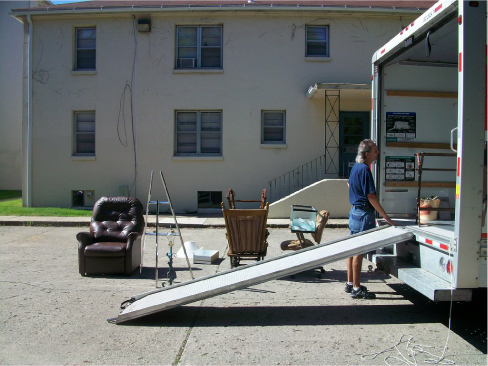
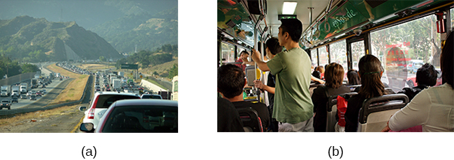
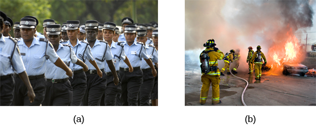

# 14.2 Các tác nhân gây căng thẳng

> [!info]
>
> ### Mục tiêu học tập
>
> Đến cuối phần này, bạn sẽ có thể:
>
> - Mô tả các loại tác nhân gây căng thẳng tiềm ẩn khác nhau
> - Giải thích tầm quan trọng của những thay đổi trong cuộc sống như những tác nhân gây căng thẳng tiềm ẩn
> - Mô tả Thang đánh giá tái thích ứng xã hội
> - Hiểu các khái niệm về quá tải công việc và kiệt sức nghề nghiệp

Để một cá nhân trải nghiệm sự **căng thẳng** (stress), trước tiên họ phải đối mặt với một **tác nhân gây căng thẳng** (stressor) tiềm ẩn.
Nhìn chung, các tác nhân gây căng thẳng có thể được xếp vào một trong hai nhóm lớn: mãn tính và cấp tính.
Tác nhân gây căng thẳng mãn tính bao gồm các sự kiện kéo dài trong một khoảng thời gian dài, chẳng hạn như chăm sóc cha mẹ mắc chứng sa sút trí tuệ, thất nghiệp dài hạn hoặc bị giam cầm trong tù.
Tác nhân gây căng thẳng cấp tính bao gồm các sự kiện trọng tâm diễn ra ngắn ngủi mà đôi khi vẫn tiếp tục được trải nghiệm là quá sức ngay cả khi sự kiện đã kết thúc từ lâu, chẳng hạn như trượt ngã trên vỉa hè đóng băng và bị gãy chân (Cohen, Janicki-Deverts, & Miller, 2007).
Cho dù là mãn tính hay cấp tính, các tác nhân gây căng thẳng tiềm ẩn xuất hiện dưới nhiều hình thức và quy mô khác nhau.
Chúng có thể bao gồm các sự kiện chấn thương lớn, những thay đổi quan trọng trong cuộc sống, những phiền toái hàng ngày, cũng như các tình huống khác mà một người thường xuyên phải tiếp xúc với mối đe dọa, thách thức hoặc sự nguy hiểm.

## Các sự kiện sang chấn

Một số tác nhân gây căng thẳng liên quan đến các sự kiện hoặc tình huống sang chấn (traumatic events) mà trong đó một người phải đối mặt với cái chết thực tế hoặc bị đe dọa, hay chấn thương nghiêm trọng.
Các tác nhân gây căng thẳng trong nhóm này bao gồm việc tham chiến quân sự, các vụ tấn công thể xác thực tế hoặc bị đe dọa (ví dụ: bị hành hung, tấn công tình dục, cướp của, lạm dụng thời thơ ấu), các cuộc tấn công khủng bố, thảm họa thiên nhiên (ví dụ: động đất, lũ lụt, bão) và tai nạn ô tô.
Nam giới, người không phải da trắng và các cá nhân thuộc các nhóm tình trạng kinh tế xã hội (SES) thấp hơn báo cáo trải qua số lượng các sự kiện sang chấn nhiều hơn so với phụ nữ, người da trắng và các cá nhân thuộc các nhóm SES cao hơn (Hatch & Dohrenwend, 2007).
Một số cá nhân tiếp xúc với các tác nhân gây căng thẳng có cường độ cực độ sẽ phát triển chứng rối loạn căng thẳng sau sang chấn (PTSD): một phản ứng căng thẳng mãn tính đặc trưng bởi các trải nghiệm và hành vi có thể bao gồm ký ức xâm nhập và đau đớn về sự kiện gây căng thẳng, sự bồn chồn giật mình, trạng thái cảm xúc tiêu cực kéo dài, sự xa cách với người khác, những cơn giận dữ bộc phát và sự né tránh các yếu tố gợi nhắc về sự kiện đó (Hiệp hội Tâm thần học Hoa Kỳ [APA], 2013).

## Những thay đổi trong cuộc sống

Hầu hết các tác nhân gây căng thẳng mà chúng ta gặp phải đều không dữ dội đến mức như những tác nhân được mô tả ở trên.
Nhiều tác nhân gây căng thẳng tiềm ẩn mà chúng ta đối mặt liên quan đến các sự kiện hoặc tình huống đòi hỏi chúng ta phải thực hiện những thay đổi trong cuộc sống đang tiếp diễn và cần có thời gian để chúng ta thích nghi với những thay đổi đó.
Các ví dụ bao gồm sự qua đời của một thành viên thân thiết trong gia đình, kết hôn, ly hôn và chuyển nhà ([Hình 14.12](#CNX_Psych_14_02_Moving)).

**Hình 14.12** Một số sự kiện khá điển hình trong cuộc sống, chẳng hạn như chuyển nhà, có thể là những tác nhân gây căng thẳng đáng kể. Ngay cả khi việc chuyển nhà là có chủ ý và mang tính tích cực, khối lượng thay đổi phát sinh trong cuộc sống hàng ngày vẫn có thể gây ra căng thẳng. (nguồn: “Jellaluna”/Flickr)

Vào những năm 1960, hai bác sĩ tâm thần Thomas **Holmes** và Richard **Rahe** muốn kiểm tra mối liên hệ giữa các tác nhân gây căng thẳng trong cuộc sống và bệnh tật thể chất, dựa trên giả thuyết rằng các sự kiện trong đời đòi hỏi những thay đổi đáng kể trong thói quen sinh hoạt bình thường của một người đều gây căng thẳng, cho dù những sự kiện này là mong muốn hay không mong muốn.
Họ đã phát triển **Thang đánh giá tái thích ứng xã hội (SRRS)** (Social Readjustment Rating Scale), bao gồm 43 sự kiện trong cuộc sống đòi hỏi các mức độ tái thích ứng cá nhân khác nhau (Holmes & Rahe, 1967).
Nhiều sự kiện trong đời mà hầu hết mọi người coi là dễ chịu (ví dụ: các kỳ nghỉ lễ, nghỉ hưu, kết hôn) đều nằm trong số những sự kiện được liệt kê trên thang đo SRRS; đây là những ví dụ về căng thẳng tích cực (eustress).
Holmes và Rahe cũng đề xuất rằng các sự kiện trong cuộc sống có thể tích tụ dần theo thời gian, và việc trải qua một chuỗi các sự kiện căng thẳng sẽ làm tăng nguy cơ phát triển các bệnh lý thể chất của một người.

Trong quá trình phát triển thang đo của mình, Holmes và Rahe đã yêu cầu 394 người tham gia cung cấp ước tính bằng số cho từng mục trong số 43 mục; mỗi ước tính tương ứng với mức độ tái thích ứng mà người tham gia cảm thấy mỗi sự kiện sẽ đòi hỏi.
Các ước tính này dẫn đến điểm số giá trị trung bình cho từng sự kiện—thường được gọi là đơn vị thay đổi cuộc sống (life change units - LCU) (Rahe, McKeen, & Arthur, 1967).
Điểm số bằng số dao động từ 11 đến 100, đại diện cho mức độ thay đổi cuộc sống được nhận thức mà mỗi sự kiện kéo theo.
Sự qua đời của người phối ngẫu xếp hạng cao nhất trên thang đo với 100 LCU, và ly hôn xếp thứ hai với 73 LCU.
Ngoài ra, chấn thương hoặc bệnh tật cá nhân, kết hôn và mất việc cũng xếp hạng cao trên thang đo với lần lượt là 53, 50 và 47 LCU.
Ngược lại, thay đổi nơi ở (20 LCU), thay đổi thói quen ăn uống (15 LCU) và kỳ nghỉ (13 LCU) xếp hạng thấp trên thang đo ([Bảng 14.1](#Table_14_02_01)).
Những vi phạm pháp luật nhỏ xếp hạng thấp nhất với 11 LCU.
Để hoàn thành thang đo, những người tham gia đánh dấu chọn “có” cho các sự kiện đã trải qua trong vòng 12 tháng qua.
Các LCU cho mỗi mục được đánh dấu sẽ được cộng lại để ra một điểm số định lượng mức độ thay đổi cuộc sống.
Sự đồng thuận về mức độ điều chỉnh cần thiết của các sự kiện cuộc sống khác nhau trên thang SRRS là rất nhất quán, ngay cả khi so sánh giữa các nền văn hóa khác nhau (Holmes & Masuda, 1974).

**Một số tác nhân gây căng thẳng trên Thang đánh giá tái thích ứng xã hội (Holmes & Rahe, 1967)**

| Sự kiện cuộc sống | Đơn vị thay đổi cuộc sống (LCU) |
| --- | --- |
| Cái chết của một thành viên thân thiết trong gia đình | 63 |
| Chấn thương hoặc bệnh tật cá nhân | 53 |
| Bị sa thải khỏi công việc | 47 |
| Thay đổi tình trạng tài chính | 38 |
| Chuyển sang ngành nghề làm việc khác | 36 |
| Thành tựu cá nhân xuất sắc | 28 |
| Bắt đầu hoặc kết thúc việc đi học | 26 |
| Thay đổi điều kiện sống | 25 |
| Thay đổi giờ làm việc hoặc điều kiện làm việc | 20 |
| Thay đổi nơi cư trú | 20 |
| Chuyển trường | 20 |
| Thay đổi các hoạt động xã hội | 18 |
| Thay đổi thói quen ngủ | 16 |
| Thay đổi thói quen ăn uống | 15 |
| Vi phạm pháp luật nhỏ | 11 |

**Bảng 14.1**

Nghiên cứu sâu rộng đã chứng minh rằng việc tích lũy một số lượng lớn các đơn vị thay đổi cuộc sống trong một khoảng thời gian ngắn (một hoặc hai năm) có liên quan đến một loạt các bệnh lý thể chất (ngay cả các vụ tai nạn và chấn thương thể thao) và các vấn đề sức khỏe tâm thần (Monat & Lazarus, 1991; Scully, Tosi, & Banning, 2000).
Trong một thử nghiệm ban đầu, các nhà nghiên cứu đã thu thập điểm số LCU của các nhân viên Hải quân Hoa Kỳ và Na Uy trước khi họ chuẩn bị bắt đầu chuyến hải trình kéo dài sáu tháng.
Việc kiểm tra hồ sơ bệnh án sau đó đã tiết lộ mối tương quan thuận (nhưng ở mức nhỏ) giữa điểm số LCU trước chuyến đi và các triệu chứng bệnh tật sau đó trong suốt chuyến hành trình sáu tháng tiếp theo (Rahe, 1974).
Ngoài ra, mọi người có xu hướng trải qua nhiều triệu chứng thể chất hơn, chẳng hạn như đau lưng, đau bụng, tiêu chảy và mụn trứng cá, vào những ngày cụ thể mà giá trị LCU tự báo cáo cao hơn đáng kể so với bình thường, chẳng hạn như ngày diễn ra đám cưới của một thành viên trong gia đình (Holmes & Holmes, 1970).

Thang đánh giá tái thích ứng xã hội (SRRS) cung cấp cho các nhà nghiên cứu một phương pháp đơn giản, dễ thực hiện để đánh giá mức độ căng thẳng trong cuộc sống của mọi người, và nó đã được sử dụng trong hàng trăm nghiên cứu (Thoits, 2010).
Bất chấp việc được sử dụng rộng rãi, thang đo này đã phải chịu nhiều lời chỉ trích.
Đầu tiên, nhiều mục trên SRRS còn mơ hồ; ví dụ, cái chết của một người bạn thân có thể liên quan đến cái chết của một người bạn thời thơ ấu đã lâu không liên lạc mà sự việc đó đòi hỏi rất ít sự tái thích ứng xã hội (Dohrenwend, 2006).
Ngoài ra, một số người đã thách thức giả định của thang đo cho rằng các sự kiện cuộc sống không mong muốn cũng không gây căng thẳng hơn các sự kiện mong muốn (Derogatis & Coons, 1993).
Tuy nhiên, hầu hết các bằng chứng sẵn có cho thấy rằng, ít nhất là đối với sức khỏe tâm thần, các sự kiện tiêu cực hoặc không mong muốn có mối liên hệ mạnh mẽ hơn với các kết quả tồi tệ (chẳng hạn như trầm cảm) so với các sự kiện tích cực, mong muốn (Hatch & Dohrenwend, 2007).
Có lẽ lời chỉ trích nghiêm trọng nhất là thang đo không xem xét đến các đánh giá nhận thức của người trả lời về các sự kiện cuộc sống mà nó chứa đựng.
Như bạn nhớ lại, việc đánh giá một tác nhân gây căng thẳng là một yếu tố then chốt trong việc khái niệm hóa và trải nghiệm tổng thể về căng thẳng.
Việc bị sa thải khỏi công việc có thể là điều tàn khốc đối với một số người nhưng lại là cơ hội đáng mừng để tìm kiếm một công việc tốt hơn đối với những người khác.
Thang đo SRRS vẫn là một trong những công cụ nổi tiếng nhất trong nghiên cứu về căng thẳng, và nó là một công cụ hữu ích để xác định các kết quả sức khỏe tiềm ẩn liên quan đến căng thẳng (Scully et al., 2000).

> [!tip]
>
> ### Kết nối học tập
>
> Hãy truy cập [trang web này và hoàn thành thang đo SRRS](https://openstax.org/l/SRRS) để xác định tổng số LCU mà bạn đã trải qua trong năm qua.

> [!example]
>
> ### Kết nối các khái niệm
>
> #### Nghiên cứu tương quan
>
> Thang đánh giá tái thích ứng xã hội (SRRS) của Holmes và Rahe sử dụng phương pháp **nghiên cứu tương quan** (correlational research) để xác định mối liên hệ giữa căng thẳng và sức khỏe.
> Nghĩa là, điểm số LCU của người trả lời có tương quan với số lượng hoặc tần suất của các triệu chứng tự báo cáo biểu thị các vấn đề sức khỏe.
> Các mối tương quan này thường là tương quan thuận—khi điểm số LCU tăng lên, số lượng các triệu chứng cũng tăng lên.
> Hãy xem xét hàng ngàn nghiên cứu đã sử dụng thang đo này để tương quan giữa căng thẳng và các triệu chứng bệnh tật: Nếu bạn phải gán một hệ số tương quan trung bình cho khối lượng nghiên cứu này, dự đoán tốt nhất của bạn sẽ là gì?
> Bạn nghĩ hệ số tương quan sẽ mạnh đến mức nào?
> Tại sao SRRS không thể chứng minh mối quan hệ nhân quả giữa căng thẳng và bệnh tật?
> Nếu có thể chứng minh mối quan hệ nhân quả, bạn nghĩ căng thẳng gây ra bệnh tật hay bệnh tật gây ra căng thẳng?

## Những phiền toái hàng ngày

Các tác nhân gây căng thẳng tiềm ẩn không phải lúc nào cũng liên quan đến các sự kiện lớn trong đời.
**Những phiền toái hàng ngày** (daily hassles)—những kích thích và bực bội nhỏ nhặt vốn là một phần của cuộc sống thường nhật của chúng ta (ví dụ: tắc đường giờ cao điểm, mất chìa khóa, đồng nghiệp khó chịu, thời tiết khắc nghiệt, tranh cãi với bạn bè hoặc gia đình)—có thể tích tụ chồng chất lên nhau và khiến chúng ta căng thẳng không kém gì những sự kiện thay đổi cuộc sống ([Hình 14.13](#CNX_Psych_14_02_DailyHass)) (Kanner, Coyne, Schaefer, & Lazarus, 1981).

**Hình 14.13** Việc đi lại hàng ngày, cho dù là (a) trên đường phố hay (b) qua phương tiện giao thông công cộng, có thể là những phiền toái góp phần vào cảm giác căng thẳng hàng ngày của chúng ta. (nguồn a: sửa đổi công trình của Jeff Turner; nguồn b: sửa đổi công trình của “epSos.de”/Flickr)

Các nhà nghiên cứu đã chứng minh rằng tần suất của những phiền toái hàng ngày thực sự là yếu tố dự báo tốt hơn về cả sức khỏe thể chất lẫn tâm lý so với các đơn vị thay đổi cuộc sống.
Trong một nghiên cứu nổi tiếng về các cư dân ở San Francisco, tần suất của những phiền toái hàng ngày được phát hiện có mối liên hệ chặt chẽ hơn với các vấn đề sức khỏe thể chất so với các sự kiện thay đổi cuộc sống (DeLongis, Coyne, Dakof, Folkman, & Lazarus, 1982).
Ngoài ra, những phiền toái nhỏ hàng ngày, đặc biệt là các xung đột giữa các cá nhân, thường dẫn đến các trạng thái tâm trạng tiêu cực và đau khổ (Bolger, DeLongis, Kessler, & Schilling, 1989).
Những phiền toái trên không gian mạng (cyber hassles) xảy ra trên mạng xã hội có thể đại diện cho một nguồn căng thẳng hiện đại và đang không ngừng phát triển.
Trong một cuộc điều tra, căng thẳng trên mạng xã hội có liên quan đến việc mất ngủ ở thanh thiếu niên, có lẽ vì việc suy nghĩ luẩn quẩn về mạng xã hội đã gây ra phản ứng căng thẳng sinh lý làm tăng sự hưng phấn kích thích (van der Schuur, Baumgartner, & Sumter, 2018).
Rõ ràng, những phiền toái hàng ngày có thể tích tụ lại và gây tổn hại cho chúng ta cả về mặt cảm xúc lẫn thể chất.

## Các tác nhân gây căng thẳng liên quan đến nghề nghiệp

Các tác nhân gây căng thẳng có thể bao gồm các tình huống mà một người thường xuyên phải tiếp xúc với các sự kiện đầy thách thức và khó chịu, chẳng hạn như điều kiện làm việc khó khăn, đòi hỏi khắt khe hoặc không an toàn.
Mặc dù hầu hết các công việc và ngành nghề đôi khi đều có thể có những đòi hỏi cao, nhưng một số công việc rõ ràng gây căng thẳng hơn những công việc khác ([Hình 14.14](#CNX_Psych_14_02_Guard)).
Ví dụ, hầu hết mọi người có lẽ sẽ đồng ý rằng công việc của một người lính cứu hỏa vốn dĩ căng thẳng hơn công việc của một người bán hoa.
Tương tự như vậy, hầu hết mọi người sẽ đồng ý rằng những công việc chứa đựng nhiều yếu tố khó chịu khác nhau, chẳng hạn như những công việc đòi hỏi phải tiếp xúc với tiếng ồn lớn (người vận hành thiết bị hạng nặng), sự quấy rối liên tục và những lời đe dọa bạo lực thể xác (quản giáo nhà tù), sự bực bội thường trực (tài xế xe buýt ở một thành phố lớn), hoặc những công việc bắt buộc nhân viên phải luân phiên làm việc theo ca ngày và đêm (nhân viên lễ tân khách sạn), đều đòi hỏi khắt khe hơn nhiều—và do đó gây căng thẳng hơn—so với những công việc không chứa đựng những yếu tố như vậy. [Bảng 14.2](#Table_14_02_02) liệt kê một số ngành nghề và một số tác nhân gây căng thẳng cụ thể gắn liền với những ngành nghề đó (Sulsky & Smith, 2005).

**Hình 14.14** (a) Sĩ quan cảnh sát và (b) lính cứu hỏa nắm giữ những nghề nghiệp có mức độ căng thẳng cao. (nguồn a: sửa đổi công trình của Trung tâm Dân sự - Quân sự Úc; nguồn b: sửa đổi công trình của Andrew Magill)

**Các ngành nghề và các tác nhân gây căng thẳng liên quan của chúng**

| Ngành nghề | Các tác nhân gây căng thẳng đặc thù theo ngành nghề |
| --- | --- |
| Sĩ quan cảnh sát | nguy hiểm thể chất, giấy tờ thủ tục quá nhiều, đối phó với hệ thống tòa án, các tương tác căng thẳng, việc ra quyết định sinh tử |
| Lính cứu hỏa | sự bấp bênh về việc liệu một đám cháy nghiêm trọng hay mối nguy hiểm có đang chờ đợi sau tiếng còi báo động hay không, tiềm ẩn nguy hiểm thể chất tột độ |
| Nhân viên công tác xã hội | ít nhận được phản hồi tích cực từ công việc hoặc từ công chúng, môi trường làm việc không an toàn, thất vọng khi đối phó với bộ máy quan liêu, giấy tờ thủ tục quá nhiều, cảm giác chịu trách nhiệm cá nhân đối với thân chủ, quá tải công việc |
| Giáo viên | Giấy tờ thủ tục quá nhiều, thiếu thốn đồ dùng hoặc cơ sở vật chất đầy đủ, quá tải công việc, thiếu phản hồi tích cực, đe dọa bạo lực thể chất, thiếu sự hỗ trợ từ phụ huynh và ban giám hiệu |
| Điều dưỡng viên | Quá tải công việc, công việc thể chất nặng nhọc, các mối bận tâm về bệnh nhân (đối mặt với cái chết và các mối lo ngại y tế), các vấn đề giữa các cá nhân với các nhân viên y tế khác (đặc biệt là bác sĩ) |
| Nhân viên cấp cứu y tế | Bản chất không thể dự đoán và cực độ của công việc, sự thiếu kinh nghiệm |
| Công việc văn phòng và thư ký | Ít cơ hội thăng tiến, cấp trên không hỗ trợ, quá tải công việc, cảm giác thiếu quyền kiểm soát |
| Công việc quản lý | Quá tải công việc, xung đột và sự mơ hồ trong việc xác định vai trò quản lý, các mối quan hệ làm việc khó khăn |

**Bảng 14.2**

Mặc dù các tác nhân gây căng thẳng cụ thể cho các ngành nghề này rất đa dạng, nhưng chúng dường như chia sẻ một số mẫu số chung như khối lượng công việc nặng nề và sự không chắc chắn cùng sự thiếu kiểm soát đối với một số khía cạnh của công việc.
Sự căng thẳng nghề nghiệp mãn tính góp phần dẫn đến **quá tải công việc** (job strain), một tình huống công việc kết hợp giữa những đòi hỏi công việc và khối lượng công việc quá mức với rất ít quyền quyết định hoặc quyền kiểm soát công việc (Karasek & Theorell, 1990).
Rõ ràng, nhiều ngành nghề khác ngoài những ngành nghề được liệt kê trong [Bảng 14.2](#Table_14_02_02) kéo theo ít nhất một mức độ quá tải công việc vừa phải ở chỗ chúng thường đòi hỏi khối lượng công việc nặng nhọc và ít quyền kiểm soát công việc (ví dụ: không thể tự quyết định thời điểm nghỉ giải lao).
Những công việc như vậy thường có địa vị thấp và bao gồm công nhân nhà máy, nhân viên bưu điện, thu ngân siêu thị, tài xế taxi và đầu bếp chế biến món ăn nhanh.
Quá tải công việc có thể gây ra những hậu quả bất lợi cho cả sức khỏe thể chất và tinh thần; nó đã được chứng minh là có liên quan đến việc tăng nguy cơ tăng huyết áp (Schnall & Landsbergis, 1994), đau tim (Theorell et al., 1998), tái phát bệnh tim sau cơn đau tim đầu tiên (Aboa-Éboulé et al., 2007), sụt cân hoặc tăng cân đáng kể (Kivimäki et al., 2006) và rối loạn trầm cảm chủ yếu (Stansfeld, Shipley, Head, & Fuhrer, 2012).
Một nghiên cứu theo chiều dọc trên 10.000 công chức Anh báo cáo rằng những người lao động dưới 50 tuổi trước đó từng báo cáo mức độ quá tải công việc cao có khả năng phát triển bệnh tim sau này cao hơn 68% so với những người lao động dưới 50 tuổi báo cáo mức độ quá tải công việc thấp (Chandola et al., 2008).

Một số người tiếp xúc với các điều kiện làm việc căng thẳng mãn tính có thể trải qua tình trạng **kiệt sức nghề nghiệp** (job burnout), đó là cảm giác chung về sự kiệt quệ cảm xúc và thái độ hoài nghi yếm thế liên quan đến công việc của một người (Maslach & Jackson, 1981).
Kiệt sức nghề nghiệp thường xảy ra ở những người làm các công việc dịch vụ con người (ví dụ: nhân viên công tác xã hội, giáo viên, nhà trị liệu và sĩ quan cảnh sát).
Kiệt sức nghề nghiệp bao gồm ba khía cạnh.
Khía cạnh thứ nhất là sự kiệt quệ (exhaustion)—cảm giác rằng các nguồn lực cảm xúc của một người bị cạn kiệt hoặc người đó đang ở bước đường cùng và không còn gì để cống hiến ở cấp độ tâm lý.
Thứ hai, kiệt sức nghề nghiệp được đặc trưng bởi sự phi cá nhân hóa (depersonalization): cảm giác xa cách về mặt cảm xúc giữa người lao động và những người tiếp nhận dịch vụ của họ, thường dẫn đến thái độ nhẫn tâm, hoài nghi hoặc thờ ơ đối với những cá nhân này.
Thứ ba, kiệt sức nghề nghiệp được đặc trưng bởi cảm giác giảm sút thành tựu cá nhân (diminished personal accomplishment), đó là xu hướng đánh giá tiêu cực về công việc của mình, chẳng hạn như trải qua sự bất mãn với những thành tựu liên quan đến công việc hoặc cảm thấy như thể mình đã thất bại hoàn toàn trong việc gây ảnh hưởng đến cuộc sống của người khác thông qua công việc.

Quá tải công việc dường như là một trong những yếu tố rủi ro lớn nhất dẫn đến kiệt sức nghề nghiệp, vốn thường được quan sát thấy nhất ở những người lao động lớn tuổi (55–64 tuổi), chưa kết hôn và công việc của họ liên quan đến lao động chân tay.
Việc tiêu thụ nhiều rượu, lười hoạt động thể chất, thừa cân và mắc chứng rối loạn thể chất hoặc tâm thần trong đời cũng có liên quan đến kiệt sức nghề nghiệp (Ahola et al., 2006).
Ngoài ra, trầm cảm thường xảy ra đồng thời với kiệt sức nghề nghiệp.
Một nghiên cứu quy mô lớn trên 3.000 nhân viên Phần Lan báo cáo rằng một nửa số người tham gia bị kiệt sức nghề nghiệp nghiêm trọng mắc một số dạng rối loạn trầm cảm (Ahola et al., 2005).
Kiệt sức nghề nghiệp thường được thúc đẩy bởi cảm giác đã đầu tư đáng kể năng lượng, nỗ lực và thời gian vào công việc của một người trong khi nhận lại rất ít (ví dụ: ít sự tôn trọng hoặc hỗ trợ từ người khác hoặc lương thấp) (Tatris, Peeters, Le Blanc, Schreurs, & Schaufeli, 2001).

Để minh họa, hãy xem xét Tyre, một trợ lý điều dưỡng làm việc trong một viện dưỡng lão.
Tyre làm việc nhiều giờ với mức lương thấp trong một cơ sở khó khăn.
Người giám sát của Tyre là người hống hách, khó chịu và không hỗ trợ, cũng như không tôn trọng thời gian cá nhân của Tyre, thường xuyên thông báo cho họ vào phút chót rằng họ phải làm thêm nhiều giờ sau khi ca làm việc kết thúc hoặc phải đến làm việc vào cuối tuần.
Tyre có rất ít quyền tự chủ trong công việc.
Họ có rất ít tiếng nói trong các nhiệm vụ hàng ngày và cách thực hiện chúng, và không được phép nghỉ giải lao trừ khi người giám sát nói rõ.
Tyre không cảm thấy sự chăm chỉ của mình được đánh giá cao, từ ban giám sát hoặc từ những người sinh sống trong viện dưỡng lão.
Tyre rất không hài lòng về mức lương thấp, và cảm thấy rằng nhiều người ở đây đối xử thiếu tôn trọng với họ.

Sau vài năm, Tyre bắt đầu ghét công việc của mình.
Tyre sợ phải đi làm vào buổi sáng, và dần dần phát triển một thái độ nhẫn tâm, thù địch đối với nhiều người già ở viện.
Cuối cùng, họ bắt đầu cảm thấy mình không còn có thể giúp đỡ các cụ già ở viện dưỡng lão được nữa.
Tình trạng vắng mặt tại nơi làm việc của Tyre tăng lên, và một ngày nọ, họ quyết định rằng mình đã chịu đựng quá đủ và bỏ việc.
Tyre hiện có một công việc trong ngành bán hàng, và thề sẽ không bao giờ làm việc trong ngành điều dưỡng nữa.

> [!tip]
>
> ### Kết nối học tập
>
> Hãy xem [đoạn clip này từ bộ phim hài *Office Space* năm 1999 để có một minh họa hài hước về sự thiếu hỗ trợ của cấp trên](https://openstax.org/l/officespace), trong đó ông chủ khó ưa của một nhân vật đáng thương đã đưa ra yêu cầu vào phút chót rằng anh ta “hãy cứ đến” văn phòng vào cả thứ Bảy và Chủ Nhật.

Cuối cùng, các mối quan hệ thân thiết của chúng ta với bạn bè và gia đình—đặc biệt là các khía cạnh tiêu cực của các mối quan hệ này—có thể là một nguồn gây căng thẳng mạnh mẽ.
Các khía cạnh tiêu cực của các mối quan hệ thân thiết có thể bao gồm các xung đột như bất đồng hoặc cãi vã, sự thiếu hỗ trợ về mặt cảm xúc hoặc thiếu sự tâm sự, và sự thiếu tương hỗ.
Tất cả những điều này đều có thể gây quá tải, đe dọa đến mối quan hệ, và do đó gây căng thẳng.
Những tác nhân gây căng thẳng như vậy có thể gây tổn hại cả về mặt cảm xúc lẫn thể chất.
Một cuộc điều tra theo chiều dọc trên 9.000 công chức Anh cho thấy những người tại một thời điểm từng báo cáo mức độ tương tác tiêu cực cao nhất trong mối quan hệ thân thiết nhất của họ có nguy cơ gặp phải các vấn đề nghiêm trọng về tim (các cơn đau tim gây tử vong hoặc không tử vong) cao hơn 34% trong khoảng thời gian 13–15 năm, so với những người trải qua mức độ tương tác tiêu cực thấp nhất (De Vogli, Chandola, & Marmot, 2007).
