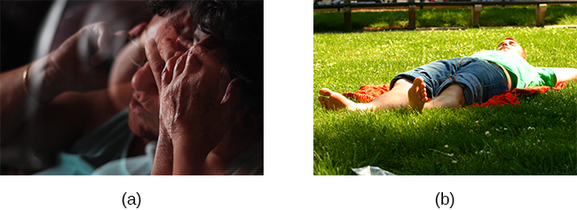

# 14.3 Căng thẳng và bệnh tật

> [!info]
>
> ### Mục tiêu học tập
>
> Đến cuối phần này, bạn sẽ có thể:
>
> - Giải thích bản chất của các rối loạn tâm sinh lý
> - Mô tả hệ thống miễn dịch và cách căng thẳng tác động đến hoạt động của nó
> - Mô tả cách thức căng thẳng và các yếu tố cảm xúc có thể dẫn đến sự phát triển và trầm trọng thêm của các rối loạn tim mạch, bệnh hen suyễn và chứng đau đầu do căng thẳng

Trong phần này, chúng ta sẽ thảo luận về **căng thẳng** (stress) và bệnh tật.
Như nhà nghiên cứu căng thẳng Robert Sapolsky (1998) đã mô tả:

bệnh tật liên quan đến căng thẳng xuất hiện, phần lớn, bắt nguồn từ thực tế là chúng ta quá thường xuyên kích hoạt một hệ thống sinh lý vốn đã tiến hóa để đối phó với các tình huống khẩn cấp cấp tính về thể chất, nhưng chúng ta lại bật nó chạy liên tục trong nhiều tháng ròng, chỉ để lo lắng về các khoản nợ thế chấp nhà, các mối quan hệ và chuyện thăng chức. (tr.
6)

Phản ứng căng thẳng, như đã lưu ý trước đó, bao gồm một hệ thống các phản ứng sinh lý phối hợp nhưng phức tạp được huy động khi cần thiết.
Những phản ứng này đôi khi có lợi vì chúng chuẩn bị cho chúng ta đối phó với các tình huống nguy hiểm hoặc đe dọa tiềm ẩn (ví dụ: hãy nhớ lại người bạn cũ của chúng ta, con gấu đáng sợ trên đường mòn).
Tuy nhiên, sức khỏe sẽ bị ảnh hưởng khi các phản ứng sinh lý này được duy trì kéo dài, như có thể xảy ra khi đối mặt với sự căng thẳng liên tục.

## Các rối loạn tâm sinh lý

Nếu các phản ứng tạo nên phản ứng căng thẳng diễn ra mãn tính hoặc nếu chúng thường xuyên vượt quá giới hạn bình thường, chúng có thể dẫn đến sự hao mòn tích lũy trên cơ thể, gần giống như cách việc bạn bật điều hòa nhiệt độ hết công suất suốt cả mùa hè cuối cùng sẽ làm nó bị hao mòn hỏng hóc.
Ví dụ, huyết áp cao mà một người phải trải qua khi chịu áp lực quá tải công việc đáng kể cuối cùng có thể gây tổn hại cho trái tim của họ và tạo điều kiện cho một cơn đau tim hoặc suy tim xuất hiện.
Ngoài ra, một người tiếp xúc với nồng độ cao của hormone căng thẳng cortisol có thể trở nên dễ bị nhiễm trùng hoặc mắc bệnh do chức năng của hệ thống miễn dịch bị suy yếu (McEwen, 1998).

> [!tip]
>
> ### Kết nối học tập
>
> Các nhà khoa học thần kinh Robert Sapolsky và Carol Shively đã tiến hành nghiên cứu sâu rộng về căng thẳng ở các loài linh trưởng không phải người trong hơn 30 năm.
> Cả hai đều chỉ ra rằng vị trí trong hệ thống thứ bậc xã hội dự đoán mức độ căng thẳng, tình trạng sức khỏe tâm thần và bệnh tật.
> Nghiên cứu của họ làm sáng tỏ cách thức căng thẳng có thể dẫn đến các kết quả tiêu cực về sức khỏe đối với những người bị kỳ thị hoặc tẩy chay.
> Dưới đây là hai video có sự tham gia của Tiến sĩ Sapolsky: một video về [sự căng thẳng chết người](https://openstax.org/l/sapolsky1) và video kia là một [bộ phim tài liệu chuyên sâu](https://openstax.org/l/sapolsky2) tuyệt vời từ *National Geographic*.

Các rối loạn thể chất hoặc bệnh tật mà các triệu chứng của chúng gây ra hoặc trở nên tồi tệ hơn bởi căng thẳng và các yếu tố cảm xúc được gọi là **các rối loạn tâm sinh lý** (psychophysiological disorders).
Các triệu chứng thể chất của rối loạn tâm sinh lý là có thật và chúng có thể được tạo ra hoặc trầm trọng thêm bởi các yếu tố tâm lý (do đó có từ *tâm* [psycho] và *sinh lý* [physiological] trong thuật ngữ tâm sinh lý).
Danh sách các rối loạn tâm sinh lý thường gặp được cung cấp trong [Bảng 14.3](#Table_14_03_01).

**Các loại rối loạn tâm sinh lý (phỏng theo Everly & Lating, 2002)**

| Loại rối loạn tâm sinh lý | Ví dụ |
| --- | --- |
| Tim mạch | tăng huyết áp, bệnh tim mạch vành |
| Tiêu hóa | hội chứng ruột kích thích |
| Hô hấp | hen suyễn, dị ứng |
| Cơ xương khớp | đau thắt lưng, đau đầu do căng thẳng |
| Da liễu | mụn trứng cá, chàm (eczema), vảy nến |

**Bảng 14.3**

Friedman và Booth-Kewley (1987) đã tổng quan thống kê 101 nghiên cứu để kiểm tra mối liên hệ giữa nhân cách và bệnh tật.
Họ đề xuất sự tồn tại của các đặc điểm nhân cách dễ mắc bệnh, bao gồm trầm cảm, tức giận/thù địch và lo âu.
Thật vậy, một nghiên cứu trên 61.000 người Na Uy đã xác định trầm cảm là một yếu tố rủi ro đối với tất cả các nguyên nhân tử vong chính liên quan đến bệnh tật (Mykletun et al., 2007).
Ngoài ra, tính nhạy cảm thần kinh (neuroticism)—một nét tính cách phản ánh mức độ lo âu, ủ rũ và buồn bã của một người—đã được xác định là một yếu tố rủi ro đối với các vấn đề sức khỏe mãn tính và tỷ lệ tử vong (Ploubidis & Grundy, 2009).

Dưới đây, chúng ta thảo luận về hai loại rối loạn tâm sinh lý đã được hiểu biết rất nhiều: các rối loạn tim mạch và bệnh hen suyễn.
Tuy nhiên, trước tiên, cần chuyển sự chú ý của chúng ta sang việc thảo luận về hệ thống miễn dịch—một trong những con đường chính mà qua đó căng thẳng và các yếu tố cảm xúc có thể dẫn đến ốm đau và bệnh tật.

> [!abstract]
>
> ### Kết nối đời sống
>
> #### Địa vị xã hội, căng thẳng và chăm sóc sức khỏe
>
> Các nhà tâm lý học từ lâu đã nhận thức được rằng địa vị xã hội (ví dụ: sự giàu có, đặc quyền) gắn bó mật thiết với căng thẳng, sức khỏe và sự an vui.
> Một số yếu tố góp phần gây ra mức độ căng thẳng cao và sức khỏe kém ở những người có địa vị xã hội thấp hơn bao gồm sự thiếu kiểm soát và thiếu khả năng dự đoán (ví dụ: tỷ lệ thất nghiệp cao hơn) cùng sự bất bình đẳng về nguồn lực (ví dụ: ít tiếp cận với dịch vụ chăm sóc sức khỏe và các nguồn lực cộng đồng khác) (Marmot & Sapolsky, 2014).
>
> Tại Hoa Kỳ, sự bất bình đẳng về nguồn lực gắn liền với địa vị xã hội thường tạo ra những khác biệt về chủng tộc và giới tính trong chăm sóc sức khỏe.
> Ví dụ, phụ nữ người Mỹ gốc Phi có tỷ lệ đến phòng cấp cứu và nhu cầu chăm sóc sức khỏe không được đáp ứng cao nhất so với bất kỳ nhóm nào khác, và sự chênh lệch này đã tăng lên đáng kể từ năm 2006 đến năm 2014 (Manuel, 2018).
> Thanh thiếu niên đồng tính nữ, đồng tính nam, song tính và chuyển giới thường trải qua chất lượng chăm sóc kém do sự kỳ thị, thiếu hiểu biết và sự vô cảm của các chuyên gia y tế (Hafeez, Zeshan, Tahir, Jahan, & Naveed, 2017).
> Một mục tiêu trong sáng kiến Healthy People 2020 của chính phủ Hoa Kỳ là xóa bỏ sự chênh lệch về giới tính và chủng tộc trong chăm sóc sức khỏe.
> Tập dữ liệu tương tác của họ cung cấp một bức tranh cập nhật về sự chênh lệch sức khỏe: <https://www.healthypeople.gov/2020/data-search/health-disparities-data>.

## Căng thẳng và hệ thống miễn dịch

Theo một nghĩa nào đó, **hệ thống miễn dịch** (immune system) là hệ thống giám sát của cơ thể.
Nó bao gồm nhiều cấu trúc, tế bào và cơ chế khác nhau nhằm bảo vệ cơ thể khỏi sự xâm nhập của các vi sinh vật có thể làm tổn hại hoặc phá hủy các mô và cơ quan của cơ thể.
Khi hệ thống miễn dịch hoạt động bình thường, nó giữ cho chúng ta khỏe mạnh và không mắc bệnh bằng cách loại bỏ các vi khuẩn, vi rút có hại và các chất ngoại lai khác xâm nhập vào cơ thể (Everly & Lating, 2002).

### Các sai sót của hệ thống miễn dịch

Đôi khi, hệ thống miễn dịch sẽ hoạt động sai lệch.
Ví dụ, đôi khi nó có thể gặp trục trặc do nhầm lẫn các tế bào khỏe mạnh của chính cơ thể bạn là những kẻ xâm lược và liên tục tấn công chúng.
Khi điều này xảy ra, người đó được cho là mắc bệnh tự miễn (autoimmune disease), vốn có thể ảnh hưởng đến hầu như bất kỳ bộ phận nào của cơ thể.
Cách một bệnh tự miễn ảnh hưởng đến một người phụ thuộc vào bộ phận nào của cơ thể bị nhắm mục tiêu.
Chẳng hạn, viêm khớp dạng thấp, một bệnh tự miễn ảnh hưởng đến các khớp, dẫn đến đau khớp, cứng khớp và mất chức năng.
Bệnh lupus ban đỏ hệ thống (lupus), một bệnh tự miễn, khiến cơ thể một người tự tấn công các mô của chính mình và có thể gây tổn thương vĩnh viễn cho nhiều cơ quan, bao gồm tim, phổi và thận.
Viêm tuyến giáp Hashimoto, một bệnh tự miễn ảnh hưởng đến tuyến giáp, có thể dẫn đến trầm cảm, mệt mỏi, chuột rút cơ bắp và các vấn đề về tim (Hiệp hội các nhà nội tiết lâm sàng Hoa Kỳ và Hiệp hội tuyến giáp Hoa Kỳ, 2012).

Ngoài ra, hệ thống miễn dịch đôi khi có thể bị suy sụp và không thể thực hiện công việc của mình.
Tình trạng này được gọi là **sự suy giảm miễn dịch** (immunosuppression), tức là sự suy giảm hiệu quả của hệ thống miễn dịch.
Khi mọi người trải qua sự suy giảm miễn dịch, họ trở nên dễ bị nhiễm trùng và mắc bất kỳ căn bệnh nào.
Ví dụ, hội chứng suy giảm miễn dịch mắc phải (AIDS) là một căn bệnh nghiêm trọng và gây tử vong do vi rút gây suy giảm miễn dịch ở người (HIV) gây ra; vi rút này làm suy yếu đáng kể hệ thống miễn dịch bằng cách lây nhiễm và phá hủy các tế bào sản xuất kháng thể, do đó khiến một người không được điều trị dễ bị nhiễm bất kỳ bệnh nhiễm trùng cơ hội nào (Powell, 1996).

### Các tác nhân gây căng thẳng và chức năng miễn dịch

Câu hỏi liệu căng thẳng và các trạng thái cảm xúc tiêu cực có thể ảnh hưởng đến chức năng miễn dịch hay không đã thu hút các nhà nghiên cứu trong hơn ba thập kỷ, và những phát hiện được thực hiện trong khoảng thời gian đó đã làm thay đổi đáng kể diện mạo của tâm lý học sức khỏe (Kiecolt-Glaser, 2009).
**Tâm thần - thần kinh - miễn dịch học** (psychoneuroimmunology) là lĩnh vực nghiên cứu cách các yếu tố tâm lý như căng thẳng ảnh hưởng đến hệ thống miễn dịch và hoạt động của hệ miễn dịch.
Thuật ngữ tâm thần - thần kinh - miễn dịch học lần đầu tiên được đặt ra vào năm 1981, khi nó xuất hiện dưới dạng tựa đề của một cuốn sách đánh giá các bằng chứng sẵn có về mối liên hệ giữa não bộ, hệ nội tiết và hệ miễn dịch (Zacharie, 2009).
Ở một mức độ lớn, lĩnh vực này phát triển từ phát hiện cho thấy có mối liên hệ giữa hệ thần kinh trung ương và hệ thống miễn dịch.

Một số bằng chứng thuyết phục nhất về mối liên hệ giữa não bộ và hệ thống miễn dịch đến từ các nghiên cứu trong đó các nhà nghiên cứu đã chứng minh rằng các phản ứng miễn dịch ở động vật có thể được điều kiện hóa cổ điển (Everly & Lating, 2002).
Ví dụ, Ader và Cohen (1975) đã ghép đôi nước có hương vị (kích thích có điều kiện) với việc dùng một loại thuốc ức chế miễn dịch (kích thích không điều kiện), gây ra tình trạng ốm (phản ứng không điều kiện).
Không có gì đáng ngạc nhiên khi những con chuột tiếp xúc với sự ghép đôi này phát triển một ác cảm có điều kiện đối với nước có hương vị.
Tuy nhiên, chỉ riêng vị của nước sau đó đã tạo ra sự suy giảm miễn dịch (phản ứng có điều kiện), cho thấy rằng bản thân hệ thống miễn dịch đã được điều kiện hóa.
Nhiều nghiên cứu tiếp theo qua nhiều năm đã chứng minh thêm rằng các phản ứng miễn dịch có thể được điều kiện hóa cổ điển ở cả động vật và con người (Ader & Cohen, 2001).
Do đó, nếu điều kiện hóa cổ điển có thể làm thay đổi khả năng miễn dịch, thì các yếu tố tâm lý khác cũng có khả năng làm thay đổi nó.

Hàng trăm nghiên cứu liên quan đến hàng chục nghìn người tham gia đã thử nghiệm nhiều loại tác nhân gây căng thẳng ngắn hạn và mãn tính cùng những ảnh hưởng của chúng đối với hệ thống miễn dịch (ví dụ: nói trước công chúng, các kỳ thi ở trường y, thất nghiệp, bất hòa trong hôn nhân, ly hôn, cái chết của người phối ngẫu, kiệt sức và quá tải công việc, chăm sóc người thân mắc bệnh Alzheimer và tiếp xúc với khí hậu khắc nghiệt ở Nam Cực).
Người ta đã nhiều lần chứng minh rằng nhiều loại tác nhân gây căng thẳng có liên quan đến chức năng miễn dịch kém hoặc bị suy yếu (Glaser & Kiecolt-Glaser, 2005; Kiecolt-Glaser, McGuire, Robles, & Glaser, 2002; Segerstrom & Miller, 2004).

Khi đánh giá những phát hiện này, điều quan trọng cần nhớ là có một mối liên hệ sinh lý hữu hình giữa não bộ và hệ thống miễn dịch.
Ví dụ, hệ thần kinh giao cảm phân nhánh chi phối các cơ quan miễn dịch như tuyến ức, tủy xương, lá lách và thậm chí cả các hạch bạch huyết (Maier, Watkins, & Fleshner, 1994).
Ngoài ra, chúng ta đã lưu ý trước đó rằng các hormone căng thẳng được giải phóng trong quá trình kích hoạt trục dưới đồi - tuyến yên - tuyến thượng thận (HPA) có thể tác động bất lợi đến chức năng miễn dịch.
Một cách chúng làm điều này là ức chế quá trình sản xuất **tế bào lympho** (lymphocytes), các tế bào bạch cầu lưu thông trong các dịch cơ thể có vai trò quan trọng trong phản ứng miễn dịch (Everly & Lating, 2002).

Một số ví dụ ấn tượng hơn chứng minh mối liên hệ giữa căng thẳng và sự suy giảm chức năng miễn dịch liên quan đến các nghiên cứu trong đó các tình nguyện viên được cho tiếp xúc với vi rút.
Cơ sở lý luận đằng sau nghiên cứu này là vì căng thẳng làm suy yếu hệ thống miễn dịch, nên những người có mức độ căng thẳng cao sẽ có nhiều khả năng mắc bệnh hơn so với những người chịu ít căng thẳng.
Trong một thí nghiệm đáng nhớ sử dụng phương pháp này, các nhà nghiên cứu đã phỏng vấn 276 tình nguyện viên khỏe mạnh về những trải nghiệm căng thẳng gần đây (Cohen et al., 1998).
Sau cuộc phỏng vấn, những người tham gia này được nhỏ thuốc nhỏ mũi có chứa vi rút cảm lạnh (trong trường hợp bạn tự hỏi tại sao lại có người muốn tham gia vào một nghiên cứu mà họ phải chịu sự đối xử như vậy, các tình nguyện viên đã được trả 800 đô la cho sự phiền toái của họ).
Khi được kiểm tra sau đó, những người tham gia báo cáo đã trải qua các tác nhân gây căng thẳng mãn tính trong hơn một tháng—đặc biệt là những khó khăn kéo dài liên quan đến công việc hoặc các mối quan hệ—có nhiều khả năng bị cảm lạnh hơn đáng kể so với những người tham gia báo cáo không có tác nhân gây căng thẳng mãn tính ([Hình 14.15](#CNX_Psych_14_03_StressCold)).

![Một biểu đồ thanh hiển thị mối quan hệ giữa các tác nhân gây căng thẳng mãn tính và tỷ lệ phần trăm những người bị cảm lạnh sau khi nhận vi rút cảm lạnh. Khoảng 50% số người có các tác nhân gây căng thẳng mãn tính trong ít nhất một tháng bị cảm lạnh so với khoảng 35% không có các tác nhân gây căng thẳng mãn tính. Khoảng 52% số người có các tác nhân gây căng thẳng mãn tính trong ít nhất ba tháng bị cảm lạnh so với khoảng 35% không có các tác nhân gây căng thẳng mãn tính. Khoảng 51% số người có các tác nhân gây căng thẳng mãn tính trong ít nhất sáu tháng bị cảm lạnh so với khoảng 35% không có các tác nhân gây căng thẳng mãn tính.](../../images/img_919c5e5fb216.jpg)

**Hình 14.15** Biểu đồ này cho thấy tỷ lệ phần trăm người tham gia bị cảm lạnh (sau khi nhận vi rút cảm lạnh) sau khi báo cáo đã trải qua các tác nhân gây căng thẳng mãn tính kéo dài ít nhất một tháng, ba tháng và sáu tháng (phỏng theo Cohen et al., 1998).

Trong một nghiên cứu khác, các tình nguyện viên lớn tuổi được tiêm vắc xin phòng vi rút cúm.
So với nhóm đối chứng, những người đang chăm sóc người phối ngẫu mắc bệnh Alzheimer (và do đó đang phải chịu căng thẳng mãn tính) cho thấy phản ứng kháng thể kém hơn sau khi tiêm vắc xin (Kiecolt-Glaser, Glaser, Gravenstein, Malarkey, & Sheridan, 1996).

Các nghiên cứu khác đã chứng minh rằng căng thẳng làm chậm quá trình lành vết thương bằng cách làm suy giảm các phản ứng miễn dịch quan trọng đối với việc phục hồi vết thương (Glaser & Kiecolt-Glaser, 2005).
Ví dụ, trong một nghiên cứu, các vết phồng rộp trên da được tạo ra trên cẳng tay.
Những đối tượng báo cáo mức độ căng thẳng cao hơn đã sản xuất mức protein miễn dịch cần thiết cho quá trình làm lành vết thương thấp hơn (Glaser et al., 1999).
Có thể nói, căng thẳng không hẳn là thanh gươm giết chết hiệp sĩ; đúng hơn, nó là thanh kiếm chém vỡ tấm khiên của hiệp sĩ, và hệ thống miễn dịch của bạn chính là tấm khiên đó.

> [!note]
>
> ### Đào sâu tìm hiểu
>
> #### Căng thẳng và sự lão hóa: Câu chuyện về các Telomere
>
> Bạn có bao giờ tự hỏi tại sao những người bị căng thẳng thường có vẻ ngoài tiều tụy, già nua?
> Một nghiên cứu tiên phong từ năm 2004 gợi ý rằng lý do là vì căng thẳng thực sự có thể đẩy nhanh quá trình sinh học tế bào của sự lão hóa.
>
> Căng thẳng, có vẻ như, có thể làm rút ngắn telomere, vốn là các đoạn DNA bảo vệ phần đầu mút của các nhiễm sắc thể.
> Các telomere bị rút ngắn có thể ức chế hoặc ngăn chặn sự phân chia tế bào, bao gồm sự phát triển và tăng sinh của các tế bào mới, do đó dẫn đến sự lão hóa nhanh hơn (Sapolsky, 2004).
> Trong nghiên cứu này, các nhà nghiên cứu đã so sánh chiều dài **telomere** trong các tế bào bạch cầu ở những bà mẹ có con bị bệnh mãn tính với chiều dài telomere của những bà mẹ có con khỏe mạnh (Epel et al., 2004).
> Những bà mẹ có con bị bệnh mãn tính được dự đoán là sẽ trải qua nhiều căng thẳng hơn so với những bà mẹ có con khỏe mạnh.
> Một người mẹ càng dành nhiều thời gian chăm sóc đứa con bị bệnh của mình thì telomere của cô ấy càng ngắn lại (mối tương quan giữa số năm chăm sóc và chiều dài telomere là *r* = -.40).
> Ngoài ra, mức độ căng thẳng được nhận thức cao hơn có tương quan nghịch với kích thước telomere (*r* = -.31).
> Những nhà nghiên cứu này cũng phát hiện ra rằng chiều dài telomere trung bình của những bà mẹ căng thẳng nhất, so với những bà mẹ ít căng thẳng nhất, tương tự như những gì bạn thấy ở những người già hơn họ từ 9–17 tuổi tính theo mức trung bình.
>
> Nhiều nghiên cứu khác kể từ đó đã tiếp tục tìm thấy mối liên hệ giữa căng thẳng và sự bào mòn telomere (Blackburn & Epel, 2012).
> Một số nghiên cứu thậm chí còn chứng minh rằng căng thẳng có thể bắt đầu làm xói mòn telomere ngay từ thời thơ ấu và thậm chí có thể trước khi đứa trẻ được sinh ra.
> Ví dụ, việc tiếp xúc với bạo lực thời thơ ấu (chẳng hạn như bạo lực gia đình từ người mẹ, nạn nhân bị bắt nạt và ngược đãi thể xác) đã được phát hiện trong một nghiên cứu là đẩy nhanh sự bào mòn telomere từ 5 đến 10 tuổi (Shalev et al., 2013).
> Một nghiên cứu khác báo cáo rằng những thanh niên có mẹ trải qua căng thẳng nghiêm trọng trong thời kỳ mang thai có telomere ngắn hơn so với những người có mẹ trải qua thai kỳ bình yên, không căng thẳng (Entringer et al., 2011).
> Hơn nữa, những tác động ăn mòn của căng thẳng thời thơ ấu đối với telomere có thể kéo dài đến tuổi trưởng thành trẻ tuổi.
> Trong một cuộc điều tra trên 4.000 phụ nữ Vương quốc Anh ở độ tuổi 41–80, những trải nghiệm bất lợi thời thơ ấu (ví dụ: bị lạm dụng thể xác, bị đuổi khỏi nhà và cha mẹ ly hôn) có liên quan đến việc rút ngắn chiều dài telomere (Surtees et al., 2010), và kích thước telomere giảm khi số lượng nghịch cảnh trải qua tăng lên ([Hình 14.16](#CNX_Psych_14_03_Telomeres)).
>
> 
>
> 
>
> **Hình 14.16** Các telomere ngắn hơn ở những người trưởng thành từng trải qua nhiều sang chấn hơn khi còn nhỏ (phỏng theo Blackburn & Epel, 2012).
>
> Các nỗ lực nhằm mổ xẻ các cơ chế tế bào và sinh lý chính xác liên kết các telomere ngắn với căng thẳng và bệnh tật hiện đang được tiến hành.
> Hiện tại, các telomere cung cấp cho chúng ta một lời nhắc nhở nữa rằng căng thẳng, đặc biệt là trong giai đoạn đầu đời, có thể gây hại cho sức khỏe của chúng ta không kém gì việc hút thuốc hay ăn đồ ăn nhanh (Blackburn & Epel, 2012).

## Các rối loạn tim mạch

Hệ thống tim mạch bao gồm tim và hệ thống tuần hoàn máu.
Trong nhiều năm, các rối loạn liên quan đến hệ tim mạch—được gọi là **các rối loạn tim mạch** (cardiovascular disorders)—đã là một trọng tâm lớn trong nghiên cứu về các rối loạn tâm sinh lý vì tính chất trung tâm của hệ tim mạch trong phản ứng căng thẳng (Everly & Lating, 2002). **Bệnh tim** (heart disease) là một tình trạng như vậy.
Mỗi năm, bệnh tim cướp đi sinh mạng của khoảng một phần ba số ca tử vong ở Hoa Kỳ, và nó là nguyên nhân gây tử vong hàng đầu ở các nước phát triển (Trung tâm Kiểm soát và Phòng ngừa Dịch bệnh [CDC], 2011; Shapiro, 2005).

Các triệu chứng của bệnh tim thay đổi đôi chút tùy thuộc vào loại bệnh tim cụ thể mà một người mắc phải, nhưng nhìn chung chúng liên quan đến chứng đau thắt ngực (angina)—các cơn đau ngực hoặc khó chịu xảy ra khi tim không nhận đủ máu (Văn phòng Sức khỏe Phụ nữ, 2009).
Cơn đau thường có cảm giác như lồng ngực bị đè ép hoặc bóp nghẹt; cảm giác bỏng rát ở ngực và khó thở cũng thường được báo cáo.
Cơn đau và cảm giác khó chịu như vậy có thể lan ra cánh tay, cổ, hàm, dạ dày (dưới dạng buồn nôn) và lưng (Hiệp hội Tim mạch Hoa Kỳ [AHA], 2012a) ([Hình 14.17](#CNX_Psych_14_03_Symptoms)).

**Hình 14.17** Nam giới và nữ giới thường trải qua các triệu chứng đau tim khác nhau.

Một yếu tố rủi ro lớn đối với bệnh tim là **tăng huyết áp** (hypertension), tức là huyết áp cao.
Tăng huyết áp buộc tim của một người phải bơm mạnh hơn, do đó gây thêm áp lực thể chất lên tim.
Nếu không được kiểm soát, tăng huyết áp có thể dẫn đến đau tim, đột quỵ hoặc suy tim; nó cũng có thể dẫn đến suy thận và mù lòa.
Tăng huyết áp là một rối loạn tim mạch nghiêm trọng, và nó đôi khi được gọi là "kẻ giết người thầm lặng" vì nó không có triệu chứng—một người bị huyết áp cao thậm chí có thể không hề hay biết về tình trạng này (AHA, 2012b).

Nhiều yếu tố rủi ro góp phần gây ra các rối loạn tim mạch đã được xác định.
Các yếu tố rủi ro này bao gồm các yếu tố quyết định xã hội như lão hóa, thu nhập, học vấn và tình trạng việc làm, cũng như các yếu tố rủi ro hành vi bao gồm chế độ ăn uống không lành mạnh, sử dụng thuốc lá, lười vận động thể chất và tiêu thụ rượu bia quá mức; béo phì và tiểu đường là những yếu tố rủi ro bổ sung (Tổ chức Y tế Thế giới [WHO], 2013).

Trong vài thập kỷ qua, đã có sự công nhận và nhận thức lớn hơn nhiều về tầm quan trọng của căng thẳng và các yếu tố tâm lý khác đối với sức khỏe tim mạch (Nusair, Al-dadah, & Kumar, 2012).
Thật vậy, việc tiếp xúc với nhiều loại tác nhân gây căng thẳng cũng có liên quan đến các vấn đề tim mạch; trong trường hợp tăng huyết áp, một số tác nhân gây căng thẳng này bao gồm quá tải công việc (Trudel, Brisson, & Milot, 2010), thảm họa thiên nhiên (Saito, Kim, Maekawa, Ikeda, & Yokoyama, 1997), xung đột hôn nhân (Nealey-Moore, Smith, Uchino, Hawkins, & Olson-Cerny, 2007) và tiếp xúc với mức độ tiếng ồn giao thông cao tại nhà của một người (de Kluizenaar, Gansevoort, Miedema, & de Jong, 2007).
Sự phân biệt đối xử được nhận thức dường như có liên quan đến chứng tăng huyết áp ở người Mỹ gốc Phi (Sims et al., 2012).
Ngoài ra, các nhiệm vụ gây căng thẳng trong phòng thí nghiệm, chẳng hạn như làm tính nhẩm dưới áp lực thời gian, ngâm tay vào nước đá (được gọi là thử nghiệm ép lạnh - cold pressor test), vẽ theo gương và nói trước công chúng đều cho thấy làm tăng huyết áp (Phillips, 2011).

## Bạn thuộc Kiểu A hay Kiểu B?

Đôi khi các ý tưởng và lý thuyết nghiên cứu lại xuất hiện từ những quan sát dường như tầm thường.
Vào những năm 1950, bác sĩ tim mạch Meyer Friedman đang xem xét đồ nội thất trong phòng chờ của mình, bao gồm những chiếc ghế bọc nệm có tay vịn.
Friedman quyết định bọc lại những chiếc ghế này.
Khi người thợ bọc ghế đến văn phòng để làm việc, anh ta nhận xét về việc những chiếc ghế bị sờn rách theo một cách độc đáo—các mép trước của đệm ghế bị mòn rách, cũng như các đầu trước của tay vịn.
Dường như các bệnh nhân tim mạch thường gõ gõ hoặc bóp chặt phần trước của tay vịn, cũng như ngồi theo nghĩa đen ở ngay mép ngoài của chiếc ghế (Friedman & Rosenman, 1974).
Liệu các bệnh nhân tim mạch có điểm gì đó khác biệt so với các loại bệnh nhân khác không?
Nếu có, thì khác như thế nào?

Sau khi nghiên cứu vấn đề này, Friedman và cộng sự của ông là Ray Rosenman đã nhận ra rằng những người dễ mắc bệnh tim có xu hướng suy nghĩ, cảm nhận và hành động khác với những người không mắc bệnh.
Những cá nhân này có xu hướng là những người tham công tiếc việc bị thúc đẩy mãnh liệt, luôn bận tâm với các hạn chót và dường như luôn trong tình trạng vội vã.
Theo Friedman và Rosenman, những cá nhân này thể hiện mô thức hành vi **Kiểu A** (Type A); những người thoải mái và thư thái hơn được đặc trưng là **Kiểu B** (Type B) ([Hình 14.18](#CNX_Psych_14_03_TypeAB)).
Trong một mẫu gồm những người Kiểu A và Kiểu B, Friedman và Rosenman đã giật mình khi phát hiện ra rằng bệnh tim xuất hiện thường xuyên hơn gấp 7 lần ở những người Kiểu A so với những người Kiểu B (Friedman & Rosenman, 1959).

**Hình 14.18** (a) Những cá nhân Kiểu A được đặc trưng là bị thúc đẩy mãnh liệt, (b) trong khi những người Kiểu B được đặc trưng là thư thái và thoải mái. (nguồn a: sửa đổi công trình của Greg Hernandez; nguồn b: sửa đổi công trình của Elvert Barnes)

Các thành phần chính của mô thức Kiểu A bao gồm một sự vật lộn hung hăng và mãn tính để đạt được ngày càng nhiều hơn trong khoảng thời gian ngày càng ít hơn (Friedman & Rosenman, 1974).
Các đặc điểm cụ thể của mô thức Kiểu A bao gồm động lực cạnh tranh quá mức, cảm giác khẩn cấp về thời gian thường trực, sự thiếu kiên nhẫn và tính thù địch đối với người khác (đặc biệt là những người cản đường họ).

Một ví dụ về một người thể hiện mô thức hành vi Kiểu A là Jeffrey.
Ngay từ khi còn nhỏ, Jeffrey đã là một người quyết liệt và đầy tham vọng.
Anh xuất sắc ở trường, là đội trưởng đội bơi lội và tốt nghiệp loại xuất sắc từ một trường đại học thuộc khối Ivy League.
Jeffrey dường như không bao giờ có thể thư giãn; anh luôn làm một việc gì đó, ngay cả vào những ngày cuối tuần.
Tuy nhiên, Jeffrey dường như luôn cảm thấy không có đủ số giờ trong ngày để hoàn thành tất cả những gì anh cảm thấy mình nên làm.
Anh tình nguyện đảm nhận thêm nhiệm vụ tại nơi làm việc và thường mang việc về nhà; anh thường đi ngủ trong tâm trạng thất vọng vào đêm khuya vì cảm thấy mình chưa làm đủ.
Jeffrey rất nóng tính với các đồng nghiệp; anh thường trở nên kích động rõ rệt khi đối phó với những đồng nghiệp mà anh cảm thấy làm việc quá chậm chạp hoặc công việc của họ không đáp ứng các tiêu chuẩn của anh.
Anh thường phản ứng với sự thù địch khi bị gián đoạn tại nơi làm việc.
Anh đã trải qua những rạn nứt trong cuộc hôn nhân do thiếu thời gian dành cho gia đình.
Khi bị kẹt xe trên đường đi làm và về nhà, Jeffrey không ngừng đập tay vào còi xe và chửi thề om sòm với những người lái xe khác.
Khi Jeffrey 52 tuổi, anh đã trải qua cơn đau tim đầu tiên.

Đến những năm 1970, phần lớn các bác sĩ tim mạch đang hành nghề đều tin rằng mô thức hành vi Kiểu A là một yếu tố rủi ro đáng kể đối với bệnh tim (Friedman, 1977).
Thật vậy, một số cuộc điều tra theo chiều dọc ban đầu đã chứng minh mối liên hệ giữa mô thức hành vi Kiểu A và sự phát triển sau này của bệnh tim (Rosenman et al., 1975; Haynes, Feinleib, & Kannel, 1980).

Tuy nhiên, các nghiên cứu tiếp theo kiểm tra mối liên hệ giữa Kiểu A và bệnh tim đã không lặp lại được những phát hiện ban đầu này (Glassman, 2007; Myrtek, 2001).
Bởi vì lý thuyết Kiểu A đã không mang lại kết quả như họ mong đợi, các nhà nghiên cứu đã chuyển sự chú ý của họ sang việc xác định xem liệu có bất kỳ yếu tố cụ thể nào của Kiểu A dự đoán bệnh tim hay không.

Nghiên cứu sâu rộng cho thấy rõ ràng rằng khía cạnh tức giận/thù địch của mô thức hành vi Kiểu A có thể là một trong những yếu tố quan trọng nhất trong sự phát triển của bệnh tim.
Mối quan hệ này ban đầu được mô tả trong nghiên cứu của Haynes et al. (1980) đã đề cập ở trên: Sự thù địch bị dồn nén được phát hiện là làm tăng đáng kể nguy cơ mắc bệnh tim cho cả nam và nữ.
Ngoài ra, một cuộc điều tra đã theo dõi hơn 1.000 sinh viên y khoa nam từ 32 đến 48 năm.
Vào đầu cuộc nghiên cứu, những người đàn ông này đã hoàn thành một bảng câu hỏi đánh giá cách họ phản ứng với áp lực; một số người chỉ ra rằng họ phản ứng với mức độ **tức giận** (anger) cao, trong khi những người khác chỉ ra rằng họ phản ứng với sự tức giận ít hơn.
Nhiều thập kỷ sau, các nhà nghiên cứu phát hiện ra rằng những người trước đó từng biểu thị mức độ tức giận cao nhất có nguy cơ bị đau tim ở tuổi 55 cao hơn gấp 6 lần so với những người biểu thị sự tức giận ít hơn, và họ có nguy cơ mắc bệnh tim ở cùng độ tuổi cao hơn gấp 3,5 lần (Chang, Ford, Meoni, Wang, & Klag, 2002).
Đứng trên góc độ sức khỏe, việc là một người hay tức giận rõ ràng không mang lại điều gì tốt đẹp.

Sau khi xem xét và tổng kết thống kê 35 nghiên cứu từ năm 1983 đến năm 2006, Chida và Steptoe (2009) kết luận rằng phần lớn các bằng chứng cho thấy sự tức giận và thù địch cấu thành các yếu tố rủi ro lâu dài nghiêm trọng đối với các kết quả tim mạch bất lợi ở cả những người khỏe mạnh và những người vốn đã mắc bệnh tim.
Một lý do khiến tâm trạng tức giận và thù địch có thể góp phần gây ra các bệnh tim mạch là vì những tâm trạng như vậy có thể tạo ra sự căng thẳng xã hội, chủ yếu dưới hình thức các cuộc đụng độ xã hội đối kháng với người khác.
Sự căng thẳng này sau đó có thể đặt nền tảng cho các phản ứng tim mạch thúc đẩy bệnh tật ở những cá nhân mang tính thù địch (Vella, Kamarck, Flory, & Manuck, 2012).
Trong mô hình tương tác giao dịch này, tính thù địch và căng thẳng xã hội tạo thành một vòng luẩn quẩn ([Hình 14.19](#CNX_Psych_14_03_Transactional)).

![Một hình vẽ hiển thị phác thảo cơ thể nữ và nam đại diện cho các tương tác xã hội được phác thảo trong mô hình giao dịch của tính thù địch. Hành vi của một người thù địch được liệt kê là thù địch, đối đầu, phòng thủ và hung hăng. Phản ứng của người tiếp nhận là ngạc nhiên, né tránh và phòng thủ. Vòng tuần hoàn giao dịch là sự củng cố hành vi thù địch, và những suy nghĩ cùng cảm xúc của người thù địch là tức giận, không tin tưởng và coi thường người khác. Các mũi tên nối các hình vẽ nữ và nam cho thấy một mô thức liên tục.](../../images/img_cbf6da722b6c.jpg)

**Hình 14.19** Theo mô hình giao dịch của tính thù địch để dự đoán các tương tác xã hội (Vella et al., 2012), những suy nghĩ và cảm xúc của một người thù địch thúc đẩy hành vi đối kháng đối với người khác, điều này đến lượt nó lại củng cố những phản ứng tương tự từ người khác, do đó làm gia tăng thiên hướng thù địch của một người và tăng cường tính chu kỳ của mối quan hệ này.

Ví dụ, giả sử Kaitlin có thiên hướng thù địch; cô ấy có thái độ hoài nghi, không tin tưởng người khác và thường nghĩ rằng người khác đang muốn hãm hại mình.
Cô ấy rất phòng thủ xung quanh mọi người, ngay cả những người cô đã biết nhiều năm, và cô luôn tìm kiếm những dấu hiệu cho thấy người khác đang thiếu tôn trọng hoặc coi thường mình.
Trong phòng tắm mỗi sáng trước khi đi làm, cô thường diễn tập trong đầu những gì cô sẽ nói với một người đã nói hoặc làm điều gì đó khiến cô tức giận, chẳng hạn như đưa ra một nhận định chính trị đi ngược lại hệ tư tưởng của chính cô.
Khi Kaitlin trải qua những màn diễn tập tinh thần này, cô thường cười mỉm và nghĩ về việc trả đũa bất kỳ ai sẽ làm cô khó chịu ngày hôm đó.

Về mặt xã hội, cô ấy hay đối đầu và có xu hướng sử dụng giọng điệu gay gắt với mọi người, điều này thường dẫn đến các tương tác xã hội rất khó chịu và đôi khi mang tính tranh cãi.
Như bạn có thể hình dung, Kaitlin không đặc biệt được người khác yêu mến, bao gồm đồng nghiệp, hàng xóm và thậm chí cả các thành viên trong gia đình cô.
Họ hoặc tránh xa cô bằng mọi giá hoặc gắt gỏng lại với cô, điều này khiến Kaitlin càng trở nên hoài nghi và mất lòng tin vào người khác hơn, khiến tính khí của cô càng thêm thù địch.
Sự thù địch của Kaitlin—thông qua hành động của chính cô—đã tạo ra một môi trường đối kháng khiến cô trở nên thù địch và tức giận hơn theo một chu kỳ luẩn quẩn, do đó có khả năng tạo tiền đề cho các vấn đề tim mạch.

Ngoài sự tức giận và thù địch, một số trạng thái cảm xúc tiêu cực khác cũng có liên quan đến bệnh tim, bao gồm tính cảm xúc tiêu cực và trầm cảm (Suls & Bunde, 2005).
**Tính cảm xúc tiêu cực** (negative affectivity) là xu hướng trải nghiệm các trạng thái cảm xúc đau khổ liên quan đến tức giận, khinh miệt, ghê tởm, tội lỗi, sợ hãi và lo lắng (Watson, Clark, & Tellegen, 1988).
Nó có liên quan đến sự phát triển của cả bệnh tăng huyết áp và bệnh tim.
Ví dụ, hơn 3.000 người tham gia ban đầu khỏe mạnh trong một nghiên cứu đã được theo dõi theo chiều dọc, lên đến 22 năm.
Những người có mức độ cảm xúc tiêu cực cao hơn tại thời điểm nghiên cứu bắt đầu có nhiều khả năng phát triển và phải điều trị bệnh tăng huyết áp hơn đáng kể trong những năm sau đó so với những người có mức độ cảm xúc tiêu cực thấp hơn (Jonas & Lando, 2000).
Ngoài ra, một nghiên cứu trên 10.000 công chức trung niên ở London được theo dõi trung bình 12,5 năm đã tiết lộ rằng những người trước đó từng đạt điểm ở nhóm một phần ba cao nhất trong bài kiểm tra về tính cảm xúc tiêu cực có nguy cơ mắc bệnh tim, đau tim hoặc đau thắt ngực trong khoảng thời gian nhiều năm cao hơn 32% so với những người đạt điểm ở nhóm một phần ba thấp nhất (Nabi, Kivimaki, De Vogli, Marmot, & Singh-Manoux, 2008).
Do đó, tính cảm xúc tiêu cực dường như là một yếu tố rủi ro có khả năng mang tính sống còn đối với sự phát triển của các rối loạn tim mạch.

## Trầm cảm và trái tim

Trong nhiều thế kỷ, các thi sĩ và văn hóa dân gian đã khẳng định rằng có mối liên hệ giữa tâm trạng và trái tim (Glassman & Shapiro, 1998).
Bạn chắc chắn đã quen thuộc với khái niệm về một "trái tim tan vỡ" sau một sự kiện đáng thất vọng hoặc chán nản và đã bắt gặp khái niệm đó trong các bài hát, phim ảnh và văn học.

Có lẽ người đầu tiên nhận ra mối liên hệ giữa **trầm cảm** (depression) và **bệnh tim** (heart disease) là Benjamin Malzberg (1937), người phát hiện ra rằng tỷ lệ tử vong ở những bệnh nhân nằm viện mắc chứng u sầu (melancholia - một thuật ngữ cổ xưa chỉ bệnh trầm cảm) cao gấp sáu lần so với dân số chung.
Một nghiên cứu kinh điển vào cuối những năm 1970 đã xem xét hơn 8.000 người được chẩn đoán mắc chứng rối loạn hưng trầm cảm (ngày nay được phân loại là rối loạn lưỡng cực) ở Đan Mạch, phát hiện thấy số ca tử vong do bệnh tim ở những bệnh nhân này tăng gần 50% so với dân số Đan Mạch nói chung (Weeke, 1979).
Đến đầu những năm 1990, các bằng chứng bắt đầu tích lũy cho thấy những cá nhân bị trầm cảm được theo dõi trong thời gian dài có nguy cơ mắc bệnh tim và tử vong do tim mạch gia tăng (Glassman, 2007).
Trong một cuộc điều tra trên 700 cư dân Đan Mạch, những người có điểm số trầm cảm cao nhất có khả năng trải qua một cơn đau tim cao hơn 71% so với những người có điểm số trầm cảm thấp hơn (Barefoot & Schroll, 1996). [Hình 14.20](#CNX_Psych_14_03_HeartAtt) minh họa mức độ phân tầng về nguy cơ đau tim cho cả nam và nữ.

![Một biểu đồ thanh hiển thị mối quan hệ giữa các nhóm tứ phân vị điểm số trầm cảm cho nam và nữ trên trục hoành và số ca đau tim trên 1000 người trên trục tung. Ở nhóm tứ phân vị điểm trầm cảm thứ 1, 3 trên 1000 phụ nữ bị đau tim so với 8 trên 1000 nam giới. Ở nhóm tứ phân vị điểm trầm cảm thứ 2, 4 trên 1000 phụ nữ bị đau tim so với 11 trên 1000 nam giới. Ở nhóm tứ phân vị điểm trầm cảm thứ 3, 5 trên 1000 phụ nữ bị đau tim so với 9 trên 1000 nam giới. Ở nhóm tứ phân vị điểm trầm cảm thứ 4, 5 trên 1000 phụ nữ bị đau tim so với 15 trên 1000 nam giới.](../../images/img_e4f36e69bf1b.jpg)

**Hình 14.20** Biểu đồ này cho thấy tỷ lệ mắc các cơn đau tim ở nam giới và nữ giới theo các nhóm tứ phân vị điểm số trầm cảm (phỏng theo Barefoot & Schroll, 1996).

Sau hơn hai thập kỷ nghiên cứu, giờ đây rõ ràng là có một mối quan hệ tồn tại: Bệnh nhân mắc bệnh tim có tỷ lệ trầm cảm cao hơn dân số nói chung, và những người mắc bệnh trầm cảm có nhiều khả năng phát triển bệnh tim sau này và trải qua tỷ lệ tử vong cao hơn so với những người không bị trầm cảm (Hare, Toukhsati, Johansson, & Jaarsma, 2013); trầm cảm càng nghiêm trọng, rủi ro càng cao (Glassman, 2007).
Hãy xem xét những điều sau đây:

- Trong một nghiên cứu, tỷ lệ tử vong do các vấn đề tim mạch cao hơn đáng kể ở những người bị trầm cảm; nam giới bị trầm cảm có khả năng tử vong do các vấn đề tim mạch cao hơn 50% và phụ nữ bị trầm cảm có khả năng tử vong cao hơn 70% (Ösby, Brandt, Correia, Ekbom, & Sparén, 2001).
- Một tổng quan thống kê của 10 nghiên cứu theo chiều dọc liên quan đến các cá nhân ban đầu khỏe mạnh đã tiết lộ rằng những người có các triệu chứng trầm cảm gia tăng có nguy cơ phát triển bệnh tim cao hơn trung bình 64% so với những người có ít triệu chứng hơn (Wulsin & Singal, 2003).
- Một nghiên cứu trên 63.000 y tá đã đăng ký phát hiện ra rằng những người có nhiều triệu chứng trầm cảm hơn khi nghiên cứu bắt đầu có nguy cơ mắc bệnh tim gây tử vong cao hơn 49% trong khoảng thời gian 12 năm (Whang et al., 2009).

Hiệp hội Tim mạch Hoa Kỳ, nhận thức đầy đủ về tầm quan trọng đã được xác lập của bệnh trầm cảm đối với các bệnh tim mạch, cách đây vài năm đã khuyến nghị sàng lọc trầm cảm định kỳ cho tất cả bệnh nhân mắc bệnh tim (Lichtman et al., 2008).
Gần đây, họ đã khuyến nghị đưa trầm cảm thành một yếu tố rủi ro cho các bệnh nhân mắc bệnh tim (AHA, 2014).

Mặc dù các cơ chế chính xác mà qua đó trầm cảm có thể tạo ra các vấn đề về tim vẫn chưa được làm sáng tỏ đầy đủ, nhưng một cuộc điều tra gần đây kiểm tra mối liên hệ này trong giai đoạn đầu đời đã mang lại một số ánh sáng.
Trong một nghiên cứu đang diễn ra về bệnh trầm cảm ở trẻ em, những thanh thiếu niên từng được chẩn đoán mắc bệnh trầm cảm khi còn nhỏ có nhiều khả năng bị béo phì, hút thuốc và lười vận động thể chất hơn so với những người không nhận được chẩn đoán này (Rottenberg et al., 2014).
Một ý nghĩa rút ra từ nghiên cứu này là bệnh trầm cảm, đặc biệt nếu nó xảy ra sớm trong đời, có thể làm tăng khả năng sống một lối sống không lành mạnh, do đó khiến con người dễ có một hồ sơ rủi ro bệnh tim mạch bất lợi.

Điều quan trọng cần chỉ ra là trầm cảm có thể chỉ là một mảnh ghép trong bức tranh cảm xúc làm tăng nguy cơ mắc bệnh tim, và việc trải qua nhiều trạng thái cảm xúc tiêu cực một cách mãn tính có thể đặc biệt quan trọng.
Một cuộc điều tra theo chiều dọc đối với các cựu chiến binh Chiến tranh Việt Nam đã phát hiện ra rằng trầm cảm, lo âu, thù địch và nét tính cách giận dữ đều độc lập dự đoán sự khởi phát của bệnh tim (Boyle, Michalek, & Suarez, 2006).
Tuy nhiên, khi từng thuộc tính tâm lý tiêu cực này được kết hợp thành một biến số duy nhất, biến số mới này (mà các nhà nghiên cứu gọi là yếu tố rủi ro tâm lý) đã dự đoán bệnh tim mạnh mẽ hơn bất kỳ biến số riêng lẻ nào.
Do đó, thay vì kiểm tra sức mạnh dự đoán của các yếu tố rủi ro tâm lý riêng lẻ biệt lập, điều quan trọng đối với các nhà nghiên cứu trong tương lai là phải kiểm tra ảnh hưởng của các đặc điểm cảm xúc và tâm lý tiêu cực tổng hợp và khái quát hơn trong sự phát triển của các bệnh tim mạch.

## Bệnh hen suyễn

**Hen suyễn** (asthma) là một căn bệnh mãn tính và nghiêm trọng, trong đó đường dẫn khí của hệ hô hấp bị tắc nghẽn, dẫn đến khó khăn lớn trong việc tống không khí ra khỏi phổi.
Sự tắc nghẽn đường thở do viêm đường dẫn khí (dẫn đến dày thành đường thở) và sự co thắt của các cơ xung quanh chúng, dẫn đến việc thu hẹp đường thở ([Hình 14.21](#CNX_Psych_14_03_Asthma)) (Hiệp hội Phổi Hoa Kỳ, 2010).
Do đường thở bị tắc nghẽn, một người mắc bệnh hen suyễn đôi khi sẽ rất khó thở và sẽ trải qua các đợt thở khò khè lặp đi lặp lại, tức ngực, khó thở và ho, cơn ho xảy ra chủ yếu vào buổi sáng và ban đêm (CDC, 2006).

![Tác động của bệnh hen suyễn đối với đường thở được minh họa. Một hình bóng của một người được hiển thị với phổi và đường thở được dán nhãn. Có một mũi tên xuất phát từ đường thở trong phổi dẫn đến hình ảnh phóng đại của một đường thở bình thường. Mặt cắt ngang của đường thở bình thường cho thấy cơ và thành đường thở, có nhiều khoảng trống cho không khí đi qua. Một đường thở trong các triệu chứng hen suyễn cũng được hiển thị, và các triệu chứng được dán nhãn là đường thở bị thu hẹp (luồng không khí bị hạn chế), các cơ bị thắt lại làm co thắt đường thở, thành đường thở bị viêm/dày lên và chất nhầy. Mặt cắt ngang của đường thở trong các triệu chứng hen suyễn cho thấy thành đường thở bị dày lên, chất nhầy và cơ. Có ít khoảng trống hơn nhiều cho không khí đi qua.](../../images/img_2257e5de3582.jpg)

**Hình 14.21** Trong bệnh hen suyễn, đường thở bị viêm và thu hẹp lại.

Theo Trung tâm Kiểm soát và Phòng ngừa Dịch bệnh (CDC), mỗi năm có khoảng 4.000 người chết vì các nguyên nhân liên quan đến hen suyễn, và hen suyễn là một yếu tố góp phần gây ra thêm 7.000 ca tử vong mỗi năm (CDC, 2013a).
CDC đã tiết lộ rằng bệnh hen suyễn ảnh hưởng đến 18,7 triệu người trưởng thành ở Hoa Kỳ và phổ biến hơn ở những người có mức thu nhập thấp hơn (CDC, 2013b).
Điều đặc biệt đáng lo ngại là bệnh hen suyễn đang có xu hướng gia tăng, với tỷ lệ mắc bệnh hen suyễn tăng 157% từ năm 2000 đến năm 2010 (CDC, 2013b).

Các cơn hen suyễn là những đợt cấp tính trong đó người mắc bệnh hen suyễn trải qua toàn bộ các triệu chứng.
Sự trầm trọng thêm của bệnh hen suyễn thường được kích hoạt bởi các yếu tố môi trường, chẳng hạn như ô nhiễm không khí, các chất gây dị ứng (ví dụ: phấn hoa, nấm mốc và lông thú cưng), khói thuốc lá, nhiễm trùng đường hô hấp, không khí lạnh hoặc sự thay đổi nhiệt độ đột ngột, và việc tập thể dục (CDC, 2013b).
Một số khu vực và vùng lân cận được biết đến là có tỷ lệ mắc bệnh hen suyễn và các bệnh liên quan cao đáng kể do tỷ lệ ô nhiễm tập trung cao và chất lượng không khí thấp.
Ví dụ, Long Beach, California và Bronx, New York có những "ngõ hẻm hen suyễn" (asthma alleys) do mật độ xe tải qua lại, các nhà máy điện, nhà máy sản xuất, công trình xử lý nước thải hoặc các tác nhân gây ô nhiễm không khí khác.

Các yếu tố tâm lý dường như đóng một vai trò quan trọng trong bệnh hen suyễn (Wright, Rodriguez, & Cohen, 1998), mặc dù một số người tin rằng các yếu tố tâm lý chỉ đóng vai trò là tác nhân kích hoạt tiềm ẩn ở một nhóm nhỏ bệnh nhân hen suyễn (Ritz, Steptoe, Bobb, Harris, & Edwards, 2006).
Nhiều nghiên cứu qua nhiều năm đã chứng minh rằng một số người mắc bệnh hen suyễn sẽ trải qua các triệu chứng giống như hen suyễn nếu họ kỳ vọng sẽ trải qua những triệu chứng như vậy, chẳng hạn như khi hít phải một chất trơ mà họ (sai lầm) tin rằng sẽ dẫn đến tắc nghẽn đường thở (Sodergren & Hyland, 1999).
Vì căng thẳng và cảm xúc ảnh hưởng trực tiếp đến các chức năng miễn dịch và hô hấp, các yếu tố tâm lý có khả năng đóng vai trò là một trong những tác nhân kích hoạt phổ biến nhất khiến bệnh hen suyễn trầm trọng hơn (Trueba & Ritz, 2013).

Những người mắc bệnh hen suyễn có xu hướng báo cáo và thể hiện mức độ cảm xúc tiêu cực cao như lo âu, và các cơn hen suyễn có liên quan đến các giai đoạn cảm xúc dâng cao (Lehrer, Isenberg, & Hochron, 1993).
Ngoài ra, mức độ đau khổ về mặt cảm xúc cao trong cả các nhiệm vụ trong phòng thí nghiệm và cuộc sống hàng ngày đã được phát hiện là ảnh hưởng tiêu cực đến chức năng đường thở và có thể tạo ra các triệu chứng giống như hen suyễn ở những người mắc bệnh hen suyễn (von Leupoldt, Ehnes, & Dahme, 2006).
Trong một cuộc điều tra, 20 người trưởng thành mắc bệnh hen suyễn đã đeo đồng hồ đeo tay được lập trình sẵn để báo hiệu họ thở vào một thiết bị cầm tay đo chức năng đường thở.
Kết quả cho thấy mức độ cảm xúc tiêu cực và căng thẳng cao hơn có liên quan đến sự gia tăng tắc nghẽn đường thở và các triệu chứng hen suyễn tự báo cáo (Smyth, Soefer, Hurewitz, Kliment, & Stone, 1999).
Ngoài ra, D’Amato, Liccardi, Cecchi, Pellegrino và D’Amato (2010) đã mô tả một trường hợp nghiên cứu về một chàng trai 18 tuổi mắc bệnh hen suyễn bị bạn gái chia tay, khiến anh rơi vào trạng thái trầm cảm.
Cô ấy cũng đã hủy kết bạn với anh trên Facebook, trong khi lại kết bạn với những chàng trai trẻ khác.
Cuối cùng, chàng trai trẻ đã có thể “kết bạn” với cô một lần nữa và có thể theo dõi hoạt động của cô qua Facebook.
Sau đó, anh sẽ trải qua các triệu chứng hen suyễn bất cứ khi nào anh đăng nhập và truy cập vào trang cá nhân của cô.
Khi sau đó anh quyết định không sử dụng Facebook nữa, các cơn hen suyễn đã chấm dứt.
Trường hợp này gợi ý rằng việc sử dụng Facebook và các hình thức mạng xã hội khác có thể đại diện cho một nguồn căng thẳng mới—nó có thể là một yếu tố kích hoạt các cơn hen suyễn, đặc biệt là ở những cá nhân mắc bệnh hen suyễn bị trầm cảm.

Việc tiếp xúc với các trải nghiệm căng thẳng, đặc biệt là những trải nghiệm liên quan đến xung đột cha mẹ hoặc xung đột giữa các cá nhân, có liên quan đến sự phát triển của bệnh hen suyễn trong suốt cuộc đời.
Một nghiên cứu theo chiều dọc trên 145 trẻ em cho thấy những khó khăn trong việc nuôi dạy con cái trong năm đầu đời đã làm tăng khả năng đứa trẻ mắc bệnh hen suyễn lên 107% (Klinnert et al., 2001).
Ngoài ra, một nghiên cứu cắt ngang trên 10.000 sinh viên đại học Phần Lan cho thấy tỷ lệ xung đột với cha mẹ hoặc xung đột cá nhân cao (ví dụ: cha mẹ ly hôn, ly thân với người phối ngẫu hoặc xung đột nghiêm trọng trong các mối quan hệ lâu dài khác) đã làm tăng nguy cơ khởi phát bệnh hen suyễn (Kilpeläinen, Koskenvuo, Helenius, & Terho, 2002).
Hơn nữa, một nghiên cứu trên 4.000 nam giới trung niên được phỏng vấn vào đầu những năm 1990 và một lần nữa một thập kỷ sau đó cho thấy việc chia tay một mối quan hệ bạn đời quan trọng trong cuộc sống (ví dụ: ly hôn hoặc cắt đứt mối quan hệ với cha mẹ) đã làm tăng nguy cơ phát triển bệnh hen suyễn lên 124% trong suốt thời gian nghiên cứu (Loerbroks, Apfelbacher, Thayer, Debling, & Stürmer, 2009).

## Đau đầu

Đau đầu là một cơn đau liên tục ở bất kỳ vị trí nào trong vùng đầu và cổ.
Tình trạng viêm các xoang do nhiễm trùng hoặc phản ứng dị ứng có thể gây ra đau đầu do viêm xoang, được trải nghiệm như cơn đau ở má và trán.
Đau nửa đầu (migraine) là một loại đau đầu được cho là do sưng mạch máu và tăng lưu lượng máu (McIntosh, 2013).
Đau nửa đầu được đặc trưng bởi cơn đau dữ dội ở một hoặc cả hai bên đầu, đau bụng buồn nôn và rối loạn thị giác.
Phụ nữ trải qua chứng bệnh này thường xuyên hơn nam giới (Viện Hàn lâm Thần kinh học Hoa Kỳ, 2014).
Đau đầu do căng thẳng (tension headaches) được kích hoạt bởi sự siết chặt/căng cứng của các cơ mặt và cổ; chúng là loại đau đầu phổ biến nhất, chiếm khoảng 42% tổng số các ca đau đầu trên toàn thế giới (Stovner et al., 2007).
Tại Hoa Kỳ, hơn một phần ba dân số trải qua những cơn đau đầu do căng thẳng mỗi năm, và 2–3% dân số phải chịu đựng những cơn đau đầu do căng thẳng mãn tính (Schwartz, Stewart, Simon, & Lipton, 1998).

Một số yếu tố có thể góp phần gây ra đau đầu do căng thẳng, bao gồm thiếu ngủ, bỏ bữa, mỏi mắt, gắng sức quá mức, căng cơ do tư thế xấu và sự căng thẳng (MedicineNet, 2013).
Mặc dù vẫn còn sự không chắc chắn về các cơ chế chính xác mà qua đó sự căng thẳng có thể tạo ra các cơn đau đầu do căng thẳng, nhưng sự căng thẳng đã được chứng minh là làm tăng độ nhạy cảm với cơn đau (Caceres & Burns, 1997; Logan et al., 2001).
Nhìn chung, những người bị đau đầu do căng thẳng, so với những người không bị, có ngưỡng chịu đau thấp hơn và độ nhạy cảm với cơn đau lớn hơn (Ukestad & Wittrock, 1996), và họ báo cáo mức độ căng thẳng chủ quan cao hơn khi đối mặt với một tác nhân gây căng thẳng (Myers, Wittrock, & Foreman, 1998).
Do đó, sự căng thẳng có thể góp phần gây ra các cơn đau đầu do căng thẳng bằng cách làm tăng độ nhạy cảm với cơn đau trong các con đường dẫn truyền cơn đau vốn đã nhạy cảm ở những người bị đau đầu do căng thẳng (Cathcart, Petkov, & Pritchard, 2008).
