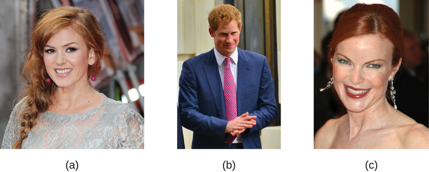
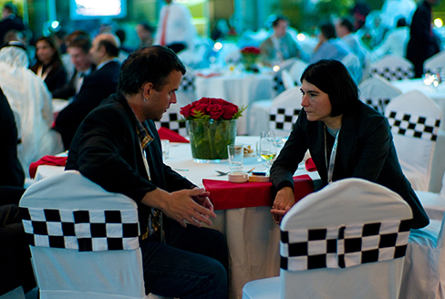

# 15.1 Rối loạn tâm lý là gì?

> [!info]
>
> ### Mục tiêu học tập
>
> Sau khi học xong phần này, bạn sẽ có khả năng:
>
> - Hiểu được những khó khăn cố hữu trong việc định nghĩa khái niệm rối loạn tâm lý
> - Mô tả khái niệm rối loạn chức năng gây hại
> - Xác định các tiêu chí chính thức mà suy nghĩ, cảm xúc và hành vi phải đáp ứng để được coi là bất thường và do đó là biểu hiện triệu chứng của một rối loạn tâm lý

Theo Hiệp hội Tâm thần học Hoa Kỳ, một **rối loạn tâm lý** (psychological disorder), hay rối loạn tâm thần (mental disorder), là “một hội chứng đặc trưng bởi sự xáo trộn có ý nghĩa lâm sàng trong nhận thức, điều hòa cảm xúc hoặc hành vi của một cá nhân, phản ánh sự rối loạn chức năng trong các quá trình tâm lý, sinh học hoặc phát triển làm nền tảng cho hoạt động tâm thần.
Rối loạn tâm thần thường đi kèm với đau khổ đáng kể trong các hoạt động xã hội, nghề nghiệp hoặc các hoạt động quan trọng khác” (2013).
**Tâm bệnh học** (Psychopathology) là ngành nghiên cứu về các rối loạn tâm lý, bao gồm các triệu chứng, **nguyên nhân học** (etiology - tức là các nguyên nhân gây ra chúng) và phương pháp điều trị.
Thuật ngữ *tâm bệnh học* cũng có thể dùng để chỉ sự biểu hiện của một rối loạn tâm lý.
Mặc dù việc đạt được sự đồng thuận có thể rất khó khăn, nhưng điều cực kỳ quan trọng đối với các chuyên gia sức khỏe tâm thần là phải thống nhất được loại suy nghĩ, cảm xúc và hành vi nào thực sự bất thường theo nghĩa chúng thực sự cho thấy sự hiện diện của tâm bệnh.
Một số mô thức hành vi và trải nghiệm nội tâm có thể dễ dàng bị dán nhãn là bất thường và biểu thị rõ ràng một dạng rối loạn tâm lý nào đó.
Một người rửa tay 40 lần mỗi ngày hay một người khẳng định nghe thấy tiếng nói của quỷ dữ đều thể hiện những hành vi và trải nghiệm nội tâm mà hầu hết mọi người đều coi là bất thường: những niềm tin và hành vi cho thấy sự tồn tại của một rối loạn tâm lý.
Nhưng hãy xem xét sự hồi hộp, bồn chồn mà một chàng trai trẻ cảm thấy khi trò chuyện với một người cuốn hút, hay cảm giác cô đơn và nhớ nhà của một sinh viên năm nhất trong học kỳ đầu tiên ở trường đại học—những cảm xúc này có thể không thường xuyên xuất hiện, nhưng chúng nằm trong phạm vi bình thường.
Vậy loại suy nghĩ, cảm xúc và hành vi nào đại diện cho một rối loạn tâm lý thực sự?
Các nhà tâm lý học nỗ lực phân biệt các rối loạn tâm lý với những trải nghiệm nội tâm và hành vi chỉ đơn thuần mang tính tình huống, mang nét đặc thù cá nhân hoặc phá cách khác thường.

Các vấn đề về sức khỏe tâm thần thường bị nhìn nhận sai lầm là kém quan trọng hơn so với các bệnh lý thể chất, và đôi khi những người mắc bệnh còn bị đổ lỗi hoặc chịu sự kỳ thị vì tình trạng của họ.
Những người mắc bệnh tâm thần không hề tự chọn hay tạo ra căn bệnh của mình, và không thể đơn giản kiểm soát nó chỉ bằng suy nghĩ tích cực hay những thay đổi thái độ thông thường.
Việc chẩn đoán, điều trị và hỗ trợ đều hết sức cần thiết, và tất cả đều phải được xem xét với sự tôn trọng và thấu cảm sâu sắc trước bản chất vô cùng khó khăn của bệnh tâm thần.
Mặc dù không phải ai gặp khó khăn cũng đều mắc rối loạn tâm lý, nhưng sức khỏe tâm thần đóng vai trò then chốt đối với khả năng duy trì các mối quan hệ, học tập và làm việc của chúng ta.
Điều quan trọng là mọi người nên trò chuyện với các chuyên gia có chuyên môn nếu họ trải qua những cảm xúc hoặc trải nghiệm dai dẳng phù hợp với các mô tả dưới đây; cuộc thảo luận đó có thể dẫn đến một chẩn đoán hoặc không, nhưng cũng giống như các bệnh thể chất, một người sẽ có cơ hội hồi phục tốt hơn nếu họ chủ động chia sẻ các vấn đề với bác sĩ hoặc các chuyên gia y tế khác.

## Định nghĩa về Rối loạn Tâm lý

Có lẽ cách tiếp cận đơn giản nhất để khái niệm hóa các rối loạn tâm lý là dán nhãn các hành vi, suy nghĩ và trải nghiệm nội tâm có tính chất không điển hình, gây đau khổ, rối loạn chức năng và đôi khi thậm chí nguy hiểm, như là những dấu hiệu của một rối loạn.
Chẳng hạn, nếu bạn rủ một người bạn cùng lớp đi hẹn hò và bị từ chối, bạn có thể sẽ cảm thấy đôi chút thất vọng và chán nản.
Những cảm xúc như vậy là hoàn toàn bình thường.
Nhưng nếu bạn cảm thấy vô cùng trầm uất—đến mức mất hứng thú với mọi hoạt động, khó ăn khó ngủ, cảm thấy bản thân hoàn toàn vô dụng và nghĩ đến việc tự sát—thì cảm xúc của bạn là **khác thường / không điển hình** (atypical), đi lệch khỏi chuẩn mực thông thường, và có thể biểu thị sự hiện diện của một rối loạn tâm lý.
Tuy nhiên, chỉ vì một điều gì đó khác thường không nhất thiết có nghĩa là nó bị rối loạn.

Ví dụ, chỉ có khoảng 4% người dân ở Hoa Kỳ có mái tóc đỏ, vì vậy tóc đỏ được coi là một đặc điểm không điển hình ([Hình 15.2](#Figure_15_01_Red_Hair)), nhưng nó không hề bị coi là rối loạn, nó chỉ đơn giản là khác biệt và hiếm thấy.
Và đặc điểm này thậm chí còn bớt khác thường hơn ở Scotland, nơi khoảng 13% dân số có mái tóc đỏ (“DNA Project Aims,” 2012).
Như bạn sẽ tìm hiểu, một số rối loạn, mặc dù không hoàn toàn điển hình, nhưng cũng chẳng hề hiếm gặp, và tỷ lệ xuất hiện của chúng trong dân số cao đến mức đáng ngạc nhiên.

**Hình 15.2** Mái tóc đỏ được coi là khác thường nhưng không phải là bất thường. (a) Isla Fischer, (b) Hoàng tử Harry, và (c) Marcia Cross là ba người có mái tóc đỏ tự nhiên. (ghi công a: chỉnh sửa tác phẩm của Richard Goldschmidt; ghi công b: chỉnh sửa tác phẩm của Glyn Lowe; ghi công c: chỉnh sửa tác phẩm của Kirk Weaver)

Nếu chúng ta đồng ý rằng chỉ riêng việc khác thường là chưa đủ tiêu chuẩn để xác định một người mắc rối loạn tâm lý, thì liệu có hợp lý không khi coi hành vi hoặc trải nghiệm nội tâm khác biệt với các giá trị hay kỳ vọng văn hóa rộng rãi là bị rối loạn?
Sử dụng tiêu chí này, một người đi lại quanh sân ga tàu điện ngầm mặc một chiếc áo khoác mùa đông dày cộp vào tháng Bảy trong khi la hét những lời tục tĩu với người lạ có thể bị coi là biểu hiện triệu chứng của một rối loạn tâm lý.
Hành động và trang phục của họ vi phạm các quy tắc được xã hội chấp nhận về trang phục và hành vi phù hợp; những đặc điểm này là không điển hình.

## Kỳ vọng Văn hóa

Việc vi phạm các kỳ vọng văn hóa tự bản thân nó không phải là một phương tiện thỏa đáng để nhận diện sự hiện diện của một rối loạn tâm lý.
Vì hành vi có sự khác biệt giữa **văn hóa** (culture) này với văn hóa khác, nên những gì được kỳ vọng và coi là phù hợp trong một nền văn hóa này có thể không được nhìn nhận như vậy trong các nền văn hóa khác.
Chẳng hạn, mỉm cười đáp lại nụ cười của một người lạ là điều được kỳ vọng ở Hoa Kỳ bởi vì một chuẩn mực xã hội phổ biến quy định rằng chúng ta nên đáp lại những cử chỉ thân thiện.
Một người từ chối đáp lại những cử chỉ như vậy có thể bị coi là vụng về về mặt xã hội—thậm chí có thể bị coi là có vấn đề—vì đã vi phạm kỳ vọng này.
Tuy nhiên, những kỳ vọng như vậy không được chia sẻ phổ quát trên toàn cầu.
Kỳ vọng văn hóa ở Nhật Bản đòi hỏi sự kín đáo, kiềm chế và ý thức duy trì sự riêng tư trước người lạ.
Người Nhật thường không đáp lại nụ cười từ người lạ (Patterson et al., 2007).
Giao tiếp bằng mắt là một ví dụ khác.
Ở Hoa Kỳ và châu Âu, giao tiếp bằng mắt với người khác thường biểu thị sự trung thực và chú ý lắng nghe.
Tuy nhiên, hầu hết các nền văn hóa Mỹ Latinh, châu Á và châu Phi lại diễn giải việc nhìn thẳng vào mắt là bất lịch sự, mang tính đối đầu và hung hăng (Pazain, 2010).
Do đó, một người nhìn thẳng vào mắt bạn có thể được coi là đúng mực và tôn trọng hoặc trơ trẽn và xúc phạm, tùy thuộc vào nền văn hóa của bạn ([Hình 15.3](#Figure_15_01_Eye_Contact)).

**Hình 15.3** Giao tiếp bằng mắt là một trong nhiều cử chỉ xã hội có sự khác biệt giữa các nền văn hóa. (ghi công: Joi Ito)

Ảo giác (nhìn thấy hoặc nghe thấy những điều không có thật về mặt vật lý) trong các xã hội phương Tây là một sự vi phạm các kỳ vọng văn hóa, và một người báo cáo những trải nghiệm nội tâm như vậy sẽ nhanh chóng bị dán nhãn là mắc rối loạn tâm lý.
Tuy nhiên, ở các nền văn hóa khác, những linh cảm hay ảo thị, chẳng hạn như những trải nghiệm liên quan đến các sự kiện tương lai, có thể được coi là những trải nghiệm bình thường và được đánh giá cao (Bourguignon, 1970).
Cuối cùng, điều quan trọng là phải nhận ra rằng các chuẩn mực văn hóa thay đổi theo thời gian: những gì có thể được coi là điển hình trong một xã hội ở một thời kỳ nào đó có thể không còn được nhìn nhận theo cách này sau đó, tương tự như việc các xu hướng thời trang từ một thời đại có thể khiến người ta ngạc nhiên tò mò nhiều thập kỷ sau—hãy tưởng tượng một chiếc băng đô cài đầu, tất giữ ấm chân (legwarmers) và kiểu tóc bồng bềnh của thập niên 1980 sẽ được đón nhận như thế nào trong khuôn viên trường đại học của bạn ngày nay.

> [!note]
>
> ### Đào sâu tìm hiểu
>
> #### Huyền thoại về bệnh tâm thần
>
> Vào những năm 1950 và 1960, khái niệm về bệnh tâm thần đã bị chỉ trích rộng rãi.
> Một trong những lời phê phán lớn nhất tập trung vào quan điểm cho rằng bệnh tâm thần là một “huyền thoại nhằm biện minh cho sự can thiệp tâm thần đối với những hành vi không được xã hội tán thành” (Wakefield, 1992).
> Thomas Szasz (1960), một bác sĩ tâm thần nổi tiếng, có lẽ là người ủng hộ mạnh mẽ nhất cho quan điểm này.
> Szasz lập luận rằng khái niệm bệnh tâm thần đã được xã hội (và giới thẩm quyền sức khỏe tâm thần) phát minh ra nhằm kỳ thị và khuất phục những người có hành vi vi phạm các chuẩn mực xã hội và pháp lý đã được chấp nhận.
> Thực vậy, Szasz gợi ý rằng những gì dường như là triệu chứng của bệnh tâm thần sẽ được đặc trưng chính xác hơn là những “vấn đề trong đời sống” (Szasz, 1960).
>
> Trong cuốn sách năm 1961 của mình, *The Myth of Mental Illness: Foundations of a Theory of Personal Conduct* (Huyền thoại về bệnh tâm thần: Nền tảng của một lý thuyết về hành vi cá nhân), Szasz đã bày tỏ sự bài xích đối với khái niệm bệnh tâm thần và đối với lĩnh vực tâm thần học nói chung (Oliver, 2006).
> Cơ sở cho cuộc công kích của Szasz là lập luận của ông cho rằng những bất thường có thể phát hiện được trong cấu trúc và chức năng cơ thể (chẳng hạn như nhiễm trùng, tổn thương hoặc rối loạn chức năng nội tạng) đại diện cho các đặc điểm xác định của một căn bệnh hoặc chứng bệnh thực sự; và bởi vì các triệu chứng của cái gọi là bệnh tâm thần không đi kèm với những bất thường phát hiện được như vậy, nên các rối loạn tâm lý thực chất hoàn toàn không phải là bệnh tật.
> Szasz (1961/2010) tuyên bố rằng “bệnh tật chỉ có thể ảnh hưởng đến thể xác; do đó, không thể có căn bệnh nào thuộc về tâm thần” (tr.
> 267).
>
> Ngày nay, chúng ta đều nhận thức rõ mức độ đau khổ tâm lý tột cùng mà những người mắc rối loạn tâm lý phải trải qua: những suy nghĩ và cảm xúc đau đớn mà họ gánh chịu, hành vi rối loạn mà họ thể hiện, cũng như mức độ đau khổ và suy giảm chức năng mà họ bộc lộ.
> Điều này khiến cho việc phủ nhận thực tại của bệnh tâm thần trở nên vô cùng khó khăn.
>
> Tuy nhiên, dù quan điểm của Szasz và những người ủng hộ ông có thể gây tranh cãi đến mức nào, họ cũng đã tạo ra ảnh hưởng đến cộng đồng sức khỏe tâm thần và xã hội theo nhiều cách khác nhau.
> Thứ nhất, những người bình thường, các chính trị gia và các chuyên gia hiện nay thường gọi bệnh tâm thần là các “vấn đề” sức khỏe tâm thần, gián tiếp thừa nhận góc nhìn về “những vấn đề trong đời sống” mà Szasz đã mô tả (Buchanan-Barker & Barker, 2009).
> Quan điểm của Szasz về xu hướng tính dục cũng có tầm ảnh hưởng lớn.
> Szasz có lẽ là bác sĩ tâm thần đầu tiên công khai thách thức ý kiến cho rằng sự hấp dẫn đồng giới đại diện cho một dạng rối loạn tâm thần hay bệnh tật (Szasz, 1965), điều này đã giúp mở đường cho các quyền xã hội và quyền công dân mà người đồng tính nam và nữ có được ngày nay (Barker, 2010).
> Các công trình của ông cũng truyền cảm hứng cho những thay đổi về mặt pháp lý nhằm bảo vệ quyền lợi của những người trong các cơ sở tâm thần, cho phép những cá nhân này có mức độ tự chủ và trách nhiệm lớn hơn đối với cuộc sống của chính mình (Buchanan-Barker & Barker, 2009).

## Rối loạn chức năng gây hại (Harmful Dysfunction)

Nếu như không có tiêu chí đơn lẻ nào được thảo luận cho đến nay là đủ để xác định sự hiện diện của một rối loạn tâm lý, thì làm thế nào để khái niệm hóa một rối loạn?
Đã có nhiều nỗ lực nhằm xác định các chiều kích cụ thể của rối loạn tâm lý, tuy nhiên vẫn chưa có nỗ lực nào hoàn toàn thỏa đáng.
Không có một định nghĩa phổ quát nào về rối loạn tâm lý có thể áp dụng cho mọi tình huống mà một rối loạn được cho là tồn tại (Zachar & Kendler, 2007).
Tuy nhiên, một trong những cách khái niệm hóa có tầm ảnh hưởng lớn hơn đã được Wakefield (1992) đề xuất, trong đó định nghĩa rối loạn tâm lý là một **rối loạn chức năng gây hại** (harmful dysfunction).
Wakefield lập luận rằng các cơ chế nội tại tự nhiên—nghĩa là các quá trình tâm lý được tôi luyện qua tiến hóa, chẳng hạn như nhận thức, tri giác và học tập—đều mang các chức năng quan trọng, chẳng hạn như cho phép chúng ta trải nghiệm thế giới theo cách người khác trải nghiệm và tham gia vào tư duy duy lý, giải quyết vấn đề và giao tiếp.
Ví dụ, học tập cho phép chúng ta liên kết một nỗi sợ hãi với một mối nguy hiểm tiềm tàng sao cho cường độ sợ hãi tương xứng xấp xỉ với mức độ nguy hiểm thực tế.
Rối loạn chức năng xảy ra khi một cơ chế nội tại bị phá vỡ và không còn có thể thực hiện chức năng bình thường của nó nữa.
Tuy nhiên, sự hiện diện đơn thuần của một rối loạn chức năng tự nó chưa quyết định một rối loạn.
Rối loạn chức năng đó phải gây hại ở chỗ nó dẫn đến những hậu quả tiêu cực cho cá nhân hoặc cho người khác, được đánh giá theo các tiêu chuẩn văn hóa của cá nhân đó.
Tác hại có thể bao gồm sự đau khổ nội tâm đáng kể (chẳng hạn như mức độ lo âu hoặc trầm cảm cao) hoặc các vấn đề trong sinh hoạt hàng ngày (chẳng hạn như trong đời sống xã hội hoặc công việc).

Để minh họa, Janet có một nỗi sợ nhện tột độ.
Nỗi sợ hãi của Janet có thể được coi là một rối loạn chức năng ở chỗ nó báo hiệu rằng cơ chế học tập nội tại đang hoạt động không chính xác (nghĩa là một quá trình bị lỗi khiến Janet không thể liên kết một cách thích hợp mức độ sợ hãi với mối đe dọa thực tế do nhện gây ra).
Nỗi sợ nhện của Janet gây ảnh hưởng tiêu cực đáng kể đến cuộc sống hàng ngày: cô tránh mọi tình huống mà cô nghi ngờ có nhện xuất hiện (chẳng hạn như tầng hầm hoặc nhà của một người bạn), và cô đã bỏ việc vào tháng trước vì nhìn thấy một con nhện trong phòng vệ sinh tại nơi làm việc và hiện đang thất nghiệp.
Theo mô hình rối loạn chức năng gây hại, tình trạng của Janet sẽ biểu thị một rối loạn vì (a) có sự rối loạn chức năng trong một cơ chế nội tại, và (b) rối loạn chức năng đó đã dẫn đến những hậu quả gây hại.
Tương tự như cách các triệu chứng của bệnh thể chất phản ánh sự rối loạn chức năng trong các quá trình sinh học, các triệu chứng của rối loạn tâm lý được giả định là phản ánh sự rối loạn chức năng trong các quá trình tâm trí.
Thành tố cơ chế nội tại của mô hình này đặc biệt hấp dẫn vì nó ngụ ý rằng các rối loạn có thể xảy ra thông qua sự suy vỡ của các chức năng sinh học chi phối các quá trình tâm lý khác nhau, do đó hỗ trợ cho các mô hình sinh học thần kinh đương đại về các rối loạn tâm lý (Fabrega, 2007).

## Định nghĩa của Hiệp hội Tâm thần học Hoa Kỳ (APA)

Nhiều đặc điểm của mô hình rối loạn chức năng gây hại đã được kết hợp vào định nghĩa chính thức về rối loạn tâm lý do **Hiệp hội Tâm thần học Hoa Kỳ** (American Psychiatric Association - APA) xây dựng.
Theo APA (2013), một rối loạn tâm lý là một tình trạng được cho là bao gồm những điều sau:

- **Có những xáo trộn đáng kể trong suy nghĩ, cảm xúc và hành vi**. Một người phải trải qua các trạng thái nội tâm (chẳng hạn như suy nghĩ và/hoặc cảm xúc) và biểu hiện các hành vi bị xáo trộn rõ rệt—nghĩa là khác thường, nhưng theo hướng tiêu cực, tự chuốc lấy thất bại (self-defeating). Thông thường, những sự xáo trộn này gây phiền toái, khổ sở cho những người xung quanh cá nhân trải nghiệm chúng. Ví dụ, một cá nhân bị ám ảnh không thể kiểm soát bởi suy nghĩ về vi trùng sẽ dành hàng giờ mỗi ngày để tắm rửa, có những trải nghiệm nội tâm và thể hiện những hành vi mà hầu hết mọi người đều coi là khác thường và tiêu cực (bị xáo trộn), đồng thời có khả năng gây phiền lòng cho các thành viên trong gia đình.
- **Những xáo trộn phản ánh một dạng rối loạn chức năng sinh học, tâm lý hoặc phát triển nào đó**. Các mô thức trải nghiệm nội tâm và hành vi bị xáo trộn phải phản ánh một khiếm khuyết nào đó (rối loạn chức năng) trong các cơ chế sinh học, tâm lý và phát triển nội tại dẫn đến hoạt động tâm lý bình thường, khỏe mạnh. Ví dụ, các ảo giác quan sát thấy ở bệnh tâm thần phân liệt có thể là dấu hiệu của những bất thường trong não bộ.
- **Những xáo trộn dẫn đến sự đau khổ đáng kể hoặc suy giảm khả năng hoạt động trong cuộc sống**. Các trải nghiệm nội tâm và hành vi của một người được coi là phản ánh một rối loạn tâm lý nếu chúng khiến người đó đau khổ đáng kể, hoặc làm suy giảm nghiêm trọng khả năng hoạt động như một cá nhân bình thường (thường được gọi là suy giảm chức năng, hoặc suy giảm chức năng nghề nghiệp và xã hội). Để minh họa, nỗi sợ hãi của một người đối với các tình huống xã hội có thể đau khổ đến mức khiến người đó né tránh mọi tình huống xã hội (chẳng hạn như ngăn cản người đó đi học hoặc nộp đơn xin việc).
- **Những xáo trộn không phản ánh các phản ứng được kỳ vọng hoặc được văn hóa chấp thuận đối với những sự kiện nhất định**. Những xáo trộn trong suy nghĩ, cảm xúc và hành vi phải là những phản ứng không thể chấp nhận được về mặt xã hội đối với những sự kiện thường xảy ra trong đời sống. Ví dụ, việc một người trải qua nỗi buồn sâu sắc và muốn ở một mình sau cái chết của một thành viên thân thiết trong gia đình là hoàn toàn tự nhiên (và được dự liệu trước). Bởi vì những phản ứng như vậy theo một cách nào đó được văn hóa kỳ vọng, nên cá nhân đó sẽ không bị coi là biểu hiện một rối loạn tâm thần.

Một số người tin rằng không có tiêu chí thiết yếu nào hoặc tập hợp tiêu chí nào có thể phân biệt dứt khoát mọi trường hợp rối loạn với không rối loạn (Lilienfeld & Marino, 1999).
Trên thực tế, không có một cách tiếp cận đơn lẻ nào để định nghĩa một rối loạn tâm lý là tự nó đầy đủ, cũng như không có sự đồng thuận phổ quát về ranh giới giữa bị rối loạn và không bị rối loạn.
Đôi khi, tất cả chúng ta đều trải qua cảm giác lo âu, những suy nghĩ không mong muốn và những khoảnh khắc buồn bã; hành vi của chúng ta vào những thời điểm khác có thể không có nhiều ý nghĩa đối với chính chúng ta hoặc đối với người khác.
Những trải nghiệm nội tâm và hành vi này có thể thay đổi về cường độ, nhưng chỉ được coi là bị rối loạn khi chúng gây xáo trộn sâu sắc đối với chúng ta và/hoặc người khác, gợi ý một sự rối loạn chức năng trong hoạt động tâm thần bình thường, và đi kèm với sự đau khổ hoặc suy giảm khả năng hoạt động đáng kể trong các hoạt động xã hội hoặc nghề nghiệp.
