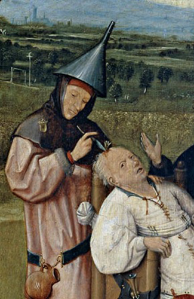
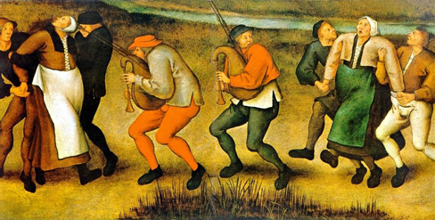

# 15.3 Các Góc nhìn về Rối loạn Tâm lý

> [!info]
>
> ### Mục tiêu học tập
>
> Sau khi học xong phần này, bạn sẽ có khả năng:
>
> - Thảo luận về các góc nhìn siêu nhiên đối với nguồn gốc của các rối loạn tâm lý trong bối cảnh lịch sử của chúng
> - Mô tả các góc nhìn sinh học và tâm lý hiện đại về nguồn gốc của các rối loạn tâm lý
> - Xác định những rối loạn nào nói chung thể hiện mức độ di truyền cao nhất
> - Mô tả mô hình tạng nhạy cảm - căng thẳng (diathesis-stress model) và tầm quan trọng của nó đối với việc nghiên cứu tâm bệnh học

Các nhà khoa học, chuyên gia sức khỏe tâm thần và các thầy chữa bệnh dân gian có thể áp dụng các góc nhìn khác nhau trong nỗ lực tìm hiểu hoặc giải thích các cơ chế cơ bản góp phần vào sự phát triển của một rối loạn tâm lý.
Góc nhìn cụ thể được sử dụng để giải thích một rối loạn tâm lý là vô cùng quan trọng.
Mỗi góc nhìn giải thích các rối loạn tâm lý, nguyên nhân hoặc bệnh căn học của chúng, và các phương pháp điều trị hiệu quả từ một quan điểm khác nhau.
Những góc nhìn khác nhau cung cấp những cách thức thay thế để tư duy về bản chất của tâm bệnh học.

## Các Góc nhìn Siêu nhiên về Rối loạn Tâm lý

Trong nhiều thế kỷ, các rối loạn tâm lý đã được nhìn nhận từ góc nhìn **siêu nhiên** (supernatural): được quy cho một thế lực nằm ngoài tầm hiểu biết khoa học.
Những người mắc bệnh bị coi là những người thực hành ma thuật đen hoặc bị ma quỷ ám ([Hình 15.6](#Figure_15_03_Madness)) (Maher & Maher, 1985).
Ví dụ, các tu viện trên khắp châu Âu vào thế kỷ 16 và 17 đã báo cáo hàng trăm nữ tu rơi vào trạng thái điên loạn, trong đó những người bị ảnh hưởng sùi bọt mép, la hét và co giật, đưa ra những lời đề nghị khiêu dâm với các linh mục, và thú nhận đã có quan hệ xác thịt với ác quỷ hoặc Chúa Kitô.
Mặc dù ngày nay những trường hợp này sẽ gợi ý về bệnh tâm thần nghiêm trọng; nhưng vào thời điểm đó, những sự kiện này thường được giải thích là do bị các thế lực ma quỷ chiếm đoạt thân xác (Waller, 2009a).
Tương tự như vậy, những cơn co giật nghiêm trọng ở các cô gái trẻ được cho là đã châm ngòi cho nỗi hoảng loạn săn phù thủy ở New England vào cuối thế kỷ 17 (Demos, 1983).
Những niềm tin như vậy vào nguyên nhân siêu nhiên của bệnh tâm thần vẫn còn tồn tại ở một số xã hội ngày nay; chẳng hạn, niềm tin rằng các thế lực siêu nhiên gây ra bệnh tâm thần là phổ biến ở một số nền văn hóa tại Nigeria ngày nay (Aghukwa, 2012).

**Hình 15.6** Trong bức tranh *Trích viên đá điên loạn* (The Extraction of the Stone of Madness), một tác phẩm hội họa thế kỷ 15 của Hieronymus Bosch, một thầy lang đang sử dụng một dụng cụ để lấy ra một vật thể (được cho là “viên đá điên loạn”) từ đầu của một người bệnh.

> [!note]
>
> ### Đào sâu tìm hiểu
>
> #### Cơn cuồng nhảy múa (Dancing Mania)
>
> Giữa thế kỷ 11 và 17, một đại dịch kỳ lạ đã quét qua Tây Âu.
> Từng nhóm người đột nhiên bắt đầu nhảy múa một cách cuồng loạn, mất kiểm soát.
> Sự thôi thúc nhảy múa không cưỡng lại được này—được gọi là **cuồng nhảy múa** (dancing mania)—đôi khi lôi cuốn hàng ngàn người cùng một lúc ([Hình 15.7](#Figure_15_03_Mania)).
> Các ghi chép lịch sử chỉ ra rằng những người mắc bệnh đôi khi nhảy múa với đôi chân bầm tím và rỉ máu trong nhiều ngày hoặc nhiều tuần, la hét về những ảo ảnh khủng khiếp và cầu xin các linh mục cùng tu sĩ cứu rỗi linh hồn họ (Waller, 2009b).
> Nguyên nhân gây ra hội chứng cuồng nhảy múa vẫn chưa được biết rõ, nhưng một số lời giải thích đã được đưa ra, bao gồm nọc nhện và ngộ độc nấm cựa gà (ergot) (“Dancing Mania,” 2011).
>
> 
>
> 
>
> **Hình 15.7** Mặc dù nguyên nhân của cơn cuồng nhảy múa, được miêu tả trong bức tranh này, chưa rõ ràng, nhưng hành vi này từng được quy cho các thế lực siêu nhiên.
>
> Nhà sử học John Waller (2009a, 2009b) đã đưa ra một lời giải thích toàn diện và thuyết phục về hội chứng cuồng nhảy múa, cho thấy hiện tượng này xuất phát từ sự kết hợp của ba yếu tố: đau khổ tâm lý tột cùng, sự lây lan xã hội (social contagion) và niềm tin vào các thế lực siêu nhiên.
> Waller lập luận rằng các thảm họa khác nhau vào thời điểm đó (chẳng hạn như nạn đói, dịch bệnh và lũ lụt) đã tạo ra mức độ đau khổ tâm lý rất cao, có thể làm tăng khả năng rơi vào trạng thái xuất thần (trance state) không tự nguyện.
> Waller chỉ ra rằng các nghiên cứu nhân học và các ghi chép về các nghi lễ nhập hồn cho thấy con người có nhiều khả năng rơi vào trạng thái xuất thần hơn nếu họ mong đợi điều đó xảy ra, và những cá nhân bị xuất thần sẽ cư xử theo lối nghi thức, trong đó suy nghĩ và hành vi của họ được định hình bởi niềm tin tâm linh của nền văn hóa của họ.
> Do đó, trong những giai đoạn đau khổ tột cùng về thể chất và tinh thần, tất cả những gì cần thiết chỉ là một vài người—tự tin rằng mình đã bị dính phải một lời nguyền nhảy múa—rơi vào trạng thái xuất thần tự phát và sau đó thể hiện trọn vẹn vai của một kẻ bị nguyền rủa bằng cách nhảy múa liên tục ngày này qua ngày khác.

## Các Góc nhìn Sinh học về Rối loạn Tâm lý

Góc nhìn sinh học xem các rối loạn tâm lý có mối liên hệ mật thiết với các hiện tượng sinh học, chẳng hạn như các yếu tố di truyền, sự mất cân bằng hóa học và các bất thường của não bộ; quan điểm này đã nhận được sự quan tâm và chấp nhận đáng kể trong những thập kỷ gần đây (Wyatt & Midkiff, 2006).
Bằng chứng từ nhiều nguồn chỉ ra rằng hầu hết các rối loạn tâm lý đều có một thành tố di truyền; trên thực tế, hầu như không có tranh cãi nào về việc một số rối loạn phần lớn là do các yếu tố di truyền gây ra.
Biểu đồ trong [Hình 15.8](#Figure_15_03_Heritability) cho thấy các ước tính về **khả năng di truyền** (heritability) đối với bệnh tâm thần phân liệt.

![Một biểu đồ cột có trục hoành ghi “Tỷ lệ phần trăm nguy cơ phát triển tâm thần phân liệt” và trục tung ghi “mối quan hệ với người mắc tâm thần phân liệt”. Một chuỗi các mối quan hệ tương quan với tỷ lệ phần trăm nguy cơ, được hiển thị bằng các dấu ngoặc chỉ mối quan hệ di truyền chung. Dân số nói chung có 1% nguy cơ. Anh chị em họ đời đầu có 2% nguy cơ; họ chia sẻ 12,5% gen. Các mối quan hệ tiếp theo là cô/dì/chú/bác, cháu trai/gái, cháu nội/ngoại và anh chị em cùng cha khác mẹ (hoặc cùng mẹ khác cha); họ chia sẻ 25% gen và nguy cơ dao động từ khoảng 3–6%. Các mối quan hệ tiếp theo là cha mẹ, anh chị em ruột, con cái và sinh đôi khác trứng; họ chia sẻ 50% gen và nguy cơ lần lượt là khoảng 6, 9, 13 và 17%. Sinh đôi cùng trứng chia sẻ 100% gen và có khoảng 48% nguy cơ.](../../images/img_a4d1bae7120f.jpg)

**Hình 15.8** Nguy cơ phát triển tâm thần phân liệt của một người tăng lên nếu có người thân mắc bệnh này. Mối quan hệ di truyền càng gần thì nguy cơ càng cao.

Những phát hiện như thế này đã dẫn dắt nhiều nhà nghiên cứu ngày nay tìm kiếm các gen cụ thể và các đột biến gen góp phần gây ra các rối loạn tâm thần.
Ngoài ra, công nghệ chẩn đoán hình ảnh thần kinh tinh vi trong những thập kỷ gần đây đã tiết lộ những bất thường trong cấu trúc và chức năng não có thể liên quan trực tiếp đến nhiều rối loạn như thế nào, và những tiến bộ trong sự hiểu biết của chúng ta về các chất dẫn truyền thần kinh và hormone đã mang lại những hiểu biết sâu sắc về các mối liên hệ khả dĩ của chúng.
Góc nhìn sinh học hiện đang phát triển rất mạnh mẽ trong nghiên cứu về các rối loạn tâm lý.

## Mô hình Tạng nhạy cảm - Căng thẳng của Rối loạn Tâm lý

Bất chấp những tiến bộ trong việc tìm hiểu cơ sở sinh học của các rối loạn tâm lý, góc nhìn tâm lý - xã hội (psychosocial perspective) vẫn giữ vai trò vô cùng quan trọng.
Góc nhìn này nhấn mạnh tầm quan trọng của việc học tập, căng thẳng, các mô thức tư duy sai lệch và tự hủy hoại, cùng các yếu tố môi trường.
Có lẽ cách tốt nhất để suy nghĩ về các rối loạn tâm lý là xem chúng bắt nguồn từ sự kết hợp giữa các quá trình sinh học và tâm lý.
Nhiều rối loạn phát triển không phải từ một nguyên nhân đơn lẻ, mà từ sự hợp nhất tinh tế giữa các yếu tố một phần là sinh học và một phần là tâm lý xã hội.

**Mô hình tạng nhạy cảm - căng thẳng** (diathesis-stress model) (Zuckerman, 1999) tích hợp các yếu tố sinh học và tâm lý xã hội để dự đoán khả năng xảy ra của một rối loạn.
Mô hình tạng nhạy cảm - căng thẳng này gợi ý rằng những người có khuynh hướng tiềm ẩn đối với một rối loạn (tức là tạng nhạy cảm / thể tạng dễ mắc bệnh - diathesis) sẽ có nhiều khả năng hơn những người khác phát triển chứng rối loạn khi phải đối mặt với các sự kiện môi trường hoặc tâm lý bất lợi (tức là căng thẳng - stress), chẳng hạn như bị ngược đãi thời thơ ấu, các biến cố tiêu cực trong đời sống, sang chấn, v.v. Một tạng nhạy cảm không phải lúc nào cũng là một tổn thương sinh học đối với một căn bệnh; một số thể tạng dễ mắc bệnh có thể thuộc về tâm lý (chẳng hạn như xu hướng suy nghĩ về các sự kiện trong cuộc sống theo cách bi quan, tự chuốc lấy thất bại).

Giả định then chốt của mô hình tạng nhạy cảm - căng thẳng là cả hai yếu tố, tạng nhạy cảm và căng thẳng, đều cần thiết trong sự phát triển của một rối loạn.
Các mô hình khác nhau khám phá mối quan hệ giữa hai yếu tố: mức độ căng thẳng cần thiết để tạo ra rối loạn tỷ lệ nghịch với mức độ của thể tạng nhạy cảm.
