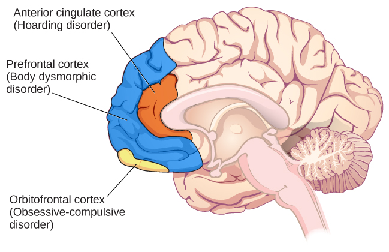

# 15.5 Rối loạn Ám ảnh Cưỡng chế và các Rối loạn Liên quan

> [!info]
>
> ### Mục tiêu học tập
>
> Sau khi học xong phần này, bạn sẽ có khả năng:
>
> - Mô tả các đặc điểm chính và tỷ lệ hiện mắc của rối loạn ám ảnh cưỡng chế, rối loạn mặc cảm ngoại hình và rối loạn tích trữ
> - Hiểu được một số yếu tố trong sự phát triển của rối loạn ám ảnh cưỡng chế

**Rối loạn ám ảnh cưỡng chế và các rối loạn liên quan** (Obsessive-compulsive and related disorders) là một nhóm các rối loạn chồng chéo nhau, nhìn chung liên quan đến những suy nghĩ xâm lấn, khó chịu và các hành vi lặp đi lặp lại.
Nhiều người trong chúng ta thỉnh thoảng trải qua những suy nghĩ không mong muốn (chẳng hạn như thèm chơi game khi đang học bài), và nhiều người trong chúng ta thỉnh thoảng tham gia vào các hành vi lặp đi lặp lại (chẳng hạn như đi đi lại lại khi căng thẳng).
Tuy nhiên, các rối loạn ám ảnh cưỡng chế và các rối loạn liên quan nâng những suy nghĩ không mong muốn và hành vi lặp đi lặp lại lên một mức độ mãnh liệt đến mức những nhận thức và hoạt động này làm gián đoạn đời sống hàng ngày.
Nằm trong danh mục này bao gồm rối loạn ám ảnh cưỡng chế (OCD), rối loạn mặc cảm ngoại hình và rối loạn tích trữ.

## Rối loạn Ám ảnh Cưỡng chế (OCD)

Những người mắc **rối loạn ám ảnh cưỡng chế (OCD)** (obsessive-compulsive disorder) trải qua những suy nghĩ, hình ảnh tâm trí, nỗi sợ hãi, cảm giác và/hoặc sự thôi thúc mang tính xâm lấn và không mong muốn (ám ảnh) và/hoặc nhu cầu tham gia vào các hành vi lặp đi lặp lại hoặc các hành động tinh thần (cưỡng chế).
Một người mắc chứng rối loạn này chẳng hạn có thể dành hàng giờ mỗi ngày để rửa tay hoặc liên tục kiểm tra đi kiểm tra lại để đảm bảo rằng bếp, vòi nước hoặc đèn đã được tắt.

Ám ảnh không chỉ đơn thuần là những suy nghĩ không mong muốn dường như ngẫu nhiên nhảy vào đầu chúng ta theo thời gian, chẳng hạn như nhớ lại một nhận xét thiếu tế nhị mà một đồng nghiệp đã đưa ra gần đây, và chúng có ý nghĩa hơn những lo lắng thường ngày mà chúng ta có thể có, chẳng hạn như những mối quan tâm chính đáng về việc bị sa thải khỏi một công việc.
Đúng hơn, ám ảnh được đặc trưng là những suy nghĩ dai dẳng, không chủ ý và không mong muốn, mang tính xâm nhập cao, khó chịu và gây đau khổ (APA, 2013).
Các **ám ảnh** (obsessions) phổ biến bao gồm những lo ngại về vi trùng và sự lây nhiễm, sự nghi ngờ (“Mình đã khóa nước chưa nhỉ?”), trật tự và sự đối xứng (“Tôi cần tất cả thìa trong khay phải được sắp xếp theo một cách nhất định”), và những ám ảnh khác từ cảm giác trách nhiệm quá mức, chủ nghĩa hoàn hảo hoặc các nghĩa vụ đạo đức.
Thông thường, người bệnh biết rằng những suy nghĩ và cảm xúc như vậy là phi lý và do đó cố gắng kìm nén hoặc phớt lờ chúng, nhưng lại vô cùng chật vật để làm được điều đó.
Những triệu chứng ám ảnh này đôi khi chồng chéo lên nhau, đến mức một người có thể có cả nỗi ám ảnh về sự lây nhiễm bẩn và nỗi ám ảnh của chủ nghĩa hoàn hảo (Abramowitz & Siqueland, 2013).

Cưỡng chế là những hành vi lặp đi lặp lại và mang tính nghi thức, thường được thực hiện chủ yếu như một phương tiện để giảm thiểu sự đau khổ mà các ám ảnh kích hoạt hoặc để giảm khả năng xảy ra một sự kiện đáng sợ (APA, 2013).
**Cưỡng chế** (compulsions) thường bao gồm các hành vi như rửa tay nhiều lần và kỹ lưỡng, dọn dẹp, kiểm tra (ví dụ: cửa đã khóa chưa) và sắp xếp trật tự (ví dụ: xếp tất cả bút chì theo một cách cụ thể), và chúng cũng bao gồm các hành động tinh thần như đếm, cầu nguyện hoặc đọc thầm điều gì đó với chính mình ([Hình 15.11](#Figure_15_05_OCD)).
Các hành vi cưỡng chế đặc trưng của OCD không được thực hiện vì niềm vui thích, chúng cũng không kết nối theo một cách thực tế với nguồn gốc của sự đau khổ hay sự kiện đáng sợ.
Không phải mọi hoạt động mang tính nghi thức, lặp đi lặp lại hoặc chuyên sâu đều là hành vi cưỡng chế; ví dụ, việc rửa tay lặp đi lặp lại sau khi ở gần một người bị cúm khó có thể là triệu chứng của OCD.
Ngoài ra, nhiều người sử dụng từ “ám ảnh” hoặc thậm chí nhắc đến OCD một cách tùy tiện, điều này có thể gây thiếu tế nhị đối với những người đang thực sự trải qua tình trạng này.
Khoảng 2,3% dân số Hoa Kỳ sẽ trải qua OCD trong suốt cuộc đời của họ (Ruscio, Stein, Chiu, & Kessler, 2010) và nếu không được điều trị, OCD có xu hướng trở thành một tình trạng mãn tính gây ra các vấn đề tâm lý và quan hệ giữa các cá nhân kéo dài suốt đời (Norberg, Calamari, Cohen, & Riemann, 2008).

**Hình 15.11** (a) Rửa tay lặp đi lặp lại và (b) kiểm tra (ví dụ: cửa đã khóa chưa) là những hành vi cưỡng chế phổ biến ở những người mắc rối loạn ám ảnh cưỡng chế. (ghi công a: chỉnh sửa tác phẩm của USDA; ghi công b: chỉnh sửa tác phẩm của Bradley Gordon)

## Rối loạn Mặc cảm Ngoại hình (Body Dysmorphic Disorder)

Một cá nhân mắc **rối loạn mặc cảm ngoại hình** (body dysmorphic disorder) luôn bận tâm với một khiếm khuyết được cảm nhận trong diện mạo cơ thể mà khiếm khuyết đó thực tế không tồn tại hoặc người khác hầu như không thể nhận thấy (APA, 2013).
Những khiếm khuyết thể chất được cảm nhận này khiến người bệnh nghĩ rằng họ kém hấp dẫn, xấu xí, gớm ghiếc hoặc dị dạng.
Những bận tâm này có thể tập trung vào bất kỳ vùng nào trên cơ thể, nhưng chúng thường liên quan đến da, khuôn mặt hoặc mái tóc.
Sự bận tâm với những khiếm khuyết thể chất tưởng tượng thúc đẩy người đó tham gia vào các hành vi và hành động tinh thần lặp đi lặp lại và mang tính nghi thức, chẳng hạn như liên tục nhìn vào gương, cố gắng che giấu bộ phận cơ thể gây phiền muộn, so sánh mình với người khác và trong một số trường hợp cực đoan là phẫu thuật thẩm mỹ (Phillips, 2005).
Ước tính có khoảng 2,4% người trưởng thành ở Hoa Kỳ đáp ứng các tiêu chí cho chứng rối loạn mặc cảm ngoại hình, với tỷ lệ ở nữ giới cao hơn một chút so với nam giới (APA, 2013).

## Rối loạn Tích trữ (Hoarding Disorder)

Mặc dù tích trữ trước đây theo truyền thống được coi là một triệu chứng của OCD, nhưng bằng chứng đáng kể cho thấy rằng tích trữ đại diện cho một chứng rối loạn hoàn toàn khác biệt (Mataix-Cols et al., 2010).
Những người mắc **rối loạn tích trữ** (hoarding disorder) không thể chịu đựng được việc phải chia tay với những món đồ sở hữu cá nhân, bất kể những món đồ đó vô giá trị hay vô dụng đến mức nào.
Kết quả là, những cá nhân này tích lũy một lượng quá mức các món đồ thường là vô giá trị làm bừa bộn không gian sống của họ ([Hình 15.12](#Figure_15_05_Hoarding)).
Thông thường, số lượng đồ đạc bừa bộn nhiều đến mức người đó không thể sử dụng nhà bếp của mình hoặc không thể ngủ trên giường của mình.
Những người mắc chứng rối loạn này gặp khó khăn rất lớn trong việc vứt bỏ đồ vật vì họ tin rằng các đồ vật đó có thể có ích về sau, hoặc vì họ hình thành một sự gắn bó tình cảm với những đồ vật đó (APA, 2013).
Điều quan trọng là chẩn đoán rối loạn tích trữ chỉ được đưa ra nếu việc tích trữ không phải do một tình trạng bệnh lý thể chất khác gây ra và nếu việc tích trữ không phải là triệu chứng của một rối loạn khác (chẳng hạn như tâm thần phân liệt) (APA, 2013).

**Hình 15.12** Những người mắc chứng rối loạn tích trữ gặp khó khăn rất lớn trong việc vứt bỏ đồ sở hữu, thường dẫn đến sự tích tụ đồ đạc làm bừa bộn khu vực sinh hoạt hoặc làm việc. (ghi công: “puuikibeach”/Flickr)

## Nguyên nhân của OCD

Kết quả từ các nghiên cứu về gia đình và cặp song sinh gợi ý rằng OCD có một thành tố di truyền vừa phải.
Chứng rối loạn này xuất hiện thường xuyên gấp năm lần ở những người thân thế hệ thứ nhất của những người mắc OCD so với những người không mắc chứng rối loạn này (Nestadt et al., 2000).
Ngoài ra, tỷ lệ tương hợp của OCD ở các cặp song sinh cùng trứng là khoảng 57%; tuy nhiên, tỷ lệ tương hợp đối với các cặp song sinh khác trứng là 22% (Bolton, Rijsdijk, O’Connor, Perrin, & Eley, 2007).
Các nghiên cứu đã chỉ ra khoảng hai chục gen tiềm năng có thể liên quan đến OCD; những gen này điều hòa chức năng của ba chất dẫn truyền thần kinh: serotonin, dopamine và glutamate (Pauls, 2010).
Nhiều nghiên cứu trong số này có cỡ mẫu nhỏ và vẫn chưa được lặp lại.
Do đó, cần có thêm các nghiên cứu bổ sung trong lĩnh vực này.

Một vùng não được cho là đóng vai trò then chốt trong OCD là **vỏ não trán ổ mắt** (orbitofrontal cortex) (Kopell & Greenberg, 2008), một khu vực của thùy trán liên quan đến việc học tập và ra quyết định (Rushworth, Noonan, Boorman, Walton, & Behrens, 2011) ([Hình 15.13](#Figure_15_05_Orbito)).
Ở những người mắc OCD, vỏ não trán ổ mắt trở nên đặc biệt tăng hoạt khi họ bị kích động bởi các nhiệm vụ, chẳng hạn như khi họ được yêu cầu nhìn vào bức ảnh chụp bồn cầu hoặc các bức tranh treo lệch trên tường (Simon, Kaufmann, Müsch, Kischkel, & Kathmann, 2010).
Vỏ não trán ổ mắt là một phần của một chuỗi các vùng não mà nhìn chung được gọi là mạch OCD; mạch này bao gồm một số vùng liên kết với nhau, có ảnh hưởng đến giá trị cảm xúc được cảm nhận của các kích thích cũng như việc lựa chọn cả phản ứng hành vi và nhận thức (Graybiel & Rauch, 2000).
Tương tự như vỏ não trán ổ mắt, các vùng khác của mạch OCD cũng cho thấy hoạt động gia tăng khi kích hoạt triệu chứng (Rotge et al., 2008), điều này gợi ý rằng những bất thường ở các vùng này có thể tạo ra các triệu chứng của OCD (Saxena, Bota, & Brody, 2001).
Phù hợp với lời giải thích này, những người mắc OCD cho thấy mức độ kết nối cao hơn đáng kể giữa vỏ não trán ổ mắt và các vùng khác của mạch OCD so với những người không mắc OCD (Beucke et al., 2013).

**Hình 15.13** Các vùng khác nhau của não bộ có thể liên quan đến các rối loạn tâm lý khác nhau.

Những phát hiện được thảo luận ở trên đều dựa trên các nghiên cứu hình ảnh học, và chúng nhấn mạnh tầm quan trọng tiềm tàng của sự rối loạn chức năng não bộ trong OCD.
Tuy nhiên, một hạn chế quan trọng của những phát hiện này là không có khả năng giải thích sự khác biệt giữa các nỗi ám ảnh và các hành vi cưỡng chế.
Một hạn chế khác là mối quan hệ tương quan giữa các bất thường về thần kinh và các triệu chứng OCD không thể hàm ý mối quan hệ nhân quả (Abramowitz & Siqueland, 2013).

> [!example]
>
> ### Kết nối Khái niệm
>
> #### Điều kiện hóa và OCD
>
> Các triệu chứng của OCD đã được lý thuyết hóa là những phản ứng tập nhiễm (learned responses), được hình thành và duy trì do kết quả của sự kết hợp giữa hai hình thức học tập: **điều kiện hóa cổ điển** (classical conditioning) và **điều kiện hóa từ kết quả** (operant conditioning) (Mowrer, 1960; Steinmetz, Tracy, & Green, 2001).
> Cụ thể, việc hình thành OCD trước tiên có thể xảy ra do kết quả của điều kiện hóa cổ điển, nhờ đó một kích thích trung tính trở nên liên kết với một kích thích không điều kiện vốn gây ra sự lo âu hoặc đau khổ.
> Khi một cá nhân đã hình thành sự liên kết này, những lần gặp gỡ sau đó với kích thích trung tính sẽ kích hoạt sự lo âu, bao gồm cả những suy nghĩ ám ảnh; sự lo âu và những suy nghĩ ám ảnh (bấy giờ là một phản xạ có điều kiện) có thể kéo dài dai dẳng cho đến khi họ xác định được một chiến lược nào đó để giải tỏa nó.
> Sự giải tỏa có thể mang hình thức của một hành vi mang tính nghi thức hoặc một hoạt động tinh thần mà khi được thực hiện lặp đi lặp lại sẽ làm giảm sự lo âu.
> Những nỗ lực giải tỏa lo âu như vậy cấu thành một ví dụ về củng cố tiêu cực (một dạng của điều kiện hóa từ kết quả).
> Hãy nhớ lại từ chương về học tập rằng củng cố tiêu cực liên quan đến việc củng cố một hành vi thông qua khả năng loại bỏ một điều gì đó khó chịu hoặc gây khó chịu của nó.
> Do đó, các hành vi cưỡng chế quan sát thấy trong OCD có thể được duy trì vì chúng mang tính củng cố tiêu cực, theo nghĩa là chúng làm giảm sự lo âu do kích thích có điều kiện kích hoạt.
>
> Giả sử một cá nhân mắc OCD trải qua những suy nghĩ ám ảnh về vi trùng, sự lây nhiễm bẩn và bệnh tật bất cứ khi nào họ chạm vào nắm đấm cửa.
> Điều gì có thể tạo thành một kích thích không điều kiện khả dĩ?
> Ngoài ra, điều gì sẽ cấu thành kích thích có điều kiện, phản xạ không điều kiện và phản xạ có điều kiện?
> Chúng ta có thể dự đoán những loại hành vi cưỡng chế nào, và chúng tự củng cố bản thân như thế nào?
> Điều gì bị giảm đi?
> Thêm vào đó, từ quan điểm của lý thuyết học tập, các triệu chứng của OCD có thể được điều trị thành công như thế nào?
