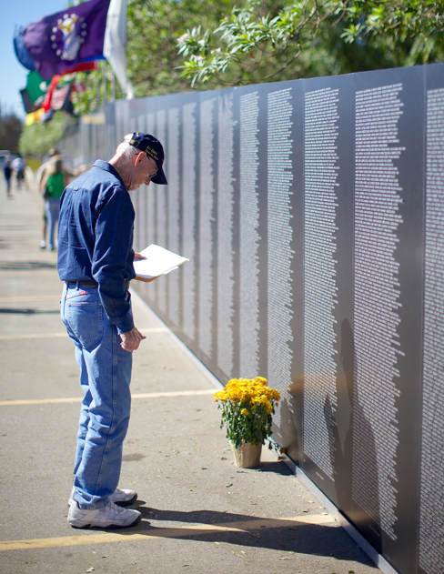

# 15.6 Rối loạn Liên quan đến Sang chấn và Tác nhân gây Căng thẳng

> [!info]
>
> ### Mục tiêu học tập
>
> Sau khi học xong phần này, bạn sẽ có khả năng:
>
> - Mô tả bản chất và các triệu chứng của rối loạn căng thẳng sau sang chấn
> - Xác định các yếu tố nguy cơ liên quan đến chứng rối loạn này
> - Hiểu tầm quan trọng của các bổ sung trong DSM chẳng hạn như rối loạn đau buồn kéo dài, cùng bản chất và tác động của rối loạn này

Sang chấn (trauma) là một tác động tiêu cực lâu dài đối với một cá nhân dựa trên một trải nghiệm hoặc sự kiện dẫn đến cảm giác bị đe dọa, nguy hiểm hoặc mất mát.
Sang chấn bao gồm ba khía cạnh: sự kiện, cách cá nhân trải nghiệm sự kiện đó, và cách sự kiện đó ảnh hưởng đến cuộc sống của cá nhân trong tương lai (Patterson & Troy, 2022).
Các sự kiện vô cùng căng thẳng hoặc sang chấn, chẳng hạn như chiến đấu, lạm dụng, thảm họa thiên nhiên và tội phạm, đặt những người trải qua chúng vào nguy cơ gia tăng phát triển các rối loạn tâm lý.
Những sự kiện quan trọng khác trong đời, chẳng hạn như mất đi người thân, ly hôn hoặc mất việc làm có thể dẫn đến căng thẳng tột độ và áp đảo, điều này cũng có thể dẫn đến việc tăng nguy cơ phát triển các rối loạn tâm lý.

Mặc dù có tên gọi tương đối quen thuộc, nhưng **rối loạn căng thẳng sau sang chấn (PTSD)** (posttraumatic stress disorder) thường bị hiểu lầm.
Trong phần lớn thế kỷ 20, chứng rối loạn này được gọi là *sốc do đạn pháo* (shell shock) và *loạn thần kinh chiến đấu* (combat neurosis) vì các triệu chứng của nó được quan sát thấy ở những người lính đã từng tham gia chiến đấu trong thời chiến.
Đến cuối những năm 1970, rõ ràng là những phụ nữ từng trải qua các sang chấn tình dục (ví dụ: bị cưỡng hiếp, bạo lực gia đình và loạn luân) thường trải qua cùng một tập hợp các triệu chứng giống như những người lính (Herman, 1997).
Thuật ngữ *rối loạn căng thẳng sau sang chấn* đã được phát triển vì những triệu chứng này có thể xảy ra với bất kỳ ai từng trải qua sang chấn tâm lý.

## Định nghĩa Rộng hơn về PTSD

PTSD từng được liệt kê trong nhóm các rối loạn lo âu ở các ấn bản DSM trước đây.
Trong DSM-5, hiện nay nó được liệt kê trong một nhóm gọi là Rối loạn Liên quan đến Sang chấn và Tác nhân gây Căng thẳng (Trauma-and-Stressor-Related Disorders).
Để một người được chẩn đoán mắc PTSD, họ phải tiếp xúc, chứng kiến hoặc trải nghiệm các chi tiết của một trải nghiệm sang chấn (ví dụ: nhân viên ứng cứu đầu tiên), một trải nghiệm liên quan đến “cái chết thực sự hoặc bị đe dọa, thương tích nghiêm trọng hoặc bạo lực tình dục” (APA, 2013, tr.
271).
Những trải nghiệm này có thể bao gồm các sự kiện như chiến đấu, bị tấn công thể xác thực tế hoặc bị đe dọa, tấn công tình dục, thảm họa thiên nhiên, tấn công khủng bố và tai nạn ô tô.
Tiêu chí này làm cho PTSD trở thành chứng rối loạn duy nhất được liệt kê trong DSM mà ở đó một nguyên nhân (sang chấn cực độ) được chỉ định một cách rõ ràng.

Các triệu chứng của PTSD bao gồm những ký ức xâm lấn và đau buồn về sự kiện, các cơn **hồi tưởng quá khứ / tái hiện sang chấn** (flashbacks - các trạng thái có thể kéo dài từ vài giây đến vài ngày, trong đó cá nhân sống lại sự kiện đó và cư xử như thể sự kiện đang xảy ra vào chính khoảnh khắc đó [APA, 2013]), né tránh các kích thích kết nối với sự kiện, các trạng thái cảm xúc tiêu cực dai dẳng (ví dụ: sợ hãi, tức giận, tội lỗi và xấu hổ), cảm giác xa lánh người khác, cáu kỉnh, dễ nổi cáu bộc phát và phản ứng giật mình thái quá (dễ giật nảy mình).
Để chẩn đoán PTSD, những triệu chứng này phải xảy ra trong ít nhất một tháng.

Việc hiểu được tỷ lệ hiện mắc của PTSD là một thách thức, và một số tổ chức chuyên điều trị chứng rối loạn này không công bố tỷ lệ xuất hiện cụ thể.
Một thách thức là chẩn đoán PTSD xảy ra ở những người đã trải qua sang chấn và đã tìm kiếm sự hỗ trợ hoặc tư vấn; nhiều người sống sót sau sang chấn không bao giờ đến gặp các chuyên gia sức khỏe tâm thần.
Thứ hai, không có công cụ sàng lọc nào được sử dụng phổ quát liên quan đến PTSD.
Do đó, các nhà nghiên cứu phân tích tỷ lệ mắc trong các quần thể và ngoại suy.
Một phân tích trên 38 nghiên cứu cho thấy rằng trong suốt cuộc đời của dân thường, tỷ lệ hiện mắc PTSD là từ 3,6 đến 8,0% dân số.
Và trong suốt cuộc đời của các cựu chiến binh, tỷ lệ hiện mắc PTSD là từ 7,7 đến 13,4% (Schein et al., 2021).
Tỷ lệ xuất hiện cao hơn này trong các quần thể cựu chiến binh phù hợp với các nghiên cứu trước đây chỉ ra tỷ lệ cao hơn ở những người tiếp xúc với sang chấn hàng loạt và những người có công việc liên quan đến việc tiếp xúc với sang chấn do nhiệm vụ (ví dụ: cảnh sát, lính cứu hỏa và nhân viên y tế cấp cứu) (APA, 2013).
Gần 21% cư dân tại các khu vực bị ảnh hưởng bởi Bão Katrina bị PTSD một năm sau cơn bão (Kessler et al., 2008), và 12,6% cư dân Manhattan được quan sát thấy mắc PTSD 2–3 năm sau vụ tấn công khủng bố ngày 11 tháng 9 (DiGrande et al., 2008).

## Các Yếu tố Nguy cơ đối với PTSD

Dĩ nhiên, không phải tất cả những ai trải qua một sự kiện sang chấn đều sẽ tiếp tục phát triển thành PTSD; một số yếu tố dự đoán mạnh mẽ sự phát triển của PTSD: trải nghiệm sang chấn, mức độ nghiêm trọng của sang chấn lớn hơn, thiếu sự hỗ trợ xã hội ngay lập tức và nhiều căng thẳng hơn trong cuộc sống sau đó (Brewin, Andrews, & Valentine, 2000).
Những sự kiện sang chấn liên quan đến tổn hại do người khác gây ra (chẳng hạn như chiến đấu, hiếp dâm và lạm dụng tình dục) mang lại nguy cơ lớn hơn so với những sang chấn khác (chẳng hạn như thảm họa thiên nhiên) (Kessler, Sonnega, Bromet, Hughes, & Nelson, 1995).
Phụ nữ có nhiều khả năng bị sang chấn hơn do sang chấn tình dục, sự bỏ bê thời thơ ấu và lạm dụng thể chất thời thơ ấu.
Nam giới có nhiều khả năng bị sang chấn hơn do thảm họa thiên nhiên, tai nạn đe dọa tính mạng và bạo lực thể chất, dù là chứng kiến hay nhằm vào họ.
Các bé trai vị thành niên có nhiều khả năng gặp tai nạn, bị tấn công thể chất và chứng kiến cái chết/thương tích; các bé gái vị thành niên có nhiều khả năng trải qua hiếp dâm/tấn công tình dục, bạo lực từ bạn đời thân mật, hoặc cái chết hay thương tích bất ngờ của một người thân yêu.
Bạo lực do hành hung và việc chứng kiến sang chấn xảy ra với người khác phổ biến hơn ở những người da màu khi so sánh với người da trắng.
Nam giới người Mỹ gốc Phi có nhiều khả năng bị tiếp xúc và là nạn nhân của bạo lực hơn so với nam giới thuộc các chủng tộc khác (Kilpatrick, Badour, & Resnick, 2017).
Một nghiên cứu năm 2012 cho thấy 27% cán bộ quản giáo báo cáo đã trải qua các triệu chứng của PTSD trong 30 ngày qua.
Tỷ lệ ở nam giới (31%) cao hơn so với nữ giới (22%) (Spinaris, Denhof, & Kellaway, 2012).
Một nghiên cứu do Jaegers et al. (2019) thực hiện cho thấy 53,4% cán bộ quản giáo nhà tù có kết quả sàng lọc dương tính với PTSD.
PTSD phổ biến hơn ở các quần thể tù nhân so với công chúng nói chung, với các ước tính tỷ lệ hiện mắc là 6% ở tù nhân nam và 21% ở tù nhân nữ (Facer-Irwin et al., 2019).
Các yếu tố làm tăng nguy cơ mắc PTSD bao gồm giới tính nữ, tình trạng kinh tế xã hội thấp, trí thông minh thấp, tiền sử cá nhân mắc các rối loạn tâm thần, tiền sử gặp nghịch cảnh thời thơ ấu (bị lạm dụng hoặc gặp các sang chấn khác trong thời thơ ấu) và tiền sử gia đình mắc các rối loạn tâm thần (Brewin et al., 2000).
Các đặc điểm tính cách như tính nhiễu tâm (neuroticism) và sự cơ thể hóa (somatization - xu hướng trải nghiệm các triệu chứng thể chất khi gặp căng thẳng) đã được chứng minh là làm tăng nguy cơ mắc PTSD (Bramsen, Dirkzwager, & van der Ploeg, 2000).
Những người trải qua nghịch cảnh thời thơ ấu và/hoặc trải nghiệm sang chấn trong tuổi trưởng thành có nguy cơ phát triển PTSD cao hơn đáng kể nếu họ sở hữu một hoặc hai phiên bản ngắn của một gen điều hòa chất dẫn truyền thần kinh serotonin (Xie et al., 2009).
Điều này gợi ý một cách diễn giải theo mô hình tạng nhạy cảm - căng thẳng khả dĩ về PTSD: sự phát triển của nó chịu ảnh hưởng bởi sự tương tác giữa các yếu tố tâm lý xã hội và sinh học.

## Sự Hỗ trợ dành cho Người mắc PTSD

Nghiên cứu đã chỉ ra rằng sự hỗ trợ xã hội sau một sự kiện sang chấn có thể làm giảm khả năng mắc PTSD (Ozer, Best, Lipsey, & Weiss, 2003).
Sự hỗ trợ xã hội thường được định nghĩa là sự an ủi, lời khuyên và sự giúp đỡ nhận được từ người thân, bạn bè và hàng xóm.
Sự hỗ trợ xã hội có thể giúp các cá nhân ứng phó trong những giai đoạn khó khăn bằng cách cho phép họ thảo luận về cảm xúc và trải nghiệm, đồng thời mang lại cảm giác được yêu thương và trân trọng.
Một nghiên cứu kéo dài 14 năm trên 1.377 người từng phục vụ trong Chiến tranh Việt Nam cho thấy những người cảm nhận được ít sự hỗ trợ xã hội hơn khi trở về nhà có nhiều khả năng phát triển PTSD hơn so với những người cảm nhận được sự hỗ trợ lớn hơn ([Hình 15.14](#Figure_15_06_Memorial)).
Ngoài ra, những người tích cực tham gia vào cộng đồng ít có khả năng phát triển PTSD hơn, và họ có nhiều khả năng thuyên giảm PTSD hơn so với những người ít tham gia hơn (Koenen, Stellman, Stellman, & Sommer, 2003).

**Hình 15.14** PTSD lần đầu tiên được nhận diện ở những người lính từng tham gia chiến đấu. Nghiên cứu đã chỉ ra rằng sự hỗ trợ xã hội mạnh mẽ làm giảm nguy cơ mắc PTSD. Người này đang đứng trước Bức tường Tưởng niệm Di động Chiến tranh Việt Nam. (ghi công: Kevin Stanchfield)

## Học tập và Sự phát triển của PTSD

Các mô hình học tập về PTSD gợi ý rằng một số triệu chứng được hình thành và duy trì thông qua điều kiện hóa cổ điển.
Sự kiện sang chấn có thể đóng vai trò như một kích thích không điều kiện khơi gợi một phản xạ không điều kiện đặc trưng bởi nỗi sợ hãi và lo âu cực độ.
Các tín hiệu nhận thức, cảm xúc, sinh lý và môi trường đi kèm hoặc liên quan đến sự kiện là các kích thích có điều kiện.
Những yếu tố gợi nhớ sang chấn này gợi ra các phản xạ có điều kiện (sợ hãi và lo âu tột độ) tương tự như những phản xạ do chính sự kiện đó gây ra (Nader, 2001).
Một người từng chứng kiến hoặc trải qua một vụ tai nạn máy bay và sau đó phát triển PTSD có thể thể hiện sự cảnh giác quá mức và đau khổ tột cùng khi máy bay bay qua đầu; hành vi này cấu thành một phản xạ có điều kiện đối với yếu tố gợi nhớ sang chấn (kích thích có điều kiện từ hình ảnh và âm thanh của máy bay).
Sự khác biệt về mức độ dễ bị điều kiện hóa ở các cá nhân giúp giải thích sự khác biệt trong quá trình phát triển và duy trì các triệu chứng PTSD (Pittman, 1988).
Các nghiên cứu về điều kiện hóa chứng minh sự hình thành nhanh hơn của các phản xạ có điều kiện và sự dập tắt chậm hơn của các phản xạ có điều kiện ở những người mắc PTSD (Orr et al., 2000).

Các yếu tố nhận thức đóng vai trò quan trọng trong sự phát triển và duy trì PTSD.
Một mô hình gợi ý rằng hai quá trình then chốt có ý nghĩa quyết định: sự xáo trộn trong trí nhớ về sự kiện, và những đánh giá tiêu cực về sang chấn cùng hậu quả của nó (Ehlers & Clark, 2000).
Theo lý thuyết này, một số người trải qua sang chấn không hình thành được ký ức mạch lạc về sang chấn; ký ức về sự kiện sang chấn được mã hóa kém và do đó bị phân mảnh, vô tổ chức và thiếu chi tiết.
Do đó, những cá nhân này không thể nhớ lại sự kiện theo cách mang lại ý nghĩa và bối cảnh cho nó.
Một nạn nhân bị cưỡng hiếp không thể nhớ lại sự kiện một cách mạch lạc có thể chỉ nhớ những mảnh vụn rời rạc (ví dụ: kẻ tấn công lặp lại một từ ngữ hoặc lời lăng mạ); bởi vì nạn nhân không thể phát triển một ký ức tích hợp đầy đủ, nên ký ức rời rạc có xu hướng nổi bật lên.
Mặc dù không thể truy xuất một ký ức hoàn chỉnh về sự kiện, nạn nhân có thể bị ám ảnh bởi những mảnh ký ức xâm lấn được kích hoạt một cách không tự nguyện bởi các kích thích liên quan đến sự kiện (ví dụ: nhớ lại những lời nhận xét của kẻ tấn công khi gặp một người có nét giống kẻ tấn công).
Cách giải thích này phù hợp với nội dung đã thảo luận trước đó liên quan đến PTSD và sự điều kiện hóa.
Mô hình này cũng đề xuất rằng những đánh giá tiêu cực về sự kiện (“Tôi đáng bị cưỡng hiếp vì tôi ngu ngốc”) có thể dẫn đến các chiến lược hành vi rối loạn chức năng (ví dụ: tránh các hoạt động xã hội nơi có khả năng có nam giới xuất hiện) vốn duy trì các triệu chứng PTSD bằng cách ngăn cản cả sự thay đổi trong bản chất của ký ức lẫn sự thay đổi trong những đánh giá có vấn đề.

## Rối loạn Đau buồn Kéo dài (Prolonged Grief Disorder)

Rối loạn đau buồn kéo dài được định nghĩa là nỗi khao khát khôn nguôi đối với một người đã khuất, thường liên quan đến nỗi đau buồn tột độ, cũng như sự ám ảnh gắn chặt vào những suy nghĩ hoặc ký ức về người đã qua đời.
Trong khi cảm giác đau đớn về mặt cảm xúc và những ký ức không thể tránh khỏi về những người thân yêu đã mất là hoàn toàn bình thường và thậm chí lành mạnh, thì những người trưởng thành trải qua rối loạn đau buồn kéo dài (PGD) lại duy trì những cảm xúc mãnh liệt, *gây suy nhược* gần như hàng ngày trong ít nhất 12 tháng.
Trẻ em và thanh thiếu niên được chẩn đoán sau khi trải qua những cảm xúc này trong ít nhất sáu tháng, và có thể bận tâm với các tình tiết xung quanh cái chết hơn là cảm giác mất mát.

Rối loạn đau buồn kéo dài là một sự bổ sung mới cho DSM-5-TR, dựa trên các khuyến nghị, phân tích và đánh giá của các chuyên gia và nhà nghiên cứu.
Các nghiên cứu đã chỉ ra rằng bất chấp những sự chồng chéo với các rối loạn khác—bao gồm rối loạn trầm cảm và rối loạn căng thẳng sau sang chấn—PGD là một chứng bệnh độc nhất và đi kèm với sự đau khổ đáng kể cùng những suy giảm chức năng kéo dài dai dẳng (Golden & Dalgliesh, 2010; Spuij et al., 2012).
PGD có liên quan đến việc tăng nguy cơ mắc các bệnh nghiêm trọng, bao gồm các tình trạng tim mạch và suy giảm hệ thống miễn dịch (Prigerson et al., 1997).

Một khi chẩn đoán mới được thêm vào DSM, sự cải tiến dựa trên bằng chứng của nó vẫn tiếp tục diễn ra.
Ví dụ, các tiêu chí và mô tả cho PGD đề cập cụ thể đến sự mất đi một con người.
Các nghiên cứu gần đây đã tập trung vào nỗi đau buồn bắt nguồn từ việc mất đi một con thú cưng, và nhìn chung phát hiện ra rằng một bộ phận nhỏ nhưng đáng kể người thực sự trải qua sự suy giảm chức năng tương tự như PGD (Highland, 2026; Lee, 2019).
Do đó, một số nhà nghiên cứu và người thực hành lâm sàng chỉ ra rằng định nghĩa về PGD nên được mở rộng hơn nữa.
