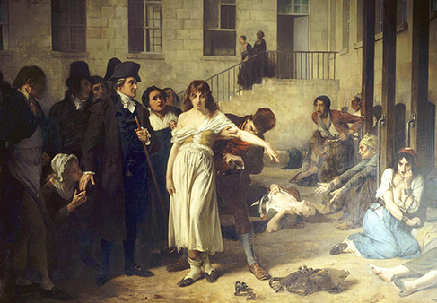
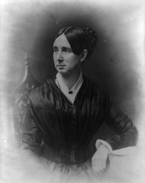
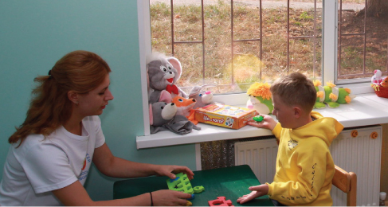

# 16.1 Điều trị Sức khỏe Tâm thần: Quá khứ và Hiện tại

> [!info]
>
> ### Mục tiêu học tập
>
> Sau khi học xong phần này, bạn sẽ có khả năng:
>
> - Giải thích cách những người mắc các rối loạn tâm lý được đối xử qua các thời kỳ lịch sử
> - Thảo luận về phong trào giải thể viện tâm thần tập trung (deinstitutionalization)
> - Thảo luận về các cách thức cung cấp dịch vụ sức khỏe tâm thần hiện nay
> - Phân biệt giữa điều trị tự nguyện và điều trị bắt buộc

Trước khi khám phá các phương pháp tiếp cận trị liệu khác nhau được sử dụng ngày nay, hãy bắt đầu nghiên cứu về trị liệu bằng cách xem xét có bao nhiêu người trải qua bệnh tâm thần và bao nhiêu người nhận được sự điều trị.
Theo Bộ Y tế và Dịch vụ Nhân sinh Hoa Kỳ (2017), 18,9% người trưởng thành ở Hoa Kỳ đã trải qua bệnh tâm thần vào năm 2017.
Đối với thanh thiếu niên (13–18 tuổi), tỷ lệ này tương tự như ở người lớn, và đối với trẻ em từ 8–15 tuổi, các ước tính hiện tại cho thấy khoảng 13% trải qua bệnh tâm thần trong một năm nhất định (National Institute of Mental Health [NIMH], 2017).

Với nhiều lựa chọn điều trị khác nhau hiện có, có khoảng bao nhiêu người nhận được sự điều trị sức khỏe tâm thần mỗi năm?
Theo Cơ quan Quản lý Dịch vụ Lạm dụng Chất và Sức khỏe Tâm thần (SAMHSA), vào năm 2017, có 14,8% người trưởng thành đã nhận được sự điều trị cho một vấn đề sức khỏe tâm thần (NIMH, 2017).
Các tỷ lệ phần trăm này, được hiển thị trong [Hình 16.2](#CNX_Psych_16_01_AdultTreat), phản ánh số lượng người trưởng thành nhận được sự chăm sóc tại các cơ sở nội trú và ngoại trú và/hoặc sử dụng thuốc theo toa cho các rối loạn tâm lý.

**Hình 16.2** Tỷ lệ phần trăm người trưởng thành nhận được sự điều trị sức khỏe tâm thần trong giai đoạn 2004–2008 được hiển thị. Số người trưởng thành tìm kiếm điều trị đã tăng nhẹ từ năm 2004 đến năm 2008.

Trẻ em và thanh thiếu niên cũng nhận được các dịch vụ sức khỏe tâm thần.
Cuộc khảo sát Kiểm tra Sức khỏe và Dinh dưỡng Quốc gia (NHANES) của Trung tâm Kiểm soát và Phòng ngừa Dịch bệnh (CDC) cho thấy khoảng một nửa (50,6%) trẻ em mắc các rối loạn tâm thần đã nhận được điều trị cho chứng rối loạn của mình trong năm qua (NIMH, n.d.).
Tuy nhiên, có một số khác biệt giữa tỷ lệ điều trị theo từng danh mục rối loạn ([Hình 16.3](#CNX_Psych_16_01_ChildTreat)).
Ví dụ, trẻ em mắc các rối loạn lo âu có ít khả năng nhận được điều trị nhất trong năm qua, trong khi trẻ em mắc ADHD hoặc rối loạn hành vi có nhiều khả năng nhận được điều trị hơn.
Bạn có thể nghĩ ra một số lý do khả dĩ cho những khác biệt này trong việc tiếp nhận điều trị không?

![Một biểu đồ cột có tiêu đề “Điều trị Sức khỏe Tâm thần ở Trẻ em Hoa Kỳ (8–15 tuổi).” Bên dưới tiêu đề này, nguồn được đưa ra: “Viện Sức khỏe Tâm thần Quốc gia, n.d.-c” Trục hoành ghi “Loại rối loạn,” và trục tung ghi “Phần trăm mắc rối loạn.” Đối với trẻ được chẩn đoán mắc “Rối loạn lo âu,” khoảng 32% nhận được điều trị. Đối với “Rối loạn khí sắc,” khoảng 42% nhận được điều trị. Đối với “Rối loạn hành vi,” khoảng 46% nhận được điều trị. Đối với “ADHD,” khoảng 48% nhận được điều trị. Đối với “Bất kỳ rối loạn nào,” khoảng 50% nhận được điều trị.](../../images/img_394b6ecb91ba.jpg)

**Hình 16.3** Khoảng một phần ba đến một nửa số thanh thiếu niên Hoa Kỳ (8–15 tuổi) mắc các rối loạn tâm thần nhận được sự điều trị, trong đó các rối loạn liên quan đến hành vi có nhiều khả năng được điều trị hơn.

Xem xét nhiều hình thức điều trị các rối loạn sức khỏe tâm thần hiện có ngày nay, những hình thức điều trị này đã xuất hiện như thế nào?
Chúng ta hãy xem xét lịch sử điều trị sức khỏe tâm thần từ quá khứ (với một số phương pháp tiếp cận đáng ngờ dưới góc nhìn của sự hiểu biết hiện đại về bệnh tâm thần) cho đến vị trí của chúng ta ngày nay.

## Điều trị trong Quá khứ

Trong phần lớn chiều dài lịch sử, những người mắc bệnh tâm thần đã bị đối xử rất tồi tệ.
Người ta tin rằng bệnh tâm thần là do bị ma quỷ ám, ma thuật phù thủy hoặc một vị thần tức giận gây ra (Szasz, 1960).
Ví dụ, vào thời thời Trung cổ, các hành vi bất thường được coi là dấu hiệu cho thấy một người đã bị quỷ dữ ám.
Nếu ai đó bị coi là bị quỷ ám, có một số hình thức điều trị để giải phóng các linh hồn khỏi cá nhân đó.
Phương pháp điều trị phổ biến nhất là trừ tà (exorcism), thường do các linh mục hoặc nhân vật tôn giáo khác tiến hành: Những câu thần chú và lời cầu nguyện được đọc lên trên cơ thể người bệnh, và họ có thể được cho uống một số loại đồ uống thuốc men.
Một hình thức điều trị khác cho những trường hợp bệnh tâm thần cực đoan là phẫu thuật mở hộp sọ (trephining): Một lỗ nhỏ được tạo ra trên hộp sọ của cá nhân bị bệnh để giải phóng các linh hồn ra khỏi cơ thể.
Hầu hết những người được điều trị theo cách này đều tử vong.
Ngoài trừ tà và đục xương sọ, các biện pháp thực hành khác liên quan đến việc hành quyết hoặc giam cầm những người mắc các rối loạn tâm lý.
Những người khác bị bỏ mặc trở thành những kẻ ăn xin vô gia cư.
Nói chung, hầu hết những người thể hiện những hành vi kỳ lạ đều bị hiểu lầm sâu sắc và bị đối xử tàn nhẫn.
Lý thuyết thịnh hành về tâm bệnh học trong lịch sử thời kỳ đầu là ý tưởng cho rằng bệnh tâm thần là kết quả của sự chiếm đoạt của ma quỷ bởi một linh hồn ma quỷ hoặc một vị thần tà ác vì những niềm tin ban đầu đã quy kết sai lầm tất cả các hiện tượng không thể giải thích được cho các vị thần được coi là thiện hoặc ác.

Từ cuối những năm 1400 đến cuối những năm 1600, một niềm tin phổ biến được duy trì bởi một số tổ chức tôn giáo là một số người đã lập giao ước với quỷ dữ và thực hiện những hành vi khủng khiếp, chẳng hạn như ăn thịt trẻ sơ sinh (Blumberg, 2007).
Những người này bị coi là phù thủy và bị các tòa án xét xử và kết án—họ thường bị thiêu sống trên cọc.
Trên toàn thế giới, ước tính có hàng chục ngàn người mắc bệnh tâm thần đã bị giết sau khi bị cáo buộc là phù thủy hoặc chịu ảnh hưởng của thuật phù thủy (Hemphill, 1966).

Đến thế kỷ 18, những người bị coi là kỳ quặc và bất thường đã bị đưa vào các viện tâm thần ([Hình 16.4](#CNX_Psych_16_01_Goya)).
**Viện tâm thần / Nhà thương điên** (Asylums) là những cơ sở đầu tiên được tạo ra với mục đích cụ thể là giam giữ những người mắc các rối loạn tâm lý, nhưng trọng tâm là trục xuất và cách ly họ khỏi xã hội hơn là điều trị các rối loạn của họ.
Thông thường, những người này bị giữ trong những ngục tối không có cửa sổ, bị đánh đập, bị xích vào giường và hầu như không có sự tiếp xúc nào với những người chăm sóc.

**Hình 16.4** Bức tranh này của Francisco Goya, mang tên *Nhà thương điên* (The Madhouse), miêu tả một viện tâm thần và những cư dân của nó vào đầu những năm 1800. Bức tranh khắc họa những người mắc các rối loạn tâm lý như những nạn nhân.

Vào cuối những năm 1700, một bác sĩ người Pháp, Philippe **Pinel**, đã lập luận ủng hộ việc đối xử nhân đạo hơn với những người mắc bệnh tâm thần.
Ông đề nghị tháo xiềng xích cho họ và trò chuyện với họ, và đó chính là những gì ông đã làm cho các bệnh nhân tại La Salpêtrière ở Paris vào năm 1795 ([Hình 16.5](#CNX_Psych_16_01_Pinel)).
Các bệnh nhân đã được hưởng lợi từ sự đối xử nhân đạo hơn này, và nhiều người đã có thể rời khỏi bệnh viện.

**Hình 16.5** Bức tranh này của Tony Robert-Fleury miêu tả Tiến sĩ Philippe Pinel ra lệnh tháo xiềng xích cho các bệnh nhân tại viện tâm thần Salpêtrière ở Paris.

Vào thế kỷ 19, Dorothea **Dix** đã dẫn đầu các nỗ lực cải cách trong việc chăm sóc sức khỏe tâm thần tại Hoa Kỳ ([Hình 16.6](#CNX_Psych_16_01_Dix)).
Bà đã điều tra xem những người mắc bệnh tâm thần và nghèo khổ được chăm sóc như thế nào, và bà đã phát hiện ra một hệ thống thiếu kinh phí và không được kiểm soát vốn duy trì sự ngược đãi đối với bộ phận dân số này (Tiffany, 1891).
Kinh hãi trước những phát hiện của mình, Dix bắt đầu vận động hành lang các cơ quan lập pháp tiểu bang khác nhau và Quốc hội Hoa Kỳ để tạo ra sự thay đổi (Tiffany, 1891).
Những nỗ lực của bà đã dẫn đến việc thành lập các viện tâm thần đầu tiên tại Hoa Kỳ.

**Hình 16.6** Dorothea Dix là một nhà cải cách xã hội, người đã trở thành người ủng hộ cho những người nghèo khổ mắc bệnh tâm thần và có công lớn trong việc tạo ra viện tâm thần đầu tiên của Mỹ. Bà đã làm điều này bằng cách không ngừng vận động hành lang các cơ quan lập pháp tiểu bang và Quốc hội để thành lập và tài trợ cho các cơ sở như vậy.

Tuy nhiên, bất chấp những nỗ lực của các nhà cải cách, một viện tâm thần điển hình vẫn rất bẩn thỉu, cung cấp rất ít phương pháp điều trị và thường giam giữ mọi người trong nhiều thập kỷ.
Ví dụ, tại Trung tâm Tâm thần Willard ở ngoại ô New York, một phương pháp điều trị là ngâm bệnh nhân trong bồn nước lạnh trong thời gian dài.
Liệu pháp sốc điện cũng đã được sử dụng, và cách thức thực hiện điều trị thường làm gãy lưng bệnh nhân; vào năm 1943, các bác sĩ tại Willard đã thực hiện 1.443 lần điều trị sốc (Willard Psychiatric Center, 2009). (Sốc điện hiện nay được gọi là liệu pháp sốc điện [electroconvulsive therapy - ECT], và liệu pháp này vẫn được sử dụng, nhưng với các biện pháp bảo vệ an toàn và dưới hình thức gây mê.
Một kích thích điện ngắn được sử dụng để tạo ra một cơn co giật toàn thể.
Tranh cãi vẫn tiếp tục về hiệu quả của nó so với các tác dụng phụ).
Nhiều khu phòng bệnh và các phòng lạnh đến mức một ly nước sẽ bị đóng băng vào buổi sáng (Willard Psychiatric Center, 2009).
Cánh cửa của Willard đã không đóng lại cho đến tận năm 1995.
Những điều kiện như thế này vẫn còn phổ biến cho đến tận thế kỷ 20.

Bắt đầu từ năm 1954 và trở nên phổ biến vào những năm 1960, các loại thuốc chống loạn thần đã được đưa vào sử dụng.
Những loại thuốc này đã chứng tỏ là một sự trợ giúp to lớn trong việc kiểm soát các triệu chứng của một số rối loạn tâm lý nhất định, chẳng hạn như chứng loạn thần.
Loạn thần là một chẩn đoán phổ biến của các cá nhân trong các bệnh viện tâm thần, và nó thường được chứng minh bằng các triệu chứng như ảo giác và hoang tưởng, cho thấy sự mất liên lạc với thực tế.
Sau đó, vào năm 1963, Quốc hội đã thông qua và Tổng thống John F. Kennedy đã ký Đạo luật Xây dựng Cơ sở Chậm phát triển Trí tuệ và Trung tâm Sức khỏe Tâm thần Cộng đồng, cung cấp sự hỗ trợ và tài trợ của liên bang cho các trung tâm sức khỏe tâm thần cộng đồng (National Institutes of Health, 2013).
Đạo luật này đã thay đổi cách thức các dịch vụ sức khỏe tâm thần được cung cấp tại Hoa Kỳ.
Nó bắt đầu tiến trình **giải thể viện tâm thần tập trung** (deinstitutionalization), tức là việc đóng cửa các viện tâm thần lớn, bằng cách tạo điều kiện cho mọi người ở lại cộng đồng của họ và được điều trị tại địa phương.
Năm 1955, có 558.239 bệnh nhân mắc bệnh tâm thần nghiêm trọng phải nhập viện tại các bệnh viện công (Torrey, 1997).
Đến năm 1994, xét theo tỷ lệ phần trăm dân số, số cá nhân phải nhập viện đã giảm đi 92% (Torrey, 1997).

## Điều trị Sức khỏe Tâm thần Ngày nay

Ngày nay, có các trung tâm sức khỏe tâm thần cộng đồng trên khắp cả nước.
Chúng nằm trong các khu dân cư gần nhà của thân chủ, và chúng cung cấp cho một số lượng lớn người dân các dịch vụ sức khỏe tâm thần thuộc nhiều loại khác nhau và cho nhiều loại vấn đề.
Đáng tiếc là một phần của những gì xảy ra với phong trào giải thể viện tâm thần tập trung là những người được xuất viện lẽ ra phải đến các trung tâm mới thành lập, nhưng hệ thống lại không được thiết lập một cách hiệu quả.
Các trung tâm bị thiếu kinh phí, nhân viên không được đào tạo để xử lý các bệnh nghiêm trọng như tâm thần phân liệt, tình trạng kiệt sức của nhân viên ở mức cao, và không có điều khoản nào được đưa ra cho các dịch vụ khác mà người bệnh cần, chẳng hạn như nhà ở, thực phẩm và đào tạo nghề.
Thiếu đi những sự hỗ trợ này, những người được xuất viện theo phong trào giải thể viện tâm thần tập trung thường kết thúc trong cảnh vô gia cư.
Ngay cả ngày nay, một bộ phận lớn dân số vô gia cư vẫn được coi là mắc bệnh tâm thần ([Hình 16.7](#CNX_Psych_16_01_Homeless)).
Số liệu thống kê cho thấy 26% người trưởng thành vô gia cư sống trong các trại tạm trú trải qua bệnh tâm thần (U.S. Department of Housing and Urban Development [HUD], 2011).

**Hình 16.7** (a) Trong số những cá nhân vô gia cư tại các trại tạm trú ở Hoa Kỳ, khoảng một phần tư mắc bệnh tâm thần nghiêm trọng (HUD, 2011). (b) Các cơ sở cải huấn cũng báo cáo một số lượng lớn các cá nhân đang sống chung với bệnh tâm thần. (ghi công a: chỉnh sửa tác phẩm của "Carl Campbell"/Flickr; ghi công b: chỉnh sửa tác phẩm của Bart Everson)

Các vấn đề sức khỏe tâm thần cũng là những mối quan ngại đáng kể liên quan đến những người nằm trong hệ thống cải huấn.
Theo một báo cáo đặc biệt năm 2006 của Cục Thống kê Tư pháp (BJS), khoảng 705.600 người trưởng thành có vấn đề về sức khỏe tâm thần đã bị giam giữ trong hệ thống nhà tù tiểu bang, và 78.800 người khác bị giam giữ trong hệ thống nhà tù liên bang.
Thêm 479.000 người nữa ở trong các nhà tù địa phương.
Theo nghiên cứu, “những người mắc bệnh tâm thần chiếm tỷ lệ quá mức trong các nhóm đối tượng chịu án treo và quản chế với tỷ lệ ước tính dao động từ hai đến bốn lần so với dân số nói chung” (Prins & Draper, 2009, tr.
23).
Hệ thống cải huấn phải đối mặt với những gánh nặng ngày càng gia tăng trong việc quản lý và hỗ trợ những người có vấn đề về sức khỏe tâm thần (Torrey et al., 2014).
Bản thân trải nghiệm bị giam giữ làm trầm trọng thêm các vấn đề hiện có, kích hoạt các rối loạn, hoặc dẫn đến những tác động lâu dài như PTSD, trầm cảm hoặc các rối loạn khác.
Trong khi bị giam giữ, mọi người thường phải chịu đựng hoặc chứng kiến bạo lực hay tấn công tình dục, đối mặt với sự cô lập khỏi gia đình và chịu đựng những sang chấn thể chất hoặc cảm xúc khác (Edgemon & Clay-Warner, 2019).

Ngày nay, thay vì các viện tâm thần, có các bệnh viện tâm thần do chính quyền tiểu bang điều hành và các bệnh viện cộng đồng địa phương tập trung vào việc chăm sóc ngắn hạn.
Trong tất cả các loại bệnh viện, sự nhấn mạnh được đặt vào thời gian lưu trú ngắn hạn, với thời gian nằm viện trung bình là dưới hai tuần và thường chỉ vài ngày.
Điều này một phần là do chi phí nằm viện tâm thần rất cao, có thể vào khoảng 800 đến 1.000 đô la mỗi đêm (Stensland, Watson, & Grazier, 2012).
Do đó, phạm vi chi trả bảo hiểm thường giới hạn khoảng thời gian một người có thể nằm viện để điều trị.
Thông thường các cá nhân chỉ phải nhập viện nếu họ là mối đe dọa sắp xảy ra đối với bản thân hoặc người khác.

> [!tip]
>
> ### Kết nối Học tập
>
> Hãy xem [dòng thời gian thể hiện lịch sử các viện tâm thần ở Hoa Kỳ](https://openstax.org/l/timeline) này để tìm hiểu thêm.

Hầu hết những người mắc bệnh tâm thần không phải nhập viện.
Nếu ai đó cảm thấy rất chán nản, phàn nàn về việc nghe thấy tiếng nói, hoặc luôn cảm thấy lo lắng, họ có thể tìm kiếm sự điều trị tâm lý.
Một người bạn, người phối ngẫu hoặc cha mẹ có thể giới thiệu ai đó đi điều trị.
Cá nhân đó có thể đến gặp bác sĩ chăm sóc ban đầu trước và sau đó được chuyển đến một người thực hành sức khỏe tâm thần.

Một số người tìm kiếm sự điều trị vì họ có liên quan đến các dịch vụ bảo vệ trẻ em của tiểu bang—nghĩa là con cái của họ đã bị đưa ra khỏi sự chăm sóc của họ do bị lạm dụng hoặc bỏ bê.
Cha mẹ có thể được chuyển đến các cơ sở tâm thần hoặc cai nghiện chất và trẻ em có khả năng sẽ nhận được điều trị vì sang chấn.
Nếu cha mẹ có thiện chí và khả năng trở thành những bậc cha mẹ tốt hơn, mục tiêu điều trị có thể là đoàn tụ gia đình.
Đối với những đứa trẻ khác có cha mẹ không thể thay đổi—ví dụ, cha mẹ nghiện ma túy nặng và từ chối tham gia điều trị—mục tiêu của trị liệu có thể là giúp trẻ thích nghi với việc được nhận nuôi dưỡng tạm thời (foster care) và/hoặc nhận làm con nuôi ([Hình 16.8](#CNX_Psych_16_01_Children)).

**Hình 16.8** Trị liệu với trẻ em có thể liên quan đến trò chơi. (ghi công: chỉnh sửa tác phẩm của UNHCR Ukraine/Flickr)

Một số người tìm đến trị liệu vì hệ thống tư pháp hình sự đã giới thiệu họ hoặc yêu cầu họ phải tham gia.
Ví dụ, đối với một số cá nhân, việc tham dự các buổi tư vấn hàng tuần có thể là một điều kiện để được ân xá.
Nếu một cá nhân bị bắt buộc phải tham gia trị liệu, họ đang tìm kiếm các dịch vụ một cách không tự nguyện.
**Điều trị bắt buộc** (Involuntary treatment) đề cập đến hình thức trị liệu không phải là sự lựa chọn của cá nhân.
Những cá nhân khác có thể tự nguyện tìm kiếm sự điều trị.
**Điều trị tự nguyện** (Voluntary treatment) có nghĩa là người đó tự chọn tham gia trị liệu để đạt được sự thuyên giảm các triệu chứng.

Điều trị tâm lý có thể diễn ra ở nhiều nơi khác nhau.
Một cá nhân có thể đến một trung tâm sức khỏe tâm thần cộng đồng hoặc một người thực hành tư nhân hoặc hành nghề tại cộng đồng.
Một đứa trẻ có thể gặp chuyên viên tư vấn học đường, nhà tâm lý học học đường hoặc nhân viên công tác xã hội học đường.
Một người bị giam giữ có thể nhận được liệu pháp nhóm trong tù.
Có nhiều loại nhà cung cấp dịch vụ điều trị khác nhau, và các yêu cầu cấp phép có sự khác nhau tùy theo từng tiểu bang.
Bên cạnh các nhà tâm lý học và bác sĩ tâm thần, còn có các nhân viên công tác xã hội lâm sàng, các nhà trị liệu hôn nhân và gia đình, và các nhân sự tôn giáo được đào tạo cũng thực hiện việc tư vấn và trị liệu.

Một loạt các nguồn tài trợ chi trả cho việc điều trị sức khỏe tâm thần: bảo hiểm y tế, chính phủ và tự chi trả cá nhân.
Trong quá khứ, ngay cả khi người dân có bảo hiểm y tế, phạm vi bảo hiểm không phải lúc nào cũng chi trả cho các dịch vụ sức khỏe tâm thần.
Điều này đã thay đổi với Đạo luật Bình đẳng Sức khỏe Tâm thần và Phòng chống Nghiện năm 2008, trong đó yêu cầu các chương trình bảo hiểm y tế nhóm và các công ty bảo hiểm phải đảm bảo có sự bình đẳng đối với các dịch vụ sức khỏe tâm thần (U.S. Department of Labor, n.d.).
Điều này có nghĩa là các khoản đồng chi trả (co-pays), tổng số lần khám và các khoản khấu trừ (deductibles) cho việc điều trị sức khỏe tâm thần và sử dụng chất cần phải tương đương và không được hạn chế hơn hoặc khắt khe hơn so với các bệnh thể chất và các vấn đề y tế/phẫu thuật.

Việc tìm kiếm các nguồn điều trị cũng không phải lúc nào cũng dễ dàng: có thể có các lựa chọn hạn chế, đặc biệt là ở các vùng nông thôn và các khu vực thành thị có thu nhập thấp; danh sách chờ đợi kéo dài; chất lượng chăm sóc kém dành cho bệnh nhân nghèo; và các trở ngại tài chính như đồng chi trả, các khoản khấu trừ và thời gian nghỉ làm.
Hơn 85% trong số 1.669 khu vực thiếu hụt chuyên gia sức khỏe tâm thần được liên bang chỉ định là ở nông thôn; thông thường các bác sĩ chăm sóc ban đầu và lực lượng thực thi pháp luật là những người cung cấp dịch vụ sức khỏe tâm thần tuyến đầu (Ivey, Scheffler, & Zazzali, 1998), mặc dù họ không được đào tạo chuyên sâu như một chuyên gia sức khỏe tâm thần, những người thường sẽ được trang bị tốt hơn để cung cấp dịch vụ chăm sóc.
Tính sẵn có, khả năng tiếp cận và sự chấp nhận (sự kỳ thị gắn liền với bệnh tâm thần) đều là những vấn đề ở các vùng nông thôn.
Khoảng hai phần ba số người có triệu chứng hoàn toàn không nhận được sự chăm sóc nào (U.S. Department of Health and Human Services, 2005; Wagenfeld, Murray, Mohatt, & DeBruiynb, 1994).
Vào cuối năm 2013, Bộ Nông nghiệp Hoa Kỳ đã công bố khoản đầu tư 50 triệu đô la để giúp cải thiện khả năng tiếp cận và điều trị cho các vấn đề sức khỏe tâm thần như một phần trong nỗ lực củng cố các cộng đồng nông thôn của chính quyền Tổng thống Obama.
